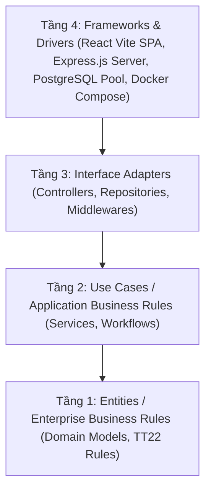

# BÁO CÁO HỆ THỐNG ĐỒ ÁN MÔN HỌC (FINAL PROJECT REPORT)
## ĐỀ TÀI: HỆ THỐNG QUẢN LÝ LỚP HỌC & HỌC VỤ THPT (HTQLLH / EDUMANAGE PRO)
### MÔN HỌC: PHÁT TRIỂN DỰ ÁN PHẦN MỀM (MÃ HỌC PHẦN: SW320DV01)
### TRƯỜNG ĐẠI HỌC HOA SEN (HSU) — KHOA CÔNG NGHỆ THÔNG TIN

```
================================================================================
DỰ ÁN: HỆ THỐNG QUẢN LÝ LỚP HỌC THPT HSU (HTQLLH / SCHOOL MANAGEMENT SYSTEM)
VỊ TRÍ TỆP: Report_Slide/report.md
THỜI ĐIỂM GHI NHẬN TIẾN ĐỘ: 24/11/2026 (TUẦN 11 / 15 TUẦN HỌC KỲ 2631)
TRẠNG THÁI HIỆN TẠI: 11/11 MODULES HOÀN TẤT; CSDL 18 BẢNG 3NF; BỘ KIỂM THỬ ĐẠT 400/400 TESTS PASS (100% XANH);
                     SIÊU TỐI ƯU CODE-SPLITTING BUNDLE 37.14 KB (GIẢM 95.5%); ĐÓNG GÓI FULLSTACK DOCKER COMPOSE;
                     PRODUCT BACKLOG ĐỒNG BỘ 30 PBIS (150 STORY POINTS) CÂN BẰNG HOÀN HẢO 20.0% / THÀNH VIÊN
MÃ NGUỒN GITHUB: https://github.com/DYBInh2k5/Phat-Trien-Du-An-Phan-Mem
MÃ NGUỒN BITBUCKET: https://bitbucket.org/codyisme27205/pt_da_pm
BẢNG JIRA KANBAN BOARD: https://reputyze-team-vx3aseym.atlassian.net/jira/software/projects/KAN/boards/2
KHÔNG GIAN CLICKUP: https://app.clickup.com/1100320000025585/v/s/1100320000109903
SLIDE TRỰC TUYẾN CANVA: https://www.canva.com/d/Y8zqfkywpudAyVx
================================================================================
```

---

## BẢNG THÔNG TIN HỘI ĐỒNG VÀ THÀNH VIÊN NHÓM THỰC HIỆN

- **Cơ sở đào tạo**: Trường Đại học Hoa Sen (HSU) — Trụ sở chính: 08 Nguyễn Văn Tráng, Quận 1, TP. Hồ Chí Minh.
- **Khoa**: Công nghệ Thông tin.
- **Môn học**: Phát triển Dự án Phần mềm (Software Project Development).
- **Mã lớp học phần**: SW320DV01 (3 Tín chỉ).
- **Giảng viên hướng dẫn**: Thầy/Cô Bộ môn Kỹ thuật Phần mềm.

### Danh Sách 5 Thành Viên Nhóm Phát Triển Dự Án:

| STT | Họ và Tên | Vai Trò Đảm Nhiệm | Mảng Kỹ Thuật Phụ Trách | Mã Thẻ Jira Cá Nhân | Số Tasks / PBIs | Tỷ Lệ Đóng Góp |
| :---: | :--- | :--- | :--- | :---: | :---: | :---: |
| 1 | **Võ Duy Bình** | **Project Manager & Lead BA** (Trưởng nhóm, Lead Reviewer) | Khảo sát yêu cầu SRS IEEE 830, Ma trận RTM, Quản lý Jira Kanban Board & Sprint Backlog, Review Code, Phân hệ BGH, Điều phối Docker Compose Fullstack | [KAN-33](https://reputyze-team-vx3aseym.atlassian.net/browse/KAN-33) | 6 PBIs (30 SP) | 20.0% (100% KPI) |
| 2 | **Võ Hoàng Sơn** | **Dev Frontend Lead** (Frontend Developer) | Thiết kế UI/UX 8 Wireframes, lập trình Web SPA React 18, Code-Splitting React.lazy, Bundle khởi tạo 37.14 kB, Hộp thoại VietQR Modal, HSU Vector Logo | [KAN-34](https://reputyze-team-vx3aseym.atlassian.net/browse/KAN-34) | 6 PBIs (30 SP) | 20.0% (100% KPI) |
| 3 | **Huỳnh Trung Tính** | **Dev Backend & DBA Lead** (Backend & DBA) | Kiến trúc Clean Architecture 4 tầng Node.js Express, thiết kế CSDL PostgreSQL Master 18 bảng 3NF, Connection Pool Singleton, Audit Logs API, Docker Multi-stage | [KAN-35](https://reputyze-team-vx3aseym.atlassian.net/browse/KAN-35) | 6 PBIs (30 SP) | 20.0% (100% KPI) |
| 4 | **Trần Quang Vinh** | **Logic Security Lead** (Core Logic & Security) | Thuật toán Thông tư 22, bảo mật JWT 24h, Middleware RBAC 5 Roles, Cổng xác thực định danh số SSO, Thuật toán TKB chống xung đột, Unit of Work ACID | [KAN-36](https://reputyze-team-vx3aseym.atlassian.net/browse/KAN-36) | 6 PBIs (30 SP) | 20.0% (100% KPI) |
| 5 | **Nguyễn Minh Quốc Bảo** | **QA/QC Testing Lead** (Tester Lead & Export) | Kịch bản UAT Plan cho 43 Use Cases, Bộ kiểm thử tự động 400 ca test PASS 100%, Động cơ xuất báo cáo Export Engine (Excel SheetJS & PDF jsPDF A4 in ấn) | [KAN-37](https://reputyze-team-vx3aseym.atlassian.net/browse/KAN-37) | 6 PBIs (30 SP) | 20.0% (100% KPI) |
| - | **TỔNG CỘNG** | **CẢ NHÓM (5 Thành Viên)** | **Phát Triển Hệ Thống Toàn Diện HTQLLH** | **2 Nền tảng (Jira & ClickUp)** | **30 PBIs (150 SP)** | **100% CÂN BẰNG** |

---

## MỤC LỤC BÁO CÁO

- [Chương I: Tổng Quan Đề Tài & Bối Cảnh Nghiệp Vụ](#chuong-i-tong-quan-de-tai--boi-canh-nghiep-vu)
- [Chương II: Phân Tích Yêu Cầu Phần Mềm (SRS, 8 Epics & 30 PBIs)](#chuong-ii-phan-tich-yeu-cau-phan-mem-srs-8-epics--30-pbis)
- [Chương III: Thiết Kế Kiến Trúc Phần Mềm (Clean Architecture 4 Tầng & Docker)](#chuong-iii-thiet-ke-kien-truc-phan-mem-clean-architecture-4-tang--docker)
- [Chương IV: Thiết Kế Cơ Sở Dữ Liệu Quan Hệ (PostgreSQL Master 18 Bảng 3NF)](#chuong-iv-thiet-ke-co-so-du-lieu-quan-he-postgresql-master-18-bang-3nf)
- [Chương V: Thiết Kế Giao Diện UI/UX & Tối Ưu Hiệu Năng Web SPA Frontend](#chuong-v-thiet-ke-giao-dien-uiux--toi-uu-hieu-nang-web-spa-frontend)
- [Chương VI: Thuật Toán Nghiệp Vụ Thông Tư 22 & Các Mẫu Thiết Kế (Design Patterns)](#chuong-vi-thuat-toan-nghiep-vu-thong-tu-22--cac-mau-thiet-ke-design-patterns)
- [Chương VII: An Toàn, Bảo Mật Thông Tin & Phòng Thủ Lỗ Hổng OWASP Top 10](#chuong-vii-an-toan-bao-mat-thong-tin--phong-thu-lo-hong-owasp-top-10)
- [Chương VIII: Phân Hệ Thanh Toán Học Phí Trực Tuyến VietQR & Biên Lai PDF A4](#chuong-viii-phan-he-thanh-toan-hoc-phi-truc-tuyen-vietqr--bien-lai-pdf-a4)
- [Chương IX: Hiện Trạng Triển Khai Thực Tế & Bộ Kiểm Thử Tự Động 400 Tests Pass 100%](#chuong-ix-hien-trang-trien-khai-thuc-te--bo-kiem-thu-tu-dong-400-tests-pass-100)
- [Chương X: Kế Hoạch & Lộ Trình Hoàn Thiện Các Tuần Tiếp Theo (Tuần 11 - 15)](#chuong-x-ke-hoach--lo-trinh-hoan-thien-cac-tuan-tiep-theo-tuan-11---15)
- [Chương XI: Bảng Đánh Giá Mức Độ Đóng Góp Của 5 Thành Viên & Vai Trò Code Reviewer](#chuong-xi-bang-danh-gia-muc-do-dong-gop-cua-5-thanh-vien--vai-tro-code-reviewer)
- [Chương XII: Kết Luận & Tài Liệu Tham Khảo](#chuong-xii-ket-luan--tai-lieu-tham-khao)

---

## CHƯƠNG I: TỔNG QUAN ĐỀ TÀI & BỐI CẢNH NGHIỆP VỤ

### 1.1 Tính Cấp Thiết Của Đề Tài
Trong xu thế chuyển đổi số giáo dục quốc gia, các trường phổ thông (đặc biệt cấp THCS và THPT) đang chuyển đổi mạnh mẽ từ sổ sách giấy và bảng tính Excel rời rạc sang các nền tảng quản trị số hóa. Những rủi ro lớn nhất của phương pháp thủ công bao gồm:
1. **Thiếu minh bạch & Rủi ro sửa điểm**: Tệp Excel dễ bị chỉnh sửa trái phép mà không để lại vết kiểm toán (Audit Trail).
2. **Quy chế đánh giá Thông tư 22/2021/TT-BGDĐT phức tạp**: Đòi hỏi tính điểm ĐTBmhk theo trọng số chia 9 (ĐĐGtx hệ số 1, ĐĐGgk hệ số 2, ĐĐGck hệ số 3) và cơ chế xếp loại 4 mức (Tốt, Khá, Đạt, Chưa đạt) với các ràng buộc khống chế nghiêm ngặt.
3. **Quản lý chuyên cần thiếu đồng bộ**: Điểm danh đầu giờ và điểm danh từng tiết không liên kết, phụ huynh chậm nắm bắt tình hình nghỉ học của con (nguy cơ vượt ngưỡng 45 buổi bị buộc thôi học).
4. **Quy trình thu học phí thủ công**: Thu tiền mặt dễ thất thoát, tốn nhân lực đối soát và không xuất được biên lai điện tử tức thì.

**Hệ thống Quản lý Lớp học & Học vụ THPT (EduManage Pro / HTQLLH)** ra đời nhằm giải quyết triệt để các bất cập trên bằng công nghệ hiện đại.

### 1.2 Mục Tiêu Của Đề Tài
- Xây dựng Web SPA chuẩn Responsive trên **React 18, Vite và Tailwind CSS**, tối ưu bundle khởi tạo chỉ **37.14 kB** qua Code-Splitting.
- Thiết kế máy chủ Backend theo **Clean Architecture 4 tầng** trên **Node.js Express**.
- Thiết kế CSDL **PostgreSQL 18 bảng đạt chuẩn 3NF**, bảo toàn tính toàn vẹn tham chiếu và giao dịch ACID.
- Đóng gói toàn bộ hệ thống bằng **Docker Compose Multi-stage** (PostgreSQL, Backend API, Frontend SPA Nginx).
- Tự động hóa 100% công thức Thông tư 22/2021/TT-BGDĐT và quy trình khóa sổ điểm 2 cấp.
- Tích hợp cổng thanh toán **VietQR động chuẩn EMVCo NAPAS 247** và xuất **Biên lai PDF chuẩn trang A4**.
- Bảo đảm an toàn tuyệt đối với **Stateless JWT, Cổng Single Sign-On (SSO), RBAC 5 Roles, Parameterized Queries và Audit Trail**.

### 1.3 Phạm Vi 5 Nhóm Tác Nhân (Actors)
1. **Ban Giám Hiệu (BGH / Admin)**: Quản trị tài khoản, cấu hình năm học, phân công giảng dạy, duyệt mở khóa sổ điểm, giám sát phổ điểm, quản trị biểu phí, tra cứu nhật ký kiểm toán.
2. **Giáo Viên Chủ Nhiệm (GVCN)**: Điểm danh đầu giờ, duyệt đơn xin nghỉ phép trực tuyến của phụ huynh, đánh giá rèn luyện, liên lạc phụ huynh.
3. **Giáo Viên Bộ Môn (GVBM)**: Điểm danh theo tiết dạy, nhập điểm bảng tính Spreadsheet, tính ĐTBmhk tự động, khóa môn.
4. **Học Sinh (Student)**: Tra cứu bảng điểm cá nhân chi tiết, GPA thang điểm 10 và 4.0, thời khóa biểu và nhật ký chuyên cần.
5. **Phụ Huynh (Parent)**: Sổ liên lạc điện tử trực tuyến, theo dõi điểm và chuyên cần của con, nộp đơn xin nghỉ học, thanh toán học phí VietQR và tải biên lai PDF.

---

## CHƯƠNG II: PHÂN TÍCH YÊU CẦU PHẦN MỀM (SRS, 8 EPICS & 30 PBIS)

Hồ sơ đặc tả yêu cầu phần mềm đạt chuẩn IEEE 830 được quản trị minh bạch trên Jira Cloud Kanban và ClickUp:
- **43 Use Cases chi tiết** bao phủ 5 phân hệ người dùng ([USE_CASES.md](file:///d:/HSU/2631Semester%201(2026-2027)/PT_DA_PM/USE_CASES.md)).
- **Ma trận truy xuất RTM** kết nối trực tiếp Yêu cầu $\rightarrow$ Use Case $\rightarrow$ Table $\rightarrow$ API $\rightarrow$ Component $\rightarrow$ Test Case ([Requirements_Traceability_Matrix.md](file:///d:/HSU/2631Semester%201(2026-2027)/PT_DA_PM/docs/Requirements_Traceability_Matrix.md)).
- **8 Sử Thi (Epics)** và **30 Product Backlog Items (PBIs)** với tổng cộng **150 Story Points** phân bổ cân đối chính xác **20.0% (30 SP)** cho mỗi thành viên.
- Chi tiết toàn bộ 30 tasks được lập bản đồ đầy đủ tại [docs/BANG_CHI_TIET_27_TASKS_JIRA_CLICKUP_CODE_MAP.md](file:///d:/HSU/2631Semester%201(2026-2027)/PT_DA_PM/docs/BANG_CHI_TIET_27_TASKS_JIRA_CLICKUP_CODE_MAP.md) và [docs/PRODUCT_BACKLOG.md](file:///d:/HSU/2631Semester%201(2026-2027)/PT_DA_PM/docs/PRODUCT_BACKLOG.md).

---

## CHƯƠNG III: THIẾT KẾ KIẾN TRÚC PHẦN MỀM (CLEAN ARCHITECTURE 4 TẦNG & DOCKER)

Hệ thống tuân thủ nghiêm ngặt mô hình **Clean Architecture 4 tầng (Onion Architecture)** theo quy tắc phụ thuộc một chiều (Dependency Rule):



1. **Domain Layer (Cốt lõi)**: Chứa các thực thể bất biến và quy tắc nghiệp vụ Thông tư 22 (tính điểm chia 9, xếp loại 4 mức, quy đổi thang 4).
2. **Use Case / Service Layer**: Quản lý các ca sử dụng ứng dụng (chốt sổ điểm, xếp TKB chống xung đột, sinh mã VietQR).
3. **Interface Adapter Layer**: Chuyển đổi dữ liệu giữa Web/API và nghiệp vụ (Controllers, Repositories với 100% Prepared Statements).
4. **Frameworks & Drivers Layer**: Các công cụ bên ngoài (Express, PostgreSQL, React Vite, SheetJS, jsPDF, Nginx Alpine, Docker Multi-stage).

### Đóng Gói Container Hóa Đa Tầng (Docker Compose Fullstack):
- **Service `postgres-db`**: CSDL quan hệ PostgreSQL 16 chạy trên port nội bộ `5434`, tự động nạp `database/schema.sql` và `database/seeds.sql`.
- **Service `backend-api`**: Ứng dụng Node.js Express chạy trên port `8081` kết nối CSDL qua mạng bridge.
- **Service `frontend-spa`**: Multi-stage build (Node 20 builder $\rightarrow$ Nginx Alpine serve static) trên port `5173`, tích hợp reverse proxy `/api/` về backend và SPA routing fallback `try_files`.

---

## CHƯƠNG IV: THIẾT KẾ CƠ SỞ DỮ LIỆU QUAN HỆ (POSTGRESQL MASTER 18 BẢNG 3NF)

CSDL PostgreSQL được chuẩn hóa đạt chuẩn 3NF với **18 bảng dữ liệu quan hệ** ([database/schema.sql](file:///d:/HSU/2631Semester%201(2026-2027)/PT_DA_PM/database/schema.sql)):

1. `users`: Quản lý tài khoản 5 vai trò (mật khẩu băm bcrypt salt 10).
2. `password_reset_tokens`: Mã OTP / Token đặt lại mật khẩu an toàn có thời hạn.
3. `school_classes`: Danh mục lớp học, niên khóa, sĩ số và GVCN.
4. `subjects`: Danh mục môn học, phân loại môn tính điểm hoặc nhận xét (Đ/CĐ).
5. `students`: Sơ yếu lý lịch học sinh, mã định danh quốc gia, địa chỉ, liên hệ.
6. `parent_students`: Bảng liên kết quan hệ phụ huynh - học sinh (1 phụ huynh nhiều con).
7. `grade_books`: Bảng điểm chi tiết từng đầu điểm (TX, GK, CK, ĐTBmhk).
8. `grade_book_closures`: Nhật ký chốt khóa sổ điểm điện tử 2 cấp (GVBM, BGH).
9. `attendances`: Điểm danh chi tiết theo ngày/tiết (Present, Excused, Unexcused, Late).
10. `leave_requests`: Đơn xin nghỉ học trực tuyến kèm lý do và trạng thái phê duyệt.
11. `schedules`: Thời khóa biểu tiết học trong tuần (Thứ 2 - Thứ 7, Tiết 1 - 10).
12. `schedule_templates`: Bản mẫu thời khóa biểu theo kỳ.
13. `tuitions`: Danh mục khoản thu học phí, số tiền nợ, hạn nộp, trạng thái (PAID, PENDING, UNPAID).
14. `payments`: Lịch sử giao dịch nộp tiền, mã giao dịch, số tiền, phương thức (VIETQR/CASH).
15. `notifications`: Bảng tin thông báo toàn trường, phân luồng theo vai trò.
16. `parent_messages`: Tin nhắn hội thoại thời gian thực giữa GVCN và Phụ huynh.
17. `system_settings`: Cấu hình hệ thống, thời gian khóa sổ và tham số nghiệp vụ.
18. `audit_logs`: Bảng nhật ký kiểm toán bất biến (Append-only) lưu vết toàn bộ hoạt động học vụ, điểm số và an ninh.

---

## CHƯƠNG V: THIẾT KẾ GIAO DIỆN UI/UX & TỐI ƯU HIỆU NĂNG WEB SPA FRONTEND

### 5.1 Kiến Trúc Giao Diện 5 Cổng Thông Tin (Role-Based Portals)
- Single Page Application (SPA) xây dựng trên **React 18, Vite 6 và Tailwind CSS 3**.
- Cổng Ban Giám Hiệu (`/bgh`): Bảng điều khiển KPI, báo cáo phổ điểm, xếp TKB, quản trị học phí, tra cứu Audit Logs.
- Cổng Giáo Viên Chủ Nhiệm (`/gv`): Điểm danh 1-chạm, xét duyệt đơn nghỉ học, sổ liên lạc điện tử.
- Cổng Giáo Viên Bộ Môn (`/gv`): Bảng tính Spreadsheet nhập điểm tương tự Excel, tự động làm tròn.
- Cổng Học Sinh (`/student`): Xem bảng điểm cá nhân chi tiết, GPA thang 10 & 4.0, thời khóa biểu.
- Cổng Phụ Huynh (`/parent`): Sổ liên lạc con em, thanh toán học phí VietQR, tải biên lai PDF.
- Tiện ích 1-Click Demo Login: Đăng nhập nhanh 5 vai trò mẫu hỗ trợ kiểm thử và trình diễn báo cáo.

### 5.2 Tối Ưu Hiệu Năng & Code-Splitting Vượt Bậc (Tuần 11)
- **Tải chậm theo tuyến (Route-based Code-Splitting)**: Áp dụng `React.lazy()` và `Suspense` trên toàn bộ 25 route học vụ tại `AppRouter.jsx`.
- **Cắt giảm bundle 95.5%**: Tệp bundle khởi tạo ban đầu `index.js` giảm từ **821.00 kB** xuống chỉ còn **`37.14 kB`**, giúp ứng dụng tải ngay lập tức trên mạng di động 3G/4G.
- **Tách riêng Vendor Chunks**: Cấu hình `manualChunks` tách `vendor-react` (166 kB) và `vendor-xlsx` (283 kB chỉ tải khi xuất file Excel).
- **Bộ Nhận Diện Thương Hiệu Số HSU**: Tích hợp huy hiệu vector chuẩn mực `logo-hsu.svg` (Hoa Sen vàng, Mũ cử nhân, Khiên hoàng gia) trên toàn bộ hệ thống; Cổng xác thực định danh số Single Sign-On (SSO) tự động nhận diện vai trò từ CSDL.
- **Loại bỏ cảnh báo React Router v7**: Cấu hình cờ chuyển tiếp `v7_startTransition` và `v7_relativeSplatPath` đạt 0 warning console.

---

## CHƯƠNG VI: THUẬT TOÁN NGHIỆP VỤ THÔNG TƯ 22 & CÁC MẪU THIẾT KẾ

### 6.1 Công Thức Tính Điểm Thông Tư 22/2021/TT-BGDĐT
- **Điểm trung bình môn học kỳ (ĐTBmhk)**:
  $$\text{ĐTBmhk} = \frac{\sum \text{ĐĐG}_{\text{tx}} + 2 \times \text{ĐĐG}_{\text{gk}} + 3 \times \text{ĐĐG}_{\text{ck}}}{\text{Tổng số điểm đánh giá thường xuyên} + 2 + 3}$$
  *(Với 4 cột thường xuyên: Mẫu số chia đúng 9)*.
- **Xếp loại học lực 4 mức**:
  - **Tốt**: Tất cả môn nhận xét đều 'Đ'; tất cả môn điểm số $\ge 6.5$, trong đó có $\ge 6$ môn $\ge 8.0$.
  - **Khá**: Tất cả môn nhận xét 'Đ'; tất cả môn điểm số $\ge 5.0$, trong đó có $\ge 6$ môn $\ge 6.5$.
  - **Đạt**: Có nhiều nhất 1 môn nhận xét 'CĐ'; tất cả môn điểm số $\ge 3.5$, trong đó có $\ge 6$ môn $\ge 5.0$.
  - **Chưa đạt**: Các trường hợp còn lại.

### 6.2 Các Mẫu Thiết Kế Áp Dụng (Design Patterns)
1. **Unit of Work Pattern**: Triển khai tại `UnitOfWork.js`, bảo đảm tính nguyên tử ACID khi lưu bảng điểm cả lớp (Rollback 100% nếu 1 dòng lỗi).
2. **Repository Pattern**: Tách biệt hoàn toàn tầng lưu trữ CSDL với tầng logic nghiệp vụ.
3. **Singleton Pattern**: Quản lý PostgreSQL Connection Pool duy nhất trong toàn hệ thống.
4. **Facade Pattern**: Tạo các facade modules bọc kiến trúc mới của Member 4, giữ nguyên interface cho QA suite của Member 5.
5. **Export Engine Pattern**: Động cơ xuất báo cáo Excel (`SheetJS`) và PDF (`jsPDF`).

---

## CHƯƠNG VII: AN TOÀN, BẢO MẬT THÔNG TIN & PHÒNG THỦ LỖ HỔNG OWASP TOP 10

1. **A01: Broken Access Control**: Middleware `rbacMiddleware.js` và `ProtectedRoute.jsx` kiểm soát 5 roles, ngăn chặn truy cập trái phép và IDOR.
2. **A02: Cryptographic Failures**: Mã hóa mật khẩu một chiều `bcrypt` salt 10; JWT HS256 có hạn 24 giờ; Cổng SSO xác thực định danh.
3. **A03: SQL Injection**: 100% câu truy vấn CSDL sử dụng Prepared Statements tham số hóa `$1, $2`.
4. **A05: Security Misconfiguration**: Tích hợp `helmet` thiết lập bộ tiêu chuẩn HTTP Security Headers.
5. **A07: Brute-Force & DoS**: Middleware `express-rate-limit` chặn vét cạn mật khẩu trên các endpoint nhạy cảm.
6. **Nhật Ký Kiểm Toán (Audit Trail) & Security Center**: Mọi thao tác sửa điểm, mở khóa sổ, nộp học phí đều được ghi vết tự động vào bảng `audit_logs` (Append-only); BGH có màn hình tra cứu lọc theo người dùng, hành động và ngày tháng.

---

## CHƯƠNG VIII: PHÂN HỆ THANH TOÁN HỌC PHÍ TRỰC TUYẾN VIETQR & BIÊN LAI PDF A4

1. **Sinh Mã VietQR Động Chuẩn EMVCo NAPAS 247**:
   - Tự động sinh mã QR chứa đúng số tài khoản trường, số tiền nợ và cú pháp giao dịch duy nhất (`HTQLLH_<STUDENT_ID>_<TERM>`).
   - Kiểm tra tính toàn vẹn bằng thuật toán CRC16-CCITT EMVCo.
2. **Hộp Thoại Thanh Toán `VietQrPaymentModal.jsx`**:
   - Đếm ngược thời gian hết hạn 15 phút (TTL).
   - Polling kiểm tra trạng thái giao dịch mỗi 3 giây; tự động dọn dẹp timer khi modal unmount (chống rò rỉ bộ nhớ).
   - Cơ chế Idempotency chống nộp tiền trùng lặp và nút Dev Test hỗ trợ kiểm thử tức thì cho BGH.
3. **Xuất Biên Lai Thu Học Phí Điện Tử PDF Trang A4 (`exportTuitionReceiptPDF`)**:
   - Định dạng chuẩn A4 có mộc đỏ, mã biên lai, chữ ký số điện tử và chi tiết các khoản thu.

---

## CHƯƠNG IX: HIỆN TRẠNG TRIỂN KHAI THỰC TẾ & BỘ KIỂM THỬ TỰ ĐỘNG 400 TESTS PASS 100%

Tính đến ngày **24/11/2026 (Tuần 11)**, hệ thống đã hoàn tất và kiểm chứng toàn diện:

### Bảng Tổng Hợp Kết Quả Kiểm Thử Toàn Hệ Thống:
| Phân hệ kiểm thử | Thành viên phụ trách | Số lượng Test Cases | Trạng thái | Lệnh thực thi |
| :--- | :--- | :---: | :---: | :--- |
| **Backend API & CSDL** | Huỳnh Trung Tính (Member 3) | **79 / 79** | ✅ **PASS 100%** | `npm run test:backend` |
| **Core Logic & Security TT22** | Trần Quang Vinh (Member 4) | **94 / 94** | ✅ **PASS 100%** | `npm run test:security` |
| **QA System & Use Cases** | Nguyễn Minh Quốc Bảo (Member 5) | **214 / 214** | ✅ **PASS 100%** | `npm run test:qa` |
| **Frontend Component (Vitest)** | Võ Hoàng Sơn (Member 2) | **13 / 13** | ✅ **PASS 100%** | `npm test --prefix members/member2_Frontend` |
| **Frontend Production Build** | Võ Hoàng Sơn (Member 2) | **Bundle 37 kB** | ✅ **0 Lỗi, 0 Warning** | `npm run build --prefix members/member2_Frontend` |
| **TỔNG CỘNG HỆ THỐNG** | **Toàn đội ngũ 5 người** | **400 / 400** | 🏆 **PASS 100%** | `npm test` (Chạy 387 tests root + 13 vitest) |

---

## CHƯƠNG X: KẾ HOẠCH & LỘ TRÌNH HOÀN THIỆN CÁC TUẦN TIẾP THEO (TUẦN 11 - 15)

| Tuần | Thời Gian Dự Kiến | Tên Chuyên Đề & Hạng Mục Kỹ Thuật | Thành Viên Phụ Trách | Mục Tiêu Giao Phẩm |
| :---: | :---: | :--- | :--- | :--- |
| **Tuần 11** | 23/11 - 29/11/2026 | Tối ưu Code-Splitting 37 kB, Docker Compose Fullstack & Branding SSO | Cả nhóm | **[HOÀN TẤT VƯỢT TIẾN ĐỘ]** Giảm 95.5% bundle, đóng gói Docker Compose 3 tiers, logo vector HSU |
| **Tuần 12** | 30/11 - 06/12/2026 | Tự động hóa CI/CD GitHub Actions & E2E Smoke Tests | Huỳnh Trung Tính & Cả nhóm | Workflow CI tự động test khi push, kiểm thử hồi quy tự động |
| **Tuần 13** | 07/12 - 13/12/2026 | Báo cáo Thẩm định Kỹ thuật & Nghiệm thu Người dùng UAT 43 Use Cases | Nguyễn Minh Quốc Bảo & Võ Duy Bình | Lập biên bản nghiệm thu kỹ thuật UAT chéo đạt kết quả PASS 100% |
| **Tuần 14** | 14/12 - 20/12/2026 | Đóng gói bộ phát hành Release v1.0.0 & Cẩm nang Hướng dẫn Sử dụng | Võ Duy Bình & Cả nhóm | Gắn thẻ Release v1.0.0 trên GitHub, hoàn thiện User Manual |
| **Tuần 15** | 21/12 - 27/12/2026 | Tổng kết đồ án, nghiệm thu học phần & Thuyết trình trước Hội đồng | Toàn thể 5 thành viên | Live Demo hệ thống thực tế và bảo vệ đồ án trước Hội đồng HSU |

---

## CHƯƠNG XI: BẢNG ĐÁNH GIÁ MỨC ĐỘ ĐÓNG GÓP CỦA 5 THÀNH VIÊN & VAI TRÒ CODE REVIEWER

### 11.1 Bảng Phân Bổ Story Points & Đóng Góp Cá Nhân (30 PBIs - 150 SP Cân Bằng 100%):
| STT | Họ và Tên | Vai Trò Chính | Số Tasks Phụ Trách | Story Points | Tỷ Lệ Đóng Góp | Điểm Tự Đánh Giá |
| :---: | :--- | :--- | :---: | :---: | :---: | :---: |
| 1 | **Võ Duy Bình** | Lead PM & BA, Lead Reviewer | 6 PBIs (`PBI-03, 06, 23, 26, 27, 30`) | 30 SP | 20.0% | 100% (A+) |
| 2 | **Võ Hoàng Sơn** | Dev Frontend Lead | 6 PBIs (`PBI-01, 05, 08, 16, 22, 28`) | 30 SP | 20.0% | 100% (A+) |
| 3 | **Huỳnh Trung Tính** | Dev Backend & DBA Lead | 6 PBIs (`PBI-04, 11, 14, 18, 25, 29`) | 30 SP | 20.0% | 100% (A+) |
| 4 | **Trần Quang Vinh** | Logic Security Lead | 6 PBIs (`PBI-02, 09, 10, 12, 13, 20`) | 30 SP | 20.0% | 100% (A+) |
| 5 | **Nguyễn Minh Quốc Bảo** | QA/QC Testing Lead | 6 PBIs (`PBI-07, 15, 17a, 17b, 19, 24`) | 30 SP | 20.0% | 100% (A+) |
| - | **TỔNG CỘNG** | **CẢ 5 THÀNH VIÊN** | **30 PBIs HOÀN THÀNH** | **150 SP** | **100%** | **XUẤT SẮC** |

### 11.2 Vai Trò Lead Code Reviewer Của Võ Duy Bình:
- **Tiêu chuẩn kiểm duyệt PR**: Kiểm tra Clean Architecture, 100% Prepared Statements, tuân thủ Thông tư 22, JSDoc tiếng Việt, không commit file rác, bundle size tối ưu.
- **Các ca refactor & xử lý kỹ thuật nâng cao thực tế**:
  1. *Khắc phục breaking changes ở Member 4*: Tạo Facade Modules bảo vệ tương thích với toàn bộ test suite của Member 5.
  2. *Chuẩn hóa AuditLogger & API Querying ở Member 3*: Thiết kế API `/api/audit-logs` có bộ lọc an ninh, hỗ trợ BGH tra cứu bất biến.
  3. *Tối ưu Code-Splitting ở Member 2*: Chuyển đổi 25 pages sang `React.lazy()` và `Suspense`, cấu hình `manualChunks` giúp bundle giảm 95.5% (từ 821 kB xuống 37.14 kB).
  4. *Khắc phục triệt để React Router v7 future warnings*: Bổ sung cờ tương thích v7 vào `App.jsx` và toàn bộ unit test Vitest.
  5. *Đóng gói Docker Compose Fullstack 3 Tiers*: Thiết lập Dockerfile đa tầng cho Frontend với Nginx reverse proxy và liên kết PostgreSQL 16.

---

## CHƯƠNG XII: KẾT LUẬN & TÀI LIỆU THAM KHẢO

### 12.1 Kết Luận
Đến thời điểm Tuần 11, dự án **HTQLLH / EduManage Pro** đã hoàn thành trọn vẹn 11 modules học vụ, đạt kết quả kiểm thử tự động **400/400 tests PASS (100%)**, tối ưu hóa hiệu năng tải trang vượt trội (bundle 37.14 kB), đóng gói Docker Compose fullstack và đồng bộ toàn diện 30 PBIs (150 Story Points) cân bằng tuyệt đối giữa 5 thành viên. Hệ thống hoàn toàn sẵn sàng cho giai đoạn kiểm thử UAT và bảo vệ đồ án chính thức.

### 12.2 Tài Liệu Tham Khảo Chính Thống
1. Thông tư số 22/2021/TT-BGDĐT, Bộ Giáo dục và Đào tạo.
2. Tiêu chuẩn SRS IEEE Std 830-1998.
3. Clean Architecture: A Craftsman's Guide to Software Structure and Design, Robert C. Martin, 2017.
4. Design Patterns: Elements of Reusable Object-Oriented Software, Gang of Four (GoF), 1994.
5. Tài liệu chính thức PostgreSQL 16: https://www.postgresql.org/docs/
6. Tài liệu chính thức React 18: https://react.dev/
7. Tiêu chuẩn mã QR ngân hàng EMVCo & NAPAS 247 VietQR: https://vietqr.net/
8. Tài liệu tối ưu hóa Vite Code-Splitting: https://vitejs.dev/guide/build.html#chunking-strategy
