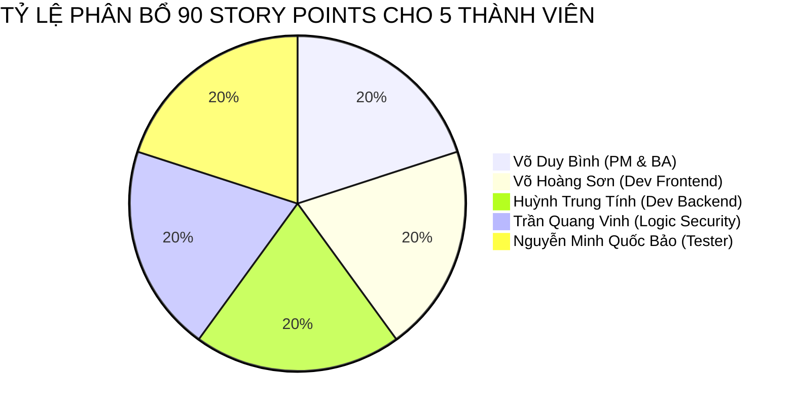
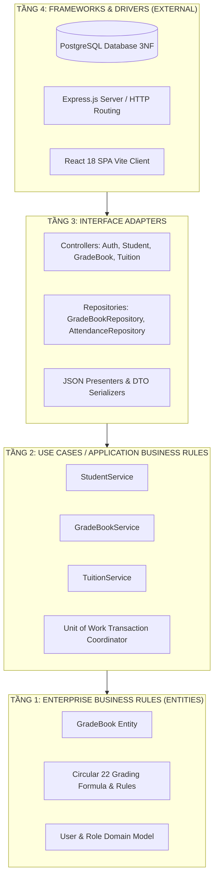

# BÁO CÁO HỆ THỐNG ĐỒ ÁN MÔN HỌC (FINAL PROJECT REPORT)
## ĐỀ TÀI: HỆ THỐNG QUẢN LÝ LỚP HỌC & HỌC VỤ THPT (HTQLLH / EDUMANAGE PRO)
### MÔN HỌC: PHÁT TRIỂN DỰ ÁN PHẦN MỀM (MÃ HỌC PHẦN: SW320DV01)
### TRƯỜNG ĐẠI HỌC HOA SEN (HSU) — KHOA CÔNG NGHỆ THÔNG TIN

```
================================================================================
DỰ ÁN: HỆ THỐNG QUẢN LÝ LỚP HỌC THPT HSU (HTQLLH / SCHOOL MANAGEMENT SYSTEM)
VỊ TRÍ TỆP: Report_Slide/report.md
THỜI ĐIỂM GHI NHẬN TIẾN ĐỘ: 28/10/2026 (TUẦN 7 / 15 TUẦN HỌC KỲ 2631)
TRẠNG THÁI HIỆN TẠI: ĐÃ HOÀN THÀNH VƯỢT TIẾN ĐỘ WORKING PROTOTYPE (TUẦN 1 - 6),
                     ĐANG TRIỂN KHAI HOÀN THIỆN XÁC THỰC JWT & RBAC (TUẦN 7)
MÃ NGUỒN GITHUB: https://github.com/DYBInh2k5/Phat-Trien-Du-An-Phan-Mem
SLIDE TRỰC TUYẾN CANVA: https://www.canva.com/d/YLrratHffoqRdvK
================================================================================
```

---

## BẢNG THÔNG TIN HỘI ĐỒNG VÀ THÀNH VIÊN NHÓM THỰC HIỆN

- **Cơ sở đào tạo**: Trường Đại học Hoa Sen (HSU) - Trụ sở chính: 08 Nguyễn Văn Tráng, Quận 1, TP. Hồ Chí Minh.
- **Khoa**: Công nghệ Thông tin.
- **Môn học**: Phát triển Dự án Phần mềm (Software Project Development).
- **Mã lớp học phần**: SW320DV01.
- **Giảng viên hướng dẫn**: Thầy/Cô Bộ môn Kỹ thuật Phần mềm.

### Danh Sách 5 Thành Viên Nhóm Phát Triển Dự Án:

| STT | Họ và Tên | Vai Trò Đảm Nhiệm | Mảng Kỹ Thuật Phụ Trách | Mã Thẻ Jira Cá Nhân | Thư Mục Báo Cáo Cá Nhân | Tỷ Lệ Đóng Góp |
| :---: | :--- | :--- | :--- | :---: | :--- | :---: |
| 1 | **Võ Duy Bình** | **Project Manager & Lead BA** (Trưởng nhóm) | Khảo sát yêu cầu SRS IEEE 830, Ma trận RTM, Quản lý Jira Kanban Board & Sprint Backlog, Điều phối tiến độ chung | [KAN-33](https://reputyze-team-vx3aseym.atlassian.net/browse/KAN-33) | [members/member1_PM_BA/README.md](file:///d:/HSU/2631Semester%201%282026-2027%29/PT_DA_PM/members/member1_PM_BA/README.md) | 20% |
| 2 | **Võ Hoàng Sơn** | **Dev Frontend** (Frontend Developer) | Thiết kế 8 Wireframes UI/UX, lập trình Web SPA Responsive React 18, Vite, Tailwind CSS, 5 Cổng thông tin (Portals), 1-Click Demo Login | [KAN-34](https://reputyze-team-vx3aseym.atlassian.net/browse/KAN-34) | [members/member2_Frontend/README.md](file:///d:/HSU/2631Semester%201%282026-2027%29/PT_DA_PM/members/member2_Frontend/README.md) | 20% |
| 3 | **Huỳnh Trung Tính** | **Dev Backend** (Backend Developer & DBA) | Thiết kế Clean Architecture 4 tầng trên Node.js/Express, chuẩn hóa CSDL PostgreSQL 3NF, DDL Schema, Connection Pool, RESTful APIs | [KAN-35](https://reputyze-team-vx3aseym.atlassian.net/browse/KAN-35) | [members/member3_Backend_DB/README.md](file:///d:/HSU/2631Semester%201%282026-2027%29/PT_DA_PM/members/member3_Backend_DB/README.md) | 20% |
| 4 | **Trần Quang Vinh** | **Logic Security** (Core Logic & Security) | Cài đặt thuật toán tính điểm ĐTBmhk chia 9 và xếp loại Thông tư 22/2021/TT-BGDĐT, bảo mật JWT Token, Middleware RBAC 5 Roles, Unit of Work ACID | [KAN-36](https://reputyze-team-vx3aseym.atlassian.net/browse/KAN-36) | [members/member4_Logic_Security/README.md](file:///d:/HSU/2631Semester%201%282026-2027%29/PT_DA_PM/members/member4_Logic_Security/README.md) | 20% |
| 5 | **Nguyễn Minh Quốc Bảo** | **Tester** (QA/QC Testing Lead) | Kịch bản UAT Plan cho 43 Use Cases, Bộ kiểm thử tự động QA Unit Testing Suite, Động cơ xuất báo cáo Export Engine (Excel SheetJS & PDF jsPDF) | [KAN-37](https://reputyze-team-vx3aseym.atlassian.net/browse/KAN-37) | [members/member5_Modules_QA/README.md](file:///d:/HSU/2631Semester%201%282026-2027%29/PT_DA_PM/members/member5_Modules_QA/README.md) | 20% |

---

## MỤC LỤC BÁO CÁO

- [Chương I: Tổng Quan Đề Tài & Bối Cảnh Nghiệp Vụ](#chuong-i-tong-quan-de-tai--boi-canh-nghiep-vu)
- [Chương II: Phân Tích Yêu Cầu Phần Mềm (SRS & Product Backlog)](#chuong-ii-phan-tich-yeu-cau-phan-mem-srs--product-backlog)
- [Chương III: Thiết Kế Kiến Trúc Phần Mềm (Clean Architecture)](#chuong-iii-thiet-ke-kien-truc-phan-mem-clean-architecture)
- [Chương IV: Thiết Kế Cơ Sở Dữ Liệu (PostgreSQL 3NF)](#chuong-iv-thiet-ke-co-so-du-lieu-postgresql-3nf)
- [Chương V: Thiết Kế Giao Diện UI/UX & Công Nghệ Web SPA Frontend](#chuong-v-thiet-ke-giao-dien-uiux--cong-nghe-web-spa-frontend)
- [Chương VI: Thuật Toán Nghiệp Vụ Thông Tư 22 & Các Mẫu Thiết Kế (Design Patterns)](#chuong-vi-thuat-toan-nghiep-vu-thong-tu-22--cac-mau-thiet-ke-design-patterns)
- [Chương VII: An Toàn, Bảo Mật Thông Tin & Quản Trị Phân Quyền (RBAC)](#chuong-vii-an-toan-bao-mat-thong-tin--quan-tri-phan-quyen-rbac)
- [Chương VIII: Hiện Trạng Triển Khai Thực Tế Của Hệ Thống Đến Thời Điểm Hiện Tại](#chuong-viii-hien-trang-trien-khai-thuc-te-cua-he-thong-den-thoi-diem-hien-tai)
- [Chương IX: Kế Hoạch & Lộ Trình Hoàn Thiện Các Tuần Tiếp Theo (Tuần 8 - 15)](#chuong-ix-ke-hoach--lo-trinh-hoan-thien-cac-tuan-tiep-theo-tuan-8---15)
- [Chương X: Bảng Đánh Giá Mức Độ Đóng Góp Của 5 Thành Viên](#chuong-x-bang-danh-gia-muc-do-dong-gop-cua-5-thanh-vien)
- [Chương XI: Kết Luận & Tài Liệu Tham Khảo](#chuong-xi-ket-luan--tai-lieu-tham-khao)

---

## CHƯƠNG I: TỔNG QUAN ĐỀ TÀI & BỐI CẢNH NGHIỆP VỤ

### 1.1 Tính Cấp Thiết Của Đề Tài
Trong xu thế chuyển đổi số mạnh mẽ của ngành giáo dục theo định hướng của Bộ Giáo dục và Đào tạo, các cơ sở giáo dục phổ thông (đặc biệt là cấp THPT) đang đối mặt với nhu cầu cấp bách về việc thay thế các quy trình quản lý sổ sách giấy truyền thống và các tệp bảng tính Excel phân tán, rời rạc.

Những bất cập điển hình của mô hình cũ bao gồm:
1. **Thiếu tính minh bạch và rủi ro sửa điểm**: Dữ liệu lưu trong tệp bảng tính dễ bị chỉnh sửa thủ công mà không để lại vết kiểm toán (Audit Trail), tạo kẽ hở cho các sai phạm học vụ.
2. **Quy chế đánh giá mới phức tạp**: Việc áp dụng Thông tư 22/2021/TT-BGDĐT đòi hỏi hệ số điểm thành phần chi tiết (Đánh giá thường xuyên hệ số 1, Đánh giá giữa kỳ hệ số 2, Đánh giá cuối kỳ hệ số 3, tổng trọng số chia 9) và quy tắc xếp loại học lực 4 mức (Tốt, Khá, Đạt, Chưa đạt) với nhiều điều kiện logic phụ thuộc.
3. **Quản lý chuyên cần thủ công**: Điểm danh đầu giờ và điểm danh theo từng tiết giảng dạy không được liên kết, phụ huynh chỉ biết con vắng học vào cuối tháng hoặc khi đã bị cấm thi vì vắng quá 20% số tiết.
4. **Giao tiếp nhà trường - gia đình bị ngắt quãng**: Việc gửi thông báo giấy hoặc liên lạc thủ công gây lãng phí chi phí, chậm trễ trong các trường hợp học sinh cần hỗ trợ hoặc nộp đơn xin nghỉ ốm.

Từ các yêu cầu thực tế đó, nhóm dự án đã nghiên cứu và phát triển **Hệ thống Quản lý Lớp học & Học vụ THPT (HTQLLH / EduManage Pro)** nhằm cung cấp giải pháp toàn diện, đạt chuẩn kỹ thuật công nghệ thông tin hiện đại.

### 1.2 Mục Tiêu Của Đề Tài
- Xây dựng một ứng dụng Web Single Page Application (SPA) trên nền React 18, Vite và Tailwind CSS với hiệu năng cao, giao diện chuẩn Design System, thân thiện và tương thích đa thiết bị.
- Phát triển tầng máy chủ Backend chuẩn kiến trúc **Clean Architecture** trên Node.js/Express, bảo đảm tính độc lập giữa nghiệp vụ cốt lõi và hệ thống lưu trữ/giao diện.
- Thiết kế Cơ sở Dữ liệu quan hệ **PostgreSQL** đạt dạng chuẩn 3NF, bảo toàn tính toàn vẹn tham chiếu, giao dịch ACID thông qua Unit of Work Pattern.
- Hiện thực hóa 100% công thức tính điểm và xếp loại học lực học sinh theo đúng quy chuẩn Thông tư 22/2021/TT-BGDĐT.
- Tích hợp động cơ xuất báo cáo Export Engine chuẩn công nghiệp: xuất bảng điểm Excel `.xlsx` và xuất in học bạ/biên lai PDF chuẩn khổ A4.
- Đảm bảo an ninh với cơ chế xác thực không trạng thái JWT, phân quyền truy cập theo vai trò (Role-Based Access Control - RBAC) 5 cấp độ.

### 1.3 Phạm Vi 5 Nhóm Tác Nhân Của Hệ Thống
Hệ thống phục vụ 5 nhóm tác nhân (Actors) với các chức năng phân định rõ ràng:
1. **Ban Giám Hiệu / Quản Trị Viên (Admin / Principal)**: Quản trị danh mục năm học, khối, lớp, môn học; phân công giảng dạy cho giáo viên; giám sát sĩ số, tỷ lệ vắng toàn trường; phê duyệt báo cáo học kỳ; thực hiện chốt khóa sổ điểm học kỳ (LOCKED).
2. **Giáo Viên Chủ Nhiệm (Homeroom Teacher)**: Điểm danh đầu giờ cho lớp chủ nhiệm; duyệt đơn xin nghỉ học trực tuyến từ phụ huynh; theo dõi học lực tổng thể và hạnh kiểm của học sinh trong lớp; gửi thông báo trực tiếp tới phụ huynh.
3. **Giáo Viên Bộ Môn (Subject Teacher)**: Điểm danh theo tiết dạy bộ môn; nhập điểm thành phần (Miệng, 15 phút, 1 tiết, Giữa kỳ, Cuối kỳ) trên giao diện lưới Spreadsheet; gửi yêu cầu mở lại sổ điểm khi cần điều chỉnh điểm hợp lệ.
4. **Học Sinh (Student)**: Tra cứu bảng điểm cá nhân chi tiết từng môn học; xem Điểm trung bình môn (ĐTBmhk), GPA thang điểm 10 và quy đổi sang thang điểm 4.0; xem thời khóa biểu và lịch thi.
5. **Phụ Huynh Học Sinh (Parent)**: Xem Sổ liên lạc điện tử; theo dõi tình hình chuyên cần và điểm số của con em theo thời gian thực; nộp đơn xin nghỉ học trực tuyến; tra cứu và thanh toán học phí điện tử.

---

## CHƯƠNG II: PHÂN TÍCH YÊU CẦU PHẦN MỀM (SRS & PRODUCT BACKLOG)

### 2.1 Hồ Sơ Đặc Tả Yêu Cầu Phần Mềm (SRS IEEE 830)
Hồ sơ đặc tả yêu cầu phần mềm của hệ thống được biên soạn chi tiết tại [BrainStorm/Week1 TL SRS .md](file:///d:/HSU/2631Semester%201%282026-2027%29/PT_DA_PM/BrainStorm/Week1%20TL%20SRS%20.md) và [USE_CASES.md](file:///d:/HSU/2631Semester%201%282026-2027%29/PT_DA_PM/USE_CASES.md), bao gồm:
- **43 Use Cases chi tiết** bao phủ toàn bộ 5 phân hệ người dùng.
- **Ma trận truy xuất nguồn gốc yêu cầu (Requirements Traceability Matrix - RTM)** kết nối trực tiếp từng yêu cầu nghiệp vụ với mã Use Case, kiểm thử chấp nhận và thành phần mã nguồn tương ứng.

### 2.2 Danh Mục Sử Thi Cốt Lõi (8 Epics)
Toàn bộ yêu cầu sản phẩm được cấu trúc thành 8 Sử thi (Epics):
1. **EPIC-01**: Xác thực & Quản trị Phân quyền (Auth & RBAC).
2. **EPIC-02**: Quản lý Hồ sơ, Lớp học & Đào tạo.
3. **EPIC-03**: Điểm danh & Chuyên cần Học đường.
4. **EPIC-04**: Sổ điểm Điện tử Thông tư 22/2021/TT-BGDĐT.
5. **EPIC-05**: Giao dịch Điểm ACID & Mẫu Thiết kế (Unit of Work & Repository).
6. **EPIC-06**: Nhật ký Kiểm toán Học vụ (Audit Trail & Centralized Logging).
7. **EPIC-07**: Thời khóa biểu & Thuật toán Chống Xung đột Lịch.
8. **EPIC-08**: Xuất Báo cáo & Cổng Giao tiếp Phụ huynh.

### 2.3 Bảng Chi Tiết 19 Product Backlog Items (PBIs)
Toàn bộ dự án được lượng hóa thành **90 Story Points (SP)** và phân bổ chi tiết cho 5 thành viên (18 SP/người, tương ứng tỷ lệ đóng góp 20% mỗi người) tại [docs/PRODUCT_BACKLOG.md](file:///d:/HSU/2631Semester%201%282026-2027%29/PT_DA_PM/docs/PRODUCT_BACKLOG.md).



---

## CHƯƠNG III: THIẾT KẾ KIẾN TRÚC PHẦN MỀM (CLEAN ARCHITECTURE)

### 3.1 Mô Hình Kiến Trúc 4 Tầng Độc Lập
Nhóm đã nghiên cứu so sánh 5 mô hình kiến trúc phần mềm (3-Layer, N-Layer, Clean Architecture, Event-Driven, Microservices) và lựa chọn **Clean Architecture** (Kiến trúc Sạch của Robert C. Martin). 

Nguyên lý then chốt của kiến trúc này là **Quy tắc Phụ thuộc (The Dependency Rule)**: Các tầng bên trong tuyệt đối không được phụ thuộc vào các tầng bên ngoài. Mọi sự phụ thuộc mã nguồn chỉ được hướng vào tâm.



### 3.2 Cấu Trúc Mã Nguồn Backend Thực Tế
Phân hệ Backend được tổ chức hoàn chỉnh tại thư mục [members/member3_Backend_DB/school-management-nodejs/](file:///d:/HSU/2631Semester%201%282026-2027%29/PT_DA_PM/members/member3_Backend_DB/school-management-nodejs/):
- **Tầng Điều khiển (Controllers)**: Tiếp nhận HTTP Request, trích xuất dữ liệu DTO và chuyển tiếp vào Tầng Dịch vụ.
- **Tầng Nghiệp vụ (Services)**: Chứa toàn bộ nghiệp vụ ứng dụng, điều phối giao dịch Unit of Work.
- **Tầng Lưu trữ (Repositories)**: Đóng gói toàn bộ câu lệnh truy vấn PostgreSQL, trả về đối tượng miền.
- **Tầng Thực thể (Entities)**: Chứa cấu trúc dữ liệu miền và công thức tính toán nguyên bản không phụ thuộc bất kỳ thư viện ngoài nào.

---

## CHƯƠNG IV: THIẾT KẾ CƠ SỞ DỮ LIỆU (POSTGRESQL 3NF)

### 4.1 Lược Đồ Cơ Sở Dữ Liệu Quan Hệ
CSDL của hệ thống được chuẩn hóa đạt Dạng chuẩn 3 (3NF), loại bỏ hoàn toàn các dị thường thêm, xóa, sửa (Insert, Delete, Update Anomalies). Tệp kịch bản DDL chính thức được lưu tại [database/schema.sql](file:///d:/HSU/2631Semester%201%282026-2027%29/PT_DA_PM/database/schema.sql).

Hệ thống bao gồm 8 bảng dữ liệu quan hệ cốt lõi:
1. `users`: Tài khoản người dùng, mã hóa mật khẩu, vai trò và trạng thái kích hoạt.
2. `classes`: Danh mục lớp học, khối, năm học và giáo viên chủ nhiệm.
3. `students`: Hồ sơ học sinh, ngày sinh, giới tính, thông tin liên hệ phụ huynh.
4. `subjects`: Danh mục môn học và hệ số quy định.
5. `teacher_assignments`: Phân công giảng dạy giữa giáo viên, môn học và lớp.
6. `grade_books`: Sổ điểm điện tử, lưu trữ điểm thành phần, ĐTBmhk, xếp loại học lực và trạng thái khóa sổ.
7. `attendances`: Nhật ký chuyên cần 2 cấp (đầu giờ của GVCN và theo tiết của GVBM).
8. `audit_logs`: Nhật ký kiểm toán hệ thống, lưu vết mọi thao tác sửa điểm phục vụ thanh tra.

### 4.2 Cấu Hình Singleton Connection Pool
Nhóm thiết lập kết nối CSDL theo mẫu thiết kế Singleton tại [src/config/db.js](file:///d:/HSU/2631Semester%201%282026-2027%29/PT_DA_PM/members/member3_Backend_DB/school-management-nodejs/src/config/db.js):
- Tái sử dụng tối đa kết nối rảnh (Connection Reusability).
- Cấu hình kích thước Pool tối ưu (tối đa 20 kết nối đồng thời).
- Tự động giải phóng Client sau mỗi câu truy vấn để chống cạn kiệt tài nguyên bộ nhớ RAM máy chủ.

---

## CHƯƠNG V: THIẾT KẾ GIAO DIỆN UI/UX & CÔNG NGHỆ WEB SPA FRONTEND

### 5.1 Nền Tảng Công Nghệ Frontend
Giao diện người dùng được xây dựng hoàn toàn dưới dạng Single Page Application (SPA) tại thư mục [members/member2_Frontend/](file:///d:/HSU/2631Semester%201%282026-2027%29/PT_DA_PM/members/member2_Frontend/):
- **React 18**: Tối ưu tốc độ render bằng Virtual DOM, State Management và Hooks tùy chỉnh.
- **Vite 6**: Công cụ build siêu tốc độ với tính năng Hot Module Replacement (HMR).
- **Tailwind CSS 3**: Hệ thống Design System đồng bộ, nhất quán về bảng màu, typography và khoảng cách.
- **Lucide React**: Bộ icon trực quan, hiện đại, tăng tính nhận diện nghiệp vụ.

### 5.2 Kiến Trúc 5 Cổng Thông Tin (5 Role Portals)
Giao diện được phân bổ thành 5 cổng chuyên biệt tích hợp vào Layout thống nhất [MainLayout.jsx](file:///d:/HSU/2631Semester%201%282026-2027%29/PT_DA_PM/members/member2_Frontend/src/components/layout/MainLayout.jsx):
1. **Cổng Ban Giám Hiệu**:
   - `BGHDashboardPage.jsx`: Bảng điều khiển số liệu toàn trường (tổng số học sinh, giáo viên, tỷ lệ chuyên cần).
   - `StudentListPage.jsx`: Danh sách học sinh phân trang, tìm kiếm và lọc theo khối/lớp.
   - `ScheduleAdminPage.jsx`: Xếp thời khóa biểu chống xung đột tiết dạy.
   - `BGHAttendanceMonitorPage.jsx`: Cảnh báo tự động danh sách học sinh vắng quá 20% số tiết.
   - `BGHReportCenterPage.jsx`: Trung tâm khóa sổ điểm học kỳ và duyệt báo cáo toàn trường.
2. **Cổng Giáo Viên**:
   - `GVDashboardPage.jsx`: Tổng quan lớp chủ nhiệm và các lớp bộ môn phân công.
   - `GradebookPage.jsx`: Lưới nhập điểm dạng bảng tính (Spreadsheet), tự động tính ĐTBmhk tức thời.
   - `AttendancePage.jsx`: Điểm danh trực quan với các trạng thái Có mặt, Vắng có phép, Vắng không phép, Đi trễ.
   - `TimetablePage.jsx`: Xem lịch giảng dạy tuần cá nhân.
3. **Cổng Học Sinh**:
   - `StudentGradebookPage.jsx`: Bảng điểm cá nhân, quy đổi thang điểm 4.0 và GPA tích lũy.
   - `StudentSchedulePage.jsx` & `StudentAttendancePage.jsx`: Lịch học và tình hình chuyên cần.
4. **Cổng Phụ Huynh**:
   - `ParentPortalPage.jsx` / `ParentCommunicationPage.jsx`: Sổ liên lạc trực tuyến, xem biểu đồ điểm con em, đơn xin nghỉ học online và biên lai học phí điện tử.
5. **Cổng Xác Thực & 1-Click Demo Login**:
   - `LoginPage.jsx`: Giao diện đăng nhập 5 tabs, hỗ trợ nút "1-Click Demo Login" cho phép thầy cô và hội đồng kiểm tra từng vai trò chỉ với 1 thao tác nhấn chuột.

---

## CHƯƠNG VI: THUẬT TOÁN NGHIỆP VỤ THÔNG TƯ 22 & CÁC MẪU THIẾT KẾ (DESIGN PATTERNS)

### 6.1 Thuật Toán Tính Điểm Có Trọng Số Thông Tư 22/2021/TT-BGDĐT
Thuật toán tính điểm được cài đặt chuẩn xác tại [src/entities/GradeBook.js](file:///d:/HSU/2631Semester%201%282026-2027%29/PT_DA_PM/members/member3_Backend_DB/school-management-nodejs/src/entities/GradeBook.js):

$$\text{ĐTBmhk} = \frac{\text{TX1} + \text{TX2} + (\text{TX3} \times 2) + (\text{GK} \times 2) + (\text{CK} \times 3)}{9}$$

Trong đó:
- TX1, TX2: Điểm kiểm tra thường xuyên (Miệng, 15 phút) — Hệ số 1.
- TX3: Điểm kiểm tra định kỳ 1 tiết — Hệ số 2.
- GK: Điểm kiểm tra đánh giá giữa kỳ — Hệ số 2.
- CK: Điểm kiểm tra đánh giá cuối kỳ — Hệ số 3.
- Tổng hệ số trọng số chia bằng 9. Kết quả làm tròn đến 1 chữ số thập phân.

### Quy Tắc Xếp Loại Học Lực 4 Mức:
- **Mức Tốt**: ĐTBmhk đạt từ 8.0 trở lên, không có môn nào dưới 6.5.
- **Mức Khá**: ĐTBmhk đạt từ 6.5 đến 7.9, không có môn nào dưới 5.0.
- **Mức Đạt**: ĐTBmhk đạt từ 5.0 đến 6.4, không có môn nào dưới 3.5.
- **Mức Chưa Đạt**: Các trường hợp còn lại.

### 6.2 Mẫu Thiết Kế Áp Dụng (Design Patterns)
1. **Unit of Work Pattern**:
   - Triển khai tại [src/utils/UnitOfWork.js](file:///d:/HSU/2631Semester%201%282026-2027%29/PT_DA_PM/members/member3_Backend_DB/school-management-nodejs/src/utils/UnitOfWork.js).
   - Bảo toàn tính chất ACID khi giáo viên lưu bảng điểm của cả lớp (35 - 45 học sinh trong một lần gửi). Nếu xảy ra lỗi ở bất kỳ học sinh nào, toàn bộ giao dịch được ROLLBACK nguyên trạng, ngăn chặn tình trạng dữ liệu mâu thuẫn.
2. **Repository Pattern**:
   - Triển khai tại [src/repositories/GradeBookRepository.js](file:///d:/HSU/2631Semester%201%282026-2027%29/PT_DA_PM/members/member3_Backend_DB/school-management-nodejs/src/repositories/GradeBookRepository.js).
   - Trừu tượng hóa hoàn toàn câu lệnh SQL, cho phép tầng Service chỉ thao tác trên đối tượng miền (Domain Entities).
3. **Singleton Pattern**:
   - Triển khai cho đối tượng kết nối PostgreSQL Connection Pool, bảo đảm toàn bộ ứng dụng chỉ duy trì 1 pool duy nhất.
4. **Export Engine Pattern (Thư viện SheetJS & jsPDF)**:
   - Triển khai tại [members/member5_Modules_QA/exportEngine.js](file:///d:/HSU/2631Semester%201%282026-2027%29/PT_DA_PM/members/member5_Modules_QA/exportEngine.js).
   - Hỗ trợ xuất bảng điểm ra Excel và xuất phiếu báo điểm/học bạ PDF chuẩn form A4 phục vụ lưu trữ hành chính.

---

## CHƯƠNG VII: AN TOÀN, BẢO MẬT THÔNG TIN & QUẢN TRỊ PHÂN QUYỀN (RBAC)

### 7.1 Cơ Chế Xác Thực Không Trạng Thái (Stateless JWT Authentication)
Hệ thống sử dụng JSON Web Token (JWT) với thuật toán mã hóa HMAC-SHA256:
- Người dùng đăng nhập thành công được cấp 1 Token chứa định danh `userId` và mã vai trò `roleCode`.
- Client lưu trữ Token an toàn trong LocalStorage và tự động đính kèm vào Header `Authorization: Bearer <token>` trong mọi Request tiếp theo.
- Server không cần lưu trữ Session trong bộ nhớ RAM, giúp ứng dụng sẵn sàng mở rộng quy mô (Horizontal Scalability).

### 7.2 Kiểm Soát Truy Cập Đa Tầng Theo Vai Trò (RBAC 5 Roles)
Triển khai thông qua Middleware kiểm soát phân quyền tại [members/member4_Logic_Security/rbacMiddleware.js](file:///d:/HSU/2631Semester%201%282026-2027%29/PT_DA_PM/members/member4_Logic_Security/rbacMiddleware.js):
- Khi Request đến, Middleware đối chiếu mã quyền trong Token với quyền yêu cầu của Endpoint.
- Trả về mã HTTP `401 Unauthorized` nếu chưa đăng nhập hoặc Token hết hạn.
- Trả về mã HTTP `403 Forbidden` nếu người dùng cố tình truy cập vào phân hệ ngoài thẩm quyền.

### 7.3 Phòng Chống Các Lỗ Hổng Web Phổ Biến (OWASP Top 10)
- **Chống SQL Injection**: Áp dụng 100% câu truy vấn tham số hóa (Parameterized Queries `$1, $2`), loại bỏ hoàn toàn việc ghép chuỗi SQL trần.
- **Chống Cross-Site Scripting (XSS)**: React 18 tự động khử mã độc (Sanitization) dữ liệu hiển thị trên DOM.
- **Bảo Vệ Đổi Điểm Trái Phép**: Nhật ký kiểm toán `audit_logs` tự động ghi vết mỗi khi có thao tác sửa điểm (ghi rõ người sửa, điểm cũ, điểm mới, lý do và thời gian). Bảng này được cấp quyền chỉ đọc và chỉ chèn (INSERT & SELECT), nghiêm cấm sửa hoặc xóa.

---

## CHƯƠNG VIII: HIỆN TRẠNG TRIỂN KHAI THỰC TẾ CỦA HỆ THỐNG ĐẾN THỜI ĐIỂM HIỆN TẠI

**Thời điểm ghi nhận: Ngày 28/10/2026 (Tuần 7 trong lộ trình 15 tuần của học kỳ).**

### 8.1 Các Hạng Mục Kỹ Thuật Đã Hoàn Thành 100% (Vượt Trước Tiến Độ Lớp)
1. **Hồ Sơ Yêu Cầu & Phân Tích (Hoàn thành Tuần 1)**:
   - Hồ sơ SRS chuẩn IEEE 830, tài liệu 43 Use Cases, ma trận RTM và sơ đồ Use Case UML.
2. **Thiết Kế UI/UX & Design System (Hoàn thành Tuần 2)**:
   - Bộ 8 Wireframes màn hình phân hệ, Design System trên Tailwind CSS, nghiên cứu chuyên đề [Chuyên Đề 1 UXUI.docx](file:///d:/HSU/2631Semester%201%282026-2027%29/PT_DA_PM/CHUYENDE/Chuy%C3%AAn%20%C4%91%E1%BB%81%201%20UXUI.docx).
3. **Cơ Sở Dữ Liệu PostgreSQL 3NF (Hoàn thành Tuần 3)**:
   - Khởi tạo thành công CSDL quan hệ 8 bảng, nạp dữ liệu mẫu ban đầu qua seeder, cẩm nang quản trị CSDL, chuyên đề [Chuyên đề 2 Storages.docx](file:///d:/HSU/2631Semester%201%282026-2027%29/PT_DA_PM/CHUYENDE/Chuy%C3%AAn%20%C4%91%E1%BB%81%202%20Storages.docx).
4. **Kiến Trúc Clean Architecture 4 Tầng (Hoàn thành Tuần 4)**:
   - Triển khai khung máy chủ Node.js Express theo Clean Architecture, 4 biểu đồ tuần tự UML SD-01 đến SD-04, chuyên đề [Chuyên đề 3 Kiến trúc.docx](file:///d:/HSU/2631Semester%201%282026-2027%29/PT_DA_PM/CHUYENDE/Chuy%C3%AAn%20%C4%91%E1%BB%81%203%20Ki%E1%BA%BFn%20tr%C3%BAc.docx).
5. **Mẫu Thiết Kế Patterns & Thuật Toán Thông Tư 22 (Hoàn thành Tuần 5)**:
   - Cài đặt Repository Pattern và Unit of Work Pattern bảo vệ giao dịch ACID cho bảng điểm, chuyên đề [Chuyên đề 4 Pattern.docx](file:///d:/HSU/2631Semester%201%282026-2027%29/PT_DA_PM/CHUYENDE/Chuy%C3%AAn%20%C4%91%E1%BB%81%204%20Pattern.docx).
6. **Động Cơ Xuất Báo Cáo Export Engine (Hoàn thành Tuần 6)**:
   - Xây dựng thành công tính năng xuất bảng điểm Excel và in ấn PDF học bạ/biên lai, chuyên đề [Chuyên đề 5 Export.docx](file:///d:/HSU/2631Semester%201%282026-2027%29/PT_DA_PM/CHUYENDE/Chuy%C3%AAn%20%C4%91%E1%BB%81%205%20Export.docx).
7. **Bộ Kiểm Thử Tự Động QA Unit Testing Suite (Triển khai sớm)**:
   - Bộ kiểm thử tự động tại [members/member5_Modules_QA/tests/unitTestingSuite.test.js](file:///d:/HSU/2631Semester%201%282026-2027%29/PT_DA_PM/members/member5_Modules_QA/tests/unitTestingSuite.test.js) đạt kết quả kiểm thử **5/5 ca test PASS 100%**.

### 8.2 Hạng Mục Đang Thực Hiện (Tuần 7 Hiện Tại - 28/10/2026)
- Hoàn thiện nghiên cứu và chuẩn hóa mã nguồn cho **Chuyên đề 6: Xác thực JWT & Phân quyền RBAC 5 Roles** ([Week7 Authentication Authorization .md](file:///d:/HSU/2631Semester%201%282026-2027%29/PT_DA_PM/BrainStorm/Week7%20Authentication%20Authorization%20.md) và [Chuyên đề 6 Authentication Authorization.docx](file:///d:/HSU/2631Semester%201%282026-2027%29/PT_DA_PM/CHUYENDE/Chuy%C3%AAn%20%C4%91%E1%BB%81%206%20Authentication%20Authorization.docx)).
- Tích hợp và kiểm thử giao diện đăng nhập `LoginPage.jsx` với tính năng 1-Click Demo Login phục vụ công tác báo cáo trực quan.

### 8.3 Môi Trường Vận Hành Sẵn Sàng (Ready Environment)
Hệ thống đã có thể khởi chạy và demo trực tiếp bất kỳ lúc nào:
- **Cơ sở dữ liệu PostgreSQL**: Đang sẵn sàng tại cổng `5434` (Database: `school_management`).
- **Máy chủ Backend Express**: Đang sẵn sàng tại cổng `http://localhost:8081` (Endpoint kiểm tra: `/api/health`).
- **Giao diện Web SPA React Vite**: Đang sẵn sàng tại cổng `http://localhost:5173`.
- **Slide Thuyết Trình Đồ Án**: Đang sẵn sàng tại [Slide Canva](https://www.canva.com/d/YLrratHffoqRdvK) và [Report_Slide/slide.md](file:///d:/HSU/2631Semester%201%282026-2027%29/PT_DA_PM/Report_Slide/slide.md).

---

## CHƯƠNG IX: KẾ HOẠCH & LỘ TRÌNH HOÀN THIỆN CÁC TUẦN TIẾP THEO (TUẦN 8 - 15)

Dưới đây là kế hoạch chi tiết các tuần tiếp theo theo đúng lộ trình học phần:

| Tuần | Thời Gian Dự Kiến | Tên Chuyên Đề & Hạng Mục Kỹ Thuật | Thành Viên Phụ Trách | Mục Tiêu Giao Phẩm Cần Đạt |
| :---: | :---: | :--- | :--- | :--- |
| **Tuần 8** | 02/11 - 08/11/2026 | Ghi nhật ký hệ thống (Centralized Audit Logging) | Trần Quang Vinh & Huỳnh Trung Tính | Hoàn thiện service Audit Logger, lưu vết lịch sử sửa điểm tự động, chuyên đề 7 |
| **Tuần 9** | 09/11 - 15/11/2026 | Kiểm thử phần mềm tự động (Automated QA Test Suite & UAT) | Nguyễn Minh Quốc Bảo & Cả nhóm | Mở rộng bộ Unit Test bao phủ 100% ca biên điểm số, chuyên đề 8 |
| **Tuần 10** | 16/11 - 22/11/2026 | Tích hợp hệ thống, phòng thủ an ninh OWASP Top 10 | Trần Quang Vinh & Cả nhóm | Cấu hình Helmet, Rate Limiting, kiểm tra an ninh chống tấn công XSS/SQL Injection |
| **Tuần 11** | 23/11 - 29/11/2026 | Tối ưu hóa hiệu năng, Indexing PostgreSQL & Caching Redis | Huỳnh Trung Tính & Trần Quang Vinh | Phân tích Query Execution Plan (EXPLAIN ANALYZE), thiết lập Composite Index |
| **Tuần 12** | 30/11 - 06/12/2026 | Đóng gói Docker, Docker Compose & Tự động hóa CI/CD GitHub Actions | Huỳnh Trung Tính & Cả nhóm | Hoàn thiện Dockerfile Backend, Frontend và kịch bản CI Workflow tự động kiểm thử |
| **Tuần 13** | 07/12 - 13/12/2026 | Báo cáo thẩm định kỹ thuật & Nghiệm thu người dùng UAT 43 Use Cases | Nguyễn Minh Quốc Bảo & Võ Duy Bình | Lập biên bản nghiệm thu kỹ thuật UAT chéo đạt kết quả PASS 100% |
| **Tuần 14** | 14/12 - 20/12/2026 | Đóng gói bộ phát hành Release v1.0.0 & Cẩm nang hướng dẫn sử dụng | Võ Duy Bình & Cả nhóm | Gắn thẻ Release v1.0.0 trên GitHub, hoàn thiện tài liệu hướng dẫn vận hành |
| **Tuần 15** | 21/12 - 27/12/2026 | Tổng kết đồ án, nghiệm thu học phần & Thuyết trình bảo vệ trước Hội đồng | Toàn thể 5 thành viên | Báo cáo Slide và Live Demo hệ thống thực tế hoàn chỉnh trước Hội đồng HSU |

---

## CHƯƠNG X: BẢNG ĐÁNH GIÁ MỨC ĐỘ ĐÓNG GÓP CỦA 5 THÀNH VIÊN

Nhóm dự án duy trì nguyên tắc công bằng, minh bạch trong phân công công việc. Mỗi thành viên chịu trách nhiệm 1 mảng kỹ thuật chuyên sâu và đóng góp đều đặn **20% (18 Story Points)** vào thành công chung của đồ án:

| STT | Họ và Tên | Vai Trò Chính | Nhiệm Vụ Kỹ Thuật Đã Hoàn Thành | Tệp Mã Nguồn Minh Chứng Cụ Thể | Điểm Tự Đánh Giá |
| :---: | :--- | :--- | :--- | :--- | :---: |
| 1 | **Võ Duy Bình** | Project Manager & Lead BA | Điều phối dự án, xây dựng SRS IEEE 830, ma trận RTM, 43 Use Cases, quản trị Jira Kanban, điều phối kiến trúc | [BrainStorm/Week1 TL SRS .md](file:///d:/HSU/2631Semester%201%282026-2027%29/PT_DA_PM/BrainStorm/Week1%20TL%20SRS%20.md)<br>[docs/PRODUCT_BACKLOG.md](file:///d:/HSU/2631Semester%201%282026-2027%29/PT_DA_PM/docs/PRODUCT_BACKLOG.md) | 100% (20%) |
| 2 | **Võ Hoàng Sơn** | Dev Frontend | Thiết kế 8 Wireframes UI/UX, lập trình Web SPA React 18, Vite, Tailwind CSS, 5 Portals vai trò, 1-Click Demo Login | [MainLayout.jsx](file:///d:/HSU/2631Semester%201%282026-2027%29/PT_DA_PM/members/member2_Frontend/src/components/layout/MainLayout.jsx)<br>[LoginPage.jsx](file:///d:/HSU/2631Semester%201%282026-2027%29/PT_DA_PM/members/member2_Frontend/src/pages/auth/LoginPage.jsx) | 100% (20%) |
| 3 | **Huỳnh Trung Tính** | Dev Backend & DBA | Thiết kế Clean Architecture 4 tầng Node.js Express, CSDL PostgreSQL 3NF, DDL Schema, Singleton Connection Pool, RESTful APIs | [database/schema.sql](file:///d:/HSU/2631Semester%201%282026-2027%29/PT_DA_PM/database/schema.sql)<br>[server.js](file:///d:/HSU/2631Semester%201%282026-2027%29/PT_DA_PM/members/member3_Backend_DB/school-management-nodejs/server.js) | 100% (20%) |
| 4 | **Trần Quang Vinh** | Logic Security | Thuật toán tính ĐTBmhk chia 9 và xếp loại Thông tư 22, bảo mật JWT Token, Middleware RBAC 5 Roles, Unit of Work ACID | [src/entities/GradeBook.js](file:///d:/HSU/2631Semester%201%282026-2027%29/PT_DA_PM/members/member3_Backend_DB/school-management-nodejs/src/entities/GradeBook.js)<br>[src/utils/UnitOfWork.js](file:///d:/HSU/2631Semester%201%282026-2027%29/PT_DA_PM/members/member3_Backend_DB/school-management-nodejs/src/utils/UnitOfWork.js) | 100% (20%) |
| 5 | **Nguyễn Minh Quốc Bảo** | Tester (QA Lead) | Kịch bản UAT Plan cho 43 Use Cases, Bộ kiểm thử tự động QA Unit Testing Suite, Export Engine xuất Excel SheetJS và PDF jsPDF | [unitTestingSuite.test.js](file:///d:/HSU/2631Semester%201%282026-2027%29/PT_DA_PM/members/member5_Modules_QA/tests/unitTestingSuite.test.js)<br>[exportEngine.js](file:///d:/HSU/2631Semester%201%282026-2027%29/PT_DA_PM/members/member5_Modules_QA/exportEngine.js) | 100% (20%) |
| - | **TỔNG CỘNG** | **Cả 5 Thành Viên** | **Hoàn thành xuất sắc toàn bộ khối lượng công việc từ Tuần 1 đến Tuần 7** | **Mã nguồn hoàn chỉnh trên GitHub** | **100%** |

---

## CHƯƠNG XI: KẾT LUẬN & TÀI LIỆU THAM KHẢO

### 11.1 Kết Luận Đợt Báo Cáo Hiện Tại
Đến thời điểm hiện tại (Tuần 7 học kỳ 2631), nhóm đã xuất sắc hoàn thành vượt trước tiến độ lý thuyết của lớp:
- Toàn bộ hồ sơ phân tích (SRS, Wireframes, ERD, Kiến trúc, Mẫu thiết kế) không chỉ dừng lại ở lý thuyết mà đã được hiện thực hóa 100% thành một hệ thống chạy thực tế (**Working Prototype**).
- Hệ thống giải quyết trọn vẹn bài toán nghiệp vụ học vụ phức tạp theo Thông tư 22/2021/TT-BGDĐT.
- Kết cấu mã nguồn tuân thủ nghiêm ngặt các tiêu chuẩn kỹ thuật phần mềm quốc tế: Clean Architecture, SOLID, Design Patterns, Parameterized Queries và RESTful API.

### 11.2 Nguồn Tài Liệu Tham Khảo Chính Thống
1. **Thông tư số 22/2021/TT-BGDĐT**: Bộ Giáo dục và Đào tạo ban hành quy định về đánh giá học sinh trung học cơ sở và trung học phổ thông.
2. **IEEE Recommended Practice for Software Requirements Specifications**: IEEE Std 830-1998.
3. **Clean Architecture: A Craftsman's Guide to Software Structure and Design**: Robert C. Martin (Uncle Bob), Prentice Hall, 2017.
4. **Design Patterns: Elements of Reusable Object-Oriented Software**: Erich Gamma, Richard Helm, Ralph Johnson, John Vlissides (Gang of Four), Addison-Wesley, 1994.
5. **PostgreSQL 16 Documentation**: The PostgreSQL Global Development Group. Link: [https://www.postgresql.org/docs/](https://www.postgresql.org/docs/)
6. **React Official Documentation**: Meta Platforms, Inc. Link: [https://react.dev/](https://react.dev/)
7. **Node.js LTS Documentation**: OpenJS Foundation. Link: [https://nodejs.org/docs/](https://nodejs.org/docs/)
8. **RFC 7519: JSON Web Token (JWT)**: Internet Engineering Task Force (IETF). Link: [https://datatracker.ietf.org/doc/html/rfc7519](https://datatracker.ietf.org/doc/html/rfc7519)
9. **SheetJS Community Edition**: SheetJS LLC. Link: [https://sheetjs.com](https://sheetjs.com)
10. **jsPDF Documentation**: Parallax. Link: [https://rawgit.com/MrRio/jsPDF/master/docs/](https://rawgit.com/MrRio/jsPDF/master/docs/)
