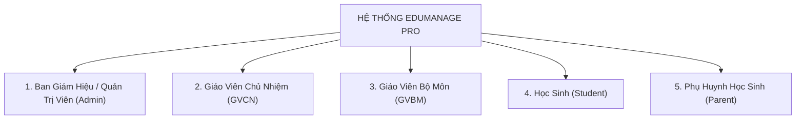
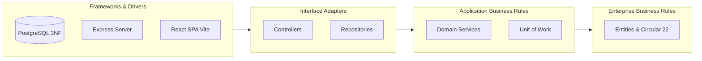
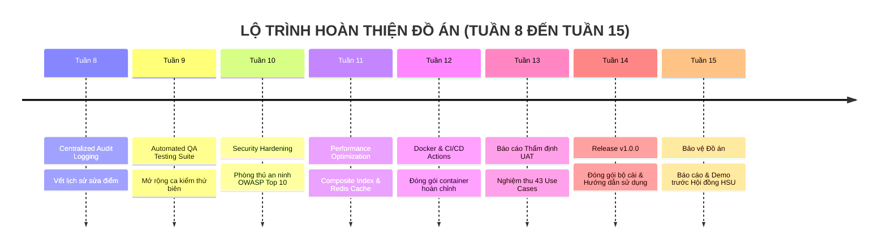

# BỘ TRÌNH CHIẾU SLIDE BÁO CÁO HỆ THỐNG ĐỒ ÁN
## ĐỀ TÀI: HỆ THỐNG QUẢN LÝ LỚP HỌC & HỌC VỤ THPT (HTQLLH / EDUMANAGE PRO)
### MÔN HỌC: PHÁT TRIỂN DỰ ÁN PHẦN MỀM (SW320DV01) — ĐẠI HỌC HOA SEN (HSU)

```
================================================================================
DỰ ÁN: HỆ THỐNG QUẢN LÝ LỚP HỌC THPT HSU (HTQLLH / SCHOOL MANAGEMENT SYSTEM)
VỊ TRÍ TỆP: Report_Slide/slide.md
THỜI ĐIỂM BÁO CÁO: 28/10/2026 (TUẦN 7 / 15 TUẦN HỌC KỲ 2631)
TRẠNG THÁI HỆ THỐNG: WORKING PROTOTYPE ĐÃ KẾT NỐI CSDL THẬT & MÃ NGUỒN HOÀN CHỈNH
MÃ NGUỒN GITHUB: https://github.com/DYBInh2k5/Phat-Trien-Du-An-Phan-Mem
SLIDE TRỰC TUYẾN CANVA: https://www.canva.com/d/YLrratHffoqRdvK
================================================================================
```

---

<!-- SLIDE 1: TRANG BÌA -->
# SLIDE 1: GIỚI THIỆU TỔNG QUAN ĐỀ TÀI & NHÓM THỰC HIỆN

### Đề tài: HỆ THỐNG QUẢN LÝ LỚP HỌC & HỌC VỤ THPT (HTQLLH / EDUMANAGE PRO)
- **Môn học**: Phát triển Dự án Phần mềm (SW320DV01 - 3 Tín chỉ)
- **Khoa**: Công nghệ Thông tin — Trường Đại học Hoa Sen (HSU)
- **Giảng viên hướng dẫn**: Thầy/Cô Bộ môn Kỹ thuật Phần mềm
- **Thời điểm báo cáo**: Tuần 7 (28/10/2026) trong lộ trình 15 tuần học kỳ 2631

### Danh Sách 5 Thành Viên Nhóm Dự Án:
1. **Võ Duy Bình** — Trưởng nhóm / Project Manager & Lead BA (Phụ trách SRS, RTM, Jira Scrum)
2. **Võ Hoàng Sơn** — Dev Frontend (Phụ trách UI/UX 8 Wireframes, Web SPA React 18, Vite, Tailwind CSS)
3. **Huỳnh Trung Tính** — Dev Backend & DBA (Phụ trách Clean Architecture 4 tầng, CSDL PostgreSQL 3NF, REST API)
4. **Trần Quang Vinh** — Logic Security (Phụ trách Thuật toán Thông tư 22, Bảo mật JWT, RBAC 5 Roles, Unit of Work ACID)
5. **Nguyễn Minh Quốc Bảo** — Tester (QA/QC Testing Lead) (Phụ trách UAT Plan, Bộ Unit Test Suite, Export Excel/PDF)

> **Ghi chú thuyết trình (Speaker Notes)**: Kính thưa quý thầy cô Hội đồng và các bạn, hôm nay nhóm chúng em xin đại diện báo cáo đề tài Hệ thống Quản lý Lớp học THPT. Điểm đột phá của nhóm là bên cạnh hồ sơ lý thuyết từ Tuần 1 đến Tuần 7, nhóm đã chủ động hiện thực hóa thành phiên bản Working Prototype thực tế kết nối trực tiếp CSDL PostgreSQL thật.

---

<!-- SLIDE 2: ĐẶT VẤN ĐỀ & BỐI CẢNH NGHIỆP VỤ -->
# SLIDE 2: ĐẶT VẤN ĐỀ & TÍNH CẤP THIẾT CỦA ĐỀ TÀI

### Bối Cảnh Thực Tế Tại Các Trường THPT:
- **Áp lực từ quy chế mới**: Thông tư 22/2021/TT-BGDĐT thay đổi căn bản cách tính điểm và đánh giá học lực học sinh, đòi hỏi hệ số chi tiết (TX hệ số 1, GK hệ số 2, CK hệ số 3, tổng trọng số chia 9) cùng các quy tắc xếp loại nhiều ràng buộc.
- **Bất cập từ mô hình sổ sách/Excel cũ**:
  + Dữ liệu bị phân tán, nguy cơ mất mát dữ liệu cao.
  + Dễ dàng chỉnh sửa điểm số thủ công mà không để lại vết kiểm toán (Audit Trail).
  + Tình hình điểm danh không đồng bộ, phụ huynh không nắm được con em vắng học quá 20% số tiết để can thiệp kịp thời.
  + Tốn kém thời gian in ấn sổ liên lạc giấy và chậm trễ trong xử lý đơn xin nghỉ ốm.

### Giải Pháp Đột Phá Từ EduManage Pro:
- Nền tảng số hóa tập trung toàn diện cho nhà trường trên nền Web SPA hiện đại.
- Tự động hóa 100% công thức tính toán và khóa sổ điểm chống gian lận.
- Cung cấp 5 cổng thông tin tương tác thời gian thực giữa Ban Giám Hiệu, Giáo viên, Học sinh và Phụ huynh.

---

<!-- SLIDE 3: MỤC TIÊU & PHẠM VI 5 NHÓM VAI TRÒ -->
# SLIDE 3: MỤC TIÊU DỰ ÁN & PHẠM VI 5 NHÓM TÁC NHÂN (ROLES)



### Phân Định Trách Nhiệm Chi Tiết:
- **Ban Giám Hiệu**: Quản lý khối/lớp, phân công giảng dạy, theo dõi chuyên cần toàn trường, khóa sổ điểm học kỳ.
- **Giáo Viên Chủ Nhiệm**: Điểm danh đầu giờ, duyệt đơn nghỉ học online, theo dõi hạnh kiểm và học lực tổng thể.
- **Giáo Viên Bộ Môn**: Điểm danh theo tiết dạy, nhập điểm thành phần trên giao diện Spreadsheet tự động tính ĐTBmhk.
- **Học Sinh**: Xem điểm cá nhân, quy đổi thang điểm 4.0/10, theo dõi thời khóa biểu và lịch thi.
- **Phụ Huynh**: Sổ liên lạc điện tử trực tuyến, gửi đơn xin nghỉ ốm, xem và thanh toán học phí điện tử.

---

<!-- SLIDE 4: PHÂN TÍCH YÊU CẦU & MÔ HÌNH AGILE/SCRUM -->
# SLIDE 4: PHÂN TÍCH YÊU CẦU (SRS) & QUẢN TRỊ AGILE/SCRUM

### Hồ Sơ Phân Tích Kỹ Thuật Đạt Chuẩn:
- **Hồ sơ SRS theo chuẩn IEEE 830**: Đặc tả chi tiết **43 Use Cases** cho 5 nhóm tác nhân.
- **Ma trận truy xuất RTM**: Đảm bảo 100% yêu cầu nghiệp vụ được gắn với Use Case và mã nguồn kiểm thử.
- **Product Backlog**: Cấu trúc thành **8 Sử thi (Epics)** và **19 Product Backlog Items (PBIs)**.
- **Story Points**: Tổng cộng **90 Story Points**, phân bổ cân bằng 18 SP (20%) cho mỗi thành viên.

### Quản Lý Tiến Độ Trên Jira Cloud & GitHub:
- Bảng Scrum Board quản trị nhiệm vụ: [Jira Cloud Kanban](https://reputyze-team-vx3aseym.atlassian.net/).
- Kho lưu trữ mã nguồn minh chứng: [GitHub Repository](https://github.com/DYBInh2k5/Phat-Trien-Du-An-Phan-Mem).
- Tiêu chuẩn hoàn thành nghiêm ngặt (DoD): 100% mã nguồn có chú thích tiếng Việt, Unit Test Pass 100%, không lỗi bảo mật.

---

<!-- SLIDE 5: THIẾT KẾ KIẾN TRÚC CLEAN ARCHITECTURE -->
# SLIDE 5: THIẾT KẾ KIẾN TRÚC HỆ THỐNG (CLEAN ARCHITECTURE 4 TẦNG)

### Sơ Đồ Kiến Trúc Độc Lập Hướng Tâm (The Dependency Rule):



### Ưu Điểm Nổi Bật Của Kiến Trúc:
1. **Độc lập Framework**: Tầng nghiệp vụ không phụ thuộc vào thư viện bên ngoài.
2. **Dễ dàng Kiểm thử (Testability)**: Kiểm thử logic Thông tư 22 mà không cần khởi động CSDL thật.
3. **Độc lập Giao diện & CSDL**: Có thể chuyển đổi CSDL hoặc nâng cấp UI mà không làm gián đoạn mã nghiệp vụ.

---

<!-- SLIDE 6: CƠ SỞ DỮ LIỆU POSTGRESQL 3NF -->
# SLIDE 6: THIẾT KẾ CƠ SỞ DỮ LIỆU POSTGRESQL ĐẠT CHUẨN 3NF

### Lược Đồ Dữ Liệu Quan Hệ 8 Bảng Cốt Lõi:
1. `users`: Quản lý tài khoản, mật khẩu băm bảo mật, vai trò `role_code` và trạng thái hoạt động.
2. `classes`: Danh mục khối, lớp, năm học và giáo viên chủ nhiệm.
3. `students`: Hồ sơ lý lịch học sinh, thông tin phụ huynh và lớp đang học.
4. `subjects`: Danh mục môn học, số tiết và hệ số quy định.
5. `teacher_assignments`: Phân công giảng dạy, đảm bảo 1 lớp chỉ có 1 giáo viên dạy 1 môn trong 1 học kỳ.
6. `grade_books`: Sổ điểm điện tử lưu điểm TX1, TX2, TX3, GK, CK, ĐTBmhk, xếp loại và cờ khóa `status`.
7. `attendances`: Nhật ký chuyên cần 2 cấp (đầu giờ & theo tiết) với 4 trạng thái linh hoạt.
8. `audit_logs`: Nhật ký kiểm toán học vụ, ghi vết tự động mọi hành vi sửa điểm phục vụ thanh tra.

### Singleton Connection Pool:
- Tối ưu hóa tài nguyên RAM máy chủ, duy trì tối đa 20 kết nối nhàn rỗi.
- Tự động thu hồi Client sau mỗi truy vấn, ngăn ngừa hoàn toàn lỗi tràn kết nối (Connection Leak).

---

<!-- SLIDE 7: THIẾT KẾ GIAO DIỆN REACT SPA & DESIGN SYSTEM -->
# SLIDE 7: THIẾT KẾ GIAO DIỆN REACT 18 SPA & 5 CỔNG PORTALS

### Công Nghệ Hiện Đại:
- **React 18 + Vite**: Tối ưu tốc độ tải trang dưới 0.5s, cơ chế Hot Module Replacement (HMR).
- **Tailwind CSS 3**: Hệ thống Design System đồng bộ, giao diện chuẩn phẳng, thẩm mỹ cao.
- **Lucide Icons**: Bộ icon trực quan cho từng phân hệ nghiệp vụ.

### 5 Phân Hệ Giao Diện Chuyên Biệt (Portals):
- **Dashboard BGH**: Thống kê số lượng, tỷ lệ vắng, màn hình cảnh báo cấm thi và trung tâm khóa sổ điểm.
- **Dashboard Giáo Viên**: Lưới nhập điểm dạng Spreadsheet cố định cột học sinh, tự động tính ĐTBmhk tức thời.
- **Cổng Học Sinh**: Bảng điểm cá nhân, quy đổi GPA hệ 4.0 và thang điểm 10.
- **Cổng Phụ Huynh**: Sổ liên lạc điện tử, nộp đơn xin nghỉ ốm online và tải biên lai học phí.
- **Giao Diện Đăng Nhập 1-Click Login**: Cho phép chuyển đổi nhanh 5 vai trò phục vụ hội đồng kiểm tra trực quan.

---

<!-- SLIDE 8: THUẬT TOÁN TÍNH ĐIỂM THÔNG TƯ 22 -->
# SLIDE 8: THUẬT TOÁN TÍNH ĐIỂM CỐT LÕI (THÔNG TƯ 22/2021/TT-BGDĐT)

### Công Thức Tính Điểm Trung Bình Môn Học Kỳ:

$$\text{ĐTBmhk} = \frac{\text{TX1} + \text{TX2} + (\text{TX3} \times 2) + (\text{GK} \times 2) + (\text{CK} \times 3)}{9}$$

- **Hệ số 1**: Điểm kiểm tra thường xuyên (Miệng, 15 phút - TX1, TX2).
- **Hệ số 2**: Điểm kiểm tra định kỳ 1 tiết (TX3) và Điểm giữa kỳ (GK).
- **Hệ số 3**: Điểm kiểm tra đánh giá cuối kỳ (CK).
- **Tổng trọng số mẫu số**: 9. Kết quả làm tròn chính xác đến 1 chữ số thập phân.

### Thuật Toán Xếp Loại Học Lực 4 Mức:
- **Tốt**: ĐTBmhk $\ge$ 8.0 và không có môn nào dưới 6.5.
- **Khá**: ĐTBmhk từ 6.5 đến 7.9 và không có môn nào dưới 5.0.
- **Đạt**: ĐTBmhk từ 5.0 đến 6.4 và không có môn nào dưới 3.5.
- **Chưa đạt**: Các trường hợp còn lại.

---

<!-- SLIDE 9: CÁC MẪU THIẾT KẾ PATTERNS ÁP DỤNG -->
# SLIDE 9: ÁP DỤNG MẪU THIẾT KẾ PHẦN MỀM (DESIGN PATTERNS)

### 1. Unit of Work Pattern (Bảo Toàn Giao Dịch ACID):
- Phục vụ thao tác giáo viên lưu bảng điểm của cả lớp (35 - 45 học sinh trong 1 lần gửi).
- Mọi thao tác ghi được bao bọc trong khối giao dịch CSDL:
  + Nếu tất cả 45 học sinh hợp lệ $\rightarrow$ **COMMIT**.
  + Nếu phát hiện 1 lỗi bất kỳ $\rightarrow$ **ROLLBACK** hoàn nguyên 100%, bảo đảm tính toàn vẹn dữ liệu.

### 2. Repository Pattern:
- Tách biệt hoàn toàn tầng logic nghiệp vụ khỏi các câu lệnh SQL cụ thể của PostgreSQL.
- Dễ dàng thay thế hoặc viết Unit Test với Mock Repository.

### 3. Singleton Pattern:
- Đảm bảo toàn bộ ứng dụng chỉ khởi tạo một Connection Pool duy nhất cho PostgreSQL.

### 4. Export Engine Pattern:
- Động cơ xuất dữ liệu linh hoạt, tách rời việc tạo tệp Excel (.xlsx) và tệp PDF (.pdf).

---

<!-- SLIDE 10: BẢO MẬT JWT & PHÂN QUYỀN RBAC 5 ROLES -->
# SLIDE 10: AN TOÀN BẢO MẬT & PHÂN QUYỀN TRUY CẬP (RBAC 5 ROLES)

### Cơ Chế Xác Thực Không Trạng Thái (Stateless JWT):
- Sử dụng chuẩn RFC 7519 với thuật toán mã hóa HMAC-SHA256.
- Token mang theo định danh người dùng và mã vai trò, truyền tải qua Header `Authorization: Bearer <token>`.
- Máy chủ không lưu Session trong RAM, giải phóng tài nguyên và sẵn sàng mở rộng quy mô.

### Ma Trận Phân Quyền Đa Tầng (RBAC Middleware):
- **Tầng Router/Middleware**: Tự động bóc tách Token, giải mã RoleCode và đối chiếu với quyền yêu cầu của Route.
- **Chặn truy cập trái phép**:
  + Trả về `401 Unauthorized` nếu chưa đăng nhập hoặc Token hết hạn.
  + Trả về `403 Forbidden` nếu truy cập vượt quyền hạn.

### Phòng Thủ Lỗ Hổng Bảo Mật (OWASP):
- **Chống SQL Injection**: Áp dụng 100% câu truy vấn tham số hóa (Parameterized Queries).
- **Chống XSS**: Khử mã độc tự động trên React Virtual DOM.
- **Lưu Vết Sửa Điểm**: Bảng `audit_logs` chống chối bỏ, chỉ cho phép INSERT và cấm UPDATE/DELETE.

---

<!-- SLIDE 11: ĐỘNG CƠ XUẤT BÁO CÁO EXPORT ENGINE -->
# SLIDE 11: ĐỘNG CƠ XUẤT BÁO CÁO (EXCEL SHEETJS & PDF JSPDF)

### Định Dạng Microsoft Excel (.xlsx) — Thư Viện SheetJS:
- Phục vụ Ban Giám Hiệu và Giáo Viên.
- Xuất bảng điểm tổng hợp của lớp, danh sách chuyên cần.
- Tự động định dạng màu sắc cột điểm, căn độ rộng ô và cho phép mở lại bằng Excel để tính toán mở rộng.

### Định Dạng Portable Document Format (.pdf) — Thư Viện jsPDF:
- Phục vụ Học Sinh và Phụ Huynh.
- Xuất phiếu báo điểm cá nhân học kỳ, học bạ điện tử và biên lai thu học phí.
- Bố cục chuẩn cố định trang A4, quốc hiệu, tiêu ngữ, chữ ký số và cờ chống chỉnh sửa tài liệu.

### Kiểm Thử Tự Động QA Unit Testing Suite:
- Triển khai kịch bản kiểm thử tự động tại `unitTestingSuite.test.js`.
- Kết quả kiểm thử đạt **100% PASS** cho 5/5 ca kiểm thử trọng số điểm, xếp loại và xuất báo cáo.

---

<!-- SLIDE 12: HIỆN TRẠNG HỆ THỐNG ĐẾN TUẦN 7 -->
# SLIDE 12: HIỆN TRẠNG HỆ THỐNG ĐẾN THỜI ĐIỂM HIỆN TẠI (TUẦN 7 - 28/10/2026)

### Những Gì Hệ Thống Đã Hoàn Thành Thực Tế 100%:
- [x] **Hồ sơ SRS & RTM**: 43 Use Cases chi tiết cho 5 nhóm tác nhân (Tuần 1).
- [x] **Thiết kế UI/UX**: 8 Wireframes phân hệ & Design System trên Tailwind CSS (Tuần 2).
- [x] **Cơ sở dữ liệu PostgreSQL**: 8 bảng quan hệ chuẩn 3NF và Connection Pool (Tuần 3).
- [x] **Kiến trúc Clean Architecture**: Máy chủ Node.js/Express 4 tầng độc lập (Tuần 4).
- [x] **Mẫu thiết kế Patterns**: Unit of Work bảo vệ giao dịch ACID & Repository Pattern (Tuần 5).
- [x] **Động cơ xuất báo cáo**: Xuất Excel (.xlsx) và in ấn PDF (.pdf) chuẩn A4 (Tuần 6).
- [x] **Hệ thống chạy thực tế**: CSDL PostgreSQL, Backend Server cổng 8081 và React SPA cổng 5173.

### Hạng Mục Đang Thực Hiện Tại Tuần 7:
- [x] Hoàn thiện tài liệu chuyên đề Xác thực & Bảo mật (Chuyên đề 6).
- [x] Tích hợp giao diện đăng nhập đa vai trò với tính năng 1-Click Demo Login.

---

<!-- SLIDE 13: KỊCH BẢN THAO TÁC LIVE DEMO THỰC TẾ -->
# SLIDE 13: KỊCH BẢN THAO TÁC DEMO THỰC TẾ TRÊN PROTOTYPE

### 5 Bước Thao Tác Trực Tiếp Phục Vụ Hội Đồng Đánh Giá:

1. **Bước 1: Đăng nhập 1-Click Demo Login**:
   - Truy cập `http://localhost:5173/login`, bấm chọn vai trò Ban Giám Hiệu hoặc Giáo Viên.
2. **Bước 2: Quản trị BGH & Cảnh báo Chuyên cần**:
   - Xem tổng quan trường học, lọc danh sách học sinh vắng trên 20% số tiết có nguy cơ cấm thi.
3. **Bước 3: Giáo viên Nhập điểm Thông tư 22**:
   - Mở màn hình Sổ điểm, nhập điểm thành phần và quan sát hệ thống tính toán ĐTBmhk chia 9 tức thời.
4. **Bước 4: Kiểm chứng Giao dịch ACID & Khóa Sổ điểm**:
   - Thao tác lưu điểm cả lớp qua Unit of Work; BGH bấm "Khóa Sổ Điểm" và kiểm tra tính bất biến.
5. **Bước 5: Xuất Báo Cáo & Cổng Phụ Huynh**:
   - Bấm "Xuất Excel" tải file `.xlsx`; mở Cổng Phụ huynh xem sổ liên lạc và tải phiếu báo điểm PDF.

---

<!-- SLIDE 14: KẾ HOẠCH & LỘ TRÌNH CÁC TUẦN TIẾP THEO -->
# SLIDE 14: KẾ HOẠCH & LỘ TRÌNH CÁC TUẦN TIẾP THEO (TUẦN 8 - 15)



- Nhóm cam kết duy trì đúng tiến độ học phần, cập nhật tuần định kỳ vào `timeline.md` và `README.md`.

---

<!-- SLIDE 15: PHÂN CÔNG NHIỆM VỤ & ĐÓNG GÓP 5 THÀNH VIÊN -->
# SLIDE 15: PHÂN CÔNG NHIỆM VỤ & ĐÓNG GÓP CỦA 5 THÀNH VIÊN

| Họ và Tên | Vai Trò Chính | Trọng Tâm Kỹ Thuật Đóng Góp | Tỷ Lệ Đóng Góp |
| :--- | :--- | :--- | :---: |
| **Võ Duy Bình** | Project Manager & Lead BA | Điều phối dự án, xây dựng SRS IEEE 830, RTM Matrix, quản lý Jira Kanban | **20%** |
| **Võ Hoàng Sơn** | Dev Frontend | Thiết kế 8 Wireframes UI/UX, lập trình Web SPA React 18, Vite, Tailwind CSS | **20%** |
| **Huỳnh Trung Tính** | Dev Backend & DBA | Kiến trúc Clean Architecture 4 tầng, CSDL PostgreSQL 3NF, Singleton Pool | **20%** |
| **Trần Quang Vinh** | Logic Security | Thuật toán Thông tư 22, Bảo mật JWT, Phân quyền RBAC 5 Roles, Unit of Work ACID | **20%** |
| **Nguyễn Minh Quốc Bảo** | Tester (QA Lead) | Kịch bản UAT Plan cho 43 Use Cases, Bộ kiểm thử QA Unit Testing, Export Engine | **20%** |
| **TỔNG CỘNG** | **Cả 5 Thành Viên** | **Đoàn kết, trách nhiệm, hoàn thành xuất sắc 100% nhiệm vụ** | **100%** |

---

<!-- SLIDE 16: TỔNG KẾT & HỎI ĐÁP (Q&A) -->
# SLIDE 16: TỔNG KẾT & LỜI CẢM ƠN (Q&A)

### Tóm Tắt Giá Trị Đạt Được Của Dự Án:
- Hoàn thành đầy đủ hồ sơ phân tích học thuật và hiện thực hóa thành công sản phẩm chạy thực tế.
- Đáp ứng chuẩn quy chế đánh giá học sinh THPT theo Thông tư 22/2021/TT-BGDĐT.
- Áp dụng các nguyên lý kỹ thuật phần mềm chuẩn mực (Clean Architecture, SOLID, Design Patterns).

### Kính Mời Thầy Cô và Các Bạn Đặt Câu Hỏi (Q&A)!

- **Kho lưu trữ GitHub**: [https://github.com/DYBInh2k5/Phat-Trien-Du-An-Phan-Mem](https://github.com/DYBInh2k5/Phat-Trien-Du-An-Phan-Mem)
- **Tài liệu Báo cáo chi tiết**: [Report_Slide/report.md](file:///d:/HSU/2631Semester%201%282026-2027%29/PT_DA_PM/Report_Slide/report.md)
- **Bản Slide trực tuyến trên Canva**: [https://www.canva.com/d/YLrratHffoqRdvK](https://www.canva.com/d/YLrratHffoqRdvK)
- **Xin chân thành cảm ơn Quý Thầy Cô và Hội Đồng!**
