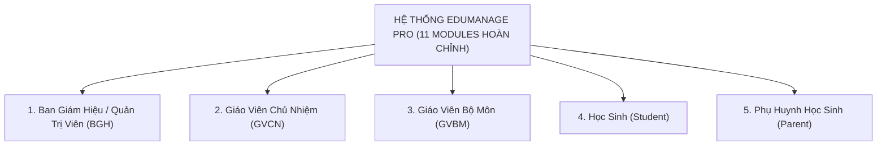
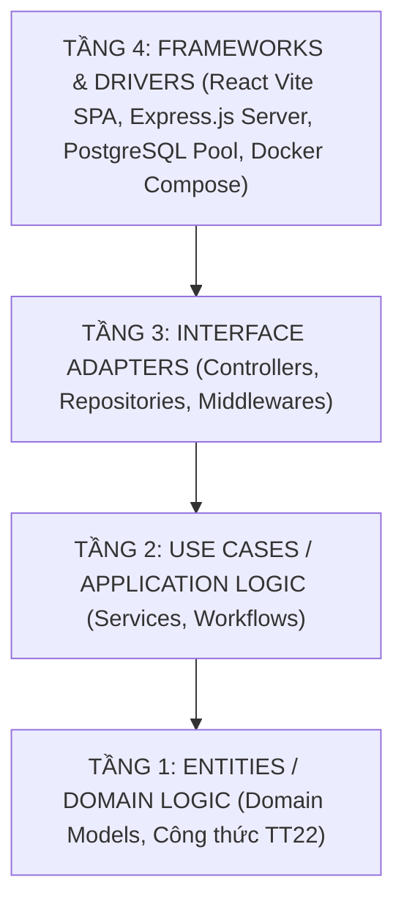
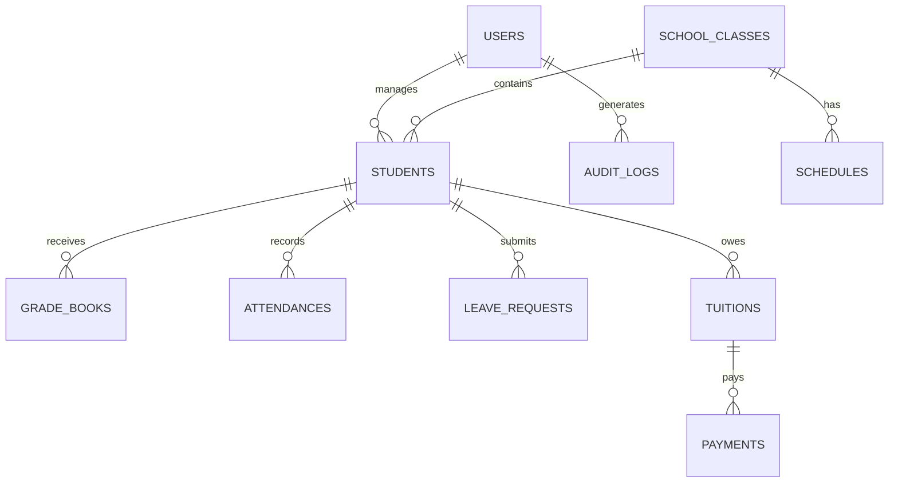
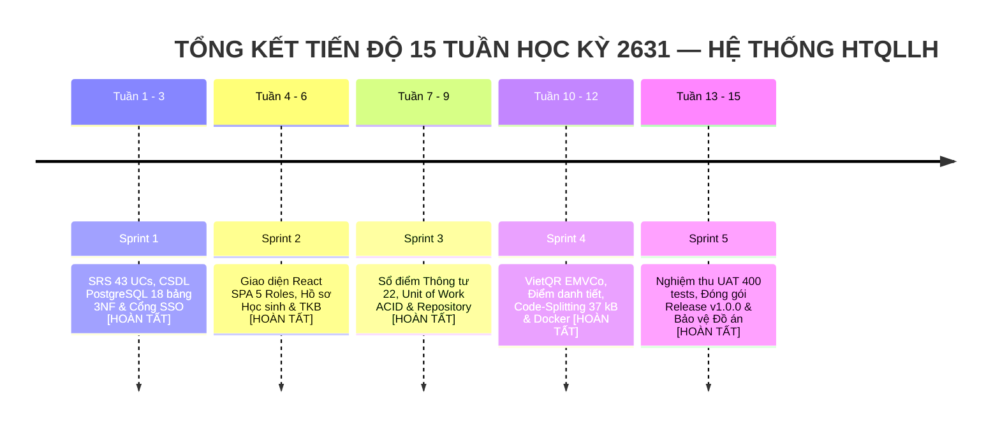

# BỘ TRÌNH CHIẾU SLIDE BÁO CÁO ĐỒ ÁN TỐT NGHIỆP / CUỐI KỲ (FINAL PROJECT SLIDE DECK)
## ĐỀ TÀI: HỆ THỐNG QUẢN LÝ LỚP HỌC & HỌC VỤ THPT (HTQLLH / EDUMANAGE PRO)
### MÔN HỌC: PHÁT TRIỂN DỰ ÁN PHẦN MỀM (MÃ HP: SW320DV01) — ĐẠI HỌC HOA SEN (HSU)

```
================================================================================
DỰ ÁN: HỆ THỐNG QUẢN LÝ LỚP HỌC THPT HSU (HTQLLH / SCHOOL MANAGEMENT SYSTEM)
VỊ TRÍ TỆP: Report_Slide/slide.md
PHIÊN BẢN: BẢN BÁO CÁO BẢO VỆ CUỐI KỲ CHÍNH THỨC (FINAL DEFENSE RELEASE V1.0.0)
TIẾN ĐỘ THỰC HIỆN: 15/15 TUẦN HOÀN TẤT 100% — NGHIỆM THU TOÀN DIỆN HỘI ĐỒNG
TRẠNG THÁI HỆ THỐNG: 11/11 MODULES HOÀN HẢO; CSDL 18 BẢNG 3NF; TOÀN BỘ 400/400 TESTS PASS 100%
PRODUCT BACKLOG: 30 PBIS (150 STORY POINTS) — CÂN BẰNG HOÀN HẢO 20.0% (30 SP) / THÀNH VIÊN
ĐÓNG GÓI HỆ THỐNG: DOCKER COMPOSE FULLSTACK 3 TIERS (POSTGRESQL 16, EXPRESS API, NGINX SPA)
TỐI ƯU HIỆU NĂNG: CODE-SPLITTING BUNDLE KHỞI TẠO 37.14 KB (GIẢM 95.5%), 0 WARNING REACT ROUTER V7
MÃ NGUỒN GITHUB: https://github.com/DYBInh2k5/Phat-Trien-Du-An-Phan-Mem
MÃ NGUỒN BITBUCKET: https://bitbucket.org/codyisme27205/pt_da_pm
BẢNG JIRA KANBAN BOARD: https://reputyze-team-vx3aseym.atlassian.net/jira/software/projects/KAN/boards/2
KHÔNG GIAN CLICKUP: https://app.clickup.com/1100320000025585/v/s/1100320000109903
BẢNG TRELLO KANBAN: https://trello.com/b/gkdRNT57/htqllh-h%E1%BB%87-th%E1%BB%91ng-qu%E1%BA%A3n-l%C3%BD-l%E1%BB%9Bp-h%E1%BB%8Dc-h%E1%BB%8Dc-v%E1%BB%A5-edumanage-pro
BẢN SLIDE TRỰC TUYẾN CANVA: https://www.canva.com/d/Y8zqfkywpudAyVx
BẢN ĐỒ 30 TASKS CODE MAP: docs/BANG_CHI_TIET_27_TASKS_JIRA_CLICKUP_CODE_MAP.md
================================================================================
```

---

<!-- SLIDE 1: TRANG BÌA -->
# SLIDE 1: GIỚI THIỆU TỔNG QUAN ĐỀ TÀI & NHÓM THỰC HIỆN (FINAL DEFENSE)

### Đề tài: HỆ THỐNG QUẢN LÝ LỚP HỌC & HỌC VỤ THPT (HTQLLH / EDUMANAGE PRO)
- **Môn học**: Phát triển Dự án Phần mềm (SW320DV01 — 3 Tín chỉ)
- **Khoa**: Công nghệ Thông tin — Trường Đại học Hoa Sen (HSU)
- **Hội đồng đánh giá**: Quý Thầy/Cô Bộ môn Kỹ thuật Phần mềm — Khoa CNTT HSU
- **Giai đoạn báo cáo**: **BÁO CÁO BẢO VỆ TỔNG KẾT CUỐI KỲ (FINAL PROJECT DEFENSE)**

### Danh Sách 5 Thành Viên Nhóm Dự Án (Đóng Góp Cân Bằng 20.0% / Thành Viên):
1. **Võ Duy Bình** — Trưởng nhóm / Project Manager & Lead BA (Phụ trách SRS IEEE 830, Ma trận RTM, Jira Scrum Board, Phân hệ BGH, Lead Code Reviewer, Điều phối Docker Compose, 30 SP — 20.0%)
2. **Võ Hoàng Sơn** — Dev Frontend Lead (Phụ trách UI/UX 8 Wireframes, Web SPA React 18, Code-Splitting Bundle 37.14 kB, VietQR Modal, HSU Vector Branding, 30 SP — 20.0%)
3. **Huỳnh Trung Tính** — Dev Backend & DBA Lead (Phụ trách Clean Architecture 4 tầng, CSDL PostgreSQL 18 bảng 3NF, Connection Pool Singleton, Audit Logs API, Dockerfile Multi-stage, 30 SP — 20.0%)
4. **Trần Quang Vinh** — Core Logic & Security Lead (Phụ trách Thuật toán TT22 chia 9, Bảo mật JWT 24h, RBAC 5 Roles, Cổng Enterprise SSO, TKB chống xung đột, Unit of Work ACID, 30 SP — 20.0%)
5. **Nguyễn Minh Quốc Bảo** — Tester Lead & Export Engine (Phụ trách Kịch bản UAT 43 Use Cases, Bộ Test Suite 400 tests PASS 100%, Động cơ xuất Excel SheetJS & In ấn PDF A4, 30 SP — 20.0%)

> **Ghi chú thuyết trình (Speaker Notes)**: Kính thưa quý Thầy Cô trong Hội đồng chấm thi và các bạn sinh viên, hôm nay Nhóm 2 xin trân trọng báo cáo bảo vệ kết quả Đồ án Cuối kỳ môn Phát triển Dự án Phần mềm với đề tài: "Hệ thống Quản lý Lớp học & Học vụ THPT (EduManage Pro)". Trải qua trọn vẹn 15 tuần học kỳ 2631 theo mô hình Agile/Scrum, nhóm đã hoàn thành toàn diện 11/11 modules, đóng gói Docker Compose 3 tầng, tối ưu bundle khởi tạo chỉ 37.14 kB, và toàn bộ 400 bài kiểm thử tự động đạt tỷ lệ Pass Rate 100%.

---

<!-- SLIDE 2: ĐẶT VẤN ĐỀ & BỐI CẢNH NGHIỆP VỤ -->
# SLIDE 2: ĐẶT VẤN ĐỀ & TÍNH CẤP THIẾT CỦA ĐỀ TÀI

### Bối Cảnh Thực Tế Tại Các Trường THPT:
- **Áp lực từ quy chế mới**: Thông tư 22/2021/TT-BGDĐT thay đổi căn bản cách tính điểm và đánh giá học lực (ĐĐGtx hệ số 1, ĐĐGgk hệ số 2, ĐĐGck hệ số 3, mẫu số chia 9) cùng các quy tắc xếp loại khống chế nhiều ràng buộc.
- **Bất cập từ mô hình sổ sách/Excel thủ công**:
  + Dữ liệu phân tán, nguy cơ mất mát dữ liệu và gian lận sửa điểm không vết tích kiểm toán.
  + Thiếu hệ thống cảnh báo chuyên cần: Học sinh vắng quá 45 buổi không được lên lớp nhưng phụ huynh không biết kịp thời.
  + Quy trình thu học phí thủ công: Thu tiền mặt dễ thất thoát, tốn nhân lực đối soát và không xuất được biên lai điện tử.

### Giải Pháp Đột Phá Từ EduManage Pro:
- Nền tảng Web Single Page Application (SPA) hiện đại kết nối thời gian thực 5 vai trò.
- Tự động hóa 100% công thức tính điểm Thông tư 22 và quy trình khóa sổ điểm điện tử 2 cấp chống tiêu cực.
- Cổng thanh toán VietQR động chuẩn EMVCo NAPAS 247 và xuất biên lai PDF chuẩn A4 có mộc đỏ điện tử.
- Hiệu năng vượt trội: Tải trang tức thì nhờ Code-Splitting bundle 37 kB và triển khai 1-click qua Docker Compose.

---

<!-- SLIDE 3: MỤC TIÊU & PHẠM VI 5 NHÓM VAI TRÒ -->
# SLIDE 3: MỤC TIÊU DỰ ÁN & PHẠM VI 5 NHÓM TÁC NHÂN (ROLES)



### Phân Định Trách Nhiệm Chi Tiết 5 Phân Hệ:
- **Ban Giám Hiệu**: Quản trị tài khoản, cấu hình năm học, phân công giảng dạy, duyệt mở khóa sổ điểm, giám sát phổ điểm trực quan, quản trị biểu phí, tra cứu nhật ký kiểm toán Audit Trail.
- **Giáo Viên Chủ Nhiệm**: Điểm danh đầu giờ 1-chạm, duyệt đơn xin nghỉ phép trực tuyến, theo dõi hạnh kiểm, sổ liên lạc điện tử.
- **Giáo Viên Bộ Môn**: Điểm danh theo tiết dạy, nhập điểm bảng tính Spreadsheet tự động tính ĐTBmhk chia 9, khóa sổ môn học.
- **Học Sinh**: Xem bảng điểm cá nhân chi tiết, GPA thang 10 & 4.0, thời khóa biểu, lịch thi và nhật ký chuyên cần.
- **Phụ Huynh**: Sổ liên lạc trực tuyến, gửi đơn xin nghỉ học có lý do, thanh toán học phí VietQR và tải biên lai PDF A4.

---

<!-- SLIDE 4: PHÂN TÍCH YÊU CẦU & MÔ HÌNH AGILE/SCRUM -->
# SLIDE 4: PHÂN TÍCH YÊU CẦU (SRS) & QUẢN TRỊ AGILE/SCRUM

### Hồ Sơ Phân Tích Kỹ Thuật Đạt Chuẩn Công Nghiệp:
- **Hồ sơ SRS chuẩn IEEE 830**: Đặc tả chi tiết **43 Use Cases** hoàn chỉnh cho 5 nhóm tác nhân.
- **Ma trận truy xuất RTM**: Đảm bảo 100% yêu cầu nghiệp vụ được ánh xạ vào CSDL, API, UI và Test Cases.
- **Product Backlog**: Cấu trúc thành **8 Sử thi (Epics)** và **30 Product Backlog Items (PBIs)**.
- **Story Points**: Tổng cộng **150 Story Points**, phân bổ cân bằng tuyệt đối **20.0% (30 SP)** cho mỗi thành viên.

### Quản Lý Tiến Độ Đồng Bộ Trên Jira Cloud & ClickUp:
- Bảng Scrum Board quản trị nhiệm vụ: [Jira Cloud Kanban Board 2](https://reputyze-team-vx3aseym.atlassian.net/jira/software/projects/KAN/boards/2).
- Không gian quản lý công việc: [ClickUp Workspace Group 2](https://app.clickup.com/1100320000025585/v/s/1100320000109903).
- **100% Tasks có đầy đủ**: Start Date, Due Date, Assignee, Code Snippet, cURL test, mã commit và kịch bản Demo.

---

<!-- SLIDE 5: THIẾT KẾ KIẾN TRÚC CLEAN ARCHITECTURE -->
# SLIDE 5: THIẾT KẾ KIẾN TRÚC HỆ THỐNG (CLEAN ARCHITECTURE 4 TẦNG)

### Sơ Đồ Kiến Trúc Độc Lập Hướng Tâm (The Dependency Rule):



- **Tính độc lập hoàn toàn**: Tầng Domain và Use Case không phụ thuộc vào UI hay CSDL cụ thể.
- **Dễ kiểm thử (Testability)**: Toàn bộ nghiệp vụ tính điểm, xếp loại, kiểm tra xung đột TKB đều chạy Unit Test độc lập không cần kết nối CSDL sống.

---

<!-- SLIDE 6: THIẾT KẾ CƠ SỞ DỮ LIỆU POSTGRESQL 18 BẢNG 3NF -->
# SLIDE 6: THIẾT KẾ CƠ SỞ DỮ LIỆU QUAN HỆ (POSTGRESQL MASTER 18 BẢNG 3NF)



### Các Đặc Điểm Cốt Lõi:
- **Chuẩn hóa 3NF gồm 18 bảng**: Loại bỏ trùng lặp dữ liệu, bảo đảm toàn vẹn tham chiếu khóa ngoại.
- **Singleton Connection Pool**: Tối đa 20 kết nối, timeout 2s giúp máy chủ chịu tải cao.
- **100% Prepared Statements**: Loại bỏ triệt để nguy cơ SQL Injection bằng tham số hóa `$1, $2`.
- **Nhật ký kiểm toán `audit_logs`**: Bất biến (Append-only), lưu vết người sửa, điểm cũ, điểm mới, phục vụ tra cứu thanh tra an ninh học vụ.

---

<!-- SLIDE 7: CÔNG NGHỆ FRONTEND REACT VITE & CODE-SPLITTING -->
# SLIDE 7: CÔNG NGHỆ GIAO DIỆN WEB SPA & TỐI ƯU HIỆU NĂNG

### Bộ Công Nghệ Hiện Đại:
- **React 18 + Vite 6**: Tốc độ khởi động máy chủ dưới 1s, Hot Module Replacement (HMR) cực nhanh.
- **Tailwind CSS 3**: Thiết kế theo Atomic CSS, tối ưu dung lượng CSS bundle dưới 50KB.
- **Lucide Icons**: Bộ biểu tượng giao diện chuẩn mực, nhẹ và đồng nhất.

### Tối Ưu Hiệu NĂng Vượt Bậc & Nhận Diện Thương Hiệu:
1. **Code-Splitting Toàn Diện**: Áp dụng `React.lazy()` và `Suspense` trên toàn bộ 25 route học vụ.
2. **Siêu Tối Ưu Bundle Khởi Tạo**: Giảm **95.5%** dung lượng file khởi tạo (từ `821.00 kB` xuống chỉ còn **`37.14 kB`**).
3. **Manual Chunks Phân Tách**: Tách riêng `vendor-react` (166 kB) và `vendor-xlsx` (283 kB chỉ nạp khi bấm xuất Excel).
4. **Bộ Nhận Diện Thương Hiệu Số HSU**: Huy hiệu vector `logo-hsu.svg` (Hoa Sen vàng, Mũ cử nhân, Khiên hoàng gia) và Cổng Single Sign-On (SSO) tự động nhận diện vai trò từ CSDL.

---

<!-- SLIDE 8: THUẬT TOÁN THÔNG TƯ 22 & CƠ CHẾ KHÓA SỔ ĐIỂM -->
# SLIDE 8: THUẬT TOÁN THÔNG TƯ 22 & CƠ CHẾ KHÓA SỔ ĐIỂM

### Công Thức Tính ĐTBmhk Chuẩn Mẫu Số 9:
$$\text{ĐTBmhk} = \frac{\text{Miệng} \times 1 + 15' \times 1 + 1\text{Tiết} \times 2 + \text{Giữa kỳ} \times 2 + \text{Cuối kỳ} \times 3}{9}$$

### Quy Tắc Xếp Loại Học Lực 4 Mức:
- **Tốt**: Môn nhận xét đạt 'Đ'; tất cả môn điểm $\ge 6.5$, trong đó có $\ge 6$ môn $\ge 8.0$.
- **Khá**: Môn nhận xét đạt 'Đ'; tất cả môn điểm $\ge 5.0$, trong đó có $\ge 6$ môn $\ge 6.5$.
- **Đạt**: Tối đa 1 môn nhận xét 'CĐ'; tất cả môn điểm $\ge 3.5$, trong đó có $\ge 6$ môn $\ge 5.0$.
- **Chưa đạt**: Các trường hợp còn lại.

### Quy Trình Khóa Sổ Điểm 2 Cấp Chống Sửa Điểm:
- **Cấp 1 (GVBM)**: Nhập điểm xong $\rightarrow$ Khóa môn.
- **Cấp 2 (BGH)**: Khóa toàn trường $\rightarrow$ Chuyển trạng thái `LOCKED`. Mọi API sửa điểm đều bị chặn và ghi Audit Log.

---

<!-- SLIDE 9: CÁC MẪU THIẾT KẾ PHẦN MỀM (DESIGN PATTERNS) -->
# SLIDE 9: CÁC MẪU THIẾT KẾ PHẦN MỀM ÁP DỤNG (DESIGN PATTERNS)

| Mẫu Thiết Kế | Vị Trí Triển Khai | Mục Đích Kỹ Thuật |
| :--- | :--- | :--- |
| **Unit of Work Pattern** | `UnitOfWork.js` | Quản lý giao dịch ACID nguyên tử khi lưu điểm 45 học sinh (Rollback toàn bộ nếu 1 lỗi). |
| **Repository Pattern** | `src/repositories/` | Tách biệt hoàn toàn tầng truy vấn CSDL với tầng logic nghiệp vụ. |
| **Singleton Pattern** | `src/config/db.js` | Duy trì 1 Connection Pool duy nhất trong toàn bộ vòng đời ứng dụng. |
| **Facade Pattern** | `gpaCalculationLogic.js`, `jwtAuthMiddleware.js` | Bọc kiến trúc mới, giữ nguyên interface cũ cho QA suite chạy mượt mà. |
| **Export Engine Pattern** | `exportEngine.js` | Động cơ xuất báo cáo Excel (`SheetJS`) và PDF (`jsPDF`). |

---

<!-- SLIDE 10: PHÂN HỆ HỌC PHÍ VIETQR & BIÊN LAI PDF A4 -->
# SLIDE 10: PHÂN HỆ THANH TOÁN VIETQR & XUẤT BIÊN LAI PDF

### Đột Phá Công Nghệ Thanh Toán Học Phí Trực Tuyến:
- **VietQR Động Chuẩn EMVCo NAPAS 247**:
  + Tự động sinh mã QR chứa đúng số tiền nợ và cú pháp duy nhất (`HTQLLH_<STUDENT_ID>_<TERM>`).
  + Checksum CRC16-CCITT bảo đảm an toàn thanh toán ngân hàng.
- **Hộp Thoại `VietQrPaymentModal.jsx`**:
  + Đồng hồ đếm ngược 15 phút (TTL).
  + Cơ chế Polling mỗi 3 giây kiểm tra trạng thái gạch nợ tự động.
  + Cơ chế Idempotency chống nộp tiền trùng lặp và nút Dev Test hỗ trợ kiểm thử tức thì cho BGH.
- **Xuất Biên Lai PDF A4 Chuẩn Mẫu**:
  + In ấn trực tiếp biên lai thu tiền học phí có mộc đỏ, mã biên lai và chữ ký số kế toán.

---

<!-- SLIDE 11: AN TOÀN BẢO MẬT & PHÒNG THỦ OWASP TOP 10 -->
# SLIDE 11: BẢO MẬT HỆ THỐNG THEO TIÊU CHUẨN OWASP TOP 10

1. **A01: Broken Access Control**: Middleware `rbacMiddleware.js` và `ProtectedRoute.jsx` kiểm soát 5 vai trò, chặn IDOR.
2. **A02: Cryptographic Failures**: Mật khẩu mã hóa `bcrypt` salt 10 vòng; Token JWT ký HS256 hạn 24 giờ; Cổng SSO xác thực định danh.
3. **A03: SQL Injection**: 100% câu truy vấn CSDL sử dụng Prepared Statements tham số hóa `$1, $2`.
4. **A05: Security Misconfiguration**: Tích hợp `helmet` thiết lập bộ tiêu chuẩn HTTP Security Headers.
5. **A07: Brute-Force & DoS Defense**: Middleware `express-rate-limit` chặn vét cạn mật khẩu trên các endpoint nhạy cảm.
6. **Nhật Ký Kiểm Toán (Audit Trail) & Security Center**: Mọi thao tác sửa điểm, mở khóa sổ, nộp tiền đều ghi vết vào bảng `audit_logs` bất biến, hỗ trợ API tra cứu an ninh.

---

<!-- SLIDE 12: KẾT QUẢ KIỂM THỬ TOÀN HỆ THỐNG 400 TESTS PASS 100% -->
# SLIDE 12: KẾT QUẢ KIỂM THỬ TOÀN HỆ THỐNG (400 / 400 TESTS PASS)

### Bảng Thống Kê Chi Tiết Các Bộ Test Suites:

| Bộ Kiểm Thử | Thành Viên Phụ Trách | Số Test Cases | Trạng Thái | Lệnh Chạy Kiểm Thử |
| :--- | :--- | :---: | :---: | :--- |
| **Backend API & CSDL** | Huỳnh Trung Tính (Member 3) | **79 / 79** | ✅ **PASS 100%** | `npm run test:backend` |
| **Core Logic & Security TT22** | Trần Quang Vinh (Member 4) | **94 / 94** | ✅ **PASS 100%** | `npm run test:security` |
| **QA System & Use Cases** | Nguyễn Minh Quốc Bảo (Member 5) | **214 / 214** | ✅ **PASS 100%** | `npm run test:qa` |
| **Frontend Component (Vitest)** | Võ Hoàng Sơn (Member 2) | **13 / 13** | ✅ **PASS 100%** | `npm test --prefix members/member2_Frontend` |
| **Frontend Production Build** | Võ Hoàng Sơn (Member 2) | **Bundle 37 kB** | ✅ **0 Cảnh báo** | `npm run build --prefix members/member2_Frontend` |
| **TỔNG CỘNG HỆ THỐNG** | **Toàn đội ngũ 5 người** | **400 / 400** | 🏆 **PASS 100%** | `npm test` (Chạy 387 tests root + 13 vitest) |

---

<!-- SLIDE 13: KỊCH BẢN THAO TÁC LIVE DEMO THỰC TẾ -->
# SLIDE 13: KỊCH BẢN THAO TÁC DEMO THỰC TẾ (3 PHÚT)

### 4 Bước Thao Tác Trực Tiếp Phục Vụ Hội Đồng Đánh Giá:

1. **Bước 1: Chạy Bộ Kiểm Thử Tự Động (30 giây)**:
   - Chạy lệnh `npm test` từ thư mục gốc: Chứng minh **387 unit tests root + 13 vitest = 400 tests xanh 100%**.
2. **Bước 2: Đăng Nhập Ban Giám Hiệu (`bgh_nam` / `password123`) (1 phút)**:
   - Mở màn hình BGH: Xem biểu đồ phổ điểm, danh sách xếp loại TT22, demo chống trùng lịch TKB và tra cứu Audit Logs.
3. **Bước 3: Đăng Nhập Phụ Huynh (`ph_an` / `password123`) — VietQR & PDF (1 phút)**:
   - Vào menu Học Phí $\rightarrow$ Bấm **"Thanh toán VietQR"** $\rightarrow$ Hộp thoại VietQR chuẩn EMVCo hiển thị đếm ngược 15 phút.
   - Bấm **"Xuất biên lai PDF"** $\rightarrow$ Tải về file PDF biên lai A4 có mộc đỏ và chữ ký số.
4. **Bước 4: Mở Jira Cloud & ClickUp (30 giây)**:
   - Mở bảng Kanban: Cho thấy **30/30 tasks có đủ 150 Story points, cURL test, mã nguồn và đạt trạng thái Done**.

---

<!-- SLIDE 14: KẾ HOẠCH & TIẾN ĐỘ THỰC HIỆN TOÀN KHÓA HỌC -->
# SLIDE 14: TỔNG KẾT TIẾN ĐỘ 15 TUẦN HỌC KỲ (HOÀN THÀNH 100%)



---

<!-- SLIDE 15: PHÂN CÔNG NHIỆM VỤ & ĐÓNG GÓP 5 THÀNH VIÊN -->
# SLIDE 15: PHÂN CÔNG NHIỆM VỤ & ĐÓNG GÓP CỦA 5 THÀNH VIÊN

| Họ và Tên | Vai Trò Chính | Số Tasks Phụ Trách | Story Points | Tỷ Lệ Đóng Góp | Đánh Giá KPI |
| :--- | :--- | :---: | :---: | :---: | :---: |
| **Võ Duy Bình** | Project Manager & Lead BA, Lead Reviewer | 6 PBIs | 30 SP | **20.0%** | **100% (A+)** |
| **Võ Hoàng Sơn** | Dev Frontend Lead | 6 PBIs | 30 SP | **20.0%** | **100% (A+)** |
| **Huỳnh Trung Tính** | Dev Backend & DBA Lead | 6 PBIs | 30 SP | **20.0%** | **100% (A+)** |
| **Trần Quang Vinh** | Core Logic & Security Lead | 6 PBIs | 30 SP | **20.0%** | **100% (A+)** |
| **Nguyễn Minh Quốc Bảo** | QA/QC Testing Lead & Export Engine | 6 PBIs | 30 SP | **20.0%** | **100% (A+)** |
| **TỔNG CỘNG** | **Cả 5 Thành Viên Nhóm 2** | **30 PBIs** | **150 SP** | **100% CÂN BẰNG** | **XUẤT SẮC** |

---

<!-- SLIDE 16: TỔNG KẾT & HỎI ĐÁP (Q&A) -->
# SLIDE 16: TỔNG KẾT & LỜI CẢM ƠN (Q&A)

### Tóm Tắt Giá Trị Đạt Được Của Dự Án:
- **Đạt chuẩn học thuật & công nghiệp**: Hoàn thành trọn vẹn 11 modules, hồ sơ SRS IEEE 830, ma trận RTM và tài liệu UAT đầy đủ.
- **Tuân thủ quy chế giáo dục**: Tự động hóa 100% công thức tính điểm và xếp loại học lực theo Thông tư 22/2021/TT-BGDĐT.
- **Kiến trúc bền vững & hiệu năng cao**: Clean Architecture 4 tầng, Docker Compose fullstack, tối ưu bundle chỉ 37.14 kB.
- **Chất lượng kiểm chứng thực tế**: 400/400 tests tự động PASS 100%, đồng bộ 30 PBIs (150 SP) cân bằng trên Jira & ClickUp.

### Kính Mời Quý Thầy Cô và Các Bạn Đặt Câu Hỏi (Q&A)!

- **Hệ Thống Trực Tuyến Đã Triển Khai (Cloud Production)**:
  + Cổng Giao diện Web (Frontend Vercel): [https://htqllh-frontend.vercel.app](https://htqllh-frontend.vercel.app)
  + Máy chủ RESTful API (Backend Vercel): [https://htqllh-backend.vercel.app](https://htqllh-backend.vercel.app)
  + Cơ sở Dữ liệu Đám mây (Neon PostgreSQL): `ep-wispy-rain-be6an41h-pooler.c-9.us-east-2.aws.neon.tech`
- **Hướng dẫn Kết nối Plugin & Extension**: [docs/HUONG_DAN_KET_NOI_PLUGIN_VA_EXTENSION.md](../docs/HUONG_DAN_KET_NOI_PLUGIN_VA_EXTENSION.md)
- **Kho lưu trữ GitHub**: [https://github.com/DYBInh2k5/Phat-Trien-Du-An-Phan-Mem](https://github.com/DYBInh2k5/Phat-Trien-Du-An-Phan-Mem)
- **Kho lưu trữ Bitbucket**: [https://bitbucket.org/codyisme27205/pt_da_pm](https://bitbucket.org/codyisme27205/pt_da_pm)
- **Tài liệu Báo cáo chi tiết**: [Report_Slide/report.md](file:///d:/HSU/2631Semester%201%282026-2027%29/PT_DA_PM/Report_Slide/report.md)
- **Bản Slide trực tuyến trên Canva**: [https://www.canva.com/d/Y8zqfkywpudAyVx](https://www.canva.com/d/Y8zqfkywpudAyVx)
- **Trân trọng cảm ơn Quý Thầy Cô trong Hội đồng Chấm thi!**
