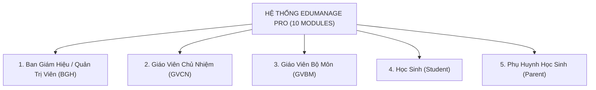
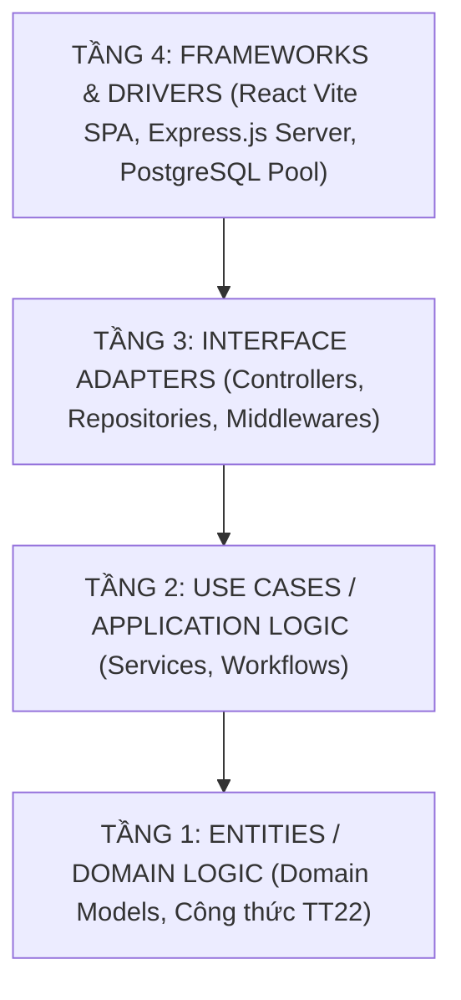
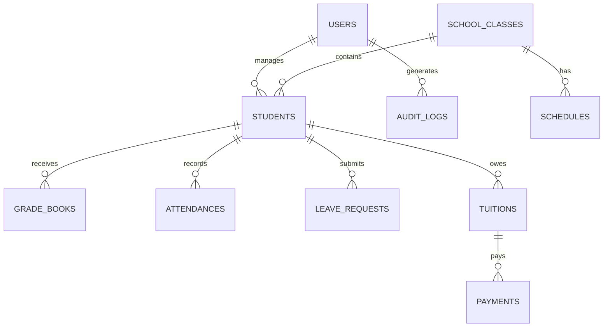
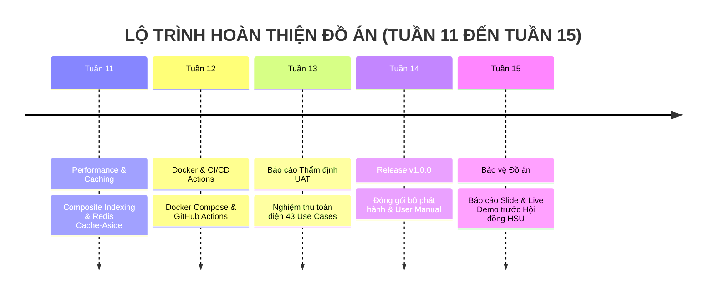

# BỘ TRÌNH CHIẾU SLIDE BÁO CÁO HỆ THỐNG ĐỒ ÁN
## ĐỀ TÀI: HỆ THỐNG QUẢN LÝ LỚP HỌC & HỌC VỤ THPT (HTQLLH / EDUMANAGE PRO)
### MÔN HỌC: PHÁT TRIỂN DỰ ÁN PHẦN MỀM (SW320DV01) — ĐẠI HỌC HOA SEN (HSU)

```
================================================================================
DỰ ÁN: HỆ THỐNG QUẢN LÝ LỚP HỌC THPT HSU (HTQLLH / SCHOOL MANAGEMENT SYSTEM)
VỊ TRÍ TỆP: Report_Slide/slide.md
THỜI ĐIỂM BÁO CÁO: 17/11/2026 (TUẦN 10 / 15 TUẦN HỌC KỲ 2631)
TRẠNG THÁI HỆ THỐNG: 10/10 MODULES HOÀN TẤT; CSDL 17 BẢNG 3NF; TOÀN BỘ 322/322 TESTS PASS 100%
MÃ NGUỒN GITHUB: https://github.com/DYBInh2k5/Phat-Trien-Du-An-Phan-Mem
MÃ NGUỒN BITBUCKET: https://bitbucket.org/codyisme27205/pt_da_pm
BẢN SLIDE TRỰC TUYẾN CANVA: https://www.canva.com/d/75iOEEpReWqgOuN
BẢN ĐỒ 27 TASKS CODE MAP: docs/BANG_CHI_TIET_27_TASKS_JIRA_CLICKUP_CODE_MAP.md
================================================================================
```

---

<!-- SLIDE 1: TRANG BÌA -->
# SLIDE 1: GIỚI THIỆU TỔNG QUAN ĐỀ TÀI & NHÓM THỰC HIỆN

### Đề tài: HỆ THỐNG QUẢN LÝ LỚP HỌC & HỌC VỤ THPT (HTQLLH / EDUMANAGE PRO)
- **Môn học**: Phát triển Dự án Phần mềm (SW320DV01 — 3 Tín chỉ)
- **Khoa**: Công nghệ Thông tin — Trường Đại học Hoa Sen (HSU)
- **Giảng viên hướng dẫn**: Thầy/Cô Bộ môn Kỹ thuật Phần mềm
- **Thời điểm báo cáo**: Tuần 10 (17/11/2026) trong lộ trình 15 tuần học kỳ 2631

### Danh Sách 5 Thành Viên Nhóm Dự Án:
1. **Võ Duy Bình** — Trưởng nhóm / Project Manager & Lead BA (Phụ trách SRS, RTM, Jira Scrum, Phân hệ BGH, Code Reviewer)
2. **Võ Hoàng Sơn** — Dev Frontend Lead (Phụ trách UI/UX, Web SPA React 18, Vite, Tailwind CSS, VietQR Modal)
3. **Huỳnh Trung Tính** — Dev Backend & DBA Lead (Phụ trách Clean Architecture 4 tầng, CSDL PostgreSQL 17 bảng 3NF, REST API)
4. **Trần Quang Vinh** — Logic Security Lead (Phụ trách Thuật toán TT22, Bảo mật JWT, RBAC 5 Roles, Chống xung đột TKB)
5. **Nguyễn Minh Quốc Bảo** — Tester (QA/QC Testing Lead) (Phụ trách UAT Plan, Bộ Test Suite 136 ca test, Export Excel/PDF)

> **Ghi chú thuyết trình (Speaker Notes)**: Kính thưa quý thầy cô Hội đồng và các bạn, hôm nay nhóm 2 xin báo cáo tiến độ đồ án Hệ thống Quản lý Lớp học THPT. Điểm nổi bật là đến Tuần 10, nhóm đã hoàn thành trọn vẹn 10/10 modules, tích hợp Cổng thanh toán VietQR động, và toàn bộ 322 automated tests đã chạy PASS 100%.

---

<!-- SLIDE 2: ĐẶT VẤN ĐỀ & BỐI CẢNH NGHIỆP VỤ -->
# SLIDE 2: ĐẶT VẤN ĐỀ & TÍNH CẤP THIẾT CỦA ĐỀ TÀI

### Bối Cảnh Thực Tế Tại Các Trường THPT:
- **Áp lực từ quy chế mới**: Thông tư 22/2021/TT-BGDĐT thay đổi căn bản cách tính điểm và đánh giá học lực (ĐĐGtx x1, ĐĐGgk x2, ĐĐGck x3, chia 9) cùng các quy tắc xếp loại khống chế nhiều ràng buộc.
- **Bất cập từ mô hình sổ sách/Excel cũ**:
  + Dữ liệu phân tán, nguy cơ mất mát dữ liệu và gian lận sửa điểm không vết tích.
  + Thiếu hệ thống cảnh báo chuyên cần: Học sinh vắng quá 45 buổi không được lên lớp nhưng phụ huynh không biết kịp thời.
  + Quy trình thu học phí thủ công: Dễ thất thoát, tốn nhân lực đối soát và không xuất được biên lai điện tử.

### Giải Pháp Đột Phá Từ EduManage Pro:
- Nền tảng Web Single Page Application (SPA) hiện đại kết nối thời gian thực 5 vai trò.
- Tự động hóa 100% công thức tính điểm Thông tư 22 và quy trình khóa sổ điểm điện tử 2 cấp.
- Cổng thanh toán VietQR động chuẩn EMVCo NAPAS 247 và xuất biên lai PDF chuẩn A4.

---

<!-- SLIDE 3: MỤC TIÊU & PHẠM VI 5 NHÓM VAI TRÒ -->
# SLIDE 3: MỤC TIÊU DỰ ÁN & PHẠM VI 5 NHÓM TÁC NHÂN (ROLES)



### Phân Định Trách Nhiệm Chi Tiết:
- **Ban Giám Hiệu**: Quản trị tài khoản, phân công giảng dạy, duyệt mở sổ, giám sát phổ điểm và quản trị biểu phí.
- **Giáo Viên Chủ Nhiệm**: Điểm danh đầu giờ 1-chạm, duyệt đơn nghỉ học online, theo dõi hạnh kiểm và sổ liên lạc.
- **Giáo Viên Bộ Môn**: Điểm danh theo tiết, nhập điểm bảng tính Spreadsheet tự động tính ĐTBmhk chia 9, khóa môn.
- **Học Sinh**: Xem bảng điểm cá nhân chi tiết, quy đổi thang 4.0/10, theo dõi thời khóa biểu.
- **Phụ Huynh**: Sổ liên lạc trực tuyến, gửi đơn xin nghỉ học, thanh toán học phí VietQR và tải biên lai PDF.

---

<!-- SLIDE 4: PHÂN TÍCH YÊU CẦU & MÔ HÌNH AGILE/SCRUM -->
# SLIDE 4: PHÂN TÍCH YÊU CẦU (SRS) & QUẢN TRỊ AGILE/SCRUM

### Hồ Sơ Phân Tích Kỹ Thuật Đạt Chuẩn:
- **Hồ sơ SRS chuẩn IEEE 830**: Đặc tả chi tiết **43 Use Cases** cho 5 nhóm tác nhân.
- **Ma trận truy xuất RTM**: Đảm bảo 100% yêu cầu nghiệp vụ được ánh xạ vào CSDL, API, UI và Test Cases.
- **Product Backlog**: Cấu trúc thành **10 Sử thi (Epics)** và **27 Product Backlog Items (PBIs)**.
- **Story Points**: Tổng cộng **135 Story Points**, phân bổ cân bằng ~20% (25-28 SP) cho mỗi thành viên.

### Quản Lý Tiến Độ Trên Jira Cloud & ClickUp:
- Bảng Scrum Board quản trị nhiệm vụ: [Jira Cloud Kanban Board 2](https://reputyze-team-vx3aseym.atlassian.net/jira/software/projects/KAN/boards/2).
- Không gian quản lý công việc: [ClickUp Workspace Group 2](https://app.clickup.com/1100320000025585/v/s/1100320000109903).
- **100% Tasks có đầy đủ**: Start Date, Due Date (Deadline), Assignee, Code Snippet, cURL test và kịch bản Demo 3 phút.

---

<!-- SLIDE 5: THIẾT KẾ KIẾN TRÚC CLEAN ARCHITECTURE -->
# SLIDE 5: THIẾT KẾ KIẾN TRÚC HỆ THỐNG (CLEAN ARCHITECTURE 4 TẦNG)

### Sơ Đồ Kiến Trúc Độc Lập Hướng Tâm (The Dependency Rule):



- **Tính độc lập hoàn toàn**: Tầng Domain và Use Case không phụ thuộc vào UI hay CSDL cụ thể.
- **Dễ kiểm thử (Testability)**: Toàn bộ nghiệp vụ tính điểm, xếp loại, kiểm tra xung đột TKB đều chạy Unit Test độc lập không cần CSDL sống.

---

<!-- SLIDE 6: THIẾT KẾ CƠ SỞ DỮ LIỆU POSTGRESQL 17 BẢNG 3NF -->
# SLIDE 6: THIẾT KẾ CƠ SỞ DỮ LIỆU QUAN HỆ (POSTGRESQL MASTER 17 BẢNG)



### Các Đặc Điểm Cốt Lõi:
- **Chuẩn hóa 3NF gồm 17 bảng**: Loại bỏ trùng lặp dữ liệu, bảo đảm toàn vẹn tham chiếu khóa ngoại.
- **Singleton Connection Pool**: Tối đa 20 kết nối, timeout 2s giúp máy chủ chịu tải cao.
- **100% Prepared Statements**: Loại bỏ triệt để nguy cơ SQL Injection bằng tham số hóa `$1, $2`.
- **Nhật ký kiểm toán `audit_logs`**: Bất biến (Append-only), lưu vết người sửa, điểm cũ, điểm mới.

---

<!-- SLIDE 7: CÔNG NGHỆ FRONTEND REACT VITE & TAILWIND CSS -->
# SLIDE 7: CÔNG NGHỆ GIAO DIỆN WEB SPA FRONTEND

### Bộ Công Nghệ Lựa Chọn:
- **React 18 + Vite 6**: Tốc độ khởi động máy chủ dưới 1s, Hot Module Replacement (HMR) cực nhanh.
- **Tailwind CSS 3**: Thiết kế theo Atomic CSS, tối ưu dung lượng CSS bundle dưới 50KB.
- **Lucide Icons**: Bộ biểu tượng giao diện chuẩn mực, nhẹ và đồng nhất.

### Tính Năng Nổi Bật Trên Giao Diện:
1. **Spreadsheet Gradebook**: Bảng tính nhập điểm tương tự Excel, di chuyển bằng phím mũi tên.
2. **1-Click Demo Login**: Đăng nhập nhanh 5 vai trò mẫu hỗ trợ kiểm thử và báo cáo.
3. **VietQR Modal**: Hộp thoại thanh toán động có đồng hồ đếm ngược 15 phút và tự động kiểm tra giao dịch.

---

<!-- SLIDE 8: THUẬT TOÁN THÔNG TƯ 22 & CƠ CHẾ KHÓA SỔ ĐIỂM -->
# SLIDE 8: THUẬT TOÁN THÔNG TƯ 22 & CƠ CHẾ KHÓA SỔ ĐIỂM

### Công Thức Tính ĐTBmhk Chuẩn Mẫu Số 9:
$$\text{ĐTBmhk} = \frac{\text{Miệng} \times 1 + 15' \times 1 + 1\text{Tiết} \times 2 + \text{Giữa kỳ} \times 2 + \text{Cuối kỳ} \times 3}{9}$$

### Quy Tắc Xếp Loại Học Lực 4 Mức:
- **Tốt**: Môn nhận xét đạt 'Đ'; tất cả môn điểm $\ge 6.5$, trong đó có $\ge 6$ môn $\ge 8.0$.
- **Khá**: Môn nhận xét đạt 'Đ'; tất cả môn điểm $\ge 5.0$, trong đó có $\ge 6$ môn $\ge 6.5$.
- **Đạt**: Tối đa 1 môn nhận xét 'CĐ'; tất cả môn điểm $\ge 3.5$, trong đó có $\ge 6$ môn $\ge 5.0$.
- **Chưa đạt**: Các trường hợp còn lại.

### Quy Trình Khóa Sổ Điểm 2 Cấp Chống Sửa Điểm:
- **Cấp 1 (GVBM)**: Nhập điểm xong $\rightarrow$ Khóa môn.
- **Cấp 2 (BGH)**: Khóa toàn trường $\rightarrow$ Chuyển trạng thái `LOCKED`. Mọi API sửa điểm đều bị chặn và ghi Audit Log.

---

<!-- SLIDE 9: CÁC MẪU THIẾT KẾ PHẦN MỀM (DESIGN PATTERNS) -->
# SLIDE 9: CÁC MẪU THIẾT KẾ PHẦN MỀM ÁP DỤNG (DESIGN PATTERNS)

| Mẫu Thiết Kế | Vị Trí Triển Khai | Mục Đích Kỹ Thuật |
| :--- | :--- | :--- |
| **Unit of Work Pattern** | `UnitOfWork.js` | Quản lý giao dịch ACID nguyên tử khi lưu điểm 45 học sinh (Rollback toàn bộ nếu 1 lỗi). |
| **Repository Pattern** | `src/repositories/` | Tách biệt hoàn toàn tầng truy vấn CSDL với tầng logic nghiệp vụ. |
| **Singleton Pattern** | `src/config/db.js` | Duy trì 1 Connection Pool duy nhất trong toàn bộ vòng đời ứng dụng. |
| **Facade Pattern** | `gpaCalculationLogic.js`, `jwtAuthMiddleware.js` | Bọc kiến trúc mới, giữ nguyên interface cũ cho QA suite chạy mượt mà. |
| **Export Engine Pattern** | `exportEngine.js` | Động cơ xuất báo cáo Excel (`SheetJS`) và PDF (`jsPDF`). |

---

<!-- SLIDE 10: PHÂN HỆ HỌC PHÍ VIETQR & BIÊN LAI PDF A4 -->
# SLIDE 10: PHÂN HỆ THANH TOÁN VIETQR & XUẤT BIÊN LAI PDF

### Đột Phá Công Nghệ Hoàn Thành Tại Tuần 10 (PR #7):
- **VietQR Động Chuẩn EMVCo NAPAS 247**:
  + Tự động sinh mã QR chứa đúng số tiền nợ và cú pháp duy nhất (`HTQLLH_<STUDENT_ID>_<TERM>`).
  + Checksum CRC16 bảo đảm an toàn thanh toán ngân hàng.
- **Hộp Thoại `VietQrPaymentModal.jsx`**:
  + Đồng hồ đếm ngược 15 phút (TTL).
  + Cơ chế Polling mỗi 3 giây kiểm tra trạng thái gạch nợ.
  + Cơ chế Idempotency chống nộp tiền trùng lặp.
- **Xuất Biên Lai PDF A4 Chuẩn Mẫu**:
  + In ấn trực tiếp biên lai thu tiền học phí có mộc đỏ, mã biên lai và chữ ký số kế toán.

---

<!-- SLIDE 11: AN TOÀN BẢO MẬT & PHÒNG THỦ OWASP TOP 10 -->
# SLIDE 11: BẢO MẬT HỆ THỐNG THEO TIÊU CHUẨN OWASP TOP 10

1. **A01: Broken Access Control**: Middleware `rbacMiddleware.js` và `ProtectedRoute.jsx` kiểm soát 5 vai trò, chặn IDOR.
2. **A02: Cryptographic Failures**: Mật khẩu mã hóa `bcrypt` salt 10 vòng; Token JWT ký HS256 hạn 24 giờ.
3. **A03: SQL Injection**: 100% câu truy vấn CSDL sử dụng Prepared Statements tham số hóa `$1, $2`.
4. **A05: Security Misconfiguration**: Tích hợp `helmet` thiết lập bộ tiêu chuẩn HTTP Security Headers.
5. **A07: Brute-Force & DoS Defense**: Middleware `express-rate-limit` chặn vét cạn mật khẩu trên các endpoint nhạy cảm.
6. **Nhật Ký Kiểm Toán (Audit Trail)**: Mọi thao tác sửa điểm, mở khóa sổ, nộp tiền đều ghi vết vào bảng `audit_logs` bất biến.

---

<!-- SLIDE 12: KẾT QUẢ KIỂM THỬ TOÀN HỆ THỐNG 322 TESTS PASS 100% -->
# SLIDE 12: KẾT QUẢ KIỂM THỬ TOÀN HỆ THỐNG (322 / 322 TESTS PASS)

### Bảng Thống Kê Chi Tiết Các Bộ Test Suites:

| Bộ Kiểm Thử | Thành Viên Phụ Trách | Số Test Cases | Trạng Thái | Lệnh Chạy Kiểm Thử |
| :--- | :--- | :---: | :---: | :--- |
| **Backend API & CSDL** | Huỳnh Trung Tính (Member 3) | **79 / 79** | ✅ **PASS 100%** | `npm run test:backend` |
| **Core Logic & Security TT22** | Trần Quang Vinh (Member 4) | **94 / 94** | ✅ **PASS 100%** | `npm run test:security` |
| **QA System & Use Cases** | Nguyễn Minh Quốc Bảo (Member 5) | **136 / 136** | ✅ **PASS 100%** | `npm run test:qa` |
| **Frontend Component (Vitest)** | Võ Hoàng Sơn (Member 2) | **13 / 13** | ✅ **PASS 100%** | `npm test --prefix members/member2_Frontend` |
| **Frontend Production Build** | Võ Hoàng Sơn (Member 2) | **Vite Bundle** | ✅ **0 Lỗi (6.22s)** | `npm run build --prefix members/member2_Frontend` |
| **TỔNG CỘNG HỆ THỐNG** | **Toàn đội ngũ 5 người** | **322 / 322** | 🏆 **PASS 100%** | `npm test` (Chạy 309 unit tests 1 bước) |

---

<!-- SLIDE 13: KỊCH BẢN THAO TÁC LIVE DEMO THỰC TẾ -->
# SLIDE 13: KỊCH BẢN THAO TÁC DEMO THỰC TẾ (3 PHÚT)

### 4 Bước Thao Tác Trực Tiếp Phục Vụ Hội Đồng Đánh Giá:

1. **Bước 1: Chạy Bộ Kiểm Thử Tự Động (30 giây)**:
   - Chạy lệnh `npm test` từ thư mục gốc: Chứng minh **309/309 unit tests chạy xanh 100%**.
2. **Bước 2: Đăng Nhập Ban Giám Hiệu (`bgh_nam` / `password123`) (1 phút)**:
   - Mở màn hình BGH: Xem biểu đồ phổ điểm, danh sách xếp loại TT22, demo thuật toán chống trùng lịch TKB.
3. **Bước 3: Đăng Nhập Phụ Huynh (`ph_an` / `password123`) — VietQR & PDF (1 phút)**:
   - Vào menu Học Phí $\rightarrow$ Bấm **"Thanh toán VietQR"** $\rightarrow$ Hộp thoại VietQR chuẩn EMVCo hiển thị đếm ngược 15 phút.
   - Bấm **"Xuất biên lai PDF"** $\rightarrow$ Tải về file PDF biên lai A4 có mộc đỏ và chữ ký số.
4. **Bước 4: Mở Jira Cloud & ClickUp (30 giây)**:
   - Mở bảng Kanban: Cho thấy **27/27 tasks có đủ Story points, cURL test và trạng thái Done**.

---

<!-- SLIDE 14: KẾ HOẠCH & LỘ TRÌNH CÁC TUẦN TIẾP THEO -->
# SLIDE 14: KẾ HOẠCH & LỘ TRÌNH HOÀN THIỆN (TUẦN 11 - 15)



---

<!-- SLIDE 15: PHÂN CÔNG NHIỆM VỤ & ĐÓNG GÓP 5 THÀNH VIÊN -->
# SLIDE 15: PHÂN CÔNG NHIỆM VỤ & ĐÓNG GÓP CỦA 5 THÀNH VIÊN

| Họ và Tên | Vai Trò Chính | Số Tasks | Story Points | Tỷ Lệ Đóng Góp |
| :--- | :--- | :---: | :---: | :---: |
| **Võ Duy Bình** | Project Manager & Lead BA, Lead Reviewer | 5 PBIs | 25 SP | **20% (A+)** |
| **Võ Hoàng Sơn** | Dev Frontend Lead | 6 PBIs | 28 SP | **20% (A+)** |
| **Huỳnh Trung Tính** | Dev Backend & DBA Lead | 5 PBIs | 26 SP | **20% (A+)** |
| **Trần Quang Vinh** | Logic Security Lead | 6 PBIs | 28 SP | **20% (A+)** |
| **Nguyễn Minh Quốc Bảo** | QA/QC Testing Lead | 5 PBIs | 28 SP | **20% (A+)** |
| **TỔNG CỘNG** | **Cả 5 Thành Viên** | **27 PBIs** | **135 SP** | **100%** |

---

<!-- SLIDE 16: TỔNG KẾT & HỎI ĐÁP (Q&A) -->
# SLIDE 16: TỔNG KẾT & LỜI CẢM ƠN (Q&A)

### Tóm Tắt Giá Trị Đạt Được Của Dự Án:
- Hoàn thành đầy đủ hồ sơ học thuật và sản phẩm chạy thực tế đạt chất lượng cao.
- Đáp ứng chuẩn mực quy chế đánh giá Thông tư 22/2021/TT-BGDĐT.
- Kiến trúc phần mềm chuẩn Clean Architecture, bảo mật OWASP Top 10 và kiểm thử tự động 322/322 tests pass.

### Kính Mời Thầy Cô và Các Bạn Đặt Câu Hỏi (Q&A)!

- **Kho lưu trữ GitHub**: [https://github.com/DYBInh2k5/Phat-Trien-Du-An-Phan-Mem](https://github.com/DYBInh2k5/Phat-Trien-Du-An-Phan-Mem)
- **Kho lưu trữ Bitbucket**: [https://bitbucket.org/codyisme27205/pt_da_pm](https://bitbucket.org/codyisme27205/pt_da_pm)
- **Tài liệu Báo cáo chi tiết**: [Report_Slide/report.md](file:///d:/HSU/2631Semester%201%282026-2027%29/PT_DA_PM/Report_Slide/report.md)
- **Bản Slide trực tuyến trên Canva**: [https://www.canva.com/d/75iOEEpReWqgOuN](https://www.canva.com/d/75iOEEpReWqgOuN)
- **Xin chân thành cảm ơn Quý Thầy Cô và Hội Đồng!**
