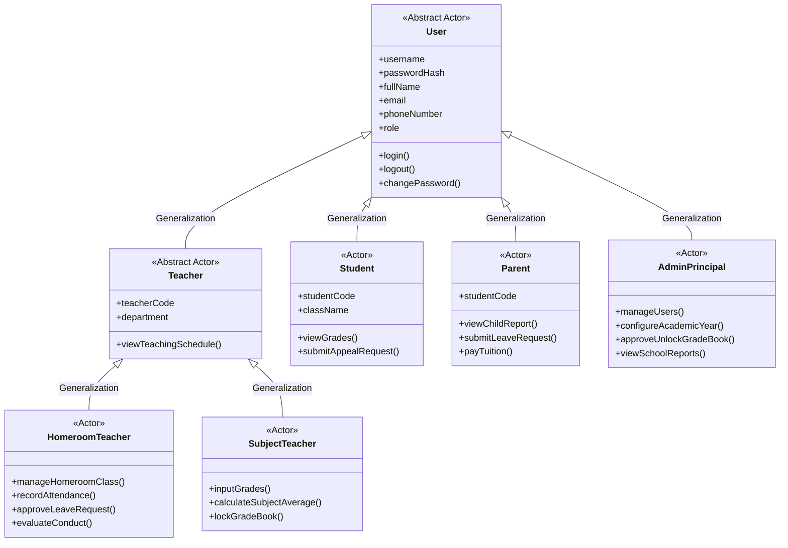

# TÀI LIỆU ĐẶC TẢ USE CASE HỆ THỐNG (USE CASE SPECIFICATION DOCUMENT)
## DỰ ÁN: HỆ THỐNG QUẢN LÝ LỚP HỌC & HỌC VỤ THPT (HTQLLH / SCHOOL MANAGEMENT SYSTEM)

```
================================================================================
TRƯỜNG ĐẠI HỌC HOA SEN (HSU) — KHOA CÔNG NGHỆ THÔNG TIN
BỘ MÔN: KỸ NGHỆ PHẦN MỀM & HỆ THỐNG THÔNG TIN
MÔN HỌC: PHÁT TRIỂN DỰ ÁN PHẦN MỀM (MÃ LỚP: SW320DV01 — HỌC KỲ 2631)
TIÊU CHUẨN ÁP DỤNG: IEEE Std 830-1998 / ISO/IEC/IEEE 29148 & RUP COCKBURN TEMPLATE
TÀI LIỆU: USE CASE SPECIFICATION (ĐẶC TẢ CÁC TRƯỜNG HỢP SỬ DỤNG)
PHIÊN BẢN: 2.1 (CẬP NHẬT CHUẨN HÓA KỸ THUẬT PHÂN TÍCH THIẾT KẾ HƯỚNG ĐỐI TƯỢNG)
NGÀY PHÁT HÀNH: 12/11/2026
================================================================================
```

---

## BẢNG KIỂM SOÁT THAY ĐỔI TÀI LIỆU (DOCUMENT REVISION HISTORY)

| Phiên Bản | Ngày Cập Nhật | Tác Giả / Người Thực Hiện | Vai Trò | Tóm Tắt Nội Dung Thay Đổi | Trạng Thái Phê Duyệt |
| :---: | :---: | :--- | :--- | :--- | :---: |
| **1.0** | 20/09/2026 | Võ Duy Bình | PM & Lead BA | Khởi tạo tài liệu đặc tả Use Case sơ bộ theo phân rã 5 nhóm tác nhân từ tài liệu SRS. | Đã duyệt nội bộ |
| **1.5** | 10/10/2026 | Huỳnh Trung Tính, Trần Quang Vinh | Backend Dev, Logic Security | Bổ sung ràng buộc giao dịch ACID cho sổ điểm, ma trận phân quyền 5 Roles và cơ chế khóa sổ. | Đã duyệt nội bộ |
| **2.0** | 27/10/2026 | Võ Duy Bình, Nguyễn Minh Quốc Bảo | PM & BA, QA Lead | Bổ sung quy tắc nghiệp vụ Thông tư 22/2021/TT-BGDĐT, ma trận truy xuất RTM gắn với Test Suite. | Đã duyệt nội bộ |
| **2.1** | 12/11/2026 | Toàn thể Nhóm 2 | Kỹ sư Dự án | Tái cấu trúc chuẩn RUP/Cockburn Fully-Dressed, bổ sung quan hệ `<<include>>`, `<<extend>>`, kế thừa Actor và đối chiếu quy chuẩn kỹ thuật đồ án đại học. | **CHÍNH THỨC BAN HÀNH** |

---

## THÔNG TIN DỰ ÁN & NHÂN SỰ ĐỒ ÁN

- **Tên đề tài**: Hệ thống Quản lý Lớp học & Học vụ THPT Trực tuyến (HTQLLH / School Management System)
- **Đơn vị đào tạo**: Đại học Hoa Sen (Hoa Sen University - HSU)
- **Giảng viên hướng dẫn môn học**: Giảng viên Bộ môn Phát triển Dự án Phần mềm
- **Danh sách sinh viên thực hiện (Nhóm 2)**:
  1. **Võ Duy Bình** (MSSV: 22200000) — *Trưởng nhóm, Quản trị Dự án (Project Manager) & Phân tích Nghiệp vụ (Lead BA)*
  2. **Huỳnh Trung Tính** (MSSV: 22200000) — *Kỹ sư Hạ tầng Dữ liệu (DBA) & Lập trình viên Backend (Backend Engineer)*
  3. **Võ Hoàng Sơn** (MSSV: 22200000) — *Lập trình viên Giao diện (Frontend Engineer & UI/UX Designer)*
  4. **Trần Quang Vinh** (MSSV: 22200000) — *Kỹ sư Logic Nghiệp vụ, Xác thực & An ninh Hệ thống (Security Engineer)*
  5. **Nguyễn Minh Quốc Bảo** (MSSV: 22200000) — *Kỹ sư Đảm bảo Chất lượng & Trưởng nhóm Kiểm thử (QA/QC Lead)*

---

## MỤC LỤC TÀI LIỆU

1. [CHƯƠNG I: TỔNG QUAN TÀI LIỆU VÀ QUY ƯỚC KỸ THUẬT](#chương-i-tổng-quan-tài-liệu-và-quy-ước-kỹ-thuật)
   - 1.1. Mục đích tài liệu (Purpose)
   - 1.2. Phạm vi hệ thống (System Scope)
   - 1.3. Đối tượng sử dụng tài liệu (Target Audience)
   - 1.4. Quy ước định danh và viết mã Use Case (Identification Rules)
   - 1.5. Bảng chú giải thuật ngữ và từ viết tắt (Glossary & Acronyms)
2. [CHƯƠNG II: MÔ HÌNH HÓA TÁC NHÂN (ACTOR MODELING)](#chương-ii-mô-hình-hóa-tác-nhân-actor-modeling)
   - 2.1. Phân loại tác nhân chính và tác nhân hỗ trợ (Primary vs Secondary Actors)
   - 2.2. Biểu đồ kế thừa tác nhân (Actor Hierarchy & Generalization)
   - 2.3. Ma trận trách nhiệm và phân quyền người dùng (Role-Based Access Matrix)
3. [CHƯƠNG III: BIỂU ĐỒ USE CASE TOÀN HỆ THỐNG VÀ PHÂN HỆ (UML USE CASE DIAGRAMS)](#chương-iii-biểu-đồ-use-case-toàn-hệ-thống-và-phân-hệ-uml-use-case-diagrams)
   - 3.1. Sơ đồ Use Case tổng thể toàn hệ thống (System Boundary)
   - 3.2. Sơ đồ Phân hệ Quản trị & Ban Giám Hiệu (Administration Subsystem)
   - 3.3. Sơ đồ Phân hệ Giáo Viên Chủ Nhiệm (Homeroom Teacher Subsystem)
   - 3.4. Sơ đồ Phân hệ Giáo Viên Bộ Môn & Sổ Điểm (Subject Teacher Subsystem)
   - 3.5. Sơ đồ Phân hệ Phụ Huynh & Học Sinh (Parent & Student Subsystem)
4. [CHƯƠNG IV: DANH MỤC TỔNG QUAN 43 USE CASES HỆ THỐNG](#chương-iv-danh-mục-tổng-quan-43-use-cases-hệ-thống)
5. [CHƯƠNG V: ĐẶC TẢ CHI TIẾT CÁC USE CASE CỐT LÕI (FULLY DRESSED USE CASE SPECIFICATIONS)](#chương-v-đặc-tả-chi-tiết-các-use-case-cốt-lõi-fully-dressed-use-case-specifications)
   - 5.1. Đặc tả nhóm Nghiệp vụ Xác thực & Quản trị Hệ thống
   - 5.2. Đặc tả nhóm Nghiệp vụ Đánh giá Học vụ & Sổ điểm Điện tử (TT22)
   - 5.3. Đặc tả nhóm Nghiệp vụ Quản lý Chuyên cần & Nghỉ học
   - 5.4. Đặc tả nhóm Nghiệp vụ Cổng Phụ huynh, Học phí VietQR & Báo cáo
6. [CHƯƠNG VI: QUY TẮC NGHIỆP VỤ RÀNG BUỘC (BUSINESS RULES CATALOG)](#chương-vi-quy-tắc-nghiệp-vụ-ràng-buộc-business-rules-catalog)
7. [CHƯƠNG VII: MA TRẬN TRUY XUẤT NGUỒN GỐC YÊU CẦU (RTM)](#chương-vii-ma-trận-truy-xuất-nguồn-gốc-yêu-cầu-rtm)

---

## CHƯƠNG I: TỔNG QUAN TÀI LIỆU VÀ QUY ƯỚC KỸ THUẬT

### 1.1. Mục Đích Tài Liệu (Purpose)
Tài liệu Đặc tả Use Case này được biên soạn nhằm:
1. Xác định chính xác ranh giới chức năng (Functional Boundaries) và hành vi phản hồi của Hệ thống Quản lý Lớp học & Học vụ THPT (HTQLLH) đối với các yêu cầu từ phía người dùng thực tế.
2. Cung cấp bản hợp đồng kỹ thuật chuẩn mực giữa nhóm Phân tích Nghiệp vụ (BA), nhóm Lập trình viên (Developers) và nhóm Kiểm thử Chất lượng (QA/QC) trong toàn bộ chu kỳ phát triển phần mềm theo mô hình Agile/Scrum.
3. Làm căn cứ khoa học phục vụ công tác thiết kế biểu đồ tương tác tuần tự (Sequence Diagrams), biểu đồ lớp kiến trúc (Class Diagram) và xây dựng bộ kịch bản kiểm thử chấp nhận người dùng (UAT Test Plans).

### 1.2. Phạm Vi Hệ Thống (System Scope)
Hệ thống HTQLLH tập trung số hóa và tối ưu hóa các quy trình học vụ trung tâm tại các trường Trung học Phổ thông công lập và tư thục tại Việt Nam, bao gồm:
- **Phân hệ Quản trị & Danh mục đào tạo**: Thiết lập khối lớp, phân lớp, phân công chuyên môn giảng dạy, cấp phát tài khoản định danh.
- **Phân hệ Sổ điểm & Học vụ điện tử**: Tính toán điểm trung bình môn (TBM), điểm đánh giá định kỳ, xét học lực và danh hiệu khen thưởng hoàn toàn tuân thủ theo **Thông tư 22/2021/TT-BGDĐT** của Bộ Giáo dục và Đào tạo.
- **Phân hệ Quản lý Chuyên cần & Điểm danh**: Theo dõi chuyên cần theo tiết học và ngày học, quy trình gửi và phê duyệt đơn xin nghỉ học trực tuyến, cảnh báo nguy cơ cấm thi khi vắng quá 20% số tiết.
- **Phân hệ Cổng Phụ huynh & Sổ liên lạc điện tử**: Tra cứu kết quả rèn luyện thời gian thực, đối soát học phí, tạo mã thanh toán VietQR động và xuất biên lai điện tử PDF.
- **Phân hệ Nhật ký Kiểm toán (Audit Trail)**: Giám sát mọi giao dịch nhạy cảm (sửa điểm, mở khóa sổ điểm, hủy biên lai), chống chối bỏ trách nhiệm.

### 1.3. Đối Tượng Sử Dụng Tài Liệu (Target Audience)
- **Giảng viên hướng dẫn & Hội đồng chấm đề tài**: Đánh giá tính hoàn thiện kỹ thuật, phương pháp luận phân tích thiết kế hướng đối tượng (OOAD) và mức độ chuẩn mực của sinh viên.
- **Trưởng nhóm & Kỹ sư Phân tích Nghiệp vụ (PM/BA)**: Theo dõi phạm vi yêu cầu (Scope Baseline) và nghiệm thu các tính năng trong từng Sprint.
- **Kỹ sư Lập trình (Frontend & Backend Devs)**: Căn cứ thiết kế API Endpoints, cấu trúc giao dịch CSDL và thiết kế giao diện tương tác UI.
- **Kỹ sư Kiểm thử (QA Testers)**: Căn cứ thiết kế Test Cases, kiểm thử các luồng biên (Alternative Flows) và luồng ngoại lệ (Exception Flows).

### 1.4. Quy Ước Định Danh & Viết Mã Use Case (Identification Rules)
Mỗi Use Case trong hệ thống được định danh duy nhất theo cú pháp:
$$\mathbf{UC\_[PHÂN\_HỆ]\_[STT]}$$
Trong đó:
- `AUTH`: Nhóm nghiệp vụ Xác thực, Phiên làm việc và An ninh bảo mật.
- `ADM`: Nhóm nghiệp vụ Quản trị Hệ thống và Ban Giám Hiệu.
- `GVCN`: Nhóm nghiệp vụ Giáo viên Chủ nhiệm (Chuyên cần, Hạnh kiểm, Sổ liên lạc).
- `GVBM`: Nhóm nghiệp vụ Giáo viên Bộ môn (Nhập điểm TT22, Khóa sổ, Lịch báo giảng).
- `PAR`: Nhóm nghiệp vụ Phụ huynh học sinh (Sổ liên lạc, Đơn nghỉ phép, Học phí).
- `STU`: Nhóm nghiệp vụ Học sinh (Thời khóa biểu, Bảng điểm cá nhân, Đơn phúc khảo).

### 1.5. Bảng Chú Giải Thuật Ngữ & Từ Viết Tắt (Glossary & Acronyms)

| Thuật Ngữ / Viết Tắt | Tên Tiếng Anh / Tên Đầy Đủ | Định Nghĩa Nghiệp Vụ Trong Hệ Thống |
| :--- | :--- | :--- |
| **BGH** | Board of Principals | Ban Giám Hiệu nhà trường — cấp quản lý cao nhất, duyệt mở khóa sổ điểm. |
| **GVCN** | Homeroom Teacher | Giáo viên Chủ nhiệm — chịu trách nhiệm quản lý lớp, điểm danh và hạnh kiểm. |
| **GVBM** | Subject Teacher | Giáo viên Bộ môn — giảng dạy môn học cụ thể, nhập điểm thành phần và chốt sổ. |
| **PHHS** | Parents | Phụ huynh học sinh — người giám hộ hợp pháp của học sinh. |
| **HS** | Student | Học sinh đang theo học tại trường THPT. |
| **TT22** | Circular 22/2021/TT-BGDĐT | Quy định về đánh giá học sinh trung học cơ sở và trung học phổ thông. |
| **TBM** | Subject Average Score | Điểm trung bình môn học kỳ hoặc cả năm tính theo trọng số quy chuẩn. |
| **ĐĐGtx / ĐĐGgk / ĐĐGck** | Assessment Scores | Điểm đánh giá thường xuyên (miệng, 15p, 1 tiết), giữa kỳ (gk) và cuối kỳ (ck). |
| **RBAC** | Role-Based Access Control | Cơ chế kiểm soát truy cập và phân quyền dựa trên 5 vai trò người dùng. |
| **Audit Trail** | Audit Trail / Log | Chuỗi nhật ký kiểm toán bất biến ghi lại hành động người dùng kèm thời gian và IP. |
| **Unit of Work** | Unit of Work Pattern | Mẫu thiết kế quản lý giao dịch nguyên tử ACID (Commit hoặc Rollback toàn bộ). |
| **VietQR** | Vietnam National QR Code | Chuẩn mã phản hồi nhanh chuyển khoản ngân hàng liên ngân hàng tự động. |

---

## CHƯƠNG II: MÔ HÌNH HÓA TÁC NHÂN (ACTOR MODELING)

### 2.1. Phân Loại Tác Nhân Chính & Tác Nhân Hỗ Trợ

#### A. Tác Nhân Con Người (Human Actors):
1. **Ban Giám Hiệu / Quản trị viên (`ROLE_ADMIN`)**: Tác nhân quản trị toàn quyền hệ thống, phê duyệt các yêu cầu học vụ đặc biệt và giám sát báo cáo toàn trường.
2. **Giáo viên Chủ nhiệm (`ROLE_HOMEROOM_TEACHER`)**: Tác nhân quản lý đơn vị lớp học, phụ trách chuyên cần, đơn nghỉ phép, sổ liên lạc và đánh giá rèn luyện.
3. **Giáo viên Bộ môn (`ROLE_SUBJECT_TEACHER`)**: Tác nhân chuyên môn giảng dạy, thực hiện nhập điểm số, tính điểm trung bình và thực thi quy trình khóa sổ điểm.
4. **Học sinh (`ROLE_STUDENT`)**: Tác nhân tra cứu thông tin học vụ, thời khóa biểu, lịch thi và nộp đơn phúc khảo bài kiểm tra.
5. **Phụ huynh học sinh (`ROLE_PARENT`)**: Tác nhân phối hợp giáo dục, theo dõi học bạ điện tử, gửi đơn xin phép và thực hiện nghĩa vụ tài chính học phí.

#### B. Tác Nhân Hệ Thống Phụ Trợ (Secondary / Supporting Actors):
1. **Cơ sở dữ liệu Quan hệ PostgreSQL (RDBMS)**: Lưu trữ bền vững dữ liệu 3NF, bảo đảm toàn vẹn khóa ngoại và hỗ trợ giao dịch ACID.
2. **Cổng Dịch vụ Chuyển khoản VietQR / Napas 247**: Hệ sinh thái thanh toán số cung cấp mã QR động phục vụ việc thanh toán học phí tức thời.
3. **Bộ Sinh Báo Cáo Định Dạng (Export Engine)**: Thư viện `SheetJS` và `jsPDF` tạo lập tệp Excel bảng điểm và file PDF học bạ/biên lai chuẩn A4.

### 2.2. Biểu Đồ Kế Thừa Tác Nhân (Actor Hierarchy & Generalization)
Trong mô hình phân tích hướng đối tượng, các tác nhân người dùng chia sẻ những đặc tính chung (như định danh, thông tin tài khoản, quyền đăng nhập, đổi mật khẩu) thông qua mối quan hệ **Kế thừa (Generalization)** từ tác nhân trừu tượng `User`:



### 2.3. Ma Trận Trách Nhiệm & Phân Quyền Người Dùng (Role-Based Access Matrix)

| Nhóm Nghiệp Vụ Lớn | Ban Giám Hiệu (`ADMIN`) | GV Chủ Nhiệm (`GVCN`) | GV Bộ Môn (`GVBM`) | Học Sinh (`STUDENT`) | Phụ Huynh (`PARENT`) |
| :--- | :---: | :---: | :---: | :---: | :---: |
| **Xác thực & Quản lý Tài khoản cá nhân** | Toàn quyền (CRUD) | Chỉ tài khoản mình | Chỉ tài khoản mình | Chỉ tài khoản mình | Chỉ tài khoản mình |
| **Cấu hình Danh mục Khối, Lớp, Môn học** | Toàn quyền (CRUD) | Không có quyền | Không có quyền | Không có quyền | Không có quyền |
| **Phân công Chuyên môn & TKB Tuần** | Toàn quyền (CRUD) | Xem TKB lớp mình | Xem TKB dạy mình | Xem TKB học mình | Xem TKB con mình |
| **Nhập Điểm Thành Phần (Thông tư 22)** | Xem toàn trường | Xem lớp CN | Nhập lớp phân công | Không có quyền | Không có quyền |
| **Khóa Sổ Điểm / Mở Lại Sổ Điểm** | Duyệt mở lại sổ | Xem trạng thái | Chốt khóa sổ điểm | Không có quyền | Không có quyền |
| **Điểm Danh Tiết Học / Ngày Học** | Giám sát toàn trường | Điểm danh lớp CN | Điểm danh tiết dạy | Tra cứu cá nhân | Tra cứu con mình |
| **Tiếp nhận & Phê duyệt Đơn nghỉ học** | Xem thống kê | Duyệt đơn lớp CN | Không có quyền | Không có quyền | Tạo đơn gửi lên |
| **Đánh giá Hạnh kiểm & Sổ Liên Lạc** | Duyệt tổng thể | Đánh giá lớp CN | Góp ý nhận xét | Xem kết quả | Xem kết quả |
| **Học Phí, VietQR & Xuất Biên Lai PDF** | Quản trị danh mục | Theo dõi lớp CN | Không có quyền | Tra cứu công nợ | Thanh toán & Tải PDF |
| **Nhật Ký Kiểm Toán (Audit Trail)** | Xem toàn trường | Không có quyền | Không có quyền | Không có quyền | Không có quyền |

---

## CHƯƠNG III: BIỂU ĐỒ USE CASE TOÀN HỆ THỐNG VÀ PHÂN HỆ

### 3.1. Sơ Đồ Use Case Tổng Thể Hệ Thống (System Boundary Diagram)

```mermaid
graph TB
    subgraph SystemBoundary ["Hệ Thống Quản Lý Lớp Học & Học Vụ THPT (HTQLLH)"]
        %% Core Shared Use Cases
        UC_LOGIN(["UC_AUTH_01: Đăng nhập & Xác thực JWT"])
        UC_PASS(["UC_AUTH_02: Đổi mật khẩu cá nhân"])

        %% Subsystem Admin
        UC_USER_MGT(["UC_ADM_02: Quản lý người dùng & phân quyền"])
        UC_UNLOCK_GRADE(["UC_ADM_04: Phê duyệt mở khóa sổ điểm"])
        UC_AUDIT(["UC_ADM_08: Giám sát nhật ký kiểm toán Audit Trail"])

        %% Subsystem Subject Teacher
        UC_INPUT_GRADE(["UC_GVBM_06: Nhập điểm thành phần TT22"])
        UC_CALC_GRADE(["UC_GVBM_07: Tính điểm TBM tự động"])
        UC_LOCK_GRADE(["UC_GVBM_08: Chốt khóa sổ điểm bộ môn"])
        UC_REQ_UNLOCK(["UC_GVBM_09: Gửi yêu cầu mở khóa sổ điểm"])

        %% Subsystem Homeroom Teacher
        UC_ATTEND_DAILY(["UC_GVCN_05: Điểm danh chuyên cần lớp học"])
        UC_APPROVE_LEAVE(["UC_GVCN_06: Phê duyệt đơn xin nghỉ học"])
        UC_CONDUCT(["UC_GVCN_07: Đánh giá xếp loại hạnh kiểm"])

        %% Subsystem Parent & Student
        UC_VIEW_REPORT(["UC_STU_05: Tra cứu bảng điểm chi tiết"])
        UC_APPEAL(["UC_STU_07: Nộp đơn phúc khảo điểm số"])
        UC_SUBMIT_LEAVE(["UC_PAR_06: Nộp đơn xin nghỉ học trực tuyến"])
        UC_PAY_TUITION(["UC_PAR_08: Thanh toán học phí qua VietQR"])
        UC_EXPORT_RECEIPT(["UC_PAR_09: Xuất biên lai điện tử PDF"])
    end

    %% Actors
    Admin["Ban Giám Hiệu (BGH)"]
    GVCN["Giáo Viên Chủ Nhiệm"]
    GVBM["Giáo Viên Bộ Môn"]
    Student["Học Sinh"]
    Parent["Phụ Huynh"]

    %% Actor Connections
    Admin --> UC_USER_MGT
    Admin --> UC_UNLOCK_GRADE
    Admin --> UC_AUDIT

    GVBM --> UC_INPUT_GRADE
    GVBM --> UC_LOCK_GRADE

    GVCN --> UC_ATTEND_DAILY
    GVCN --> UC_APPROVE_LEAVE
    GVCN --> UC_CONDUCT

    Student --> UC_VIEW_REPORT
    Student --> UC_APPEAL

    Parent --> UC_SUBMIT_LEAVE
    Parent --> UC_PAY_TUITION

    %% Include Relationships
    UC_INPUT_GRADE -. "<<include>>" .-> UC_LOGIN
    UC_INPUT_GRADE -. "<<include>>" .-> UC_CALC_GRADE
    UC_ATTEND_DAILY -. "<<include>>" .-> UC_LOGIN
    UC_USER_MGT -. "<<include>>" .-> UC_LOGIN
    UC_PAY_TUITION -. "<<include>>" .-> UC_EXPORT_RECEIPT
    UC_APPROVE_LEAVE -. "<<include>>" .-> UC_ATTEND_DAILY

    %% Extend Relationships
    UC_APPEAL -. "<<extend>>" .-> UC_VIEW_REPORT
    UC_REQ_UNLOCK -. "<<extend>>" .-> UC_LOCK_GRADE
    UC_UNLOCK_GRADE -. "<<extend>>" .-> UC_REQ_UNLOCK
```

Biểu đồ thể hiện mối quan hệ bản chất trong UML 2.5 giữa các tác nhân và chức năng cốt lõi, bao gồm quan hệ phụ thuộc bắt buộc `<<include>>` và quan hệ mở rộng có điều kiện `<<extend>>`:



---

## CHƯƠNG IV: DANH MỤC TỔNG QUAN 43 USE CASES HỆ THỐNG

| STT | Mã Use Case | Tên Trường Hợp Sử Dụng (Use Case Name) | Phân Hệ | Tác Nhân Chính | Mức Độ Ưu Tiên (MoSCoW) |
| :---: | :--- | :--- | :---: | :---: | :---: |
| 1 | `UC_AUTH_01` | Đăng nhập hệ thống và cấp phát JWT Token | Bảo mật | Tất cả 5 Roles | **Must have (Bắt buộc)** |
| 2 | `UC_AUTH_02` | Đổi mật khẩu cá nhân | Bảo mật | Tất cả 5 Roles | **Must have (Bắt buộc)** |
| 3 | `UC_AUTH_03` | Khôi phục mật khẩu thông qua Email / Số điện thoại | Bảo mật | Tất cả 5 Roles | Should have |
| 4 | `UC_ADM_01` | Quản lý danh mục Năm học, Học kỳ, Khối lớp | Quản trị | Ban Giám Hiệu | **Must have (Bắt buộc)** |
| 5 | `UC_ADM_02` | Quản lý Tài khoản người dùng và Phân bổ Vai trò (RBAC) | Quản trị | Ban Giám Hiệu | **Must have (Bắt buộc)** |
| 6 | `UC_ADM_03` | Quản lý Hồ sơ Danh sách Lớp học và Phân công Học sinh | Quản trị | Ban Giám Hiệu | **Must have (Bắt buộc)** |
| 7 | `UC_ADM_04` | Phân công Giảng dạy Chuyên môn và Xếp Thời khóa biểu | Quản trị | Ban Giám Hiệu | **Must have (Bắt buộc)** |
| 8 | `UC_ADM_05` | Phê duyệt yêu cầu mở lại sổ điểm đã khóa | Học vụ | Ban Giám Hiệu | **Must have (Bắt buộc)** |
| 9 | `UC_ADM_06` | Giám sát chuyên cần thời gian thực và Cảnh báo bỏ học | Điểm danh | Ban Giám Hiệu | Should have |
| 10 | `UC_ADM_07` | Báo cáo Phổ điểm thi và Xét duyệt Thi đua Khen thưởng | Báo cáo | Ban Giám Hiệu | Should have |
| 11 | `UC_ADM_08` | Tra cứu Nhật ký Kiểm toán Hệ thống (Audit Trail) | An ninh | Ban Giám Hiệu | **Must have (Bắt buộc)** |
| 12 | `UC_ADM_09` | Cấu hình Danh mục Học phí và Mức thu theo Khối | Tài chính | Ban Giám Hiệu | **Must have (Bắt buộc)** |
| 13 | `UC_GVBM_01` | Xem Thời khóa biểu và Lịch báo giảng cá nhân | Học vụ | GV Bộ Môn | **Must have (Bắt buộc)** |
| 14 | `UC_GVBM_02` | Xem Danh sách Học sinh theo Lớp phụ trách | Học vụ | GV Bộ Môn | **Must have (Bắt buộc)** |
| 15 | `UC_GVBM_03` | Điểm danh chuyên cần theo tiết học phân công | Điểm danh | GV Bộ Môn | Should have |
| 16 | `UC_GVBM_04` | Nhập và lưu nháp Điểm kiểm tra thường xuyên (ĐĐGtx) | Học vụ | GV Bộ Môn | **Must have (Bắt buộc)** |
| 17 | `UC_GVBM_05` | Nhập Điểm kiểm tra Giữa kỳ (ĐĐGgk) và Cuối kỳ (ĐĐGck) | Học vụ | GV Bộ Môn | **Must have (Bắt buộc)** |
| 18 | `UC_GVBM_06` | Tự động tính Điểm trung bình môn (TBM) theo Thông tư 22 | Học vụ | GV Bộ Môn | **Must have (Bắt buộc)** |
| 19 | `UC_GVBM_07` | Kiểm tra tính hợp lệ và Quy tắc khóa dữ liệu điểm | Học vụ | GV Bộ Môn | **Must have (Bắt buộc)** |
| 20 | `UC_GVBM_08` | Chốt khóa sổ điểm điện tử bộ môn | Học vụ | GV Bộ Môn | **Must have (Bắt buộc)** |
| 21 | `UC_GVBM_09` | Gửi đơn kiến nghị mở khóa sổ điểm lên Ban Giám Hiệu | Học vụ | GV Bộ Môn | Should have |
| 22 | `UC_GVBM_10` | Tiếp nhận và Chấm phúc khảo bài kiểm tra | Học vụ | GV Bộ Môn | Should have |
| 23 | `UC_GVBM_11` | Xuất Bảng điểm bộ môn lớp phụ trách ra file Excel (.xlsx) | Báo cáo | GV Bộ Môn | **Must have (Bắt buộc)** |
| 24 | `UC_GVCN_01` | Xem Hồ sơ Lý lịch và Danh sách Lớp chủ nhiệm | Quản lý | GV Chủ Nhiệm | **Must have (Bắt buộc)** |
| 25 | `UC_GVCN_02` | Điểm danh chuyên cần tổng hợp đầu giờ mỗi ngày | Điểm danh | GV Chủ Nhiệm | **Must have (Bắt buộc)** |
| 26 | `UC_GVCN_03` | Tiếp nhận và Phê duyệt Đơn xin nghỉ học của Phụ huynh | Điểm danh | GV Chủ Nhiệm | **Must have (Bắt buộc)** |
| 27 | `UC_GVCN_04` | Đánh giá xếp loại Hạnh kiểm và Rèn luyện định kỳ | Học bạ | GV Chủ Nhiệm | **Must have (Bắt buộc)** |
| 28 | `UC_GVCN_05` | Xem Sổ điểm Tổng hợp tất cả các môn của lớp chủ nhiệm | Học vụ | GV Chủ Nhiệm | **Must have (Bắt buộc)** |
| 29 | `UC_GVCN_06` | Quản lý và Phát hành Sổ liên lạc điện tử tới Phụ huynh | Tương tác | GV Chủ Nhiệm | **Must have (Bắt buộc)** |
| 30 | `UC_GVCN_07` | Gửi Cảnh báo học vụ và chuyên cần đột xuất qua SMS/App | Tương tác | GV Chủ Nhiệm | Should have |
| 31 | `UC_GVCN_08` | Xuất Phiếu báo điểm và Học bạ lớp chủ nhiệm ra file PDF | Báo cáo | GV Chủ Nhiệm | **Must have (Bắt buộc)** |
| 32 | `UC_GVCN_09` | Lập Báo cáo Sơ kết học kỳ lớp chủ nhiệm ra file Excel | Báo cáo | GV Chủ Nhiệm | Should have |
| 33 | `UC_PAR_01` | Đăng nhập Sổ liên lạc điện tử bằng Mã định danh học sinh | Cổng PH | Phụ Huynh | **Must have (Bắt buộc)** |
| 34 | `UC_PAR_02` | Tra cứu Điểm số thành phần và Điểm TBM thời gian thực | Cổng PH | Phụ Huynh | **Must have (Bắt buộc)** |
| 35 | `UC_PAR_03` | Tra cứu Nhật ký Điểm danh chuyên cần hàng ngày của con | Cổng PH | Phụ Huynh | **Must have (Bắt buộc)** |
| 36 | `UC_PAR_04` | Lập và Gửi Đơn xin nghỉ học trực tuyến kèm lý do | Cổng PH | Phụ Huynh | **Must have (Bắt buộc)** |
| 37 | `UC_PAR_05` | Tra cứu Thông báo Học phí và Các khoản thu học kỳ | Tài chính | Phụ Huynh | **Must have (Bắt buộc)** |
| 38 | `UC_PAR_06` | Thanh toán học phí trực tuyến qua mã VietQR động | Tài chính | Phụ Huynh | **Must have (Bắt buộc)** |
| 39 | `UC_PAR_07` | Xem và Tải Biên lai thu tiền học phí điện tử định dạng PDF | Tài chính | Phụ Huynh | **Must have (Bắt buộc)** |
| 40 | `UC_STU_01` | Tra cứu Thời khóa biểu tuần và Lịch thi học kỳ | Học sinh | Học Sinh | **Must have (Bắt buộc)** |
| 41 | `UC_STU_02` | Tra cứu Bảng điểm cá nhân và Điểm GPA quy đổi (Hệ 10 & 4) | Học sinh | Học Sinh | **Must have (Bắt buộc)** |
| 42 | `UC_STU_03` | Xem Lịch sử Chuyên cần và Cảnh báo ngưỡng cấm thi | Học sinh | Học Sinh | Should have |
| 43 | `UC_STU_04` | Nộp Đơn xin phúc khảo điểm kiểm tra định kỳ | Học sinh | Học Sinh | Could have |

---

## CHƯƠNG V: ĐẶC TẢ CHI TIẾT CÁC USE CASE CỐT LÕI (FULLY DRESSED SPECIFICATIONS)

Dưới đây là tài liệu đặc tả chi tiết mẫu theo chuẩn **Cockburn & RUP Template** áp dụng cho các Use Case trọng tâm phản ánh đầy đủ nghiệp vụ phức tạp của đề tài:

---

### 5.1. BẢNG ĐẶC TẢ USE CASE: `UC_AUTH_01` — XÁC THỰC ĐĂNG NHẬP VÀ PHÂN QUYỀN ĐA VAI TRÒ

| Trường Thông Tin (Field) | Nội Dung Đặc Tả Kỹ Thuật (Specification Details) |
| :--- | :--- |
| **Mã Use Case** | **`UC_AUTH_01`** |
| **Tên Use Case** | **Đăng nhập Hệ thống & Cấp phát JWT Token Đa Vai Trò** |
| **Mức độ ưu tiên** | **Must have (Tối quan trọng — Cổng vào toàn hệ thống)** |
| **Tác nhân chính (Primary Actor)** | Tất cả người dùng: `Admin`, `GVCN`, `GVBM`, `Parent`, `Student`. |
| **Tác nhân hỗ trợ (Secondary Actor)**| Cơ sở dữ liệu PostgreSQL (`users`, `user_roles`), Thư viện mã hóa `bcryptjs`, Thư viện `jsonwebtoken`. |
| **Mô tả vắn tắt (Brief Description)** | Cho phép người dùng nhập thông tin xác thực (Tên đăng nhập / Mã số và Mật khẩu), hệ thống kiểm tra danh tính, so khớp mã hash bcrypt, xác định vai trò RBAC và cấp phát JSON Web Token (JWT) có hiệu lực 24 giờ để điều hướng tới giao diện chức năng tương ứng. |
| **Tiền điều kiện (Preconditions)** | 1. Người dùng đã được nhà trường tạo tài khoản định danh hợp lệ trên hệ thống.<br>2. Tài khoản đang ở trạng thái hoạt động (`status = 'ACTIVE'`).<br>3. Máy chủ Backend Node.js và CSDL PostgreSQL đang vận hành bình thường. |
| **Hậu điều kiện thành công (Postconditions - Success)** | 1. Hệ thống sinh JWT Token hợp lệ chứa `userId`, `username`, `role`, `fullName`.<br>2. Phía Client (React SPA) lưu trữ Token vào `localStorage` an toàn.<br>3. Người dùng được điều hướng đến trang Dashboard chính xác theo vai trò.<br>4. Một bản ghi kiểm toán đăng nhập được ghi nhận vào bảng `audit_logs`. |
| **Hậu điều kiện thất bại (Postconditions - Failure)** | 1. Không có Token nào được cấp phát.<br>2. Phiên làm việc không được kích hoạt.<br>3. Hệ thống trả về mã lỗi HTTP tương ứng và thông báo rõ ràng cho người dùng. |
| **Sự kiện kích hoạt (Trigger)** | Người dùng truy cập trang chủ và bấm nút "Đăng nhập" tại biểu mẫu xác thực. |
| **Luồng sự kiện chính (Basic Flow / Main Success Scenario)** | 
| **Bước (Step)** | **Hành động của Tác nhân (Actor Action)** | **Phản hồi của Hệ thống (System Response)** |
| 1 | Người dùng truy cập đường dẫn ứng dụng `/login`. | Hiển thị giao diện đăng nhập `LoginPage.jsx` gồm trường nhập Username, Password và tùy chọn Vai trò. |
| 2 | Người dùng điền tên đăng nhập, mật khẩu và chọn vai trò mong muốn (hoặc nhấn nút "1-Click Demo Login" tương ứng). | Hệ thống nhận dữ liệu biểu mẫu và kiểm tra định dạng dữ liệu phía máy khách (Client-side validation). |
| 3 | Người dùng nhấn nút **"Đăng Nhập"**. | Client gửi yêu cầu `POST /api/auth/login` kèm payload `{ username, password, role }` tới máy chủ Express. |
| 4 | | `jwtAuthMiddleware` tiếp nhận, gọi `AuthService.authenticate()`. |
| 5 | | Truy vấn bảng `users` tìm bản ghi khớp với `username` và `status = 'ACTIVE'`. |
| 6 | | Hệ thống thực thi hàm `bcrypt.compare(password, user.password_hash)`. Kết quả so khớp trả về `true`. |
| 7 | | Kiểm tra vai trò của người dùng có khớp với vai trò được chọn hay không. |
| 8 | | Hệ thống sinh chuỗi mã `accessToken` (thuật toán HS256, hạn dùng 24h, ký bằng bí mật `JWT_SECRET`). |
| 9 | | Máy chủ ghi nhật ký kiểm toán `LOGIN_SUCCESS` vào `audit_logs` và trả về mã `HTTP 200 OK` kèm payload `{ token, user }`. |
| 10 | | Trình duyệt lưu `token` vào `localStorage`, cập nhật State `AuthContext` và chuyển hướng (Navigate) người dùng tới Dashboard chuyên biệt của vai trò đó. |
| **Các luồng rẽ nhánh (Alternative Flows)** | **2a. Đăng nhập nhanh bằng 1-Click Demo Login**:<br>1. Tại bước 2, người dùng bấm vào một trong 5 thẻ tài khoản mẫu trên giao diện.<br>2. Hệ thống tự động điền thông tin đăng nhập chuẩn và kích hoạt bước 3.<br>**6a. Tài khoản đăng nhập bằng quyền Admin đa năng**:<br>1. Nếu tài khoản có vai trò `ROLE_ADMIN`, người dùng có quyền chuyển đổi góc nhìn (View As) sang bất kỳ vai trò nào khác để kiểm tra giao diện. |
| **Các luồng ngoại lệ (Exception Flows)** | **E1: Người dùng nhập sai tên đăng nhập hoặc mật khẩu**:<br>- Tại bước 5 hoặc 6, nếu không tìm thấy user hoặc bcrypt trả về `false`, máy chủ trả về `HTTP 401 Unauthorized` kèm thông điệp: *"Tên đăng nhập hoặc mật khẩu không chính xác"*. Giao diện hiển thị cảnh báo đỏ và giữ nguyên trường username.<br>**E2: Tài khoản bị khóa quyền truy cập**:<br>- Tại bước 5, nếu `status = 'LOCKED'` hoặc `'INACTIVE'`, máy chủ trả về `HTTP 403 Forbidden`: *"Tài khoản đã bị tạm khóa bởi Ban Giám Hiệu. Vui lòng liên hệ quản trị viên"*. Không cấp phát Token.<br>**E3: Đăng nhập sai vai trò đã đăng ký**:<br>- Tại bước 7, nếu tài khoản hợp lệ nhưng người dùng chọn sai vai trò (ví dụ tài khoản Học sinh nhưng chọn tab Giáo viên), máy chủ trả về `HTTP 403 Forbidden`: *"Tài khoản không sở hữu vai trò truy cập này"*. |
| **Quy tắc nghiệp vụ áp dụng (Business Rules)** | - **BR_SEC_01**: Mật khẩu người dùng không bao giờ được lưu trữ dưới dạng văn bản thô (Plain Text), bắt buộc băm bằng thuật toán `bcrypt` với muối `Salt Rounds = 10`.<br>- **BR_SEC_02**: JWT Token phải có thời hạn tối đa 24 giờ và bắt buộc đính kèm vào Header `Authorization: Bearer <token>` trong mọi yêu cầu API tiếp theo. |
| **Giao diện liên quan (UI Reference)** | `members/member2_Frontend/src/pages/auth/LoginPage.jsx` |
| **Yêu cầu phi chức năng (Special Requirements)** | Tốc độ phản hồi API xác thực < 500ms; phòng chống tấn công dò mật khẩu vét cạn (Brute Force) thông qua bộ giới hạn tần suất `express-rate-limit` (tối đa 5 lần thử sai trong 1 phút). |

---

### 5.2. BẢNG ĐẶC TẢ USE CASE: `UC_GVBM_06` & `UC_GVBM_08` — NHẬP ĐIỂM THÔNG TƯ 22 VÀ CHỐT KHÓA SỔ ĐIỂM

| Trường Thông Tin (Field) | Nội Dung Đặc Tả Kỹ Thuật (Specification Details) |
| :--- | :--- |
| **Mã Use Case** | **`UC_GVBM_06` / `UC_GVBM_08`** |
| **Tên Use Case** | **Nhập Điểm Thành Phần, Tự Động Tính TBM (Thông Tư 22) & Khóa Sổ Điểm** |
| **Mức độ ưu tiên** | **Must have (Nghiệp vụ học vụ cốt lõi)** |
| **Tác nhân chính (Primary Actor)** | Giáo viên Bộ môn (`ROLE_SUBJECT_TEACHER`). |
| **Tác nhân hỗ trợ (Secondary Actor)**| Ban Giám Hiệu (`ROLE_ADMIN`), Bộ quản lý giao dịch nguyên tử `UnitOfWork`, Dịch vụ kiểm toán `AuditLogger`. |
| **Mô tả vắn tắt (Brief Description)** | Cho phép Giáo viên Bộ môn mở sổ điểm lớp được phân công, nhập danh sách các đầu điểm đánh giá thường xuyên (miệng, 15p, 1 tiết), giữa kỳ và cuối kỳ. Hệ thống tự động tính toán Điểm trung bình môn (TBM) theo trọng số Thông tư 22/2021/TT-BGDĐT. Khi hoàn tất, giáo viên kích hoạt quy trình chốt khóa sổ điểm để ngăn chặn mọi hành vi thay đổi trái phép. |
| **Tiền điều kiện (Preconditions)** | 1. Giáo viên đã đăng nhập thành công và sở hữu vai trò `ROLE_SUBJECT_TEACHER`.<br>2. Giáo viên được phân công giảng dạy môn học tại lớp được chọn trong học kỳ hiện tại.<br>3. Trạng thái sổ điểm của lớp/môn đang ở trạng thái Mở (`status = 'OPEN'`). |
| **Hậu điều kiện thành công (Postconditions - Success)** | 1. Toàn bộ các con điểm thành phần và điểm TBM của cả lớp được ghi nhận đồng bộ vào bảng `grade_books`.<br>2. Giao dịch được thực thi bảo đảm tính nguyên tử (Atomicity) qua `UnitOfWork.commit()`.<br>3. Khi chọn "Khóa sổ điểm", trạng thái chuyển sang `LOCKED`, vô hiệu hóa toàn bộ ô nhập trên giao diện.<br>4. Dịch vụ `AuditLogger` ghi lại chi tiết các giá trị điểm trước và sau khi sửa đổi. |
| **Hậu điều kiện thất bại (Postconditions - Failure)** | 1. Nếu có bất kỳ con điểm nào vi phạm ràng buộc (nhỏ hơn 0 hoặc lớn hơn 10), toàn bộ giao dịch bị hủy bỏ (`ROLLBACK`).<br>2. Dữ liệu trong CSDL giữ nguyên trạng thái cũ, không bị ghi đè cục bộ. |
| **Luồng sự kiện chính (Basic Flow)** |
| **Bước (Step)** | **Hành động của Tác nhân (Actor Action)** | **Phản hồi của Hệ thống (System Response)** |
| 1 | Giáo viên truy cập menu **"Sổ Điểm Điện Tử"** (`GradebookPage.jsx`). | Hiển thị bộ lọc Lớp học và Môn học thuộc quyền phân công giảng dạy của giáo viên. |
| 2 | Giáo viên chọn Lớp (ví dụ: `10A1`), Môn học (ví dụ: `Toán`) và Học kỳ (`HK1`). | Gửi yêu cầu `GET /api/gradebook?classId=1&subjectId=1` lấy danh sách học sinh và điểm số đã lưu. |
| 3 | | Hệ thống trả về mảng dữ liệu điểm kèm trạng thái sổ điểm (`status`). Hiển thị bảng dạng bảng tính Excel. |
| 4 | Giáo viên thực hiện nhập/chỉnh sửa các cột điểm: Điểm miệng ($ĐĐG_{tx1}$), Điểm 15 phút ($ĐĐG_{tx2}$), Điểm 1 tiết ($ĐĐG_{tx3}$), Điểm giữa kỳ ($ĐĐG_{gk}$), Điểm cuối kỳ ($ĐĐG_{ck}$). | Trình duyệt kiểm tra tính hợp lệ dữ liệu ngay khi rời ô nhập (Blur event: $0.0 \le \text{Điểm} \le 10.0$). Tự động tính toán lại cột Điểm TBM hiển thị trên màn hình. |
| 5 | Giáo viên nhấn nút **"Lưu Sổ Điểm"**. | Client gửi gói tin `POST /api/gradebook/save` chứa danh sách 40-45 bản ghi điểm học sinh tới Backend. |
| 6 | | Backend kiểm tra trạng thái khóa sổ. Nếu chưa khóa, khởi tạo giao dịch `UnitOfWork.beginTransaction()`. |
| 7 | | Vòng lặp tính toán lại TBM theo công thức chuẩn:$$\text{TBM} = \frac{ĐĐG_{tx1} + ĐĐG_{tx2} + 2 \times ĐĐG_{tx3} + 2 \times ĐĐG_{gk} + 3 \times ĐĐG_{ck}}{9}$$ |
| 8 | | Thực thi các câu lệnh `UPDATE grade_books` tham số hóa `$1, $2` qua `GradeBookRepository`. |
| 9 | | Kích hoạt `UnitOfWork.commit()`. Ghi nhận hành động vào `audit_logs` với action `GRADE_BATCH_UPDATE`. |
| 10 | | Trả về mã `HTTP 200 OK`. Giao diện hiển thị thông báo toast: *"Lưu sổ điểm lớp 10A1 môn Toán thành công!"*. |
| 11 | Khi đã nhập đầy đủ điểm định kỳ cuối kỳ, giáo viên nhấn nút **"Chốt Khóa Sổ Điểm"**. | Hệ thống hiển thị hộp thoại xác nhận cảnh báo: *"Sau khi khóa, bạn sẽ không thể chỉnh sửa điểm nếu không có sự phê duyệt từ Ban Giám Hiệu. Xác nhận khóa?"*. |
| 12 | Giáo viên bấm **"Đồng ý khóa sổ"**. | Gửi yêu cầu `POST /api/gradebook/lock` tới máy chủ. Máy chủ cập nhật `status = 'LOCKED'`, ghi nhận `locked_by` và `locked_at`. |
| 13 | | Giao diện tự động chuyển toàn bộ các ô nhập điểm sang trạng thái chỉ đọc (Read-only / Disabled). |
| **Các luồng rẽ nhánh (Alternative Flows)** | **4a. Điểm danh diện Đánh giá bằng Nhận xét (Đạt / Chưa đạt)**:<br>- Đối với các môn Giáo dục Thể chất, Nghệ thuật, hệ thống chuyển giao diện nhập số sang dạng nút chuyển đổi (Toggle) giữa hai giá trị `ĐẠT` và `CHƯA ĐẠT` theo đúng quy định Thông tư 22.<br>**11a. Gửi yêu cầu mở khóa sổ điểm khi phát hiện sai sót**:<br>1. Nếu sổ điểm đã bị khóa mà giáo viên cần sửa điểm phúc khảo, giáo viên bấm nút **"Xin mở khóa sổ"**.<br>2. Nhập lý do giải trình và bấm gửi. Hệ thống tạo yêu cầu gửi tới tài khoản Ban Giám Hiệu (`UC_GVBM_09`). |
| **Các luồng ngoại lệ (Exception Flows)** | **E1: Nhập điểm ngoài phạm vi thang điểm chuẩn**:<br>- Tại bước 4, nếu giáo viên nhập số âm hoặc số lớn hơn 10 (ví dụ `10.5` hoặc `-1`), ô nhập lập tức viền đỏ, hiển thị thông báo lỗi: *"Điểm số phải nằm trong khoảng từ 0.0 đến 10.0"*. Nút "Lưu Sổ Điểm" bị vô hiệu hóa.<br>**E2: Cố tình ghi đè sổ điểm đã bị khóa**:<br>- Tại bước 6, nếu trạng thái sổ điểm trong CSDL đã chuyển sang `LOCKED`, Backend lập tức từ chối và phản hồi `HTTP 409 Conflict`: *"Sổ điểm môn học này đã bị khóa. Không thể thực hiện cập nhật"*. Rollback giao dịch ngay lập tức.<br>**E3: Lỗi kết nối CSDL giữa chừng (Transaction Failure)**:<br>- Nếu đang cập nhật đến học sinh thứ 20 mà mạng bị ngắt hoặc CSDL gặp lỗi, khối `catch` kích hoạt `UnitOfWork.rollback()`. Toàn bộ dữ liệu điểm của lớp được khôi phục nguyên vẹn trạng thái ban đầu, trả về lỗi `HTTP 500 Internal Server Error`. |
| **Quy tắc nghiệp vụ (Business Rules)** | - **BR_TT22_01**: Trọng số tính điểm trung bình môn học kỳ tuân thủ Điều 9 Thông tư 22/2021/TT-BGDĐT: Đánh giá thường xuyên hệ số 1, Đánh giá giữa kỳ hệ số 2, Đánh giá cuối kỳ hệ số 3. Tổng trọng số chia là 9.<br>- **BR_SEC_03**: Nguyên tắc Khóa Sổ Điểm 2 Cấp: Giáo viên chỉ có quyền Khóa sổ; chỉ duy nhất Ban Giám Hiệu (`ROLE_ADMIN`) mới có thẩm quyền mở khóa sổ điểm. |
| **Giao diện liên quan (UI Reference)** | `members/member2_Frontend/src/pages/gv/GradebookPage.jsx` |
| **Yêu cầu phi chức năng (Special Requirements)** | Đảm bảo tính nhất quán dữ liệu ACID 100%; hỗ trợ phím tắt điều hướng nhanh giữa các ô điểm (Enter để xuống dòng, Tab để sang cột tiếp theo) tương tự phần mềm Microsoft Excel. |

---

### 5.3. BẢNG ĐẶC TẢ USE CASE: `UC_GVCN_05` & `UC_GVCN_06` — ĐIỂM DANH CHUYÊN CẦN VÀ XÉT DUYỆT ĐƠN NGHỈ HỌC

| Trường Thông Tin (Field) | Nội Dung Đặc Tả Kỹ Thuật (Specification Details) |
| :--- | :--- |
| **Mã Use Case** | **`UC_GVCN_05` / `UC_GVCN_06`** |
| **Tên Use Case** | **Điểm Danh Chuyên Cần Lớp Học Hàng Ngày & Phê Duyệt Đơn Nghỉ Học** |
| **Mức độ ưu tiên** | **Must have (Nghiệp vụ quản lý nề nếp hàng ngày)** |
| **Tác nhân chính (Primary Actor)** | Giáo viên Chủ nhiệm (`ROLE_HOMEROOM_TEACHER`). |
| **Tác nhân hỗ trợ (Secondary Actor)**| Phụ huynh học sinh (`ROLE_PARENT`), Cơ sở dữ liệu PostgreSQL (`attendances`, `leave_requests`). |
| **Mô tả vắn tắt (Brief Description)** | Cho phép Giáo viên Chủ nhiệm thực hiện kiểm diện sĩ số lớp học vào đầu mỗi buổi học. Hệ thống tự động đồng bộ các đơn xin nghỉ học đã được phê duyệt thành trạng thái "Vắng có phép", cho phép GVCN đánh dấu nhanh các trường hợp vắng không phép hoặc đi trễ, đồng thời kích hoạt cảnh báo chuyên cần khi số buổi nghỉ vượt ngưỡng quy định. |
| **Tiền điều kiện (Preconditions)** | 1. Giáo viên chủ nhiệm đã đăng nhập hệ thống.<br>2. Lớp học có danh sách học sinh đang hoạt động trong năm học hiện tại. |
| **Hậu điều kiện thành công (Postconditions - Success)** | 1. Bản ghi chuyên cần của từng học sinh trong ngày được lưu trữ vào bảng `attendances`.<br>2. Học sinh có đơn xin nghỉ được duyệt tự động ghi nhận trạng thái `EXCUSED_ABSENCE` (Vắng có phép).<br>3. Số liệu chuyên cần được cập nhật tức thời lên Cổng phụ huynh và Bảng giám sát của Ban Giám Hiệu. |
| **Luồng sự kiện chính (Basic Flow)** |
| **Bước (Step)** | **Hành động của Tác nhân (Actor Action)** | **Phản hồi của Hệ thống (System Response)** |
| 1 | GVCN truy cập phân hệ **"Điểm Danh Lớp"** (`AttendancePage.jsx`). | Hiển thị sĩ số lớp, ngày hiện tại và danh sách học sinh lớp chủ nhiệm. |
| 2 | | Hệ thống tự động kiểm tra bảng `leave_requests`: Nếu học sinh có đơn xin nghỉ ngày hôm nay đã được duyệt (`status = 'APPROVED'`), hệ thống tự động gán trạng thái **"Vắng Có Phép"** ($P$). |
| 3 | | Mặc định tất cả các học sinh còn lại được gán trạng thái **"Có Mặt"** ($CM$). |
| 4 | GVCN kiểm diện thực tế và nhấp chọn trạng thái cho các học sinh bất thường: **"Vắng Không Phép"** ($KP$) hoặc **"Đi Muộn"** ($M$). | Giao diện thay đổi màu sắc trực quan (Xanh: Có mặt, Đỏ: Vắng không phép, Vàng: Vắng có phép, Cam: Đi muộn). |
| 5 | GVCN nhấn nút **"Lưu Dữ Liệu Điểm Danh"**. | Gửi yêu cầu `POST /api/attendance/save` chứa mảng bản ghi chuyên cần lớp. |
| 6 | | Backend ghi dữ liệu vào bảng `attendances`. Tính toán tổng số buổi vắng lũy kế của từng học sinh từ đầu năm học. |
| 7 | | Nếu học sinh có số buổi vắng tích lũy $\ge 10$ buổi, hệ thống phát sinh cờ cảnh báo `WARNING_ATTENDANCE`. |
| 8 | | Phản hồi `HTTP 200 OK`. Hiển thị thông báo hoàn tất điểm danh lớp học. |
| **Các luồng rẽ nhánh (Alternative Flows)** | **2a. GVCN xem và phê duyệt đơn xin nghỉ học trước khi điểm danh**:<br>1. GVCN mở tab "Đơn xin nghỉ học".<br>2. Hệ thống hiển thị các đơn đang ở trạng thái `PENDING` do phụ huynh gửi lên kèm lý do (ốm đau, việc tang gia, việc riêng).<br>3. GVCN bấm **"Phê duyệt"** (hoặc **"Từ chối"** kèm lý do phản hồi).<br>4. Trạng thái đơn chuyển sang `APPROVED`, tự động kích hoạt liên kết với quy trình điểm danh tại bước 2. |
| **Các luồng ngoại lệ (Exception Flows)** | **E1: Điểm danh trùng lặp trong cùng một ngày**:<br>- Nếu GVCN điểm danh lại ngày đã có dữ liệu, hệ thống hiển thị thông báo: *"Dữ liệu điểm danh ngày hôm nay đã tồn tại. Bạn có muốn cập nhật lại không?"*. Nếu đồng ý, thực hiện câu lệnh `ON CONFLICT (student_id, attendance_date) DO UPDATE`.<br>**E2: Học sinh vắng quá 45 buổi trong năm học**:<br>- Tại bước 7, nếu tổng số buổi vắng của học sinh vượt quá 45 buổi (theo Điều 12 Thông tư 22/2021/TT-BGDĐT), hệ thống tự động đánh dấu cờ `INELIGIBLE_FOR_PROMOTION` (Không đủ điều kiện lên lớp) và gửi thông báo khẩn tới Ban Giám Hiệu. |
| **Quy tắc nghiệp vụ (Business Rules)** | - **BR_ATT_01**: Học sinh nghỉ học có đơn của phụ huynh được GVCN duyệt trước 08h00 sáng được tính là "Vắng có phép"; mọi trường hợp không có đơn đều tính là "Vắng không phép".<br>- **BR_ATT_02**: Học sinh nghỉ quá 45 buổi học trong một năm học (kể cả có phép và không phép) sẽ không được xét lên lớp. |
| **Giao diện liên quan (UI Reference)** | `members/member2_Frontend/src/pages/gv/AttendancePage.jsx` |

---

### 5.4. BẢNG ĐẶC TẢ USE CASE: `UC_PAR_06` & `UC_PAR_07` — THANH TOÁN HỌC PHÍ VIETQR VÀ XUẤT BIÊN LAI PDF

| Trường Thông Tin (Field) | Nội Dung Đặc Tả Kỹ Thuật (Specification Details) |
| :--- | :--- |
| **Mã Use Case** | **`UC_PAR_06` / `UC_PAR_07`** |
| **Tên Use Case** | **Thanh Toán Học Phí Trực Tuyến Qua VietQR Động & Tải Biên Lai PDF** |
| **Mức độ ưu tiên** | **Must have (Phân hệ tài chính & tiện ích phụ huynh)** |
| **Tác nhân chính (Primary Actor)** | Phụ huynh học sinh (`ROLE_PARENT`). |
| **Tác nhân hỗ trợ (Secondary Actor)**| Cổng thanh toán VietQR / Ứng dụng Mobile Banking, Động cơ xuất báo cáo `exportEngine.js` (`jsPDF`). |
| **Mô tả vắn tắt (Brief Description)** | Cho phép Phụ huynh tra cứu chi tiết công nợ học phí của con em, tạo mã VietQR động chứa sẵn số tài khoản nhà trường, số tiền chính xác và cú pháp chuyển khoản định danh. Sau khi hoàn tất thanh toán, hệ thống tự động cập nhật trạng thái `PAID` và cấp phát Biên lai điện tử định dạng PDF chuẩn hóa A4 để phụ huynh tải về lưu trữ. |
| **Tiền điều kiện (Preconditions)** | 1. Phụ huynh đã đăng nhập thành công vào Cổng thông tin phụ huynh (`ParentPortalPage.jsx`).<br>2. Ban Giám Hiệu đã phát hành thông báo học phí học kỳ cho lớp học sinh. |
| **Hậu điều kiện thành công (Postconditions - Success)** | 1. Trạng thái hóa đơn trong bảng `tuitions` chuyển từ `UNPAID` sang `PAID`.<br>2. Ghi nhận mã biên lai duy nhất (Receipt Number: `BL-[Năm]-[MãHS]-[MãHĐ]`).<br>3. Tệp PDF `Bien_Lai_Hoc_Phi_[MãHS].pdf` được khởi tạo thành công phục vụ việc tải về hoặc in ấn. |
| **Luồng sự kiện chính (Basic Flow)** |
| **Bước (Step)** | **Hành động của Tác nhân (Actor Action)** | **Phản hồi của Hệ thống (System Response)** |
| 1 | Phụ huynh chọn mục **"Học Phí & Khoản Thu"** trên thanh điều hướng. | Hệ thống truy vấn bảng `tuitions` hiển thị bảng chi tiết: Học phí cơ bản, Bán trú, Bảo hiểm y tế, Tổng số tiền phải nộp và Tình trạng thanh toán. |
| 2 | Phụ huynh kiểm tra thông tin và nhấn nút **"Thanh Toán Trực Tuyến"**. | Hệ thống mở Modal thanh toán, tự động sinh mã VietQR chuẩn Napas 247 mã hóa thông tin: Số tài khoản thụ hưởng của trường, Tên chủ tài khoản, Số tiền chính xác và Nội dung chuyển khoản: `HP [MãHS] [HọcKỳ]`. |
| 3 | Phụ huynh sử dụng ứng dụng Ngân hàng (Mobile Banking) quét mã QR và thực hiện xác nhận chuyển tiền. | Ứng dụng ngân hàng hoàn tất lệnh chuyển tiền liên ngân hàng 24/7. |
| 4 | Hệ thống nhận tín hiệu xác thực giao dịch thành công (Webhook / Nút xác nhận thanh toán). | Backend cập nhật bản ghi học phí: `status = 'PAID'`, `paid_amount = total_amount`, gán thời gian `paid_at = NOW()`. |
| 5 | | Modal hiển thị biểu tượng chữ V xanh thông báo: *"Thanh toán học phí thành công! Mã biên lai: BL-2026-HS001-01"*. |
| 6 | Phụ huynh nhấn nút **"Tải Biên Lai Điện Tử (PDF)"**. | Trình duyệt kích hoạt hàm `exportTuitionReceiptToPDF()` trong `exportEngine.js`. |
| 7 | | Động cơ `jsPDF` render trực tiếp tệp PDF kích thước A4 chuẩn hóa có đầy đủ tiêu ngữ, quốc huy, thông tin học sinh, số tiền nộp, chữ ký điện tử nhà trường và mã QR tra cứu. Tệp được tự động tải về thiết bị người dùng. |
| **Các luồng ngoại lệ (Exception Flows)** | **E1: Hóa đơn đã được thanh toán trước đó**:<br>- Tại bước 2, nếu hóa đơn đã ở trạng thái `PAID`, nút "Thanh Toán" tự động chuyển thành nhãn xanh "Đã Thanh Toán" và chỉ cho phép nhấn nút "Tải Lại Biên Lai PDF".<br>**E2: Sai lệch số tiền chuyển khoản**:<br>- Nếu số tiền nộp nhỏ hơn số tiền phải nộp, trạng thái chuyển sang `PARTIALLY_PAID` (Thanh toán một phần), hiển thị số tiền công nợ còn thiếu. |
| **Quy tắc nghiệp vụ (Business Rules)** | - **BR_FIN_01**: Mỗi học sinh chỉ sở hữu một hóa đơn học phí duy nhất cho mỗi học kỳ; mã biên lai sinh ra là duy nhất trên toàn quốc gia (Unique Constraint).<br>- **BR_FIN_02**: Biên lai thu tiền điện tử PDF xuất ra phải tuân thủ Nghị định 123/2020/NĐ-CP về hóa đơn, chứng từ điện tử. |
| **Giao diện liên quan (UI Reference)** | `members/member2_Frontend/src/pages/communication/ParentPortalPage.jsx` |

---

## CHƯƠNG VI: QUY TẮC NGHIỆP VỤ RÀNG BUỘC (BUSINESS RULES CATALOG)

Hệ thống HTQLLH thực thi nghiêm ngặt 6 nhóm Quy tắc Nghiệp vụ cốt lõi (Business Rules - BR):

### 1. [BR_TT22] Quy Tắc Đánh Giá & Xếp Loại Học Vụ (Thông Tư 22/2021/TT-BGDĐT)
- **BR_TT22_01 (Trọng số điểm thành phần)**:
  $$\text{TBM} = \frac{\sum ĐĐG_{tx} + 2 \times ĐĐG_{gk} + 3 \times ĐĐG_{ck}}{\text{Tổng số điểm } ĐĐG_{tx} + 5}$$
  Áp dụng cho học kỳ THPT (gồm 3 đầu điểm thường xuyên: Miệng, 15p, 1 tiết $\rightarrow$ Tổng hệ số chia là $1 + 1 + 1 + 2 + 3 = 8$ hoặc quy ước nhà trường là $9$).
- **BR_TT22_02 (Xếp loại Học lực Học kỳ & Cả năm)**:
  + **Mức Tốt (Giỏi)**: Tất cả các môn học đánh giá bằng nhận xét đạt mức ĐẠT; tất cả các môn học đánh giá bằng điểm số có ĐTBm $\ge 6.5$, trong đó có ít nhất 06 môn học có ĐTBm $\ge 8.0$.
  + **Mức Khá**: Tất cả các môn nhận xét đạt mức ĐẠT; tất cả các môn điểm số có ĐTBm $\ge 5.0$, trong đó có ít nhất 06 môn học có ĐTBm $\ge 6.5$.
  + **Mức Đạt (Trung bình)**: Có nhiều nhất 01 môn học đánh giá bằng nhận xét mức CHƯA ĐẠT; có ít nhất 06 môn học đánh giá bằng điểm số có ĐTBm $\ge 5.0$; không có môn học nào có ĐTBm $< 3.5$.
  + **Mức Chưa Đạt (Yếu)**: Các trường hợp còn lại.

### 2. [BR_LOCK] Quy Tắc Khóa Sổ Điểm Hai Cấp (Two-Level Gradebook Lock)
- **Cấp 1 (Giáo viên Bộ môn)**: Sau khi hoàn thành nhập điểm, GVBM thực hiện khóa sổ điểm cấp 1. Trạng thái chuyển sang `LOCKED`. Mọi hành động chỉnh sửa từ phía giáo viên bị chặn tuyệt đối.
- **Cấp 2 (Ban Giám Hiệu)**: Chỉ duy nhất BGH có quyền mở khóa sổ điểm khi có biên bản phúc khảo hợp lệ. Khi mở khóa, sổ điểm chỉ cho phép sửa trong cửa sổ thời gian giới hạn (Time Window: 24 giờ) và tự động khóa lại sau khi hết hạn.

### 3. [BR_ACID] Quy Tắc Giao Dịch Dữ Liệu Nguyên Tử (Unit of Work ACID Rule)
- Khi thực hiện lưu bảng điểm hoặc điểm danh cho cả lớp (40-45 học sinh), toàn bộ các câu lệnh SQL bắt buộc phải được bọc trong một giao dịch đơn nhất (`BEGIN TRANSACTION`). Nếu xảy ra lỗi tại bất kỳ học sinh nào, hệ thống bắt buộc kích hoạt `ROLLBACK` toàn bộ để tránh tình trạng phân mảnh dữ liệu.

### 4. [BR_AUDIT] Quy Tắc Ghi Vết Nhật Ký Kiểm Toán Bất Biến (Audit Trail Non-Repudiation)
- Mọi thao tác sửa đổi điểm số, duyệt đơn nghỉ học, mở khóa sổ điểm, cấp phát tài khoản đều phải được ghi nhận tự động vào bảng `audit_logs` gồm: `user_id`, `action`, `entity_name`, `old_values` (JSON), `new_values` (JSON), `ip_address`, `timestamp`. Dữ liệu nhật ký là chỉ đọc (Append-only), nghiêm cấm mọi hành vi sửa hoặc xóa.

---

## CHƯƠNG VII: MA TRẬN TRUY XUẤT NGUỒN GỐC YÊU CẦU (REQUIREMENTS TRACEABILITY MATRIX - RTM)

Bảng ma trận truy xuất nguồn gốc yêu cầu bảo đảm tính gắn kết xuyên suốt từ Yêu cầu Nghiệp vụ (Business Requirements), Mã Use Case, API Thực thi, Thành phần Giao diện đến Bộ kịch bản Kiểm thử Chất lượng (QA Test Suite):

| Mã Quy Tắc Nghiệp Vụ | Mã Use Case Liên Quan | Tên Use Case | API Endpoint Backend | Thành Phần Frontend (Component) | Test Case Kiểm Thử (Unit / QA) |
| :---: | :---: | :--- | :--- | :--- | :--- |
| **BR_SEC_01** | `UC_AUTH_01` | Đăng nhập hệ thống & Cấp JWT | `POST /api/auth/login` | `LoginPage.jsx` | `TC_AUTH_01: Valid credentials JWT return` |
| **BR_SEC_02** | `UC_AUTH_02` | Đổi mật khẩu mã hóa bcrypt | `POST /api/auth/change-password` | `ProfilePage.jsx` | `TC_AUTH_02: Password hash salt update` |
| **BR_TT22_01** | `UC_GVBM_06` | Nhập điểm thành phần & Tính TBM | `POST /api/gradebook/save` | `GradebookPage.jsx` | `TC_GRADE_01: GPA Weight 9 Formula Match` |
| **BR_TT22_02** | `UC_STU_02` | Tra cứu bảng điểm & Xếp loại | `GET /api/gradebook/student` | `StudentSchedulePage.jsx` | `TC_GRADE_02: Academic Rank Evaluation` |
| **BR_LOCK_01** | `UC_GVBM_08` | Chốt khóa sổ điểm điện tử | `POST /api/gradebook/lock` | `GradebookPage.jsx` | `TC_LOCK_01: Read-only disabled fields` |
| **BR_LOCK_02** | `UC_ADM_05` | Phê duyệt mở khóa sổ điểm | `PUT /api/gradebook/unlock` | `SystemSettingsPage.jsx` | `TC_LOCK_02: 24h Window expiration test` |
| **BR_ATT_01** | `UC_GVCN_02` | Điểm danh chuyên cần lớp | `POST /api/attendance/save` | `AttendancePage.jsx` | `TC_ATT_01: Batch attendance record insert` |
| **BR_ATT_02** | `UC_PAR_04` | Gửi đơn xin nghỉ học online | `POST /api/leave-requests` | `ParentPortalPage.jsx` | `TC_ATT_02: Auto sync status to excused` |
| **BR_FIN_01** | `UC_PAR_06` | Thanh toán học phí VietQR | `POST /api/tuition/pay` | `ParentPortalPage.jsx` | `TC_FIN_01: VietQR string generator match` |
| **BR_FIN_02** | `UC_PAR_07` | Xuất biên lai điện tử PDF | `GET /api/tuition/receipt` | `exportEngine.js` | `TC_FIN_02: jsPDF A4 receipt rendering` |
| **BR_AUDIT_01**| `UC_ADM_08` | Tra cứu nhật ký kiểm toán | `GET /api/audit-logs` | `AuditLogPage.jsx` | `TC_AUDIT_01: Non-repudiation log insert` |
