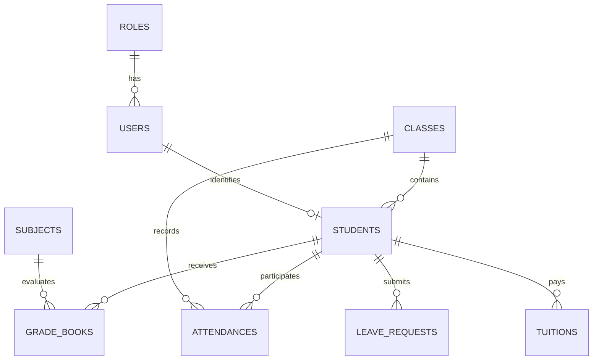

# Báo Cáo Kỹ Thuật: Chi Tiết Toàn Bộ Công Nghệ Sử Dụng Trong Hệ Thống (Technical Architecture & Technology Stack Specification)

- **Dự án**: Hệ thống Quản lý Trường học (School Management System - SMS / HTQLLH)
- **Học phần**: Phát triển dự án phần mềm (SW320DV01 - 3 Tín chỉ)
- **Đơn vị đào tạo**: Đại học Hoa Sen (HSU) - Khoa Công nghệ Thông tin
- **Chủ sở hữu Repository / Trưởng nhóm**: Võ Duy Bình (DYBInh2k5)
- **Cập nhật ngày**: 13/10/2026

---

## 1. TỔNG QUAN HỆ THỐNG VÀ ĐỊNH HƯỚNG KIẾN TRÚC

Hệ thống Quản lý Trường học (HTQLLH) được thiết kế và triển khai nhằm giải quyết triệt để các bài toán thực tế của môi trường giáo dục phổ thông: dữ liệu điểm số phân mảnh trên các bảng tính Excel rời rạc, thông tin liên lạc giữa gia đình và nhà trường bị chậm trễ, rủi ro gian lận chỉnh sửa điểm thi và sự quá tải trong quy trình thu học phí bằng tiền mặt.

Hệ thống được xây dựng theo mô hình kiến trúc phân tầng hiện đại (**Clean Architecture Modular Monolith**), kết hợp giữa **Single Page Application (SPA)** ở phía máy khách, **RESTful API Service** bất đồng bộ ở phía máy chủ và hệ quản trị cơ sở dữ liệu quan hệ **PostgreSQL 15 Container** ở tầng lưu trữ vật lý.

Toàn bộ hệ thống tuân thủ nghiêm ngặt các căn cứ pháp lý của Bộ Giáo dục & Đào tạo, đặc biệt là **Thông tư 22/2021/TT-BGDĐT** về quy chế đánh giá và xếp loại học sinh THCS/THPT.

---

## 2. BẢNG TỔNG HỢP DANH MỤC CÔNG NGHỆ, THƯ VIỆN VÀ CÔNG CỤ (TECH STACK MATRIX)

| Tầng Kiến Trúc | Tên Công Nghệ / Thư Viện | Phiên Bản | Nhà Phát Triển / Chuẩn | Vai Trò Kỹ Thuật Trong Hệ Thống |
| :--- | :--- | :--- | :--- | :--- |
| **Frontend Framework** | React | `18.3.1` | Meta (Facebook) & Community | Xây dựng giao diện trang đơn (SPA) hướng linh kiện (Component-based), tối ưu render qua Virtual DOM |
| **Frontend Build Tool** | Vite | `6.x` | Evan You & Vite Team | Máy chủ phát triển và đóng gói mã nguồn siêu tốc dựa trên ES Modules nguyên bản và Rollup |
| **Styling & Design Tokens** | Tailwind CSS | `3.4.19` | Tailwind Labs | Utility-First CSS Framework, quản lý Design Tokens, chuẩn hóa khoảng cách và bố cục Responsive |
| **CSS Processing** | PostCSS, Autoprefixer | `8.5.28` / `10.6.1` | Open Source | Tiền xử lý CSS, tự động gắn Vendor Prefixes bảo đảm tương thích đa trình duyệt |
| **Client Routing** | React Router DOM | `6.30.6` | Remix Software | Điều hướng không tải lại trang (Client-Side Routing) cho toàn bộ 28 màn hình chức năng |
| **Excel Export Engine** | SheetJS (`xlsx`) | `0.18.5` | SheetJS LLC | Đọc, tạo lập và kết xuất bảng điểm môn học, danh sách học sinh ra định dạng Microsoft Excel `.xlsx` |
| **Runtime Environment** | Node.js | `22.x LTS` | OpenJS Foundation | Môi trường thực thi JavaScript phía máy chủ, vận hành cơ chế Event Loop đơn luồng phi nghẽn (Non-blocking I/O) |
| **Backend Web Framework**| Express.js | `4.21.2` | OpenJS Foundation | Bộ khung định tuyến RESTful API, quản lý Middleware, xử lý HTTP Request/Response |
| **Database Connection** | `pg` (node-postgres) | `8.13.1` | Brianc & Community | Trình điều khiển kết nối PostgreSQL thuần, quản lý Connection Pooling và thực thi truy vấn tham số hóa |
| **Authentication Standard**| JSON Web Token (`jsonwebtoken`) | `9.0.2` | IETF (RFC 7519) | Tạo và giải mã chữ ký điện tử cho phiên làm việc không trạng thái (Stateless Authentication) |
| **Password Hashing** | `bcryptjs` | `2.4.3` | Open Source | Giải thuật băm mật khẩu một chiều kết hợp muối ngẫu nhiên (10 Salt Rounds) chống tấn công Rainbow Table |
| **Cross-Origin Security** | `cors` | `2.8.5` | Express.js Middleware | Thiết lập chính sách chia sẻ tài nguyên tên miền chéo an toàn giữa Frontend (`5173`) và Backend (`8081`) |
| **Environment Config** | `dotenv` | `16.4.7` | Motdotla | Tải các biến môi trường cấu hình nhạy cảm từ tệp `.env` vào `process.env` |
| **Database Engine** | PostgreSQL | `15-Alpine` | PostgreSQL Global Development Group | Hệ quản trị CSDL quan hệ - đối tượng chuẩn ACID, kiểm soát đồng thời đa phiên bản (MVCC) |
| **Containerization** | Docker & Docker Compose | `v3.8 Spec` | Docker Inc. | Đóng gói môi trường cô lập, ảo hóa dịch vụ CSDL và Backend trong mạng nội bộ an toàn |
| **Presentation Deck** | HTML5 / CSS3 / Vanilla JS | Chuẩn W3C | Nhóm phát triển | Bộ Slide thuyết trình toàn khung (Full-Frame Edge-to-Edge) tích hợp đồng hồ, ghi chú và bộ chuyển ảnh demo |

---

## 3. TẦNG GIAO DIỆN NGƯỜI DÙNG (FRONTEND CLIENT LAYER - REACT 18 SPA)

Thư mục mã nguồn: [members/member2_Frontend](file:///d:/HSU/2631Semester%201%282026-2027%29/PT_DA_PM/members/member2_Frontend)

### 3.1. Kiến Trúc Single Page Application (SPA) Với React 18
- **Cơ chế tải trang đơn:** Ứng dụng chỉ tải tài liệu HTML một lần duy nhất lúc khởi động. Mọi quá trình chuyển trang giữa 28 màn hình được xử lý nội bộ bởi `React Router DOM` mà không gửi yêu cầu tải lại toàn bộ trang web tới máy chủ.
- **Cơ chế Virtual DOM (DOM ảo):** Khi người dùng thay đổi dữ liệu (ví dụ: gõ điểm kiểm tra vào một ô trong bảng 45 học sinh), React so sánh cây DOM ảo hiện tại với cây DOM ảo mới thông qua thuật toán phân tách hiệu năng cao (Reconciliation Algorithm) và chỉ tác động cập nhật chính xác phần tử ô điểm đó trên DOM thật. Điều này giúp loại bỏ hoàn toàn hiện tượng nhấp nháy màn hình và suy giảm hiệu năng.
- **Mẫu Thiết Kế MVVM qua Custom Hooks:**
  Giao diện tách biệt hoàn toàn giữa mã JSX trình bày và logic nghiệp vụ. Các trạng thái thao tác (`idle`, `saving`, `saved`, `error`), kiểm tra biên điểm từ 0.0 đến 10.0 và thuật toán tính nhẩm điểm trung bình môn xem trước (preview) được đóng gói trong các Custom Hooks, đóng vai trò như tầng ViewModel trong kiến trúc MVVM.

### 3.2. Công Cụ Đóng Gói Vite & Hot Module Replacement (HMR)
- Khác với Webpack phải đóng gói toàn bộ ứng dụng trước khi khởi chạy máy chủ phát triển, Vite sử dụng cơ chế Native ES Modules của trình duyệt. Các tập tin mã nguồn `.jsx` được biên dịch tức thì theo yêu cầu (On-demand compilation) thông qua `esbuild` viết bằng ngôn ngữ Go.
- Tốc độ khởi động máy chủ chỉ mất từ 1 đến 3 giây; tính năng Hot Module Replacement (HMR) cập nhật trực tiếp mã nguồn vào trình duyệt trong thời gian dưới 100ms mà không làm mất trạng thái dữ liệu đang nhập dở của người dùng.

### 3.3. Định Dạng Bố Cục Với Tailwind CSS
- Áp dụng triết lý Utility-First CSS, xây dựng giao diện từ các lớp tiện ích được chuẩn hóa sẵn, không phát sinh các tệp CSS tùy biến rời rạc gây khó khăn cho việc bảo trì.
- **Thiết kế thích ứng (Responsive Design):**
  - Màn hình Desktop (độ phân giải từ 1024px trở lên): Hiển thị bố cục bảng ma trận đầy đủ cột dành cho Ban Giám Hiệu và Giáo viên bộ môn nhập liệu tốc độ cao.
  - Màn hình Mobile/Tablet: Tự động thu gọn thanh điều hướng thành menu trượt và tái cấu trúc dữ liệu dạng thẻ 1 cột giúp Học sinh và Phụ huynh dễ dàng thao tác bằng một tay theo nguyên tắc "The Thumb Zone".
- **Chuẩn Tiếp Cận WCAG 2.1:** Màu sắc giao diện sử dụng bảng màu thuần sáng (Pure Light Theme), tỷ lệ tương phản giữa văn bản và nền luôn đạt từ 4.5:1 trở lên, bảo đảm độ sắc nét và chống mỏi mắt cho giáo viên làm việc lâu dài.

### 3.4. Thanh Chuyển Đổi Vai Trò Tức Thì (Role Switcher Tab)
- Tích hợp thanh công cụ điều khiển nhanh ở đầu ứng dụng, hỗ trợ chuyển đổi linh hoạt phiên làm việc giữa 5 nhóm vai trò: Admin, Giáo viên Chủ nhiệm, Giáo viên Bộ môn, Học sinh và Phụ huynh.
- Thanh công cụ tự động thay đổi thông tin xác thực mẫu và điều hướng người dùng tới đúng cổng thông tin tương ứng, phục vụ công tác kiểm thử và nghiệm thu giao diện (UAT).

---

## 4. TẦNG XỬ LÝ NGHIỆP VỤ VÀ MÁY CHỦ (BACKEND API LAYER - NODE.JS CLEAN ARCHITECTURE)

Thư mục mã nguồn: [members/member3_Backend_DB/school-management-nodejs](file:///d:/HSU/2631Semester%201%282026-2027%29/PT_DA_PM/members/member3_Backend_DB/school-management-nodejs)

### 4.1. Cơ Chế Xử Lý Bất Đồng Bộ Node.js & Libuv Event Loop
- Node.js vận hành dựa trên V8 JavaScript Engine và thư viện xử lý I/O `libuv`.
- Vận hành theo mô hình đơn luồng phi nghẽn (Single-threaded Non-blocking Event Loop) trải qua 6 pha tuần tự:
  1. **Timers Phase:** Thực thi các bộ hẹn giờ `setTimeout` và `setInterval`.
  2. **Pending Callbacks Phase:** Xử lý các phản hồi I/O bị hoãn lại từ vòng lặp trước.
  3. **Idle, Prepare Phase:** Xử lý các tác vụ nội bộ của hệ thống.
  4. **Poll Phase:** Tiếp nhận các kết nối mạng HTTP mới và thực thi mã kịch bản.
  5. **Check Phase:** Thực thi các hàm gọi lại đăng ký qua `setImmediate`.
  6. **Close Callbacks Phase:** Xử lý sự kiện đóng socket hoặc giải phóng kết nối.
- Khi có yêu cầu truy vấn dữ liệu từ giáo viên, luồng chính của Node.js không bị khóa cứng chờ ổ đĩa phản hồi mà ủy quyền thao tác đó cho Thread Pool của `libuv`. Khi CSDL trả kết quả, sự kiện sẽ được đưa vào hàng đợi để gửi lại cho Client. Nhờ đó, máy chủ duy trì khả năng phục vụ hàng ngàn kết nối đồng thời với mức tiêu thụ RAM cực thấp.

### 4.2. Cấu Trúc Phân Lớp Clean Architecture (4 Vòng Tròn Đồng Tâm)
Kiến trúc Backend được thiết kế chặt chẽ theo nguyên lý Clean Architecture:

```
+-------------------------------------------------------------+
| 4. Frameworks & Drivers (Express.js, PostgreSQL Driver pg)  |
|   +-----------------------------------------------------+   |
|   | 3. Interface Adapters (Controllers, Repositories)   |   |
|   |   +---------------------------------------------+   |   |
|   |   | 2. Use Cases (Application Business Rules)   |   |   |
|   |   |   +-------------------------------------+   |   |   |
|   |   |   | 1. Entities (Enterprise Rules)      |   |   |   |
|   |   |   +-------------------------------------+   |   |   |
|   |   +---------------------------------------------+   |   |
|   +-----------------------------------------------------+   |
+-------------------------------------------------------------+
```

1. **Entities (Lõi Trung Tâm):**
   Chứa các định nghĩa đối tượng dữ liệu và các quy tắc nghiệp vụ bất biến (`Student`, `GradeBook`, `Class`, `Tuition`). Các tệp trong tầng này là mã JavaScript thuần, không chứa bất kỳ câu lệnh nhập (import) nào từ thư viện bên ngoài hoặc framework.
2. **Use Cases (Quy Tắc Ứng Dụng):**
   Chứa logic điều phối các trường hợp sử dụng cụ thể của hệ thống:
   - `CalculateGPAUseCase`: Tính điểm trung bình tích lũy và chuyển đổi sang thang điểm 4.0.
   - `SaveGradesUseCase`: Điều phối lưu điểm kiểm tra có kiểm soát giao dịch.
   - `LockGradeSheetUseCase`: Kiểm tra điều kiện và thực thi chốt khóa sổ điểm môn học.
   - `ProcessAttendanceUseCase`: Ghi nhận dữ liệu chuyên cần và phát thông báo khi có học sinh vắng học.
3. **Interface Adapters (Bộ Điều Hợp Giao Tiếp):**
   - **Controllers:** `AuthController`, `StudentController`, `GradeBookController`, `AttendanceController`, `LeaveRequestController`, `TuitionController`. Giữ vai trò là các Slim Controllers (Controller mỏng): chỉ tiếp nhận yêu cầu HTTP, kiểm tra tính hợp lệ cơ bản của dữ liệu và ủy quyền cho Use Case.
   - **Repository Implementations:** Chuyển đổi dữ liệu thô từ cơ sở dữ liệu thành các thực thể nghiệp vụ hoàn chỉnh.
4. **Frameworks & Drivers (Hạ Tầng Bên Ngoài):**
   Chứa các công nghệ cụ thể như khung làm việc `Express.js`, cổng HTTP, trình điều khiển `pg` kết nối PostgreSQL. Toàn bộ các công nghệ ở tầng này có thể thay thế được mà không làm ảnh hưởng đến mã nguồn của Use Cases và Entities bên trong (tuân thủ nguyên lý Dependency Inversion Principle).

---

## 5. TẦNG CƠ SỞ DỮ LIỆU VÀ LƯU TRỮ (DATABASE & STORAGE LAYER - POSTGRESQL 15 DOCKER)

Thư mục tài liệu & cấu hình: [database](file:///d:/HSU/2631Semester%201%282026-2027%29/PT_DA_PM/database) và [docker-compose.yml](file:///d:/HSU/2631Semester%201%282026-2027%29/PT_DA_PM/docker-compose.yml)

### 5.1. Hệ Quản Trị Cơ Sở Dữ Liệu PostgreSQL 15
PostgreSQL được lựa chọn làm giải pháp lưu trữ chính thức thay vì MongoDB hay Microsoft SQL Server dựa trên các tiêu chuẩn kỹ thuật vượt trội:
- **Tuân thủ nghiêm ngặt chuẩn ANSI SQL:** Hỗ trợ đầy đủ các quan hệ bảng phức tạp, khóa chính, khóa ngoại và phép nối JOIN nhiều bảng với tốc độ xử lý tối ưu.
- **Bảo toàn giao dịch ACID (Atomicity, Consistency, Isolation, Durability):** Dữ liệu học vụ, điểm số và học phí được bảo vệ nguyên vẹn ngay cả khi máy chủ gặp sự cố sập nguồn đột ngột thông qua cơ chế ghi nhật ký trước khi ghi đĩa (Write-Ahead Logging - WAL).
- **Kiểm soát đồng thời đa phiên bản (MVCC):** Khi Ban Giám Hiệu chạy báo cáo thống kê phổ điểm toàn trường (truy vấn đọc lớn), câu lệnh đọc sẽ đọc phiên bản ảnh chụp dữ liệu (snapshot) mà không khóa các dòng dữ liệu. Giáo viên bộ môn vẫn có thể tiếp tục ghi điểm vào hệ thống một cách đồng thời mà không bị treo yêu cầu.
- **Hỗ trợ kiểu dữ liệu lai JSONB:** Hỗ trợ lưu trữ các trường dữ liệu bán cấu trúc linh hoạt (như chi tiết cấu hình đợt thu học phí hoặc siêu dữ liệu nhật ký hệ thống) và cho phép đánh chỉ mục GIN trên dữ liệu JSONB.

### 5.2. Lược Đồ Dữ Liệu Chuẩn Hóa 3NF (8 Thực Thể Cốt Lõi)
Cơ sở dữ liệu loại bỏ triệt để các phụ thuộc bắc cầu và dư thừa dữ liệu:



1. **`roles`**: Danh mục vai trò trong hệ thống (`role_id`, `role_name`).
2. **`users`**: Tài khoản người dùng (`id`, `username`, `password_hash`, `full_name`, `role`, `created_at`).
3. **`school_classes`**: Danh mục lớp học (`id`, `class_name`, `grade_level`, `homeroom_teacher_id`, `max_capacity`).
4. **`subjects`**: Danh mục môn học (`id`, `subject_code`, `subject_name`, `coefficient`, `periods_per_week`).
5. **`students`**: Hồ sơ học sinh (`id`, `student_code`, `full_name`, `gender`, `dob`, `class_name`, `parent_name`, `parent_phone`, `gpa`, `academic_rank`, `status`).
6. **`grade_books`**: Sổ điểm điện tử chi tiết (`id`, `student_id`, `student_code`, `student_name`, `class_name`, `subject_name`, `score_oral_1`, `score_oral_2`, `score_15m_1`, `score_15m_2`, `score_1period_1`, `score_midterm`, `score_final`, `score_tbm`, `is_locked`, `updated_at`).
7. **`attendances`**: Nhật ký điểm danh chuyên cần (`id`, `student_id`, `student_code`, `student_name`, `class_name`, `date`, `period`, `status`, `note`).
8. **`leave_requests`**: Đơn xin nghỉ học trực tuyến (`id`, `student_id`, `student_code`, `student_name`, `class_name`, `start_date`, `end_date`, `reason`, `status`, `approved_by`, `created_at`).
9. **`tuitions`**: Quản lý học phí và thu chi (`id`, `student_id`, `student_code`, `student_name`, `amount`, `semester`, `due_date`, `status`, `receipt_url`, `paid_at`).

### 5.3. Ràng Buộc Kỹ Thuật & Chỉ Mục Truy Vấn
- **CHECK Constraints:** Ràng buộc chặt chẽ thang điểm số học tại CSDL:
  ```sql
  ALTER TABLE grade_books ADD CONSTRAINT chk_scores_valid
  CHECK (
    (score_oral_1 IS NULL OR (score_oral_1 >= 0.0 AND score_oral_1 <= 10.0)) AND
    (score_midterm IS NULL OR (score_midterm >= 0.0 AND score_midterm <= 10.0)) AND
    (score_final IS NULL OR (score_final >= 0.0 AND score_final <= 10.0)) AND
    (score_tbm IS NULL OR (score_tbm >= 0.0 AND score_tbm <= 10.0))
  );
  ```
- **B-Tree Indexing:** Tăng tốc tra cứu điểm và chuyên cần:
  ```sql
  CREATE INDEX idx_gradebooks_student_subject ON grade_books (student_id, subject_name);
  CREATE INDEX idx_attendances_class_date ON attendances (class_name, date);
  ```

---

## 6. CÁC MẪU THIẾT KẾ PHẦN MỀM VÀ NGUYÊN LÝ ÁP DỤNG (DESIGN PATTERNS)

Thư mục tài liệu: [BrainStorm/Week5 Pattern .md](file:///d:/HSU/2631Semester%201%282026-2027%29/PT_DA_PM/BrainStorm/Week5%20Pattern%20.md)

### 6.1. Split-MVC Pattern (Model-View-Controller Tách Đôi)
Trong kiến trúc ứng dụng web hiện đại, mẫu MVC truyền thống được phân tách qua ranh giới mạng:
- **Model (Backend Node.js/PostgreSQL):** Định nghĩa cấu trúc dữ liệu, mối quan hệ và quy tắc tính điểm chuẩn xác tập trung tại máy chủ.
- **View (Frontend React SPA):** Tiếp nhận dữ liệu JSON từ API và trực quan hóa thành bảng biểu, biểu đồ hoặc thẻ thông tin.
- **Controller (Backend Express):** Đóng vai trò Slim Controller, chỉ phân tích cú pháp HTTP, xác thực chữ ký số JWT và chuyển tiếp dữ liệu tới Use Case. Không nhồi nhét câu lệnh SQL hay nghiệp vụ vào Controller.

### 6.2. Repository Pattern (Trừu Tượng Hóa Truy Cập CSDL)
- Triển khai trong [src/repositories/StudentRepository.js](file:///d:/HSU/2631Semester%201%282026-2027%29/PT_DA_PM/members/member3_Backend_DB/school-management-nodejs/src/repositories/StudentRepository.js) và [src/repositories/GradeBookRepository.js](file:///d:/HSU/2631Semester%201%282026-2027%29/PT_DA_PM/members/member3_Backend_DB/school-management-nodejs/src/repositories/GradeBookRepository.js).
- Cung cấp giao diện trừu tượng hóa toàn bộ thao tác CRUD dữ liệu. Tầng Use Cases chỉ gọi `findByStudentCode()`, `save()`, `getAll()` mà không biết dữ liệu được lấy từ PostgreSQL hay nguồn lưu trữ khác. Giúp việc viết bài kiểm thử đơn vị (Unit Test) có thể dễ dàng sử dụng Mock Repository trong bộ nhớ mà không cần kết nối tới cơ sở dữ liệu thật.

### 6.3. Unit of Work Pattern (Điều Phối Giao Dịch Nguyên Tử)
- **Vấn đề thực tế:** Khi giáo viên bộ môn lưu bảng điểm của cả lớp gồm 45 học sinh, hệ thống phải thực hiện 45 câu lệnh cập nhật CSDL. Nếu câu lệnh thứ 40 thất bại do lỗi mạng, 39 câu lệnh trước đó không được phép lưu vào CSDL, tránh gây ra tình trạng điểm số dở dang và sai lệch kết quả xếp hạng.
- **Cơ chế triển khai:** Unit of Work mượn một kết nối duy nhất từ `Connection Pool` và thực thi:
  ```javascript
  const client = await pool.connect();
  try {
    await client.query('BEGIN'); // Bắt đầu Transaction
    for (const record of studentGrades) {
      await gradeRepository.saveWithClient(client, record);
    }
    await client.query('COMMIT'); // Xác nhận toàn bộ 45 học sinh
  } catch (error) {
    await client.query('ROLLBACK'); // Hoàn tác toàn bộ nếu có bất kỳ lỗi nào
    throw error;
  } finally {
    client.release(); // Trả kết nối về Pool
  }
  ```

### 6.4. Dependency Inversion Principle (DIP) & Dependency Injection (DI)
- **Nguyên lý DIP (Chữ D trong SOLID):** Các module cấp cao (Use Case, Service) không phụ thuộc trực tiếp vào module cấp thấp (PostgreSQL Client, Mail Server). Cả hai cùng phụ thuộc vào sự trừu tượng hóa (Interface/Contract).
- **Kỹ thuật DI:** Thay vì Use Case tự tạo kết nối CSDL bằng từ khóa `new PgPool()`, phụ thuộc được truyền từ bên ngoài vào thông qua hàm khởi tạo (Constructor Injection).
- **Điểm Ghép Nối Tập Trung (Composition Root):** Triển khai tại [server.js](file:///d:/HSU/2631Semester%201%282026-2027%29/PT_DA_PM/members/member3_Backend_DB/school-management-nodejs/server.js). Đây là nơi duy nhất trong toàn bộ hệ thống chịu trách nhiệm khởi tạo đối tượng và tiêm các phụ thuộc vào nhau.
- **Quản lý 3 Vòng Đời Đối Tượng (Lifetimes):**
  1. `Singleton`: Tồn tại duy nhất trong suốt vòng đời của tiến trình máy chủ (ví dụ: `Database Connection Pool`, `Logger`).
  2. `Scoped`: Tồn tại trong phạm vi một yêu cầu HTTP hoặc một chu trình giao dịch CSDL (ví dụ: `Unit of Work Transaction Client`).
  3. `Transient`: Khởi tạo mới mỗi lần được yêu cầu (ví dụ: DTO Mappers, Validators kiểm tra dữ liệu).

---

## 7. TIÊU CHUẨN NGHIỆP VỤ HỌC VỤ VÀ AN TOÀN THÔNG TIN

### 7.1. Căn Cứ Pháp Lý Giáo Dục: Thông Tư 22/2021/TT-BGDĐT
Hệ thống tự động hóa toàn bộ công thức tính điểm và xếp loại học lực của Bộ Giáo dục & Đào tạo:
- **Công thức tính Điểm trung bình môn học kỳ (TBMhk):**
  $$\text{TBM}_{hk} = \frac{\sum \text{ĐĐG}_{tx} + 2 \times \text{ĐĐG}_{gk} + 3 \times \text{ĐĐG}_{ck}}{\text{Số cột}_{tx} + 5}$$
  Trong đó:
  - $\text{ĐĐG}_{tx}$: Điểm đánh giá thường xuyên (Kiểm tra miệng, 15 phút - Hệ số 1).
  - $\text{ĐĐG}_{gk}$: Điểm đánh giá giữa kỳ (Hệ số 2).
  - $\text{ĐĐG}_{ck}$: Điểm đánh giá cuối kỳ (Hệ số 3).
- **Quy tắc chuyển đổi GPA Thang điểm 10 sang Thang điểm 4.0 chuẩn quốc tế:**
  - $8.5 \le \text{GPA} \le 10.0 \implies 4.0$ (Hạng A - Xuất sắc / Giỏi).
  - $7.0 \le \text{GPA} \le 8.4 \implies 3.0$ (Hạng B - Khá).
  - $5.5 \le \text{GPA} \le 6.9 \implies 2.0$ (Hạng C - Trung bình).
  - $4.0 \le \text{GPA} \le 5.4 \implies 1.0$ (Hạng D - Yếu).
  - $\text{GPA} < 4.0 \implies 0.0$ (Hạng F - Kém).
- **Thuật toán xếp loại học lực có khống chế môn:**
  - **Mức Tốt:** ĐTB các môn $\ge 6.5$, có ít nhất 6 môn $\ge 8.0$, không có môn nào $< 5.0$.
  - **Mức Khá:** ĐTB các môn $\ge 5.0$, có ít nhất 6 môn $\ge 6.5$, không có môn nào $< 3.5$.
  - **Mức Đạt:** Không quá 1 môn $< 3.5$ và không có môn nào $< 2.0$.

### 7.2. Quy Trình Chốt Khóa Sổ Điểm 2 Cấp An Toàn
1. **Cấp 1 - Giáo viên Bộ môn (GVBM):**
   Sau khi hoàn tất nhập điểm kiểm tra học kỳ, GVBM nhấn nút "Chốt khóa sổ điểm". Cột cờ `is_locked` trong bảng `grade_books` được gán giá trị `TRUE`. Từ thời điểm này, mọi quyền cập nhật hoặc xóa điểm trên giao diện của GVBM bị vô hiệu hóa hoàn toàn.
2. **Cấp 2 - Ban Giám Hiệu (BGH / Admin):**
   Khi có đơn xin phúc khảo điểm hợp lệ từ phía học sinh/phụ huynh, chỉ duy nhất tài khoản có vai trò `ROLE_ADMIN` mới có quyền kích hoạt tính năng mở khóa sổ điểm tạm thời. Hệ thống ghi lại danh tính người mở khóa và yêu cầu nhập lý do giải trình.

### 7.3. Tiêu Chuẩn Bảo Mật & Xác Thực OWASP
- **Xác thực phi trạng thái (Stateless Authentication):** Sử dụng chuẩn JSON Web Token (JWT - RFC 7519). Mã token được mã hóa chứa thông tin định danh `userId` và `role`. Máy chủ không cần lưu session trong bộ nhớ, hỗ trợ mở rộng ngang dễ dàng.
- **Mã hóa mật khẩu an toàn:** Sử dụng thư viện `bcryptjs` với 10 vòng muối ngẫu nhiên (salt rounds). Mật khẩu người dùng trong cơ sở dữ liệu luôn ở dạng chuỗi băm một chiều, ngăn chặn rò rỉ ngay cả khi CSDL bị lộ.
- **Phân quyền dựa trên vai trò (Role-Based Access Control - RBAC):** Hệ thống phân quyền chặt chẽ trên 5 nhóm vai trò:
  - `ROLE_ADMIN`: Toàn quyền quản trị cấu hình năm học, môn, lớp, tài khoản và mở khóa sổ điểm.
  - `ROLE_HOMEROOM_TEACHER`: Điểm danh hàng ngày, duyệt đơn nghỉ học, đánh giá hạnh kiểm lớp chủ nhiệm.
  - `ROLE_SUBJECT_TEACHER`: Nhập điểm môn học phụ trách, điểm danh theo tiết học, chốt khóa sổ điểm.
  - `ROLE_STUDENT`: Tra cứu bảng điểm cá nhân, xem thời khóa biểu, nộp đơn phúc khảo.
  - `ROLE_PARENT`: Sổ liên lạc điện tử, nhận thông báo vắng học, nộp đơn xin nghỉ học, thanh toán học phí qua mã QR.
- **Phòng thủ SQL Injection:** Toàn bộ các câu lệnh SQL trong hệ thống sử dụng cú pháp tham số hóa (`$1, $2, $3`), phân tách tuyệt đối giữa mã lệnh và dữ liệu đầu vào.
- **Chính sách CORS có kiểm soát:** Máy chủ Express chỉ chấp nhận các yêu cầu HTTP bắt nguồn từ tên miền được phê duyệt của Frontend SPA (`http://localhost:5173`).

---

## 8. HẠ TẦNG TRIỂN KHAI VÀ VẬN HÀNH (DEVOPS & CONTAINERIZATION)

Tệp cấu hình: [docker-compose.yml](file:///d:/HSU/2631Semester%201%282026-2027%29/PT_DA_PM/docker-compose.yml)

### 8.1. Đóng Gói Docker Compose
Hệ thống sử dụng Docker Compose phiên bản 3.8 để quản lý vòng đời của cụm dịch vụ:
- **Dịch vụ CSDL `htqllh_postgres`:**
  - Base Image: `postgres:15-alpine` (dung lượng siêu nhẹ ~80MB, giảm thiểu bề mặt tấn công bảo mật).
  - Ánh xạ cổng: `5434:5432` (tránh xung đột với các phiên bản PostgreSQL đã cài sẵn trên máy chủ).
  - Khối lưu trữ (Volume): `postgres_data` gắn vào `/var/lib/postgresql/data`, đảm bảo dữ liệu học sinh và điểm số được lưu trữ bền vững khi container khởi động lại.
  - Healthcheck tự động: Thực thi định kỳ `pg_isready -U postgres -d school_management` mỗi 5 giây để kiểm tra độ sẵn sàng.
- **Dịch vụ Backend `htqllh_backend`:**
  - Xây dựng từ Dockerfile đa tầng (Multi-stage build).
  - Cơ chế phụ thuộc thông minh `depends_on` với điều kiện `service_healthy`, bảo đảm máy chủ API chỉ khởi chạy sau khi cơ sở dữ liệu PostgreSQL đã hoàn toàn sẵn sàng nhận kết nối.

### 8.2. Cổng Kết Nối Và Môi Trường Vận Hành Hiện Tại
- **PostgreSQL Database:** Đang chạy tại `localhost:5434` (User: `postgres`, DB: `school_management`).
- **Node.js Express Backend:** Đang lắng nghe tại cổng `http://localhost:8081` (Endpoint kiểm tra sức khỏe: `/api/health`).
- **React Frontend Vite SPA:** Đang phục vụ tại cổng `http://localhost:5173` (Hỗ trợ truy cập tức thời 28 màn hình chức năng).
- **Slide Thuyết Trình:** Tệp độc lập [Sprint/index.html](file:///d:/HSU/2631Semester%201%282026-2027%29/PT_DA_PM/Sprint/index.html) phục vụ trình chiếu toàn khung trước hội đồng bảo vệ.

---

## 9. BẢNG PHÂN CÔNG NHIỆM VỤ 5 THÀNH VIÊN THEO CÔNG NGHỆ

| STT | Họ và Tên | Vai Trò | Mảng Công Nghệ Phụ Trách Cụ Thể | Tỷ Lệ Đóng Góp |
| :---: | :--- | :--- | :--- | :---: |
| 1 | **Võ Duy Bình** | Trưởng nhóm / Lead BA & Architect | Khảo sát yêu cầu SRS, Ma trận RBAC; Thiết kế kiến trúc Clean Architecture & Composition Root; Nghiên cứu nền tảng Web SPA React & Tailwind CSS; Khảo sát CSDL MS SQL Server; Quản lý tiến độ chung | 20% |
| 2 | **Nguyễn Minh Quốc Bảo** | Frontend & Database Specialist | Xây dựng công thức tính điểm và xếp loại học lực Thông tư 22/2021/TT-BGDĐT; Nghiên cứu CSDL PostgreSQL & cơ chế MVCC; Khảo sát kiến trúc Event-Driven & Microservices; Nghiên cứu Repository Pattern | 20% |
| 3 | **Trần Quang Vinh** | Backend & UI/UX Specialist | Thiết kế phân hệ Hồ sơ học sinh & Thời khóa biểu; Nghiên cứu công cụ thiết kế Figma & Frontend Frameworks; Khảo sát MySQL, Supabase, MongoDB; Nghiên cứu Node.js Event Loop & Non-blocking I/O | 20% |
| 4 | **Võ Hoàng Sơn** | Logic & Security Specialist | Thiết kế phân hệ Điểm danh & Sổ liên lạc điện tử; Nghiên cứu ứng dụng Desktop WinForms; Chuẩn hóa báo cáo CSDL; Nghiên cứu nguyên lý Dependency Inversion (DIP) và kỹ thuật Dependency Injection (DI) | 20% |
| 5 | **Huỳnh Trung Tính** | Modules & QA Specialist | Thiết kế phân hệ Học phí & Ma trận truy xuất RTM; Nghiên cứu chuyên sâu hướng dẫn quản trị PostgreSQL; So sánh 5 mô hình kiến trúc & Modular Monolith; So sánh và tổng hợp 6 Mẫu thiết kế Design Patterns | 20% |

---

*Tài liệu được lưu trữ chính thức tại kho mã nguồn của đồ án phục vụ công tác đối soát, bảo vệ chuyên đề và chuyển giao kỹ thuật.*
