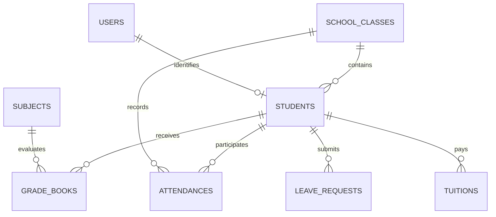

# Báo Cáo Kỹ Thuật: Chi Tiết Toàn Bộ Công Nghệ Và Bản Đồ Tệp Mã Nguồn Hệ Thống (Technical Architecture, Technology Stack & Source Code Navigation)

- **Dự án**: Hệ thống Quản lý Trường học (School Management System - SMS / HTQLLH)
- **Học phần**: Phát triển dự án phần mềm (SW320DV01 - 3 Tín chỉ)
- **Đơn vị đào tạo**: Đại học Hoa Sen (HSU) - Khoa Công nghệ Thông tin
- **Chủ sở hữu Repository / Trưởng nhóm**: Võ Duy Bình (DYBInh2k5)
- **Cập nhật ngày**: 13/10/2026

---

## 1. TỔNG QUAN HỆ THỐNG VÀ ĐỊNH HƯỚNG KIẾN TRÚC

Hệ thống Quản lý Trường học (HTQLLH) được thiết kế và triển khai nhằm giải quyết triệt để các bài toán thực tế của môi trường giáo dục phổ thông: dữ liệu điểm số phân mảnh trên các bảng tính Excel rời rạc, thông tin liên lạc giữa gia đình và nhà trường bị chậm trễ, rủi ro gian lận chỉnh sửa điểm thi và sự quá tải trong quy trình thu học phí bằng tiền mặt.

Hệ thống được xây dựng theo mô hình kiến trúc phân tầng hiện đại (**Clean Architecture Modular Monolith**), kết hợp giữa:
1. **Single Page Application (SPA)** ở phía máy khách: Triển khai bằng React 18, Vite và Tailwind CSS trong thư mục [members/member2_Frontend](file:///d:/HSU/2631Semester%201%282026-2027%29/PT_DA_PM/members/member2_Frontend).
2. **RESTful API Service** bất đồng bộ ở phía máy chủ: Triển khai bằng Node.js, Express.js và mô hình Clean Architecture trong thư mục [members/member3_Backend_DB/school-management-nodejs](file:///d:/HSU/2631Semester%201%282026-2027%29/PT_DA_PM/members/member3_Backend_DB/school-management-nodejs).
3. **Cơ sở dữ liệu quan hệ ACID**: PostgreSQL 15 Container vận hành cô lập thông qua tệp điều phối [docker-compose.yml](file:///d:/HSU/2631Semester%201%282026-2027%29/PT_DA_PM/docker-compose.yml) và lược đồ dữ liệu chuẩn [database/schema.sql](file:///d:/HSU/2631Semester%201%282026-2027%29/PT_DA_PM/database/schema.sql).

Toàn bộ hệ thống tuân thủ nghiêm ngặt các quy định pháp lý của Bộ Giáo dục & Đào tạo, đặc biệt là **Thông tư 22/2021/TT-BGDĐT** về quy chế đánh giá và xếp loại học sinh THCS/THPT.

---

## 2. BẢNG TỔNG HỢP DANH MỤC CÔNG NGHỆ, THƯ VIỆN VÀ TỆP MÃ NGUỒN MINH CHỨNG (TECH STACK MATRIX)

Bảng dưới đây ánh xạ trực tiếp từng công nghệ, phiên bản, vai trò kỹ thuật tới đúng vị trí tập tin mã nguồn và cấu hình trong dự án:

| Tầng Kiến Trúc | Tên Công Nghệ / Thư Viện | Phiên Bản | Nhà Phát Triển / Chuẩn | Vai Trò Kỹ Thuật Trong Hệ Thống | Tập Tin Mã Nguồn / Cấu Hình Minh Chứng |
| :--- | :--- | :--- | :--- | :--- | :--- |
| **Frontend Framework** | React | `18.3.1` | Meta & Community | Xây dựng giao diện trang đơn (SPA) hướng linh kiện, tối ưu render qua Virtual DOM | [package.json](file:///d:/HSU/2631Semester%201%282026-2027%29/PT_DA_PM/members/member2_Frontend/package.json), [src/main.jsx](file:///d:/HSU/2631Semester%201%282026-2027%29/PT_DA_PM/members/member2_Frontend/src/main.jsx), [src/App.jsx](file:///d:/HSU/2631Semester%201%282026-2027%29/PT_DA_PM/members/member2_Frontend/src/App.jsx) |
| **Frontend Build Tool** | Vite | `6.x` | Evan You & Vite Team | Máy chủ phát triển và đóng gói mã nguồn dựa trên Native ES Modules | [vite.config.js](file:///d:/HSU/2631Semester%201%282026-2027%29/PT_DA_PM/members/member2_Frontend/vite.config.js), [index.html](file:///d:/HSU/2631Semester%201%282026-2027%29/PT_DA_PM/members/member2_Frontend/index.html) |
| **Styling & Design Tokens** | Tailwind CSS | `3.4.19` | Tailwind Labs | Utility-First CSS, chuẩn hóa bảng màu Pure Light Theme và bố cục Responsive | [tailwind.config.js](file:///d:/HSU/2631Semester%201%282026-2027%29/PT_DA_PM/members/member2_Frontend/tailwind.config.js), [src/index.css](file:///d:/HSU/2631Semester%201%282026-2027%29/PT_DA_PM/members/member2_Frontend/src/index.css) |
| **CSS Processing** | PostCSS, Autoprefixer | `8.5.28` / `10.6.1` | Open Source | Tiền xử lý CSS, tự động gắn Vendor Prefixes bảo đảm tương thích đa trình duyệt | [postcss.config.js](file:///d:/HSU/2631Semester%201%282026-2027%29/PT_DA_PM/members/member2_Frontend/postcss.config.js) |
| **Client Routing** | React Router DOM | `6.30.6` | Remix Software | Điều hướng không tải lại trang cho toàn bộ 28 màn hình chức năng | [src/routes/AppRouter.jsx](file:///d:/HSU/2631Semester%201%282026-2027%29/PT_DA_PM/members/member2_Frontend/src/routes/AppRouter.jsx), [src/components/auth/ProtectedRoute.jsx](file:///d:/HSU/2631Semester%201%282026-2027%29/PT_DA_PM/members/member2_Frontend/src/components/auth/ProtectedRoute.jsx) |
| **Excel Export Engine** | SheetJS (`xlsx`) | `0.18.5` | SheetJS LLC | Đọc, tạo lập và kết xuất bảng điểm môn học, danh sách học sinh ra file `.xlsx` | [src/utils/exportEngine.js](file:///d:/HSU/2631Semester%201%282026-2027%29/PT_DA_PM/members/member2_Frontend/src/utils/exportEngine.js), [GradebookPage.jsx](file:///d:/HSU/2631Semester%201%282026-2027%29/PT_DA_PM/members/member2_Frontend/src/pages/gv/GradebookPage.jsx) |
| **Icons Library** | Lucide React | `0.475.0` | Lucide Community | Hệ thống icon vector nhất quán cho thanh điều hướng và các bảng điều khiển | [src/components/layout/Sidebar.jsx](file:///d:/HSU/2631Semester%201%282026-2027%29/PT_DA_PM/members/member2_Frontend/src/components/layout/Sidebar.jsx), [Header.jsx](file:///d:/HSU/2631Semester%201%282026-2027%29/PT_DA_PM/members/member2_Frontend/src/components/layout/Header.jsx) |
| **Runtime Environment** | Node.js | `22.x LTS` | OpenJS Foundation | Môi trường thực thi JavaScript phía máy chủ, vận hành Event Loop phi nghẽn | [package.json](file:///d:/HSU/2631Semester%201%282026-2027%29/PT_DA_PM/members/member3_Backend_DB/school-management-nodejs/package.json), [Dockerfile](file:///d:/HSU/2631Semester%201%282026-2027%29/PT_DA_PM/members/member3_Backend_DB/school-management-nodejs/Dockerfile) |
| **Backend Framework** | Express.js | `4.21.2` | OpenJS Foundation | Bộ khung định tuyến RESTful API, quản lý Middleware và xử lý HTTP Request | [server.js](file:///d:/HSU/2631Semester%201%282026-2027%29/PT_DA_PM/members/member3_Backend_DB/school-management-nodejs/server.js) |
| **Database Connection** | `pg` (node-postgres) | `8.13.1` | Brianc & Community | Trình điều khiển kết nối PostgreSQL thuần, quản lý Connection Pooling | [src/config/db.js](file:///d:/HSU/2631Semester%201%282026-2027%29/PT_DA_PM/members/member3_Backend_DB/school-management-nodejs/src/config/db.js) |
| **Authentication Standard**| JSON Web Token (`jsonwebtoken`) | `9.0.2` | IETF (RFC 7519) | Tạo và kiểm tra chữ ký điện tử cho phiên làm việc không trạng thái | [src/controllers/AuthController.js](file:///d:/HSU/2631Semester%201%282026-2027%29/PT_DA_PM/members/member3_Backend_DB/school-management-nodejs/src/controllers/AuthController.js) |
| **Password Hashing** | `bcryptjs` | `2.4.3` | Open Source | Giải thuật băm mật khẩu một chiều kết hợp 10 vòng muối ngẫu nhiên | [src/repositories/UserRepository.js](file:///d:/HSU/2631Semester%201%282026-2027%29/PT_DA_PM/members/member3_Backend_DB/school-management-nodejs/src/repositories/UserRepository.js), [AuthController.js](file:///d:/HSU/2631Semester%201%282026-2027%29/PT_DA_PM/members/member3_Backend_DB/school-management-nodejs/src/controllers/AuthController.js) |
| **Cross-Origin Security** | `cors` | `2.8.5` | Express.js Middleware | Thiết lập chính sách chia sẻ tài nguyên an toàn giữa Frontend (`5173`) và Backend (`8081`) | [server.js](file:///d:/HSU/2631Semester%201%282026-2027%29/PT_DA_PM/members/member3_Backend_DB/school-management-nodejs/server.js) |
| **Environment Config** | `dotenv` | `16.4.7` | Motdotla | Nạp các tham số bảo mật và cổng kết nối từ file `.env` vào `process.env` | [server.js](file:///d:/HSU/2631Semester%201%282026-2027%29/PT_DA_PM/members/member3_Backend_DB/school-management-nodejs/server.js), [src/config/db.js](file:///d:/HSU/2631Semester%201%282026-2027%29/PT_DA_PM/members/member3_Backend_DB/school-management-nodejs/src/config/db.js) |
| **Database Engine** | PostgreSQL | `15-Alpine` | PGDG | Hệ quản trị CSDL quan hệ chuẩn ACID, kiểm soát đồng thời đa phiên bản (MVCC) | [docker-compose.yml](file:///d:/HSU/2631Semester%201%282026-2027%29/PT_DA_PM/docker-compose.yml), [database/schema.sql](file:///d:/HSU/2631Semester%201%282026-2027%29/PT_DA_PM/database/schema.sql) |
| **Containerization** | Docker & Docker Compose | `v3.8 Spec` | Docker Inc. | Đóng gói môi trường cô lập, ảo hóa dịch vụ CSDL và Backend trong mạng nội bộ | [docker-compose.yml](file:///d:/HSU/2631Semester%201%282026-2027%29/PT_DA_PM/docker-compose.yml), [Dockerfile](file:///d:/HSU/2631Semester%201%282026-2027%29/PT_DA_PM/members/member3_Backend_DB/school-management-nodejs/Dockerfile) |
| **Presentation Deck** | HTML5 / CSS3 / Vanilla JS | Chuẩn W3C | Nhóm phát triển | Bộ Slide thuyết trình toàn khung (Edge-to-Edge) tích hợp đồng hồ, ghi chú và ảnh demo | [Sprint/index.html](file:///d:/HSU/2631Semester%201%282026-2027%29/PT_DA_PM/Sprint/index.html) |

---

## 3. TẦNG GIAO DIỆN NGƯỜI DÙNG (FRONTEND CLIENT LAYER - REACT 18 SPA)

Thư mục mã nguồn gốc: [members/member2_Frontend](file:///d:/HSU/2631Semester%201%282026-2027%29/PT_DA_PM/members/member2_Frontend)

### 3.1. Điểm Khởi Chạy Và Cấu Trúc Khung Ứng Dụng (Application Shell)
Giao diện người dùng được tổ chức theo cấu trúc dạng vỏ bọc (Application Shell Layout), bảo đảm tính nhất quán trên toàn bộ 28 màn hình:
- **Tập tin điểm khởi động HTML**: [index.html](file:///d:/HSU/2631Semester%201%282026-2027%29/PT_DA_PM/members/member2_Frontend/index.html) chứa thẻ gốc `<div id="root"></div>` cùng cấu hình phông chữ liên kết.
- **Tập tin gắn kết React DOM**: [src/main.jsx](file:///d:/HSU/2631Semester%201%282026-2027%29/PT_DA_PM/members/member2_Frontend/src/main.jsx) khởi tạo phiên làm việc React 18 dưới chế độ kiểm soát nghiêm ngặt `React.StrictMode`.
- **Tập tin thành phần gốc**: [src/App.jsx](file:///d:/HSU/2631Semester%201%282026-2027%29/PT_DA_PM/members/member2_Frontend/src/App.jsx) bọc ứng dụng trong `AuthProvider` và kích hoạt bộ định tuyến [AppRouter.jsx](file:///d:/HSU/2631Semester%201%282026-2027%29/PT_DA_PM/members/member2_Frontend/src/routes/AppRouter.jsx).
- **Khung giao diện dùng chung (Main Layout)**: [src/components/layout/MainLayout.jsx](file:///d:/HSU/2631Semester%201%282026-2027%29/PT_DA_PM/members/member2_Frontend/src/components/layout/MainLayout.jsx) phân chia không gian màn hình thành 3 khu vực cố định:
  1. Thanh điều hướng bên hông: [src/components/layout/Sidebar.jsx](file:///d:/HSU/2631Semester%201%282026-2027%29/PT_DA_PM/members/member2_Frontend/src/components/layout/Sidebar.jsx).
  2. Thanh tiêu đề và thông tin cá nhân: [src/components/layout/Header.jsx](file:///d:/HSU/2631Semester%201%282026-2027%29/PT_DA_PM/members/member2_Frontend/src/components/layout/Header.jsx).
  3. Thanh chuyển đổi vai trò kiểm thử tức thời (Role Switcher Tab): Tích hợp trực tiếp tại [src/components/layout/MainLayout.jsx](file:///d:/HSU/2631Semester%201%282026-2027%29/PT_DA_PM/members/member2_Frontend/src/components/layout/MainLayout.jsx).

### 3.2. Điều Hướng Và Bảo Vệ Tuyến Đường (Routing & RBAC Guards)
- **Khai báo 28 màn hình chức năng**: Toàn bộ tuyến đường URL được khai báo tập trung tại [src/routes/AppRouter.jsx](file:///d:/HSU/2631Semester%201%282026-2027%29/PT_DA_PM/members/member2_Frontend/src/routes/AppRouter.jsx).
- **Cơ chế bọc bảo vệ quyền truy cập**: Tuyến đường được bảo vệ qua linh kiện [src/components/auth/ProtectedRoute.jsx](file:///d:/HSU/2631Semester%201%282026-2027%29/PT_DA_PM/members/member2_Frontend/src/components/auth/ProtectedRoute.jsx). Nếu người dùng chưa đăng nhập, hệ thống lập tức chuyển hướng về [src/pages/auth/LoginPage.jsx](file:///d:/HSU/2631Semester%201%282026-2027%29/PT_DA_PM/members/member2_Frontend/src/pages/auth/LoginPage.jsx); nếu người dùng không thuộc vai trò được phép (`allowedRoles`), hệ thống chặn lại và điều hướng về [src/pages/auth/UnauthorizedPage.jsx](file:///d:/HSU/2631Semester%201%282026-2027%29/PT_DA_PM/members/member2_Frontend/src/pages/auth/UnauthorizedPage.jsx).
- **Quản lý phiên làm việc tập trung**: Tệp [src/context/AuthContext.jsx](file:///d:/HSU/2631Semester%201%282026-2027%29/PT_DA_PM/members/member2_Frontend/src/context/AuthContext.jsx) lưu trữ token, đối tượng `currentUser` và đồng bộ hóa trạng thái phiên làm việc vào `localStorage`.

### 3.3. Tầng Giao Tiếp Mạng Và Khả Năng Ngoại Tuyến (API Client & Offline Stubs)
- **Tập tin giao tiếp HTTP Client**: [src/api/client.js](file:///d:/HSU/2631Semester%201%282026-2027%29/PT_DA_PM/members/member2_Frontend/src/api/client.js) đóng gói phương thức `fetch()` chuẩn, tự động gắn tiêu đề `Authorization: Bearer <token>` và định cấu hình máy chủ đích `http://localhost:8081`.
- **Cơ chế dự phòng ngoại tuyến (Offline Stubs & Mock Data)**: Khi máy chủ cơ sở dữ liệu hoặc backend chưa khởi động, tệp [src/api/stubs.js](file:///d:/HSU/2631Semester%201%282026-2027%29/PT_DA_PM/members/member2_Frontend/src/api/stubs.js) cung cấp dữ liệu mô phỏng đầy đủ cho 45 học sinh lớp 10A1, các đầu điểm Thông tư 22 và danh mục học phí, bảo đảm giao diện không bao giờ rơi vào trạng thái lỗi màn hình trắng.

### 3.4. Các Màn Hình Chức Năng Cốt Lõi Và Linh Kiện Dùng Chung
- **Sổ điểm điện tử môn học (Gradebook)**: [src/pages/gv/GradebookPage.jsx](file:///d:/HSU/2631Semester%201%282026-2027%29/PT_DA_PM/members/member2_Frontend/src/pages/gv/GradebookPage.jsx) triển khai bảng ma trận nhập điểm trực tiếp, kiểm tra biên điểm từ 0.0 đến 10.0, tính nhẩm điểm trung bình môn học kỳ (TBM) theo thời gian thực và gọi tính năng chốt khóa sổ điểm.
- **Điểm danh chuyên cần**: [src/pages/gv/AttendancePage.jsx](file:///d:/HSU/2631Semester%201%282026-2027%29/PT_DA_PM/members/member2_Frontend/src/pages/gv/AttendancePage.jsx) cung cấp bảng chấm công theo tiết học và ngày với 3 trạng thái: Có mặt, Có phép, Vắng không phép.
- **Hồ sơ học sinh**: [src/pages/students/StudentListPage.jsx](file:///d:/HSU/2631Semester%201%282026-2027%29/PT_DA_PM/members/member2_Frontend/src/pages/students/StudentListPage.jsx) hiển thị danh sách toàn trường, hỗ trợ lọc theo khối lớp và tìm kiếm theo mã số học sinh.
- **Bảng điều khiển Ban Giám Hiệu**: [src/pages/bgh/BGHDashboardPage.jsx](file:///d:/HSU/2631Semester%201%282026-2027%29/PT_DA_PM/members/member2_Frontend/src/pages/bgh/BGHDashboardPage.jsx) tổng hợp các chỉ số KPI chất lượng giáo dục, tỷ lệ chuyên cần và phổ điểm.
- **Trung tâm báo cáo thống kê**: [src/pages/bgh/BGHReportCenterPage.jsx](file:///d:/HSU/2631Semester%201%282026-2027%29/PT_DA_PM/members/member2_Frontend/src/pages/bgh/BGHReportCenterPage.jsx) kết xuất báo cáo học vụ cho các cấp quản lý.
- **Cổng thông tin phụ huynh**: [src/pages/communication/ParentPortalPage.jsx](file:///d:/HSU/2631Semester%201%282026-2027%29/PT_DA_PM/members/member2_Frontend/src/pages/communication/ParentPortalPage.jsx) hỗ trợ phụ huynh xem sổ liên lạc điện tử, nhận tin nhắn cảnh báo vắng học và thanh toán học phí.
- **Thời khóa biểu toàn trường**: [src/pages/schedule/TimetablePage.jsx](file:///d:/HSU/2631Semester%201%282026-2027%29/PT_DA_PM/members/member2_Frontend/src/pages/schedule/TimetablePage.jsx).
- **Bộ máy kết xuất Excel**: [src/utils/exportEngine.js](file:///d:/HSU/2631Semester%201%282026-2027%29/PT_DA_PM/members/member2_Frontend/src/utils/exportEngine.js) sử dụng thư viện SheetJS để trích xuất bảng điểm ra tập tin Excel chuẩn định dạng.
- **Thư viện linh kiện giao diện tái sử dụng**:
  - Bảng dữ liệu đa năng: [src/components/shared/DataTable.jsx](file:///d:/HSU/2631Semester%201%282026-2027%29/PT_DA_PM/members/member2_Frontend/src/components/shared/DataTable.jsx).
  - Thẻ hiển thị chỉ số: [src/components/shared/KpiCard.jsx](file:///d:/HSU/2631Semester%201%282026-2027%29/PT_DA_PM/members/member2_Frontend/src/components/shared/KpiCard.jsx).
  - Hộp thoại tương tác: [src/components/shared/Modal.jsx](file:///d:/HSU/2631Semester%201%282026-2027%29/PT_DA_PM/members/member2_Frontend/src/components/shared/Modal.jsx).
  - Huy hiệu trạng thái màu: [src/components/shared/StatusBadge.jsx](file:///d:/HSU/2631Semester%201%282026-2027%29/PT_DA_PM/members/member2_Frontend/src/components/shared/StatusBadge.jsx).

---

## 4. TẦNG XỬ LÝ NGHIỆP VỤ VÀ MÁY CHỦ (BACKEND API LAYER - NODE.JS CLEAN ARCHITECTURE)

Thư mục mã nguồn gốc: [members/member3_Backend_DB/school-management-nodejs](file:///d:/HSU/2631Semester%201%282026-2027%29/PT_DA_PM/members/member3_Backend_DB/school-management-nodejs)

### 4.1. Điểm Khởi Động Tập Trung (Composition Root)
Toàn bộ ứng dụng máy chủ được khởi động và cấu hình tại tệp duy nhất [server.js](file:///d:/HSU/2631Semester%201%282026-2027%29/PT_DA_PM/members/member3_Backend_DB/school-management-nodejs/server.js):
- Thiết lập middleware toàn cục: `express.json()`, `cors({ origin: 'http://localhost:5173' })`.
- Khởi tạo kết nối CSDL và tự động chạy tiến trình tạo bảng: hàm `initDatabase()` trong [src/config/db.js](file:///d:/HSU/2631Semester%201%282026-2027%29/PT_DA_PM/members/member3_Backend_DB/school-management-nodejs/src/config/db.js).
- Thực thi nạp dữ liệu mẫu ban đầu: hàm `seedInitialData()` trong [src/seeders/dataInitializer.js](file:///d:/HSU/2631Semester%201%282026-2027%29/PT_DA_PM/members/member3_Backend_DB/school-management-nodejs/src/seeders/dataInitializer.js).
- Đóng vai trò là Composition Root: Khởi tạo các thể hiện Repository, tiêm (inject) vào Service, rồi tiêm Service vào Controller trước khi đăng ký các tuyến đường RESTful API vào máy chủ Express.

### 4.2. Cấu Trúc Phân Tầng Clean Architecture
Kiến trúc Backend được tổ chức thành 4 phân tầng độc lập:

```
+-----------------------------------------------------------------------------------+
| 4. Frameworks & Drivers                                                           |
|    - Server Entry & Routes: server.js                                             |
|    - Database Connection & Pool: src/config/db.js                                 |
|    - Container Build: Dockerfile                                                  |
|   +---------------------------------------------------------------------------+   |
|   | 3. Interface Adapters                                                     |   |
|   |    - Controllers: src/controllers/*.js (Auth, Grade, Student,...)         |   |
|   |    - Repositories: src/repositories/*.js (GradeBookRepo, StudentRepo,...) |   |
|   |   +-------------------------------------------------------------------+   |   |
|   |   | 2. Application Business Rules (Use Cases / Services)              |   |   |
|   |   |    - Services: src/services/*.js (GradeBook, Student, Tuition,...)   |   |   |
|   |   |    - Transaction Coordinator: src/utils/UnitOfWork.js             |   |   |
|   |   |   +-----------------------------------------------------------+   |   |   |
|   |   |   | 1. Enterprise Business Rules (Entities)                   |   |   |   |
|   |   |   |    - src/entities/GradeBook.js (Công thức Thông tư 22)    |   |   |   |
|   |   |   |    - src/entities/Student.js (Thực thể học sinh)          |   |   |   |
|   |   |   |    - src/entities/User.js (Thực thể người dùng)           |   |   |   |
|   |   |   +-----------------------------------------------------------+   |   |   |
|   |   +-------------------------------------------------------------------+   |   |
|   +---------------------------------------------------------------------------+   |
+-----------------------------------------------------------------------------------+
```

#### Tầng 1: Entities (Quy Tắc Nghiệp Vụ Bất Biến)
- [src/entities/GradeBook.js](file:///d:/HSU/2631Semester%201%282026-2027%29/PT_DA_PM/members/member3_Backend_DB/school-management-nodejs/src/entities/GradeBook.js): Định nghĩa thực thể Sổ điểm. Tự động kiểm tra tính hợp lệ của thang điểm số học (từ 0.0 đến 10.0), tính toán điểm trung bình môn học kỳ (TBM) theo đúng trọng số Thông tư 22 và xác định trạng thái chốt khóa `is_locked`.
- [src/entities/Student.js](file:///d:/HSU/2631Semester%201%282026-2027%29/PT_DA_PM/members/member3_Backend_DB/school-management-nodejs/src/entities/Student.js): Định nghĩa đối tượng học sinh, quy đổi điểm trung bình tích lũy GPA và tính toán danh hiệu thi đua.
- [src/entities/User.js](file:///d:/HSU/2631Semester%201%282026-2027%29/PT_DA_PM/members/member3_Backend_DB/school-management-nodejs/src/entities/User.js): Mô hình hóa người dùng và quyền hạn tương ứng.

#### Tầng 2: Use Cases / Services (Quy Tắc Ứng Dụng)
- [src/services/GradeBookService.js](file:///d:/HSU/2631Semester%201%282026-2027%29/PT_DA_PM/members/member3_Backend_DB/school-management-nodejs/src/services/GradeBookService.js): Điều phối quy trình nạp bảng điểm cả lớp, lưu bảng điểm hàng loạt theo giao dịch nguyên tử, thực thi nghiệp vụ chốt khóa sổ điểm cấp giáo viên và mở khóa sổ điểm cấp Ban Giám Hiệu.
- [src/services/StudentService.js](file:///d:/HSU/2631Semester%201%282026-2027%29/PT_DA_PM/members/member3_Backend_DB/school-management-nodejs/src/services/StudentService.js): Xử lý nghiệp vụ tiếp nhận học sinh, chuyển lớp và tổng hợp thống kê học sinh theo khối.
- [src/services/AttendanceService.js](file:///d:/HSU/2631Semester%201%282026-2027%29/PT_DA_PM/members/member3_Backend_DB/school-management-nodejs/src/services/AttendanceService.js): Ghi nhận chuyên cần và tự động lập danh sách học sinh vắng để kích hoạt thông báo cho phụ huynh.
- [src/services/LeaveRequestService.js](file:///d:/HSU/2631Semester%201%282026-2027%29/PT_DA_PM/members/member3_Backend_DB/school-management-nodejs/src/services/LeaveRequestService.js): Quản lý vòng đời đơn xin nghỉ học (Chờ duyệt, Đã duyệt, Từ chối).
- [src/services/TuitionService.js](file:///d:/HSU/2631Semester%201%282026-2027%29/PT_DA_PM/members/member3_Backend_DB/school-management-nodejs/src/services/TuitionService.js): Tính toán học phí từng học kỳ, xác nhận hóa đơn và ghi nhận biên lai thanh toán.

#### Tầng 3: Interface Adapters (Bộ Điều Hợp Controllers & Repositories)
**Danh sách 8 Controllers (Bộ tiếp nhận HTTP):**
1. [src/controllers/AuthController.js](file:///d:/HSU/2631Semester%201%282026-2027%29/PT_DA_PM/members/member3_Backend_DB/school-management-nodejs/src/controllers/AuthController.js): Xử lý đăng nhập, so khớp mật khẩu băm qua `bcryptjs` và cấp mã JWT token.
2. [src/controllers/GradeBookController.js](file:///d:/HSU/2631Semester%201%282026-2027%29/PT_DA_PM/members/member3_Backend_DB/school-management-nodejs/src/controllers/GradeBookController.js): Cung cấp các Endpoint: lấy bảng điểm lớp, lưu điểm cả lớp, chốt khóa và mở khóa sổ điểm.
3. [src/controllers/StudentController.js](file:///d:/HSU/2631Semester%201%282026-2027%29/PT_DA_PM/members/member3_Backend_DB/school-management-nodejs/src/controllers/StudentController.js): Cung cấp các Endpoint tra cứu và quản lý hồ sơ học sinh.
4. [src/controllers/AttendanceController.js](file:///d:/HSU/2631Semester%201%282026-2027%29/PT_DA_PM/members/member3_Backend_DB/school-management-nodejs/src/controllers/AttendanceController.js): Cung cấp Endpoint điểm danh chuyên cần hàng ngày và theo tiết.
5. [src/controllers/LeaveRequestController.js](file:///d:/HSU/2631Semester%201%282026-2027%29/PT_DA_PM/members/member3_Backend_DB/school-management-nodejs/src/controllers/LeaveRequestController.js): Tiếp nhận và xét duyệt đơn xin nghỉ học trực tuyến.
6. [src/controllers/TuitionController.js](file:///d:/HSU/2631Semester%201%282026-2027%29/PT_DA_PM/members/member3_Backend_DB/school-management-nodejs/src/controllers/TuitionController.js): Quản lý các đợt thu học phí và xác nhận đóng học phí.
7. [src/controllers/ClassController.js](file:///d:/HSU/2631Semester%201%282026-2027%29/PT_DA_PM/members/member3_Backend_DB/school-management-nodejs/src/controllers/ClassController.js): Cung cấp danh mục các lớp học trong trường.
8. [src/controllers/SubjectController.js](file:///d:/HSU/2631Semester%201%282026-2027%29/PT_DA_PM/members/member3_Backend_DB/school-management-nodejs/src/controllers/SubjectController.js): Cung cấp danh mục các môn học và hệ số số tiết.

**Danh sách 8 Repositories (Truy cập dữ liệu CSDL):**
1. [src/repositories/GradeBookRepository.js](file:///d:/HSU/2631Semester%201%282026-2027%29/PT_DA_PM/members/member3_Backend_DB/school-management-nodejs/src/repositories/GradeBookRepository.js): Thực thi các câu lệnh SQL truy vấn và cập nhật bảng `grade_books`.
2. [src/repositories/StudentRepository.js](file:///d:/HSU/2631Semester%201%282026-2027%29/PT_DA_PM/members/member3_Backend_DB/school-management-nodejs/src/repositories/StudentRepository.js): Thao tác dữ liệu bảng `students`.
3. [src/repositories/AttendanceRepository.js](file:///d:/HSU/2631Semester%201%282026-2027%29/PT_DA_PM/members/member3_Backend_DB/school-management-nodejs/src/repositories/AttendanceRepository.js): Thao tác dữ liệu bảng `attendances`.
4. [src/repositories/LeaveRequestRepository.js](file:///d:/HSU/2631Semester%201%282026-2027%29/PT_DA_PM/members/member3_Backend_DB/school-management-nodejs/src/repositories/LeaveRequestRepository.js): Thao tác dữ liệu bảng `leave_requests`.
5. [src/repositories/TuitionRepository.js](file:///d:/HSU/2631Semester%201%282026-2027%29/PT_DA_PM/members/member3_Backend_DB/school-management-nodejs/src/repositories/TuitionRepository.js): Thao tác dữ liệu bảng `tuitions`.
6. [src/repositories/ClassRepository.js](file:///d:/HSU/2631Semester%201%282026-2027%29/PT_DA_PM/members/member3_Backend_DB/school-management-nodejs/src/repositories/ClassRepository.js): Thao tác dữ liệu bảng `school_classes`.
7. [src/repositories/SubjectRepository.js](file:///d:/HSU/2631Semester%201%282026-2027%29/PT_DA_PM/members/member3_Backend_DB/school-management-nodejs/src/repositories/SubjectRepository.js): Thao tác dữ liệu bảng `subjects`.
8. [src/repositories/UserRepository.js](file:///d:/HSU/2631Semester%201%282026-2027%29/PT_DA_PM/members/member3_Backend_DB/school-management-nodejs/src/repositories/UserRepository.js): Thao tác dữ liệu bảng `users`.

#### Tầng 4: Frameworks & Drivers
- **Cấu hình hồ chứa kết nối (Connection Pool)**: [src/config/db.js](file:///d:/HSU/2631Semester%201%282026-2027%29/PT_DA_PM/members/member3_Backend_DB/school-management-nodejs/src/config/db.js) khởi tạo đối tượng `pg.Pool` kết nối tới PostgreSQL với cấu hình cổng `5434`, kiểm tra liveness và tự động chạy DDL tạo bảng nếu bảng chưa tồn tại.
- **Điều phối giao dịch nguyên tử (Unit of Work)**: [src/utils/UnitOfWork.js](file:///d:/HSU/2631Semester%201%282026-2027%29/PT_DA_PM/members/member3_Backend_DB/school-management-nodejs/src/utils/UnitOfWork.js) quản lý các khối lệnh `BEGIN`, `COMMIT`, `ROLLBACK` khi thực hiện các tác vụ ghi đồng loạt nhiều bản ghi.
- **Nhật ký kiểm toán an toàn (Audit Logger)**: [src/utils/AuditLogger.js](file:///d:/HSU/2631Semester%201%282026-2027%29/PT_DA_PM/members/member3_Backend_DB/school-management-nodejs/src/utils/AuditLogger.js) ghi lại toàn bộ hành vi sửa điểm, mở khóa sổ điểm và thao tác quản trị nhằm phục vụ công tác thanh tra.
- **Bộ nạp dữ liệu mẫu ban đầu (Seeder)**: [src/seeders/dataInitializer.js](file:///d:/HSU/2631Semester%201%282026-2027%29/PT_DA_PM/members/member3_Backend_DB/school-management-nodejs/src/seeders/dataInitializer.js) tự động khởi tạo 5 tài khoản người dùng theo 5 vai trò, danh mục môn học, 45 học sinh lớp 10A1 và các điểm số mẫu.

---

## 5. TẦNG CƠ SỞ DỮ LIỆU VÀ LƯU TRỮ (DATABASE & STORAGE LAYER - POSTGRESQL 15 DOCKER)

Tài liệu thiết kế và tập tin DDL:
- Kịch bản DDL chuẩn: [database/schema.sql](file:///d:/HSU/2631Semester%201%282026-2027%29/PT_DA_PM/database/schema.sql)
- Sơ đồ quan hệ thực thể: [database/ERD.md](file:///d:/HSU/2631Semester%201%282026-2027%29/PT_DA_PM/database/ERD.md)
- Kịch bản DDL nhúng tự động trong mã nguồn máy chủ: [src/config/db.js](file:///d:/HSU/2631Semester%201%282026-2027%29/PT_DA_PM/members/member3_Backend_DB/school-management-nodejs/src/config/db.js)
- Cấu hình hạ tầng container: [docker-compose.yml](file:///d:/HSU/2631Semester%201%282026-2027%29/PT_DA_PM/docker-compose.yml)

### 5.1. Lược Đồ Dữ Liệu Chuẩn Hóa 3NF (8 Thực Thể Cốt Lõi)
Lược đồ dữ liệu loại bỏ triệt để hiện tượng dị thường cập nhật và dư thừa thông tin:



1. **`users`** (Tài khoản người dùng): Quản lý mã đăng nhập, chuỗi băm mật khẩu `password_hash`, họ tên và vai trò hệ thống (`ROLE_ADMIN`, `ROLE_HOMEROOM_TEACHER`, `ROLE_SUBJECT_TEACHER`, `ROLE_STUDENT`, `ROLE_PARENT`).
2. **`school_classes`** (Danh mục lớp học): Quản lý tên lớp (`10A1`, `10A2`), khối lớp (Khối 10, 11, 12), mã giáo viên chủ nhiệm và sĩ số tối đa.
3. **`subjects`** (Danh mục môn học): Quản lý mã môn (`TOAN`, `VAN`, `ANH`), tên môn học, hệ số môn và số tiết học mỗi tuần.
4. **`students`** (Hồ sơ học sinh): Quản lý mã định danh duy nhất `student_code`, họ tên, giới tính, ngày sinh, tên lớp, thông tin liên lạc của phụ huynh, điểm trung bình GPA và xếp loại học lực.
5. **`grade_books`** (Sổ điểm điện tử môn học): Lưu trữ chi tiết các cột điểm theo Thông tư 22 (`score_oral_1`, `score_oral_2`, `score_15m_1`, `score_15m_2`, `score_1period_1`, `score_midterm`, `score_final`), điểm trung bình môn `score_tbm` và cờ khóa bảo mật `is_locked`.
6. **`attendances`** (Nhật ký chuyên cần): Lưu trữ trạng thái điểm danh theo ngày, tiết học và ghi chú của giáo viên.
7. **`leave_requests`** (Đơn xin nghỉ học trực tuyến): Quản lý ngày bắt đầu, ngày kết thúc, lý do nghỉ học và trạng thái xét duyệt của giáo viên chủ nhiệm.
8. **`tuitions`** (Học phí và thu chi học vụ): Quản lý số tiền phải nộp, học kỳ, hạn nộp, trạng thái thanh toán và đường dẫn lưu trữ hóa đơn điện tử.

### 5.2. Các Ràng Buộc Kỹ Thuật Bảo Vệ Toàn Vẹn Dữ Liệu
Triển khai trực tiếp trong [database/schema.sql](file:///d:/HSU/2631Semester%201%282026-2027%29/PT_DA_PM/database/schema.sql) và [src/config/db.js](file:///d:/HSU/2631Semester%201%282026-2027%29/PT_DA_PM/members/member3_Backend_DB/school-management-nodejs/src/config/db.js):
- **Ràng buộc CHECK Constraint trên các cột điểm**: Ngăn chặn tuyệt đối việc lưu các giá trị điểm âm hoặc vượt quá 10.0 tại tầng vật lý CSDL.
- **Khóa duy nhất kết hợp (Composite UNIQUE Constraint)**: Ràng buộc `UNIQUE (student_id, subject_name)` trong bảng `grade_books` bảo đảm mỗi học sinh chỉ có duy nhất một bản ghi sổ điểm cho một môn học cụ thể trong cùng một học kỳ.
- **Chỉ mục B-Tree (B-Tree Indexes)**: Đánh chỉ mục trên `(student_id, subject_name)` và `(class_name, date)` giúp tốc độ phản hồi các câu lệnh truy vấn lọc điểm và điểm danh đạt dưới 10ms.

---

## 6. CÁC MẪU THIẾT KẾ PHẦN MỀM VÀ NGUYÊN LÝ ÁP DỤNG (DESIGN PATTERNS)

Tài liệu nghiên cứu chuyên đề: [BrainStorm/Week5 Pattern .md](file:///d:/HSU/2631Semester%201%282026-2027%29/PT_DA_PM/BrainStorm/Week5%20Pattern%20.md)

### 6.1. Mẫu Thiết Kế Split-MVC (Model-View-Controller Tách Đôi)
- **View (Frontend React SPA)**: Giao diện người dùng nhận dữ liệu JSON từ API và trực quan hóa thành bảng biểu tương tác tại [members/member2_Frontend/src](file:///d:/HSU/2631Semester%201%282026-2027%29/PT_DA_PM/members/member2_Frontend/src). View không bao giờ kết nối trực tiếp tới CSDL.
- **Controller (Backend Slim Controller)**: Các tệp Controller tại [src/controllers](file:///d:/HSU/2631Semester%201%282026-2027%29/PT_DA_PM/members/member3_Backend_DB/school-management-nodejs/src/controllers) chỉ tiếp nhận HTTP Request, kiểm tra tham số đầu vào và ủy quyền xử lý cho tầng Service.
- **Model (Backend Entities & Database)**: Quy tắc nghiệp vụ tính điểm Thông tư 22 được bảo vệ chặt chẽ tại [src/entities/GradeBook.js](file:///d:/HSU/2631Semester%201%282026-2027%29/PT_DA_PM/members/member3_Backend_DB/school-management-nodejs/src/entities/GradeBook.js) và lưu trữ trong PostgreSQL.

### 6.2. Mẫu Thiết Kế Repository (Trừu Tượng Hóa Truy Cập CSDL)
- Triển khai trong thư mục [src/repositories](file:///d:/HSU/2631Semester%201%282026-2027%29/PT_DA_PM/members/member3_Backend_DB/school-management-nodejs/src/repositories).
- Đại diện tiêu biểu: [GradeBookRepository.js](file:///d:/HSU/2631Semester%201%282026-2027%29/PT_DA_PM/members/member3_Backend_DB/school-management-nodejs/src/repositories/GradeBookRepository.js) và [StudentRepository.js](file:///d:/HSU/2631Semester%201%282026-2027%29/PT_DA_PM/members/member3_Backend_DB/school-management-nodejs/src/repositories/StudentRepository.js).
- Cung cấp các hàm trừu tượng `findByClassAndSubject()`, `saveBatch()`, `lockGradeBook()`, giúp tầng Service hoàn toàn độc lập với chi tiết câu lệnh SQL cụ thể.

### 6.3. Mẫu Thiết Kế Unit of Work (Điều Phối Giao Dịch Nguyên Tử)
- Triển khai trong [src/utils/UnitOfWork.js](file:///d:/HSU/2631Semester%201%282026-2027%29/PT_DA_PM/members/member3_Backend_DB/school-management-nodejs/src/utils/UnitOfWork.js).
- Ứng dụng cụ thể trong [src/services/GradeBookService.js](file:///d:/HSU/2631Semester%201%282026-2027%29/PT_DA_PM/members/member3_Backend_DB/school-management-nodejs/src/services/GradeBookService.js): Khi giáo viên lưu bảng điểm của 45 học sinh, Unit of Work mở một giao dịch duy nhất (`BEGIN`), thực thi 45 câu lệnh cập nhật, và chỉ xác nhận (`COMMIT`) khi tất cả thành công. Nếu có bất kỳ lỗi nào xảy ra ở học sinh thứ 40, toàn bộ 39 bản ghi trước đó sẽ được hoàn tác ngay lập tức (`ROLLBACK`).

### 6.4. Nguyên Lý Đảo Ngược Phụ Thuộc (DIP) & Kỹ Thuật Dependency Injection (DI)
- **Nguyên lý DIP**: Các lớp cấp cao trong [src/services](file:///d:/HSU/2631Semester%201%282026-2027%29/PT_DA_PM/members/member3_Backend_DB/school-management-nodejs/src/services) không tự tạo mới các Repository bằng từ khóa `new`. Thay vào đó, phụ thuộc được tiêm vào qua Constructor Injection.
- **Điểm ghép nối tập trung (Composition Root)**: Thực hiện tại [server.js](file:///d:/HSU/2631Semester%201%282026-2027%29/PT_DA_PM/members/member3_Backend_DB/school-management-nodejs/server.js). Toàn bộ cây phụ thuộc của hệ thống được lắp ráp tại một nơi duy nhất lúc khởi động máy chủ.

---

## 7. TIÊU CHUẨN NGHIỆP VỤ HỌC VỤ VÀ AN TOÀN THÔNG TIN

### 7.1. Căn Cứ Pháp Lý Giáo Dục: Thông Tư 22/2021/TT-BGDĐT
- **Công thức tính Điểm trung bình môn học kỳ (TBMhk)**:
  Triển khai bằng mã nguồn tại [src/entities/GradeBook.js](file:///d:/HSU/2631Semester%201%282026-2027%29/PT_DA_PM/members/member3_Backend_DB/school-management-nodejs/src/entities/GradeBook.js#L20-L45) và hiển thị tức thời tại [src/pages/gv/GradebookPage.jsx](file:///d:/HSU/2631Semester%201%282026-2027%29/PT_DA_PM/members/member2_Frontend/src/pages/gv/GradebookPage.jsx):
  $$\text{TBM}_{hk} = \frac{\sum \text{ĐĐG}_{tx} + 2 \times \text{ĐĐG}_{gk} + 3 \times \text{ĐĐG}_{ck}}{\text{Số cột}_{tx} + 5}$$
- **Quy đổi GPA thang điểm 4.0 và xếp loại học lực**: Triển khai trong [src/entities/Student.js](file:///d:/HSU/2631Semester%201%282026-2027%29/PT_DA_PM/members/member3_Backend_DB/school-management-nodejs/src/entities/Student.js) theo các mức Tốt, Khá, Đạt, Chưa đạt có kiểm tra điều kiện khống chế môn học.

### 7.2. Quy Trình Chốt Khóa Sổ Điểm 2 Cấp An Toàn
- **Cấp 1 - Giáo viên Bộ môn (GVBM)**: Sau khi hoàn tất kiểm tra điểm, GVBM nhấn "Chốt khóa sổ điểm" trên [GradebookPage.jsx](file:///d:/HSU/2631Semester%201%282026-2027%29/PT_DA_PM/members/member2_Frontend/src/pages/gv/GradebookPage.jsx). Phương thức `lockGradeBook()` trong [src/services/GradeBookService.js](file:///d:/HSU/2631Semester%201%282026-2027%29/PT_DA_PM/members/member3_Backend_DB/school-management-nodejs/src/services/GradeBookService.js) gán cờ `is_locked = TRUE`. Mọi ô điểm trên giao diện sẽ chuyển sang trạng thái chỉ đọc (read-only).
- **Cấp 2 - Ban Giám Hiệu (BGH / Admin)**: Khi có đơn phúc khảo điểm hợp lệ, chỉ tài khoản `ROLE_ADMIN` mới có thể gọi hàm `unlockGradeBook()` trong [src/controllers/GradeBookController.js](file:///d:/HSU/2631Semester%201%282026-2027%29/PT_DA_PM/members/member3_Backend_DB/school-management-nodejs/src/controllers/GradeBookController.js) để mở khóa tạm thời kèm theo lý do giải trình được ghi vết bởi [src/utils/AuditLogger.js](file:///d:/HSU/2631Semester%201%282026-2027%29/PT_DA_PM/members/member3_Backend_DB/school-management-nodejs/src/utils/AuditLogger.js).

### 7.3. Tiêu Chuẩn Bảo Mật & Xác Thực OWASP
- **Xác thực phi trạng thái (Stateless JWT Authentication)**: Triển khai trong [src/controllers/AuthController.js](file:///d:/HSU/2631Semester%201%282026-2027%29/PT_DA_PM/members/member3_Backend_DB/school-management-nodejs/src/controllers/AuthController.js).
- **Băm mật khẩu an toàn**: Sử dụng `bcryptjs` với 10 vòng muối ngẫu nhiên tại [src/repositories/UserRepository.js](file:///d:/HSU/2631Semester%201%282026-2027%29/PT_DA_PM/members/member3_Backend_DB/school-management-nodejs/src/repositories/UserRepository.js).
- **Kiểm soát truy cập dựa trên vai trò (RBAC)**: Bảo vệ toàn bộ giao diện thông qua [src/components/auth/ProtectedRoute.jsx](file:///d:/HSU/2631Semester%201%282026-2027%29/PT_DA_PM/members/member2_Frontend/src/components/auth/ProtectedRoute.jsx).
- **Phòng thủ SQL Injection**: 100% câu lệnh truy vấn trong các tệp tại [src/repositories](file:///d:/HSU/2631Semester%201%282026-2027%29/PT_DA_PM/members/member3_Backend_DB/school-management-nodejs/src/repositories) sử dụng truy vấn tham số hóa (`$1, $2, $3`).
- **Chính sách CORS an toàn**: Cấu hình tại [server.js](file:///d:/HSU/2631Semester%201%282026-2027%29/PT_DA_PM/members/member3_Backend_DB/school-management-nodejs/server.js) chỉ cho phép nguồn gốc xuất xứ từ `http://localhost:5173`.

---

## 8. HẠ TẦNG TRIỂN KHAI VÀ VẬN HÀNH (DEVOPS & CONTAINERIZATION)

Tập tin điều phối hạ tầng: [docker-compose.yml](file:///d:/HSU/2631Semester%201%282026-2027%29/PT_DA_PM/docker-compose.yml)  
Tập tin đóng gói dịch vụ backend: [members/member3_Backend_DB/school-management-nodejs/Dockerfile](file:///d:/HSU/2631Semester%201%282026-2027%29/PT_DA_PM/members/member3_Backend_DB/school-management-nodejs/Dockerfile)

### 8.1. Đóng Gói Docker Compose
- **Dịch vụ CSDL `htqllh_postgres`**:
  - Image: `postgres:15-alpine`.
  - Cổng mở ra máy chủ: `5434:5432`.
  - Khối lưu trữ (Volume): `postgres_data` gắn vào `/var/lib/postgresql/data`, bảo đảm dữ liệu điểm và học sinh không bị mất khi container khởi động lại.
  - Healthcheck tự động: Kiểm tra định kỳ bằng `pg_isready -U postgres -d school_management`.
- **Dịch vụ Backend `htqllh_backend`**:
  - Đóng gói bằng Node.js 22 Alpine qua Dockerfile.
  - Phụ thuộc thông minh `depends_on` với điều kiện `service_healthy` từ container CSDL.

### 8.2. Các Cổng Dịch Vụ Và Môi Trường Vận Hành Đang Hoạt Động
- **Cơ sở dữ liệu PostgreSQL**: Đang hoạt động tại `localhost:5434` (User: `postgres`, Database: `school_management`).
- **Máy chủ Node.js Express Backend**: Đang hoạt động tại cổng `http://localhost:8081` (Endpoint kiểm tra trạng thái: `/api/health`).
- **Giao diện React Frontend Vite SPA**: Đang phục vụ tại cổng `http://localhost:5173`.
- **Tập tin Slide thuyết trình**: Tệp trình chiếu toàn khung độc lập [Sprint/index.html](file:///d:/HSU/2631Semester%201%282026-2027%29/PT_DA_PM/Sprint/index.html).

---

## 9. BẢNG PHÂN CÔNG NHIỆM VỤ 5 THÀNH VIÊN THEO CÔNG NGHỆ VÀ TỆP MÃ NGUỒN MINH CHỨNG

| STT | Họ và Tên | Vai Trò | Mảng Công Nghệ Phụ Trách Cụ Thể | Tệp Nghiên Cứu & Tệp Mã Nguồn Minh Chứng | Tỷ Lệ Đóng Góp |
| :---: | :--- | :--- | :--- | :--- | :---: |
| 1 | **Võ Duy Bình** | Trưởng nhóm / Lead BA & Architect | Khảo sát yêu cầu SRS, Ma trận RBAC; Thiết kế kiến trúc Clean Architecture & Composition Root; Nghiên cứu nền tảng Web SPA React & Tailwind CSS; Khảo sát CSDL MS SQL Server; Quản lý tiến độ chung | [BrainStorm/Week1.md](file:///d:/HSU/2631Semester%201%282026-2027%29/PT_DA_PM/BrainStorm/Week1.md), [server.js](file:///d:/HSU/2631Semester%201%282026-2027%29/PT_DA_PM/members/member3_Backend_DB/school-management-nodejs/server.js), [MainLayout.jsx](file:///d:/HSU/2631Semester%201%282026-2027%29/PT_DA_PM/members/member2_Frontend/src/components/layout/MainLayout.jsx), [Sprint/index.html](file:///d:/HSU/2631Semester%201%282026-2027%29/PT_DA_PM/Sprint/index.html) | 20% |
| 2 | **Nguyễn Minh Quốc Bảo** | Frontend & Database Specialist | Xây dựng công thức tính điểm và xếp loại học lực Thông tư 22/2021/TT-BGDĐT; Nghiên cứu CSDL PostgreSQL & cơ chế MVCC; Khảo sát kiến trúc Event-Driven & Microservices; Nghiên cứu Repository Pattern | [BrainStorm/Week2.md](file:///d:/HSU/2631Semester%201%282026-2027%29/PT_DA_PM/BrainStorm/Week2.md), [src/entities/GradeBook.js](file:///d:/HSU/2631Semester%201%282026-2027%29/PT_DA_PM/members/member3_Backend_DB/school-management-nodejs/src/entities/GradeBook.js), [GradeBookRepository.js](file:///d:/HSU/2631Semester%201%282026-2027%29/PT_DA_PM/members/member3_Backend_DB/school-management-nodejs/src/repositories/GradeBookRepository.js), [GradebookPage.jsx](file:///d:/HSU/2631Semester%201%282026-2027%29/PT_DA_PM/members/member2_Frontend/src/pages/gv/GradebookPage.jsx) | 20% |
| 3 | **Trần Quang Vinh** | Backend & UI/UX Specialist | Thiết kế phân hệ Hồ sơ học sinh & Thời khóa biểu; Nghiên cứu công cụ thiết kế Figma & Frontend Frameworks; Khảo sát MySQL, Supabase, MongoDB; Nghiên cứu Node.js Event Loop & Non-blocking I/O | [BrainStorm/Week3.md](file:///d:/HSU/2631Semester%201%282026-2027%29/PT_DA_PM/BrainStorm/Week3.md), [StudentService.js](file:///d:/HSU/2631Semester%201%282026-2027%29/PT_DA_PM/members/member3_Backend_DB/school-management-nodejs/src/services/StudentService.js), [StudentListPage.jsx](file:///d:/HSU/2631Semester%201%282026-2027%29/PT_DA_PM/members/member2_Frontend/src/pages/students/StudentListPage.jsx), [TimetablePage.jsx](file:///d:/HSU/2631Semester%201%282026-2027%29/PT_DA_PM/members/member2_Frontend/src/pages/schedule/TimetablePage.jsx) | 20% |
| 4 | **Võ Hoàng Sơn** | Logic & Security Specialist | Thiết kế phân hệ Điểm danh & Sổ liên lạc điện tử; Nghiên cứu ứng dụng Desktop WinForms; Chuẩn hóa báo cáo CSDL; Nghiên cứu nguyên lý Dependency Inversion (DIP) và kỹ thuật Dependency Injection (DI) | [BrainStorm/Week4.md](file:///d:/HSU/2631Semester%201%282026-2027%29/PT_DA_PM/BrainStorm/Week4.md), [AttendanceRepository.js](file:///d:/HSU/2631Semester%201%282026-2027%29/PT_DA_PM/members/member3_Backend_DB/school-management-nodejs/src/repositories/AttendanceRepository.js), [AttendancePage.jsx](file:///d:/HSU/2631Semester%201%282026-2027%29/PT_DA_PM/members/member2_Frontend/src/pages/gv/AttendancePage.jsx), [ParentPortalPage.jsx](file:///d:/HSU/2631Semester%201%282026-2027%29/PT_DA_PM/members/member2_Frontend/src/pages/communication/ParentPortalPage.jsx) | 20% |
| 5 | **Huỳnh Trung Tính** | Modules & QA Specialist | Thiết kế phân hệ Học phí & Ma trận truy xuất RTM; Nghiên cứu chuyên sâu hướng dẫn quản trị PostgreSQL; So sánh 5 mô hình kiến trúc & Modular Monolith; So sánh và tổng hợp 6 Mẫu thiết kế Design Patterns | [BrainStorm/Week5 Pattern .md](file:///d:/HSU/2631Semester%201%282026-2027%29/PT_DA_PM/BrainStorm/Week5%20Pattern%20.md), [TuitionRepository.js](file:///d:/HSU/2631Semester%201%282026-2027%29/PT_DA_PM/members/member3_Backend_DB/school-management-nodejs/src/repositories/TuitionRepository.js), [TuitionService.js](file:///d:/HSU/2631Semester%201%282026-2027%29/PT_DA_PM/members/member3_Backend_DB/school-management-nodejs/src/services/TuitionService.js), [database/schema.sql](file:///d:/HSU/2631Semester%201%282026-2027%29/PT_DA_PM/database/schema.sql) | 20% |

---

## 10. BẢN ĐỒ TRA CỨU TOÀN BỘ TẬP TIN MÃ NGUỒN HỆ THỐNG (COMPLETE SOURCE CODE DIRECTORY MAP)

Dưới đây là cây phả hệ đầy đủ các tệp mã nguồn của hệ thống với đường dẫn nhấp chuột trực tiếp:

### 10.1. Phân Hệ Backend (Node.js & Express Clean Architecture)
- Thư mục gốc: [members/member3_Backend_DB/school-management-nodejs](file:///d:/HSU/2631Semester%201%282026-2027%29/PT_DA_PM/members/member3_Backend_DB/school-management-nodejs)
  - Khởi động máy chủ & Composition Root: [server.js](file:///d:/HSU/2631Semester%201%282026-2027%29/PT_DA_PM/members/member3_Backend_DB/school-management-nodejs/server.js)
  - Khai báo gói phụ thuộc: [package.json](file:///d:/HSU/2631Semester%201%282026-2027%29/PT_DA_PM/members/member3_Backend_DB/school-management-nodejs/package.json)
  - Đóng gói container Docker: [Dockerfile](file:///d:/HSU/2631Semester%201%282026-2027%29/PT_DA_PM/members/member3_Backend_DB/school-management-nodejs/Dockerfile)
  - Cấu hình CSDL: [src/config/db.js](file:///d:/HSU/2631Semester%201%282026-2027%29/PT_DA_PM/members/member3_Backend_DB/school-management-nodejs/src/config/db.js)
  - Bộ nạp dữ liệu mẫu ban đầu: [src/seeders/dataInitializer.js](file:///d:/HSU/2631Semester%201%282026-2027%29/PT_DA_PM/members/member3_Backend_DB/school-management-nodejs/src/seeders/dataInitializer.js)
  - Công cụ tiện ích & Mẫu thiết kế:
    - Điều phối giao dịch nguyên tử: [src/utils/UnitOfWork.js](file:///d:/HSU/2631Semester%201%282026-2027%29/PT_DA_PM/members/member3_Backend_DB/school-management-nodejs/src/utils/UnitOfWork.js)
    - Ghi nhật ký kiểm toán hệ thống: [src/utils/AuditLogger.js](file:///d:/HSU/2631Semester%201%282026-2027%29/PT_DA_PM/members/member3_Backend_DB/school-management-nodejs/src/utils/AuditLogger.js)
  - Tầng Thực Thể (Entities):
    - [src/entities/GradeBook.js](file:///d:/HSU/2631Semester%201%282026-2027%29/PT_DA_PM/members/member3_Backend_DB/school-management-nodejs/src/entities/GradeBook.js)
    - [src/entities/Student.js](file:///d:/HSU/2631Semester%201%282026-2027%29/PT_DA_PM/members/member3_Backend_DB/school-management-nodejs/src/entities/Student.js)
    - [src/entities/User.js](file:///d:/HSU/2631Semester%201%282026-2027%29/PT_DA_PM/members/member3_Backend_DB/school-management-nodejs/src/entities/User.js)
  - Tầng Dịch Vụ Nghiệp Vụ (Services):
    - [src/services/GradeBookService.js](file:///d:/HSU/2631Semester%201%282026-2027%29/PT_DA_PM/members/member3_Backend_DB/school-management-nodejs/src/services/GradeBookService.js)
    - [src/services/StudentService.js](file:///d:/HSU/2631Semester%201%282026-2027%29/PT_DA_PM/members/member3_Backend_DB/school-management-nodejs/src/services/StudentService.js)
    - [src/services/AttendanceService.js](file:///d:/HSU/2631Semester%201%282026-2027%29/PT_DA_PM/members/member3_Backend_DB/school-management-nodejs/src/services/AttendanceService.js)
    - [src/services/LeaveRequestService.js](file:///d:/HSU/2631Semester%201%282026-2027%29/PT_DA_PM/members/member3_Backend_DB/school-management-nodejs/src/services/LeaveRequestService.js)
    - [src/services/TuitionService.js](file:///d:/HSU/2631Semester%201%282026-2027%29/PT_DA_PM/members/member3_Backend_DB/school-management-nodejs/src/services/TuitionService.js)
  - Tầng Bộ Điều Khiển (Controllers):
    - [src/controllers/AuthController.js](file:///d:/HSU/2631Semester%201%282026-2027%29/PT_DA_PM/members/member3_Backend_DB/school-management-nodejs/src/controllers/AuthController.js)
    - [src/controllers/GradeBookController.js](file:///d:/HSU/2631Semester%201%282026-2027%29/PT_DA_PM/members/member3_Backend_DB/school-management-nodejs/src/controllers/GradeBookController.js)
    - [src/controllers/StudentController.js](file:///d:/HSU/2631Semester%201%282026-2027%29/PT_DA_PM/members/member3_Backend_DB/school-management-nodejs/src/controllers/StudentController.js)
    - [src/controllers/AttendanceController.js](file:///d:/HSU/2631Semester%201%282026-2027%29/PT_DA_PM/members/member3_Backend_DB/school-management-nodejs/src/controllers/AttendanceController.js)
    - [src/controllers/LeaveRequestController.js](file:///d:/HSU/2631Semester%201%282026-2027%29/PT_DA_PM/members/member3_Backend_DB/school-management-nodejs/src/controllers/LeaveRequestController.js)
    - [src/controllers/TuitionController.js](file:///d:/HSU/2631Semester%201%282026-2027%29/PT_DA_PM/members/member3_Backend_DB/school-management-nodejs/src/controllers/TuitionController.js)
    - [src/controllers/ClassController.js](file:///d:/HSU/2631Semester%201%282026-2027%29/PT_DA_PM/members/member3_Backend_DB/school-management-nodejs/src/controllers/ClassController.js)
    - [src/controllers/SubjectController.js](file:///d:/HSU/2631Semester%201%282026-2027%29/PT_DA_PM/members/member3_Backend_DB/school-management-nodejs/src/controllers/SubjectController.js)
  - Tầng Kho Dữ Liệu (Repositories):
    - [src/repositories/GradeBookRepository.js](file:///d:/HSU/2631Semester%201%282026-2027%29/PT_DA_PM/members/member3_Backend_DB/school-management-nodejs/src/repositories/GradeBookRepository.js)
    - [src/repositories/StudentRepository.js](file:///d:/HSU/2631Semester%201%282026-2027%29/PT_DA_PM/members/member3_Backend_DB/school-management-nodejs/src/repositories/StudentRepository.js)
    - [src/repositories/AttendanceRepository.js](file:///d:/HSU/2631Semester%201%282026-2027%29/PT_DA_PM/members/member3_Backend_DB/school-management-nodejs/src/repositories/AttendanceRepository.js)
    - [src/repositories/LeaveRequestRepository.js](file:///d:/HSU/2631Semester%201%282026-2027%29/PT_DA_PM/members/member3_Backend_DB/school-management-nodejs/src/repositories/LeaveRequestRepository.js)
    - [src/repositories/TuitionRepository.js](file:///d:/HSU/2631Semester%201%282026-2027%29/PT_DA_PM/members/member3_Backend_DB/school-management-nodejs/src/repositories/TuitionRepository.js)
    - [src/repositories/ClassRepository.js](file:///d:/HSU/2631Semester%201%282026-2027%29/PT_DA_PM/members/member3_Backend_DB/school-management-nodejs/src/repositories/ClassRepository.js)
    - [src/repositories/SubjectRepository.js](file:///d:/HSU/2631Semester%201%282026-2027%29/PT_DA_PM/members/member3_Backend_DB/school-management-nodejs/src/repositories/SubjectRepository.js)
    - [src/repositories/UserRepository.js](file:///d:/HSU/2631Semester%201%282026-2027%29/PT_DA_PM/members/member3_Backend_DB/school-management-nodejs/src/repositories/UserRepository.js)

### 10.2. Phân Hệ Frontend (React 18 & Vite SPA)
- Thư mục gốc: [members/member2_Frontend](file:///d:/HSU/2631Semester%201%282026-2027%29/PT_DA_PM/members/member2_Frontend)
  - Tập tin gắn kết HTML: [index.html](file:///d:/HSU/2631Semester%201%282026-2027%29/PT_DA_PM/members/member2_Frontend/index.html)
  - Khởi tạo React 18: [src/main.jsx](file:///d:/HSU/2631Semester%201%282026-2027%29/PT_DA_PM/members/member2_Frontend/src/main.jsx)
  - Linh kiện ứng dụng gốc: [src/App.jsx](file:///d:/HSU/2631Semester%201%282026-2027%29/PT_DA_PM/members/member2_Frontend/src/App.jsx)
  - Định hình phong cách & Design Tokens: [src/index.css](file:///d:/HSU/2631Semester%201%282026-2027%29/PT_DA_PM/members/member2_Frontend/src/index.css), [tailwind.config.js](file:///d:/HSU/2631Semester%201%282026-2027%29/PT_DA_PM/members/member2_Frontend/tailwind.config.js), [postcss.config.js](file:///d:/HSU/2631Semester%201%282026-2027%29/PT_DA_PM/members/member2_Frontend/postcss.config.js)
  - Bộ định tuyến 28 màn hình: [src/routes/AppRouter.jsx](file:///d:/HSU/2631Semester%201%282026-2027%29/PT_DA_PM/members/member2_Frontend/src/routes/AppRouter.jsx)
  - Bảo vệ quyền RBAC: [src/components/auth/ProtectedRoute.jsx](file:///d:/HSU/2631Semester%201%282026-2027%29/PT_DA_PM/members/member2_Frontend/src/components/auth/ProtectedRoute.jsx)
  - Quản lý phiên xác thực: [src/context/AuthContext.jsx](file:///d:/HSU/2631Semester%201%282026-2027%29/PT_DA_PM/members/member2_Frontend/src/context/AuthContext.jsx)
  - Giao tiếp HTTP & Dữ liệu dự phòng: [src/api/client.js](file:///d:/HSU/2631Semester%201%282026-2027%29/PT_DA_PM/members/member2_Frontend/src/api/client.js), [src/api/stubs.js](file:///d:/HSU/2631Semester%201%282026-2027%29/PT_DA_PM/members/member2_Frontend/src/api/stubs.js)
  - Công cụ xuất Excel: [src/utils/exportEngine.js](file:///d:/HSU/2631Semester%201%282026-2027%29/PT_DA_PM/members/member2_Frontend/src/utils/exportEngine.js)
  - Khung Bố Cục Giao Diện (Layouts):
    - [src/components/layout/MainLayout.jsx](file:///d:/HSU/2631Semester%201%282026-2027%29/PT_DA_PM/members/member2_Frontend/src/components/layout/MainLayout.jsx)
    - [src/components/layout/Sidebar.jsx](file:///d:/HSU/2631Semester%201%282026-2027%29/PT_DA_PM/members/member2_Frontend/src/components/layout/Sidebar.jsx)
    - [src/components/layout/Header.jsx](file:///d:/HSU/2631Semester%201%282026-2027%29/PT_DA_PM/members/member2_Frontend/src/components/layout/Header.jsx)
  - Linh Kiện Giao Diện Dùng Chung (Shared Components):
    - [src/components/shared/DataTable.jsx](file:///d:/HSU/2631Semester%201%282026-2027%29/PT_DA_PM/members/member2_Frontend/src/components/shared/DataTable.jsx)
    - [src/components/shared/KpiCard.jsx](file:///d:/HSU/2631Semester%201%282026-2027%29/PT_DA_PM/members/member2_Frontend/src/components/shared/KpiCard.jsx)
    - [src/components/shared/Modal.jsx](file:///d:/HSU/2631Semester%201%282026-2027%29/PT_DA_PM/members/member2_Frontend/src/components/shared/Modal.jsx)
    - [src/components/shared/StatusBadge.jsx](file:///d:/HSU/2631Semester%201%282026-2027%29/PT_DA_PM/members/member2_Frontend/src/components/shared/StatusBadge.jsx)
  - Các Trang Chức Năng Phân Nhóm:
    - Nhóm Giáo Viên:
      - [src/pages/gv/GradebookPage.jsx](file:///d:/HSU/2631Semester%201%282026-2027%29/PT_DA_PM/members/member2_Frontend/src/pages/gv/GradebookPage.jsx)
      - [src/pages/gv/AttendancePage.jsx](file:///d:/HSU/2631Semester%201%282026-2027%29/PT_DA_PM/members/member2_Frontend/src/pages/gv/AttendancePage.jsx)
      - [src/pages/gv/GVDashboardPage.jsx](file:///d:/HSU/2631Semester%201%282026-2027%29/PT_DA_PM/members/member2_Frontend/src/pages/gv/GVDashboardPage.jsx)
      - [src/pages/gv/GVCNDashboardPage.jsx](file:///d:/HSU/2631Semester%201%282026-2027%29/PT_DA_PM/members/member2_Frontend/src/pages/gv/GVCNDashboardPage.jsx)
    - Nhóm Ban Giám Hiệu & Quản Trị:
      - [src/pages/bgh/BGHDashboardPage.jsx](file:///d:/HSU/2631Semester%201%282026-2027%29/PT_DA_PM/members/member2_Frontend/src/pages/bgh/BGHDashboardPage.jsx)
      - [src/pages/bgh/BGHReportCenterPage.jsx](file:///d:/HSU/2631Semester%201%282026-2027%29/PT_DA_PM/members/member2_Frontend/src/pages/bgh/BGHReportCenterPage.jsx)
      - [src/pages/bgh/BGHAttendanceMonitorPage.jsx](file:///d:/HSU/2631Semester%201%282026-2027%29/PT_DA_PM/members/member2_Frontend/src/pages/bgh/BGHAttendanceMonitorPage.jsx)
      - [src/pages/bgh/ScheduleAdminPage.jsx](file:///d:/HSU/2631Semester%201%282026-2027%29/PT_DA_PM/members/member2_Frontend/src/pages/bgh/ScheduleAdminPage.jsx)
      - [src/pages/bgh/SystemSettingsPage.jsx](file:///d:/HSU/2631Semester%201%282026-2027%29/PT_DA_PM/members/member2_Frontend/src/pages/bgh/SystemSettingsPage.jsx)
    - Nhóm Học Sinh & Hồ Sơ:
      - [src/pages/students/StudentListPage.jsx](file:///d:/HSU/2631Semester%201%282026-2027%29/PT_DA_PM/members/member2_Frontend/src/pages/students/StudentListPage.jsx)
      - [src/pages/student/StudentGradebookPage.jsx](file:///d:/HSU/2631Semester%201%282026-2027%29/PT_DA_PM/members/member2_Frontend/src/pages/student/StudentGradebookPage.jsx)
      - [src/pages/student/StudentAttendancePage.jsx](file:///d:/HSU/2631Semester%201%282026-2027%29/PT_DA_PM/members/member2_Frontend/src/pages/student/StudentAttendancePage.jsx)
      - [src/pages/student/StudentSchedulePage.jsx](file:///d:/HSU/2631Semester%201%282026-2027%29/PT_DA_PM/members/member2_Frontend/src/pages/student/StudentSchedulePage.jsx)
      - [src/pages/student/StudentExamsPage.jsx](file:///d:/HSU/2631Semester%201%282026-2027%29/PT_DA_PM/members/member2_Frontend/src/pages/student/StudentExamsPage.jsx)
    - Nhóm Phụ Huynh & Sổ Liên Lạc:
      - [src/pages/communication/ParentPortalPage.jsx](file:///d:/HSU/2631Semester%201%282026-2027%29/PT_DA_PM/members/member2_Frontend/src/pages/communication/ParentPortalPage.jsx)
      - [src/pages/communication/ParentCommunicationPage.jsx](file:///d:/HSU/2631Semester%201%282026-2027%29/PT_DA_PM/members/member2_Frontend/src/pages/communication/ParentCommunicationPage.jsx)
    - Nhóm Thời Khóa Biểu:
      - [src/pages/schedule/TimetablePage.jsx](file:///d:/HSU/2631Semester%201%282026-2027%29/PT_DA_PM/members/member2_Frontend/src/pages/schedule/TimetablePage.jsx)
    - Nhóm Xác Thực:
      - [src/pages/auth/LoginPage.jsx](file:///d:/HSU/2631Semester%201%282026-2027%29/PT_DA_PM/members/member2_Frontend/src/pages/auth/LoginPage.jsx)
      - [src/pages/auth/UnauthorizedPage.jsx](file:///d:/HSU/2631Semester%201%282026-2027%29/PT_DA_PM/members/member2_Frontend/src/pages/auth/UnauthorizedPage.jsx)

### 10.3. Hạ Tầng Triển Khai & Tài Liệu Dữ Liệu
- Cấu hình điều phối container: [docker-compose.yml](file:///d:/HSU/2631Semester%201%282026-2027%29/PT_DA_PM/docker-compose.yml)
- Bản phác thảo CSDL SQL: [database/schema.sql](file:///d:/HSU/2631Semester%201%282026-2027%29/PT_DA_PM/database/schema.sql)
- Sơ đồ quan hệ thực thể: [database/ERD.md](file:///d:/HSU/2631Semester%201%282026-2027%29/PT_DA_PM/database/ERD.md)
- Slide thuyết trình toàn khung: [Sprint/index.html](file:///d:/HSU/2631Semester%201%282026-2027%29/PT_DA_PM/Sprint/index.html)

---

*Tài liệu được lưu trữ chính thức tại kho mã nguồn của đồ án phục vụ công tác đối soát, bảo vệ chuyên đề và chuyển giao kỹ thuật.*
