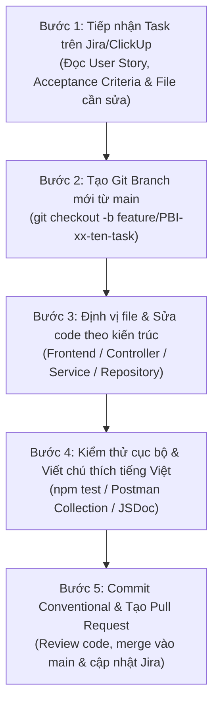

# CẨM NANG HƯỚNG DẪN PHÁT TRIỂN, LẬP TRÌNH & SỬA MÃ NGUỒN (DEVELOPER HANDBOOK & CODING GUIDE)

> **Dự án:** Hệ thống Quản lý Trường học Toàn diện (HTQLLH / EduManage Pro)  
> **Môn học:** Phát triển dự án phần mềm (SW320DV01) - Đại học Hoa Sen (HSU)  
> **Tác giả:** Võ Duy Bình (Project Manager & Lead Business Analyst)  
> **Ngày cập nhật:** 14/11/2026 (Tuần 10)  
> **Phiên bản:** v2.0 - Bổ sung Hướng dẫn sửa code & Danh mục Link tài liệu kỹ thuật  

---

## 1. TỔNG QUAN KIẾN TRÚC & PHÂN BỔ THƯ MỤC MÃ NGUỒN

Dự án áp dụng mô hình kiến trúc tách biệt rõ ràng giữa **Frontend (Single Page Application)** và **Backend (Clean Architecture REST API)** cùng cơ sở dữ liệu quan hệ **PostgreSQL**.

```
PT_DA_PM/
├── database/                                # Khởi tạo & Dữ liệu mẫu CSDL PostgreSQL
│   ├── 01_init_schema.sql                  # Định nghĩa 18 bảng, Foreign Keys, Indexes
│   └── 02_seed_data.sql                    # Dữ liệu hạt giống (5 vai trò demo)
├── members/
│   ├── member1_PM_BA/                      # Quản lý Jira, ClickUp, Script đồng bộ
│   │   ├── enrich_clickup_and_jira.js      # Script đẩy mô tả & link kỹ thuật lên Jira/ClickUp
│   │   └── restore_visible_clickup.js      # Script bảo đảm hiển thị tasks ClickUp
│   ├── member2_Frontend/                   # Phân hệ Giao diện React Vite SPA
│   │   └── src/
│   │       ├── api/                        # Axios HTTP Client & API Services
│   │       ├── components/                 # UI Components (Sidebar, Navbar, Modal, Card)
│   │       ├── context/                    # React Context (AuthContext, SocketContext)
│   │       └── pages/                      # Màn hình chức năng theo 5 phân hệ người dùng
│   ├── member3_Backend_DB/                 # Phân hệ Backend Node.js Express REST API
│   │   └── school-management-nodejs/
│   │       └── src/
│   │           ├── config/                 # Kết nối CSDL (db.js / pg Pool)
│   │           ├── controllers/            # Xử lý HTTP Request/Response (Presentation Layer)
│   │           ├── services/               # Nghiệp vụ cốt lõi & Tính điểm TT22 (Domain Layer)
│   │           ├── repositories/           # Tương tác truy vấn SQL (Data Access Layer)
│   │           └── routes/                 # Định tuyến API Endpoints
│   └── member4_Logic_Security/             # Lớp Bảo mật & Thuật toán nghiệp vụ
│       ├── jwtAuthMiddleware.js            # Xác thực chữ ký số JWT
│       ├── rbacMiddleware.js               # Phân quyền 5 cấp bậc
│       ├── tt22EvaluationLogic.js          # Thuật toán xếp loại học lực & rèn luyện TT22
│       └── auditLogger.js                  # Ghi vết kiểm toán (Audit Trail)
└── docs/                                   # Tài liệu kỹ thuật, kiến trúc, Use Case & UML
```

---

## 2. QUY TRÌNH 5 BƯỚC THỰC HIỆN & SỬA CODE TỪ JIRA / CLICKUP

Khi bất kỳ thành viên nào nhận task từ **Jira Cloud** (Board `KAN`) hoặc **ClickUp** (Thư mục `HTQLLH`), hãy thực hiện theo đúng quy trình chuẩn 5 bước sau:



### Bước 1: Tiếp nhận Task & Chuyển trạng thái
1. Mở task được giao trên Jira Kanban hoặc ClickUp.
2. Đọc kỹ **3 nội dung cốt lõi**:
   - `User Story` & `Tiêu chí nghiệm thu (Acceptance Criteria)`.
   - `Danh sách tệp liên quan trực tiếp (Primary Files)`.
   - `Hướng dẫn kỹ thuật & Gợi ý lập trình`.
3. Kéo trạng thái task từ `To Do` sang `In Progress`.

### Bước 2: Tạo Git Branch phát triển
Trước khi viết mã, luôn đồng bộ nhánh `main` mới nhất và tạo nhánh tính năng riêng:
```bash
git checkout main
git pull origin main
git checkout -b feature/PBI-xx-ten-ngan-gon
# Ví dụ: git checkout -b feature/PBI-08-nhap-diem-bo-mon
```

### Bước 3: Định vị tệp mã nguồn & Sửa code theo tầng kiến trúc
- **Nếu làm Frontend**:
  - Mở tệp Page hoặc Component được chỉ định trong task (ví dụ: `members/member2_Frontend/src/pages/teacher/GradeEntry.jsx`).
  - Gọi API thông qua axios client tại `src/api/`. Không viết trực tiếp `fetch()` rời rạc trong component.
  - Sử dụng Toast notifications (`react-hot-toast` hoặc component Alert có sẵn) để báo lỗi/thành công thân thiện.
- **Nếu làm Backend**:
  - **Route** (`src/routes/`): Khai báo endpoint, gắn Middleware xác thực `authMiddleware` và phân quyền `rbacMiddleware`.
  - **Controller** (`src/controllers/`): Tiếp nhận `req.body`, `req.params`, validate sơ bộ (kiểm tra rỗng, kiểu dữ liệu), trả về mã lỗi HTTP chuẩn (`400`, `401`, `403`, `404`, `409`, `500`).
  - **Service** (`src/services/`): Chứa nghiệp vụ, logic tính toán (ví dụ công thức TT22, kiểm tra trùng lặp lịch dạy, khóa sổ điểm).
  - **Repository** (`src/repositories/`): Viết câu lệnh truy vấn PostgreSQL tham số hóa (`$1, $2`) qua `pool.query()`.
- **Nếu có giao dịch tiền tệ/khóa điểm**: Bắt buộc dùng `client = await pool.connect()` với `BEGIN ... COMMIT ... ROLLBACK`.

### Bước 4: Viết chú thích (Code Comment) tiếng Việt & Kiểm thử
- **Quy định bắt buộc**: Mọi hàm, phương thức mới hoặc được sửa PHẢI có JSDoc tiếng Việt giải thích:
  ```javascript
  /**
   * Lưu điểm đánh giá định kỳ môn học cho học sinh theo Thông tư 22
   * @param {number} studentId - Mã định danh học sinh
   * @param {number} subjectId - Mã môn học
   * @param {string} semester - Học kỳ ('HK1' | 'HK2')
   * @param {Array<number>} regularScores - Mảng điểm kiểm tra thường xuyên [0-10]
   * @returns {Promise<Object>} Bản ghi điểm đã được lưu thành công
   * @throws {Error} Ném lỗi 400 nếu dải điểm không hợp lệ ngoài [0, 10]
   */
  ```
- **Kiểm thử**: Chạy Postman Collection `docs/HTQLLH_Postman_Collection.json` hoặc chạy unit test `npm test`.

### Bước 5: Commit & Tạo Pull Request
1. Commit theo quy chuẩn Conventional Commits:
   ```bash
   git add .
   git commit -m "feat(PBI-08): them chuc nang kiem tra dai diem 0-10 va luu diem bo mon"
   ```
2. Đẩy nhánh lên cả 2 remote repository:
   ```bash
   git push origin feature/PBI-xx-ten-ngan-gon
   git push bitbucket feature/PBI-xx-ten-ngan-gon
   ```
3. Tạo Pull Request trên GitHub/Bitbucket và báo Lead PM/Reviewer kiểm duyệt trước khi merge vào `main`.

---

## 3. HƯỚNG DẪN CHI TIẾT CÁCH SỬA CODE THEO TỪNG PHÂN HỆ

### 3.1. Phân hệ Frontend (React 18, Vite, Tailwind CSS)
- **Quản lý Trạng thái (State Management)**: Sử dụng React Hooks chuẩn (`useState`, `useEffect`, `useCallback`). Không lưu trữ dữ liệu nhạy cảm (như mật khẩu tài khoản) vào `localStorage`.
- **Xử lý gọi API**:
  ```javascript
  // Ví dụ chuẩn tại src/api/gradeApi.js
  import axiosClient from './axiosClient';

  export const gradeApi = {
    getGradesByClassAndSubject: (classId, subjectId, semester) => {
      return axiosClient.get(`/api/grades/class/${classId}/subject/${subjectId}`, {
        params: { semester }
      });
    },
    saveGradesBatch: (gradeData) => {
      return axiosClient.post('/api/grades/batch', gradeData);
    }
  };
  ```
- **Kiểm soát hiển thị theo vai trò (Role-based UI Rendering)**:
  ```jsx
  const { user } = useAuth();
  return (
    <div>
      {user.role === 'ROLE_ADMIN' && <AdminControlPanel />}
      {['ROLE_HOMEROOM_TEACHER', 'ROLE_SUBJECT_TEACHER'].includes(user.role) && (
        <GradeEntryTable />
      )}
    </div>
  );
  ```

### 3.2. Phân hệ Backend (Node.js, Express, PostgreSQL)
- **Truy vấn an toàn chống SQL Injection (Prepared Statements)**:
  ```javascript
  // ĐÚNG: Sử dụng tham số hóa $1, $2
  const query = 'SELECT * FROM students WHERE class_id = $1 AND status = $2';
  const result = await pool.query(query, [classId, 'ACTIVE']);

  // TUYỆT ĐỐI KHÔNG: Nối chuỗi trực tiếp (Nguy cơ SQL Injection)
  // const query = `SELECT * FROM students WHERE class_id = ${classId}`;
  ```
- **Xử lý Giao dịch an toàn (Unit of Work Transaction)**:
  ```javascript
  const client = await pool.connect();
  try {
    await client.query('BEGIN');
    
    // Bước 1: Trừ công nợ học phí
    await client.query('UPDATE tuition_fees SET status = $1 WHERE id = $2', ['PAID', feeId]);
    
    // Bước 2: Tạo biên lai thu tiền
    await client.query('INSERT INTO receipts (fee_id, amount, payment_method) VALUES ($1, $2, $3)', [feeId, amount, 'VIETQR']);
    
    // Bước 3: Ghi vết kiểm toán
    await client.query('INSERT INTO audit_logs (user_id, action) VALUES ($1, $2)', [userId, 'PAYMENT_SUCCESS']);
    
    await client.query('COMMIT');
  } catch (error) {
    await client.query('ROLLBACK');
    throw error;
  } finally {
    client.release();
  }
  ```

---

## 4. BỘ SƯU TẬP ĐƯỜNG LINK TÀI LIỆU & HƯỚNG DẪN THAM KHẢO CHÍNH THỨC

Dưới đây là các tài liệu kỹ thuật chuẩn quốc tế mà tất cả thành viên có thể tra cứu nhanh trong quá trình code và sửa lỗi:

### 🌐 Phân hệ Frontend & Giao diện
1. **React 18 Official Documentation:** [https://react.dev/learn](https://react.dev/learn)  
   *Tài liệu chuẩn của React: Hướng dẫn State, Hooks (`useEffect`, `useState`), Component Lifecycle và Performance Optimization.*
2. **Vite Official Guide:** [https://vitejs.dev/guide/](https://vitejs.dev/guide/)  
   *Hướng dẫn cấu hình dự án, biến môi trường `.env`, build production tối ưu.*
3. **Tailwind CSS Components & Utilities:** [https://tailwindcss.com/docs](https://tailwindcss.com/docs)  
   *Bảng tra cứu class Tailwind CSS cho Flexbox, Grid, Colors, Spacing, Responsive Breakpoints.*
4. **Lucide Icons React:** [https://lucide.dev/icons/](https://lucide.dev/icons/)  
   *Bộ thư viện icon trực quan, tìm kiếm nhanh tên icon để import vào JSX.*
5. **React Router v6 Guide:** [https://reactrouter.com/en/main/start/overview](https://reactrouter.com/en/main/start/overview)  
   *Hướng dẫn tạo Private Route, Nested Routes, Redirects khi phân quyền người dùng.*

### ⚙️ Phân hệ Backend & API RESTful
6. **Express.js Routing & Middleware Guide:** [https://expressjs.com/en/guide/routing.html](https://expressjs.com/en/guide/routing.html)  
   *Cách viết Router, Middleware tiền xử lý request, Error-handling middleware.*
7. **Node.js Best Practices Repository:** [https://github.com/goldbergyoni/nodebestpractices](https://github.com/goldbergyoni/nodebestpractices)  
   *Hơn 80 nguyên tắc vàng thiết kế Clean Architecture, bảo mật, xử lý lỗi async/await trong Node.js.*
8. **RESTful API Design Rulebook (IETF / RFC):** [https://restfulapi.net/](https://restfulapi.net/)  
   *Quy chuẩn đặt tên URL endpoint, cấu trúc HTTP Status Codes (`200 OK`, `201 Created`, `400 Bad Request`, `401 Unauthorized`, `403 Forbidden`, `404 Not Found`, `409 Conflict`, `500 Internal Error`).*

### 🗄️ Cơ sở Dữ liệu & Kết nối PostgreSQL
9. **node-postgres (`pg`) Official Documentation:** [https://node-postgres.com/](https://node-postgres.com/)  
   *Hướng dẫn chi tiết sử dụng `Pool`, `pool.query()`, và [Quản lý Giao dịch Transactions (`BEGIN ... COMMIT ... ROLLBACK`)](https://node-postgres.com/features/transactions).*
10. **PostgreSQL Documentation (v15/v16):** [https://www.postgresql.org/docs/current/](https://www.postgresql.org/docs/current/)  
    *Cú pháp SQL chuẩn, Indexes (B-tree), Foreign Keys, Foreign Key Constraints và Aggregation Functions.*

### 🛡️ Lớp Bảo mật & Xác thực (Security & Auth)
11. **JWT.io Debugger & Introduction:** [https://jwt.io/introduction](https://jwt.io/introduction)  
    *Công cụ kiểm tra cấu trúc Header - Payload - Signature của JWT Token và tài liệu đặc tả RFC 7519.*
12. **OWASP Top 10 Web Application Security Risks:** [https://owasp.org/www-project-top-ten/](https://owasp.org/www-project-top-ten/)  
    *Tài liệu phòng chống các lỗ hổng Injection (SQLi), Broken Authentication, Broken Access Control (BOLA/IDOR), Rate Limiting.*
13. **bcrypt.js Documentation:** [https://www.npmjs.com/package/bcryptjs](https://www.npmjs.com/package/bcryptjs)  
    *Hướng dẫn hash mật khẩu an toàn với Salt Rounds và so khớp mật khẩu.*

### ⚡ Các Thư viện Nghiệp vụ Chuyên sâu (Specialized Modules)
14. **Socket.io Real-time Communication:** [https://socket.io/docs/v4/tutorial/step-5](https://socket.io/docs/v4/tutorial/step-5)  
    *Hướng dẫn thiết lập phòng chat (Rooms), phát sự kiện (Broadcasting), và xác thực token qua Socket Handshake.*
15. **SheetJS (xlsx) Documentation:** [https://docs.sheetjs.com/](https://docs.sheetjs.com/)  
    *Hướng dẫn đọc và ghi file Excel `.xlsx`, parse dữ liệu danh sách học sinh và xuất sổ điểm học tập.*
16. **PDFKit Documentation:** [https://pdfkit.org/docs/getting_started.html](https://pdfkit.org/docs/getting_started.html)  
    *Hướng dẫn thiết kế mẫu PDF học bạ, phiếu điểm, biên lai học phí có kẻ bảng và hỗ trợ Unicode tiếng Việt.*
17. **VietQR API & Payment Gateway Specifications:** [https://vietqr.net/](https://vietqr.net/)  
    *Đặc tả kỹ thuật tạo mã QR động ngân hàng chuẩn NAPAS 247 kèm mã đơn hàng và số tiền.*
18. **Chart.js Documentation:** [https://www.chartjs.org/docs/latest/](https://www.chartjs.org/docs/latest/)  
    *Hướng dẫn vẽ biểu đồ cột (Bar), tròn (Doughnut), đường (Line) cho phân hệ Báo cáo & Dashboard BGH.*

---

## 5. BẢNG TRA CỨU NHANH THEO MÔ ĐUN CHỨC NĂNG

| Mô đun | Tệp chính cần xem khi sửa code | Link tài liệu khuyến nghị |
| :--- | :--- | :--- |
| **Mô đun 1: Xác thực & RBAC** | `authMiddleware.js`, `AuthController.js`, `LoginPage.jsx` | [JWT.io](https://jwt.io/introduction) • [OWASP Auth](https://cheatsheetseries.owasp.org/cheatsheets/Authentication_Cheat_Sheet.html) |
| **Mô đun 2: Hồ sơ & Điểm danh** | `StudentController.js`, `AttendanceController.js` | [SheetJS Docs](https://docs.sheetjs.com/) • [PostgreSQL Transactions](https://node-postgres.com/features/transactions) |
| **Mô đun 3: Sổ điểm & TT22** | `GradeController.js`, `tt22EvaluationLogic.js` | [Thông tư 22/2021/TT-BGDĐT](https://thuvienphapluat.vn/) • [Clean Architecture Guide](https://blog.cleancoder.com/uncle-bob/2012/08/13/the-clean-architecture.html) |
| **Mô đun 4: Thời khóa biểu** | `TimetableController.js`, `TimetableGrid.jsx` | [React State Guide](https://react.dev/learn/managing-state) • [Express Routing](https://expressjs.com/en/guide/routing.html) |
| **Mô đun 5: Thông báo & Chat** | `chat.handler.js`, `AnnouncementController.js` | [Socket.io v4 Guide](https://socket.io/docs/v4/) • [WebSocket Protocol](https://developer.mozilla.org/en-US/docs/Web/API/WebSockets_API) |
| **Mô đun 6: Tài chính & VietQR** | `FeeController.js`, `vietqr.service.js` | [VietQR Specs](https://vietqr.net/) • [Node pg Transactions](https://node-postgres.com/features/transactions) |
| **Mô đun 7: Báo cáo & Dashboard** | `ReportController.js`, `DashboardPage.jsx` | [PDFKit Guide](https://pdfkit.org/) • [Chart.js Docs](https://www.chartjs.org/docs/latest/) |
| **Mô đun 8: Kiểm toán & Bảo mật** | `auditLogger.js`, `rateLimiter.js` | [OWASP Logging Cheat Sheet](https://cheatsheetseries.owasp.org/cheatsheets/Logging_Cheat_Sheet.html) • [Helmet.js](https://helmetjs.github.io/) |

---

*Tài liệu này được lưu trữ chính thức tại `docs/HUONG_DAN_LAP_TRINH_VA_SUA_CODE.md` trong kho mã nguồn của nhóm. Mọi thắc mắc trong quá trình thực hiện vui lòng trao đổi trực tiếp với Trưởng nhóm (PM/BA).*
