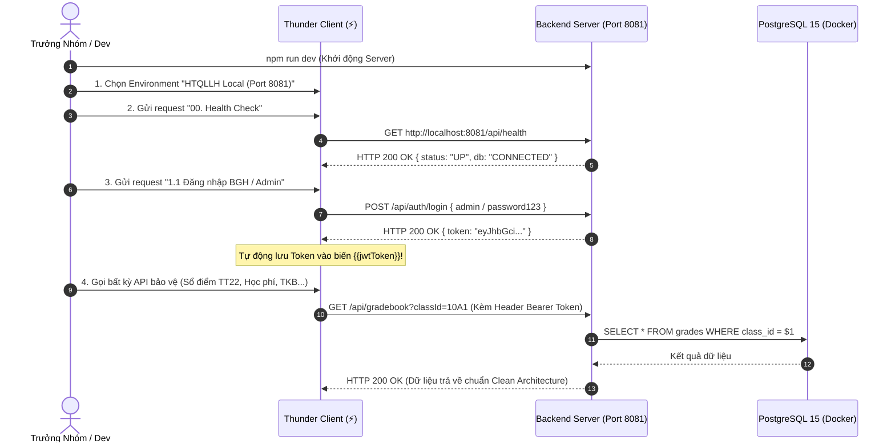

# CẨM NANG HƯỚNG DẪN KIỂM THỬ API BẰNG THUNDER CLIENT TRONG IDE
## HỆ THỐNG QUẢN LÝ LỚP HỌC & HỌC VỤ THPT (HTQLLH) — ĐẠI HỌC HOA SEN (HSU)

```
================================================================================
TỆP TÀI LIỆU: docs/HUONG_DAN_THUNDER_CLIENT.md
MỤC ĐÍCH: HƯỚNG DẪN TRƯỞNG NHÓM & CÁC THÀNH VIÊN SỬ DỤNG THUNDER CLIENT NGAY TRONG IDE:
          - 1. Giới thiệu Thunder Client Extension (⚡) nhẹ, chạy trực tiếp trong IDE.
          - 2. Hướng dẫn nạp Collection & Environment tự động (thư mục thunder-tests/).
          - 3. Hướng dẫn Import thủ công 1-Click (hỗ trợ cả Postman & Thunder Client format).
          - 4. Quy trình 3 bước kiểm thử API thực chiến không cần copy Token JWT.
          - 5. Danh mục 11 phân hệ API (35 endpoints mẫu chuẩn kiến trúc Clean Architecture).
VỊ TRÍ FILE SẴN CÓ:
  - Native Workspace Sync: thunder-tests/thunderCollection.json & thunderEnvironment.json
  - Import Files (docs/):  docs/HTQLLH_ThunderClient_Collection.json & Environment.json
  - Postman Backup:        docs/HTQLLH_Postman_Collection.json & Environment.json
TÁC GIẢ: Võ Duy Bình (Trưởng nhóm / Project Manager & Lead BA)
NGÀY PHÁT HÀNH: 15/11/2026 (Tuần 10 / 15 Tuần học kỳ 2631)
================================================================================
```

---

## 1. TẠI SAO NÊN DÙNG THUNDER CLIENT THAY VÌ POSTMAN NGOÀI?

**Thunder Client** là phần mở rộng (Extension) kiểm thử REST API phổ biến hàng đầu được tích hợp sẵn ngay trong môi trường phát triển (VS Code / Antigravity IDE):
- ⚡ **Siêu nhẹ & Tiết kiệm RAM**: Không cần mở phần mềm Postman Desktop nặng nề gây chậm máy hay xung đột bộ nhớ.
- 🎯 **Trực quan ngay cạnh Code**: Vừa sửa mã nguồn tại Backend/Frontend, vừa mở tab Thunder Client bên cạnh để bấm `Send` kiểm tra phản hồi API ngay lập tức.
- 🔄 **Tích hợp sẵn trong Repository**: Toàn bộ Collections và Environments đã được cấu hình sẵn trong thư mục `thunder-tests/` của dự án.

---

## 2. HƯỚNG DẪN NẠP BỘ SƯU TẬP API VÀO THUNDER CLIENT (2 CÁCH)

### CÁCH 1: TỰ ĐỘNG NHẬN DIỆN (KHUYÊN DÙNG — KHÔNG CẦN IMPORT)
Nhóm đã tạo sẵn cấu hình Git-Sync chuẩn của Thunder Client tại thư mục:
- `thunder-tests/thunderCollection.json`
- `thunder-tests/thunderEnvironment.json`

1. Trên thanh công cụ bên trái IDE (Activity Bar), bấm vào **biểu tượng tia sét ⚡ (Thunder Client)**.
2. Bấm vào tab **Collections**, bạn sẽ thấy ngay bộ sưu tập:
   👉 **`HTQLLH — School Management System (THPT HSU)`** (11 phân hệ, 35 endpoints).
3. Bấm vào tab **Env**, bạn sẽ thấy môi trường:
   👉 **`HTQLLH Local (Port 8081)`** với biến `baseUrl: http://localhost:8081`.

---

### CÁCH 2: IMPORT THỦ CÔNG BẰNG 1-CLICK (KHUYÊN DÙNG TRÊN BẢN FREE)

Khi bấm vào nút menu **≡ (More Options)** $\rightarrow$ chọn **Import**, Thunder Client cho phép bạn chọn một trong 2 định dạng:

#### Lựa chọn A: Import dạng "Thunder Client" (Đã chuẩn hóa chuẩn v1.1)
1. Trong thanh Thunder Client, chuyển sang tab **Collections**.
2. Bấm vào menu **≡ (More Options)** $\rightarrow$ Chọn **Import** $\rightarrow$ Chọn **Thunder Client**.
3. Chọn tệp:
   👉 [`docs/HTQLLH_ThunderClient_Collection.json`](file:///d:/HSU/2631Semester%201%282026-2027%29/PT_DA_PM/docs/HTQLLH_ThunderClient_Collection.json)
4. Tương tự tab **Env**: Bấm menu **≡** $\rightarrow$ Chọn **Import** $\rightarrow$ Chọn **Thunder Client** $\rightarrow$ Chọn tệp:
   👉 [`docs/HTQLLH_ThunderClient_Environment.json`](file:///d:/HSU/2631Semester%201%282026-2027%29/PT_DA_PM/docs/HTQLLH_ThunderClient_Environment.json)

#### Lựa chọn B: Import dạng "Postman" (Dự phòng cực kỳ tin cậy)
1. Trong tab **Collections**, bấm menu **≡** $\rightarrow$ Chọn **Import** $\rightarrow$ Chọn **Postman**.
2. Chọn tệp:
   👉 [`docs/HTQLLH_Postman_Collection.json`](file:///d:/HSU/2631Semester%201%282026-2027%29/PT_DA_PM/docs/HTQLLH_Postman_Collection.json)
3. Trong tab **Env**, bấm menu **≡** $\rightarrow$ Chọn **Import** $\rightarrow$ Chọn **Postman** $\rightarrow$ Chọn tệp:
   👉 [`docs/HTQLLH_Postman_Environment.json`](file:///d:/HSU/2631Semester%201%282026-2027%29/PT_DA_PM/docs/HTQLLH_Postman_Environment.json)

---

## 3. QUY TRÌNH 3 BƯỚC THỰC CHIẾN TEST TOÀN BỘ API CHO LEADER



### Bước 1: Khởi Động Máy Chủ Backend
Mở Terminal trong thư mục dự án và chạy:
```powershell
npm run dev
# Máy chủ Backend sẽ lắng nghe tại: http://localhost:8081
```

### Bước 2: Chọn Môi Trường & Kiểm Tra Kết Nối (Health Check)
1. Ở góc trên bên phải giao diện Thunder Client, bấm vào dropdown chọn môi trường:  
   👉 Chọn **`HTQLLH Local (Port 8081)`**.
2. Mở thư mục **`00. Health Check (Kiểm tra Server)`** $\rightarrow$ Bấm chọn request **`Kiểm tra trạng thái máy chủ (Health Check)`**.
3. Bấm nút màu xanh **Send**.
4. Phản hồi nhận được:
   ```json
   {
     "status": "UP",
     "timestamp": "2026-11-15T...",
     "uptime": 120.5,
     "database": "CONNECTED"
   }
   ```
   *(Trạng thái HTTP `200 OK` màu xanh lá là thành công!)*

### Bước 3: Đăng Nhập Để Tự Động Nhận Token JWT
1. Mở thư mục **`01. Xác Thực & Đăng Nhập (Authentication)`**.
2. Chọn request **`1.1 Đăng nhập BGH / Admin (Lấy Token tự động)`**.
3. Bấm **Send**.
4. Hệ thống đăng nhập tài khoản BGH, nhận về chuỗi JWT Token và **TỰ ĐỘNG GÁN** vào biến `jwtToken`.
5. Từ lúc này, **tất cả 30+ requests học vụ còn lại** (nhập điểm Thông tư 22, điểm danh, duyệt khóa sổ, thanh toán học phí VietQR...) đều đã được gắn sẵn Header `Authorization: Bearer {{jwtToken}}`, bạn chỉ việc click và bấm **Send** mà không cần copy token bằng tay!

---

## 4. DANH MỤC 11 PHÂN HỆ API TRONG BỘ TEST THUNDER CLIENT

| Thư mục API | Chức năng kiểm thử chính | Endpoints tiêu biểu | Phương thức |
| :--- | :--- | :--- | :---: |
| **00. Health Check** | Kiểm tra trạng thái máy chủ & CSDL | `/api/health` | `GET` |
| **01. Authentication** | Đăng nhập 5 Roles (BGH, GVCN, GVBM, HS, PH), Auth Me, Đổi mật khẩu | `/api/auth/login`<br>`/api/auth/me`<br>`/api/auth/change-password` | `POST`<br>`GET`<br>`POST` |
| **02. Students** | Lấy danh sách HS theo lớp, tra cứu cá nhân, cập nhật thông tin | `/api/students`<br>`/api/students/:id` | `GET`<br>`PUT` |
| **03. GradeBook TT22** | Xem bảng điểm môn, lưu điểm hàng loạt (ACID), chốt khóa sổ điểm | `/api/gradebook`<br>`/api/gradebook/save`<br>`/api/gradebook/lock` | `GET`<br>`POST`<br>`POST` |
| **04. Attendance** | Điểm danh chuyên cần lớp đầu giờ và theo tiết, báo cáo vắng $\ge 20\%$ | `/api/attendance`<br>`/api/attendance/save` | `GET`<br>`POST` |
| **05. Leave Requests** | Đơn xin nghỉ phép online từ PH, GVCN phê duyệt đơn | `/api/leave-requests`<br>`/api/leave-requests/approve` | `POST`<br>`PUT` |
| **06. Tuition & VietQR**| Tra cứu học phí, sinh mã VietQR NAPAS 247, thanh toán & xuất biên lai | `/api/tuition`<br>`/api/tuition/pay` | `GET`<br>`POST` |
| **07. Schedules (TKB)** | Tra cứu thời khóa biểu tuần, xếp lịch dạy chống xung đột tiết | `/api/schedules`<br>`/api/schedules/save` | `GET`<br>`POST` |
| **08. Dashboard BGH** | Thống kê số liệu học vụ, chuyên cần, tỷ lệ đạt/giỏi toàn trường | `/api/dashboard/admin`<br>`/api/dashboard/teacher` | `GET` |
| **09. Notifications** | Trung tâm thông báo đẩy, danh bạ sổ liên lạc trực tuyến PH - GV | `/api/notifications`<br>`/api/communication/messages` | `GET`<br>`POST` |
| **10. Users & Settings**| Quản trị người dùng BGH: Tạo tài khoản, Khóa user vi phạm, Reset pass | `/api/users`<br>`/api/users/:id/deactivate` | `GET`/`POST`<br>`PATCH` |

---

## 5. MỘT SỐ MẸO HỮU ÍCH KHI DÙNG THUNDER CLIENT TRONG DỰ ÁN

1. **Xem thời gian phản hồi (Response Time)**:
   - Ngay cạnh mã trạng thái HTTP (ví dụ `200 OK`), Thunder Client hiển thị thời gian máy chủ xử lý (ví dụ: `15 ms`). Nếu thấy thời gian $> 200\text{ ms}$, Leader có thể yêu cầu thành viên kiểm tra lại câu truy vấn CSDL.
2. **Kiểm tra mã nguồn trả về định dạng JSON**:
   - Thunder Client tự động tô màu cú pháp JSON (Pretty Print) và có chức năng thu gọn/mở rộng từng node dữ liệu, giúp đọc bảng điểm 45 học sinh rất dễ dàng.
3. **Chạy kiểm thử hàng loạt (Runner)**:
   - Trong tab **Collections**, bấm chuột phải vào thư mục (ví dụ `01. Authentication`) $\rightarrow$ Chọn **Run** $\rightarrow$ Thunder Client sẽ tự động chạy liên tiếp tất cả các request và hiển thị báo cáo Pass/Fail tức thì!

---

Leader có thể mở ngay tab Thunder Client ⚡ trên thanh công cụ IDE bên trái để trải nghiệm thử nghiệm API trực tiếp ạ!
