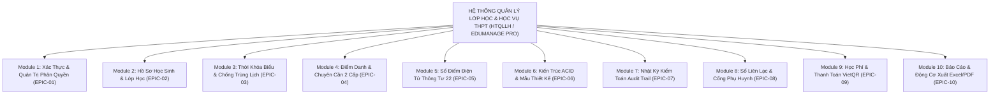
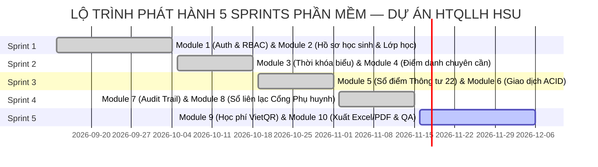

# CẨM NANG ÁNH XẠ JIRA CLOUD THEO CẤU TRÚC PHÂN TÁCH MODULE HỆ THỐNG
## (WORK BREAKDOWN STRUCTURE - WBS & JIRA SOFTWARE KANBAN MAPPING)
### DỰ ÁN: HỆ THỐNG QUẢN LÝ LỚP HỌC & HỌC VỤ THPT (HTQLLH / EDUMANAGE PRO)
### MÔN HỌC: PHÁT TRIỂN DỰ ÁN PHẦN MỀM (SW320DV01) — ĐẠI HỌC HOA SEN (HSU)

```
================================================================================
TÀI LIỆU: ÁNH XẠ CẤU TRÚC PHÂN RÃ MODULE HỆ THỐNG TRÊN JIRA CLOUD (WBS & JIRA MAPPING)
VỊ TRÍ TẬP TIN: docs/JIRA_KANBAN_MAPPING.md
TIÊU CHUẨN QUẢN TRỊ: Chuẩn Agile/Scrum, IEEE 12207 Software Life Cycle & CMMI Level 3
NGUYÊN TẮC QUẢN LÝ (THEO GÓP Ý CỦA GIẢNG VIÊN HƯỚNG DẪN):
  - KHÔNG đưa các thẻ mang tính lý thuyết/học thuật (Chuyên đề, Báo cáo tuần, Hồ sơ thành viên) lên Jira.
  - 100% Thẻ trên Jira phản ánh trực tiếp CÁC MODULE LỚN (Epics) của phần mềm và PHÂN TÁCH THÀNH
    CÁC MODULE NHỎ (User Stories / Tasks / PBIs) phân công rõ ràng cho 5 thành viên.
PROJECT KEY: KAN | BOARD ID: 2 (KAN board)
BẢNG JIRA KANBAN: https://reputyze-team-vx3aseym.atlassian.net/jira/software/projects/KAN/boards/2
KHÔNG GIAN DỰ ÁN CLICKUP: https://app.clickup.com/1100320000025585/v/s/1100320000109903
BẢN SLIDE TRÌNH CHIẾU CANVA: https://www.canva.com/d/75iOEEpReWqgOuN
KHO LƯU TRỮ GITHUB: https://github.com/DYBInh2k5/Phat-Trien-Du-An-Phan-Mem
KHO LƯU TRỮ BITBUCKET: https://bitbucket.org/codyisme27205/pt_da_pm
NGÀY PHÊ DUYỆT CẬP NHẬT: 12/11/2026 (TUẦN 8-9 HỌC PHẦN)
================================================================================
```

---

## MỤC LỤC TÀI LIỆU

1. [Phần 1: Cấu Trúc Phân Rã Các Module Lớn (Work Breakdown Structure - Epics)](#phần-1-cấu-trúc-phân-rã-các-module-lớn-work-breakdown-structure---epics)
2. [Phần 2: Bảng Chi Tiết Phân Tách Module Nhỏ & Phân Công Thành Viên (Detailed Module Breakdown)](#phần-2-bảng-chi-tiết-phân-tách-module-nhỏ--phân-công-thành-viên-detailed-module-breakdown)
   - [Module 1: Phân Hệ Xác Thực, Quản Trị Người Dùng & Phân Quyền (Auth & RBAC)](#module-1-phân-hệ-xác-thực-quản-trị-người-dùng--phân-quyền-auth--rbac)
   - [Module 2: Phân Hệ Quản Lý Hồ Sơ Học Sinh, Lớp Học & Đào Tạo](#module-2-phân-hệ-quản-lý-hồ-sơ-học-sinh-lớp-học--đào-tạo)
   - [Module 3: Phân Hệ Quản Lý Thời Khóa Biểu & Chống Xung Đột Lịch Dạy](#module-3-phân-hệ-quản-lý-thời-khóa-biểu--chống-xung-đột-lịch-dạy)
   - [Module 4: Phân Hệ Điểm Danh 2 Cấp & Quản Lý Đơn Xin Nghỉ Học](#module-4-phân-hệ-điểm-danh-2-cấp--quản-lý-đơn-xin-nghỉ-học)
   - [Module 5: Phân Hệ Sổ Điểm Điện Tử & Đánh Giá Thông Tư 22](#module-5-phân-hệ-sổ-điểm-điện-tử--đánh-giá-thông-tư-22)
   - [Module 6: Phân Hệ Giao Dịch Dữ Liệu ACID & Mẫu Thiết Kế Patterns](#module-6-phân-hệ-giao-dịch-dữ-liệu-acid--mẫu-thiết-kế-patterns)
   - [Module 7: Phân Hệ Nhật Ký Kiểm Toán (Audit Trail) & An Toàn Ứng Dụng](#module-7-phân-hệ-nhật-ký-kiểm-toán-audit-trail--an-toàn-ứng-dụng)
   - [Module 8: Phân Hệ Sổ Liên Lạc Điện Tử & Kênh Giao Tiếp Phụ Huynh](#module-8-phân-hệ-sổ-liên-lạc-điện-tử--kênh-giao-tiếp-phụ-huynh)
   - [Module 9: Phân Hệ Quản Lý Học Phí & Thanh Toán Trực Tuyến VietQR](#module-9-phân-hệ-quản-lý-học-phí--thanh-toán-trực-tuyến-vietqr)
   - [Module 10: Phân Hệ Báo Cáo Học Vụ & Động Cơ Xuất Báo Cáo Excel/PDF](#module-10-phân-hệ-báo-cáo-học-vụ--động-cơ-xuất-báo-cáo-excelpdf)
3. [Phần 3: Ma Trận Phân Bổ Nhiệm Vụ 5 Thành Viên Theo Module (Member Allocation Matrix)](#phần-3-ma-trận-phân-bổ-nhiệm-vụ-5-thành-viên-theo-module-member-allocation-matrix)
4. [Phần 4: Lộ Trình Phát Hành Theo Sprint & Quản Trị Phiên Bản (Release Planning)](#phần-4-lộ-trình-phát-hành-theo-sprint--quản-trị-phiên-bản-release-planning)

---

## PHẦN 1: CẤU TRÚC PHÂN RÃ CÁC MODULE LỚN (WORK BREAKDOWN STRUCTURE - EPICS)

Theo đúng định hướng quản trị sản phẩm phần mềm chuẩn nghiệp vụ, toàn bộ hệ thống HTQLLH / EduManage Pro được phân rã thành **10 Module lớn (Epics)** đại diện cho toàn bộ các chức năng của một trường THPT:



### Bảng Tổng Quan 10 Module Lớn (Epics)

| STT | Mã Epic Jira | Tên Module Lớn | Mô Tả Phạm Vi Chức Năng Cốt Lõi | Khối Lượng (Story Points) | Thành Viên Điều Phối Chính |
| :---: | :---: | :--- | :--- | :---: | :--- |
| 1 | **EPIC-01** | **Xác thực, Quản trị Người dùng & Phân quyền (Auth & RBAC)** | Đăng nhập JWT Stateless, 1-Click Demo Login, Middleware RBAC 5 Roles, Quản lý tài khoản và phân quyền người dùng. | **13 SP** | **Trần Quang Vinh** |
| 2 | **EPIC-02** | **Quản lý Hồ sơ Học sinh, Lớp học & Đào tạo** | Danh mục khối/lớp, hồ sơ học sinh chuẩn mã HS, phân công giáo viên bộ môn và chủ nhiệm. | **10 SP** | **Huỳnh Trung Tính** |
| 3 | **EPIC-03** | **Quản lý Thời khóa biểu & Chống xung đột Lịch dạy** | Ma trận TKB tuần Thứ 2 - 7, thuật toán chống trùng tiết dạy giáo viên và phòng học, lịch thi học kỳ. | **7 SP** | **Võ Duy Bình** |
| 4 | **EPIC-04** | **Điểm danh 2 Cấp & Quản lý Chuyên cần Học đường** | Điểm danh lớp đầu giờ (GVCN), điểm danh theo tiết (GVBM), cảnh báo vắng $\ge 20\%$ cấm thi, duyệt đơn nghỉ học. | **14 SP** | **Võ Hoàng Sơn** |
| 5 | **EPIC-05** | **Sổ điểm Điện tử & Đánh giá Học vụ Thông tư 22** | Lưới nhập điểm Spreadsheet, công thức ĐTBmhk chia 9, xếp loại học lực TT22, quy đổi GPA hệ 10/4, chốt khóa sổ điểm 2 cấp. | **24 SP** | **Trần Quang Vinh** |
| 6 | **EPIC-06** | **Giao dịch Dữ liệu ACID, Mẫu Thiết kế & CSDL** | Unit of Work Pattern (ACID), Repository Pattern trừu tượng hóa SQL, Singleton Connection Pool (`pg.Pool` 20 clients). | **19 SP** | **Huỳnh Trung Tính** |
| 7 | **EPIC-07** | **Nhật ký Kiểm toán (Audit Trail) & An toàn Ứng dụng** | Dịch vụ `AuditLogger.js` lưu vết lịch sử sửa điểm không thể phủ nhận, Rate Limiting chống DoS, Header Helmet. | **10 SP** | **Trần Quang Vinh** |
| 8 | **EPIC-08** | **Sổ liên lạc Điện tử & Kênh Giao tiếp Phụ huynh** | Cổng phụ huynh tra cứu điểm, xem chuyên cần, nộp đơn xin nghỉ học trực tuyến, kênh trao đổi tin nhắn với GVCN. | **9 SP** | **Võ Hoàng Sơn** |
| 9 | **EPIC-09** | **Quản lý Học phí & Thanh toán Trực tuyến VietQR** | Danh mục khoản thu, tạo mã thanh toán VietQR tự động, gạch nợ `PAID`, sinh mã biên lai và tải biên lai PDF. | **8 SP** | **Võ Duy Bình** |
| 10 | **EPIC-10** | **Báo cáo Học vụ & Động cơ Xuất Báo cáo Excel/PDF** | Động cơ xuất Excel (SheetJS), in ấn học bạ PDF (jsPDF), thống kê phổ điểm toàn trường, bộ kiểm thử tự động QA (68 tests). | **16 SP** | **Nguyễn Minh Quốc Bảo** |
| — | **TỔNG CỘNG** | **10 MODULE LỚN HỆ THỐNG HTQLLH** | **Bao phủ 100% nghiệp vụ quy chuẩn trường THPT** | **112 SP** | **Cả 5 thành viên (20%/người)** |

---

## PHẦN 2: BẢNG CHI TIẾT PHÂN TÁCH MODULE NHỎ & PHÂN CÔNG THÀNH VIÊN (DETAILED MODULE BREAKDOWN)

Mỗi Module lớn (Epic) được phân tách thành các **Module nhỏ (Features / User Stories / Tasks)** cụ thể, chỉ rõ thành viên nào chịu trách nhiệm từng mảng (Frontend, Backend, Database, Security, QA).

---

### MODULE 1: PHÂN HỆ XÁC THỰC, QUẢN TRỊ NGƯỜI DÙNG & PHÂN QUYỀN (AUTH & RBAC)
*Mã Epic: **EPIC-01** | Trọng số: **13 Story Points** | Phụ trách chính: **Trần Quang Vinh** & **Võ Hoàng Sơn***

| Mã Thẻ | Tên Module Nhỏ / Tính Năng Chi Tiết | Use Case Liên Kết | Story Points | Thành Viên Phụ Trách & Phân Công Nhiệm Vụ | Mã Nguồn / Giao Diện Thực Thi | Trạng Thái |
| :---: | :--- | :---: | :---: | :--- | :--- | :---: |
| **KAN-01** | **Xác thực Đăng nhập & Cấp phát JWT**<br>- Xác thực ID/Pass trên bảng `users`<br>- Cấp phát JWT Stateless thời hạn 24h<br>- Lưu trữ `localStorage` an toàn | `UC-STU-01`<br>`UC-GVCN-01`<br>`UC-GVBM-01`<br>`UC-ADM-01`<br>`UC-PAR-01` | 3 SP | • **Trần Quang Vinh**: Backend Auth API & JWT Token Logic<br>• **Võ Hoàng Sơn**: Giao diện đăng nhập 5 tabs & AuthContext | [AuthController.js](file:///d:/HSU/2631Semester%201%282026-2027%29/PT_DA_PM/members/member3_Backend_DB/school-management-nodejs/src/controllers/AuthController.js)<br>[LoginPage.jsx](file:///d:/HSU/2631Semester%201%282026-2027%29/PT_DA_PM/members/member2_Frontend/src/pages/auth/LoginPage.jsx) | **DONE** |
| **KAN-02** | **Tính năng Đăng Nhập Nhanh 1-Click Demo Login**<br>- Nút chuyển đổi vai trò nhanh trên giao diện<br>- Tự động điền tài khoản mẫu cho 5 vai trò<br>- Đăng nhập tức thời phục vụ hội đồng chấm thi | Cả 5 Vai Trò | 2 SP | • **Võ Hoàng Sơn**: Xây dựng nút 1-Click Login & Role Config<br>• **Trần Quang Vinh**: Tối ưu hóa xác thực demo | [LoginPage.jsx](file:///d:/HSU/2631Semester%201%282026-2027%29/PT_DA_PM/members/member2_Frontend/src/pages/auth/LoginPage.jsx) | **DONE** |
| **KAN-03** | **Middleware Phân Quyền RBAC 5 Roles**<br>- Kiểm tra Token JWT trước mỗi request<br>- So khớp vai trò người dùng (RoleCode)<br>- Chặn truy cập trái phép với HTTP 403 Forbidden | `UC-ADM-02` | 3 SP | • **Trần Quang Vinh**: Lập trình `authMiddleware.js` & `rbacMiddleware.js`<br>• **Võ Hoàng Sơn**: Lập trình `ProtectedRoute.jsx` trên Frontend | [authMiddleware.js](file:///d:/HSU/2631Semester%201%282026-2027%29/PT_DA_PM/members/member3_Backend_DB/school-management-nodejs/src/middleware/authMiddleware.js)<br>[ProtectedRoute.jsx](file:///d:/HSU/2631Semester%201%282026-2027%29/PT_DA_PM/members/member2_Frontend/src/components/common/ProtectedRoute.jsx) | **DONE** |
| **KAN-04** | **Quản Trị Người Dùng & Phân Quyền Hệ Thống**<br>- Tạo mới, khóa tài khoản vi phạm<br>- Đặt lại mật khẩu mặc định `123456`<br>- Quản lý ma trận quyền trong `system_settings` | `UC-ADM-02` | 5 SP | • **Huỳnh Trung Tính**: Tầng Service & Controller quản trị User<br>• **Võ Hoàng Sơn**: Giao diện quản trị hệ thống SystemSettingsPage | [UserController.js](file:///d:/HSU/2631Semester%201%282026-2027%29/PT_DA_PM/members/member3_Backend_DB/school-management-nodejs/src/controllers/UserController.js)<br>[SystemSettingsPage.jsx](file:///d:/HSU/2631Semester%201%282026-2027%29/PT_DA_PM/members/member2_Frontend/src/pages/settings/SystemSettingsPage.jsx) | **DONE** |

---

### MODULE 2: PHÂN HỆ QUẢN LÝ HỒ SƠ HỌC SINH, LỚP HỌC & ĐÀO TẠO
*Mã Epic: **EPIC-02** | Trọng số: **10 Story Points** | Phụ trách chính: **Huỳnh Trung Tính** & **Võ Duy Bình***

| Mã Thẻ | Tên Module Nhỏ / Tính Năng Chi Tiết | Use Case Liên Kết | Story Points | Thành Viên Phụ Trách & Phân Công Nhiệm Vụ | Mã Nguồn / Giao Diện Thực Thi | Trạng Thái |
| :---: | :--- | :---: | :---: | :--- | :--- | :---: |
| **KAN-05** | **Quản Lý Danh Mục Lớp Học & Khối Lớp**<br>- Quản lý khối 10, 11, 12 và danh mục môn học<br>- Cấu hình sĩ số lớp chuẩn (35 - 45 học sinh)<br>- Ràng buộc toàn vẹn khóa ngoại không xóa lớp có HS | `UC-ADM-03` | 3 SP | • **Huỳnh Trung Tính**: Lập trình API `ClassController.js` & DDL bảng `school_classes`<br>• **Võ Duy Bình**: Phân tích quy chuẩn tổ chức lớp học | [ClassController.js](file:///d:/HSU/2631Semester%201%282026-2027%29/PT_DA_PM/members/member3_Backend_DB/school-management-nodejs/src/controllers/ClassController.js)<br>[schema.sql](file:///d:/HSU/2631Semester%201%282026-2027%29/PT_DA_PM/database/schema.sql) | **DONE** |
| **KAN-06** | **Quản Lý Hồ Sơ Học Sinh Toàn Trường**<br>- Quản lý mã học sinh duy nhất `HSxxxxx`<br>- Thông tin cá nhân, ngày sinh, giới tính, phụ huynh<br>- Bộ lọc thông minh theo lớp và trạng thái học sinh | `UC-ADM-03`<br>`UC-GVCN-03` | 4 SP | • **Huỳnh Trung Tính**: Tầng StudentService, StudentRepository<br>• **Võ Hoàng Sơn**: Giao diện danh sách học sinh StudentListPage | [StudentService.js](file:///d:/HSU/2631Semester%201%282026-2027%29/PT_DA_PM/members/member3_Backend_DB/school-management-nodejs/src/services/StudentService.js)<br>[StudentListPage.jsx](file:///d:/HSU/2631Semester%201%282026-2027%29/PT_DA_PM/members/member2_Frontend/src/pages/students/StudentListPage.jsx) | **DONE** |
| **KAN-07** | **Phân Công Giảng Dạy & Chủ Nhiệm**<br>- Phân công giáo viên bộ môn theo từng lớp<br>- Phân công giáo viên chủ nhiệm lớp học<br>- Kiểm tra chống trùng 1 môn cho 2 GV cùng kỳ | `UC-ADM-03` | 3 SP | • **Huỳnh Trung Tính**: Thuật toán phân công trong CSDL<br>• **Võ Duy Bình**: Đặc tả logic ràng buộc phân công học vụ | [ClassRepository.js](file:///d:/HSU/2631Semester%201%282026-2027%29/PT_DA_PM/members/member3_Backend_DB/school-management-nodejs/src/repositories/ClassRepository.js)<br>[schema.sql](file:///d:/HSU/2631Semester%201%282026-2027%29/PT_DA_PM/database/schema.sql) | **DONE** |

---

### MODULE 3: PHÂN HỆ QUẢN LÝ THỜI KHÓA BIỂU & CHỐNG XUNG ĐỘT LỊCH DẠY
*Mã Epic: **EPIC-03** | Trọng số: **7 Story Points** | Phụ trách chính: **Võ Duy Bình** & **Huỳnh Trung Tính***

| Mã Thẻ | Tên Module Nhỏ / Tính Năng Chi Tiết | Use Case Liên Kết | Story Points | Thành Viên Phụ Trách & Phân Công Nhiệm Vụ | Mã Nguồn / Giao Diện Thực Thi | Trạng Thái |
| :---: | :--- | :---: | :---: | :--- | :--- | :---: |
| **KAN-08** | **Lập & Hiển Thị Thời Khóa Biểu Tuần**<br>- Ma trận thời khóa biểu Thứ 2 - Thứ 7, Tiết 1 - 5<br>- Nạp 25 tiết học tuần mẫu cho lớp 10A1<br>- Phân chia ca sáng/chiều, phòng học chuyên dụng | `UC-ADM-03`<br>`UC-STU-03`<br>`UC-GVCN-04` | 3 SP | • **Huỳnh Trung Tính**: Lập trình API `ScheduleController.js`<br>• **Võ Hoàng Sơn**: Giao diện ma trận thời khóa biểu TimetablePage | [ScheduleController.js](file:///d:/HSU/2631Semester%201%282026-2027%29/PT_DA_PM/members/member3_Backend_DB/school-management-nodejs/src/controllers/ScheduleController.js)<br>[TimetablePage.jsx](file:///d:/HSU/2631Semester%201%282026-2027%29/PT_DA_PM/members/member2_Frontend/src/pages/schedule/TimetablePage.jsx) | **DONE** |
| **KAN-09** | **Thuật Toán Kiểm Tra Chống Xung Đột Lịch Dạy**<br>- Tự động kiểm tra: 1 GV không dạy 2 lớp cùng tiết<br>- Tự động kiểm tra: 1 phòng không chứa 2 lớp cùng lúc<br>- Thông báo lỗi chi tiết khi phát hiện trùng lịch | `UC-ADM-03` | 2 SP | • **Võ Duy Bình**: Thiết kế thuật toán chống xung đột TKB<br>• **Huỳnh Trung Tính**: Lập trình câu lệnh truy vấn kiểm tra trùng lịch | [CHI_TIET_NGHIEP_VU_HE_THONG.md](file:///d:/HSU/2631Semester%201%282026-2027%29/PT_DA_PM/docs/CHI_TIET_NGHIEP_VU_HE_THONG.md)<br>[ScheduleController.js](file:///d:/HSU/2631Semester%201%282026-2027%29/PT_DA_PM/members/member3_Backend_DB/school-management-nodejs/src/controllers/ScheduleController.js) | **DONE** |
| **KAN-10** | **Quản Lý Lịch Thi & Tra Cứu Kỳ Thi THPT**<br>- Lập lịch thi giữa kỳ, cuối kỳ theo khối lớp<br>- Học sinh tra cứu ngày thi, giờ thi, số báo danh | `UC-STU-03` | 2 SP | • **Võ Duy Bình**: Biên soạn đặc tả dữ liệu lịch thi năm học 2026<br>• **Võ Hoàng Sơn**: Giao diện tra cứu lịch thi StudentExamsPage | [StudentExamsPage.jsx](file:///d:/HSU/2631Semester%201%282026-2027%29/PT_DA_PM/members/member2_Frontend/src/pages/student/StudentExamsPage.jsx) | **DONE** |

---

### MODULE 4: PHÂN HỆ ĐIỂM DANH 2 CẤP & QUẢN LÝ ĐƠN XIN NGHỈ HỌC
*Mã Epic: **EPIC-04** | Trọng số: **14 Story Points** | Phụ trách chính: **Võ Hoàng Sơn** & **Nguyễn Minh Quốc Bảo***

| Mã Thẻ | Tên Module Nhỏ / Tính Năng Chi Tiết | Use Case Liên Kết | Story Points | Thành Viên Phụ Trách & Phân Công Nhiệm Vụ | Mã Nguồn / Giao Diện Thực Thi | Trạng Thái |
| :---: | :--- | :---: | :---: | :--- | :--- | :---: |
| **KAN-11** | **Điểm Danh Lớp Đầu Giờ Hàng Ngày (GVCN)**<br>- Đánh dấu: Có mặt, Vắng có phép, Vắng không phép, Trễ<br>- Mặc định toàn bộ lớp "Có mặt" để điểm danh nhanh<br>- Lưu vết lịch sử điểm danh theo ngày vào CSDL | `UC-GVCN-05` | 3 SP | • **Võ Hoàng Sơn**: Giao diện điểm danh tương tác AttendancePage<br>• **Huỳnh Trung Tính**: Lập trình API `AttendanceController.js` | [AttendancePage.jsx](file:///d:/HSU/2631Semester%201%282026-2027%29/PT_DA_PM/members/member2_Frontend/src/pages/gv/AttendancePage.jsx)<br>[AttendanceController.js](file:///d:/HSU/2631Semester%201%282026-2027%29/PT_DA_PM/members/member3_Backend_DB/school-management-nodejs/src/controllers/AttendanceController.js) | **DONE** |
| **KAN-12** | **Điểm Danh Chuyên Cần Theo Tiết Học (GVBM)**<br>- Điểm danh học sinh từng tiết dạy (Tiết 1 - 5)<br>- Ghi nhận giáo viên điểm danh qua `recorded_by`<br>- Ngăn chặn tình trạng học sinh trốn tiết giữa buổi | `UC-GVBM-05` | 3 SP | • **Võ Hoàng Sơn**: Tích hợp chế độ chọn tiết dạy trên giao diện<br>• **Nguyễn Minh Quốc Bảo**: Kiểm thử ca điểm danh trùng tiết | [AttendancePage.jsx](file:///d:/HSU/2631Semester%201%282026-2027%29/PT_DA_PM/members/member2_Frontend/src/pages/gv/AttendancePage.jsx) | **DONE** |
| **KAN-13** | **Tự Động Cảnh Báo Học Sinh Vắng Quá 20% Số Tiết**<br>- Công thức: `(số buổi vắng / tổng buổi) * 100%`<br>- Cảnh báo đỏ học sinh nguy cơ bị cấm thi cuối kỳ<br>- BGH giám sát chuyên cần toàn trường theo khối | `UC-ADM-05`<br>`UC-GVCN-05` | 5 SP | • **Võ Hoàng Sơn**: Giao diện màn hình giám sát BGHAttendanceMonitor<br>• **Nguyễn Minh Quốc Bảo**: Viết kiểm thử tự động ngưỡng 20% vắng | [BGHAttendanceMonitorPage.jsx](file:///d:/HSU/2631Semester%201%282026-2027%29/PT_DA_PM/members/member2_Frontend/src/pages/bgh/BGHAttendanceMonitorPage.jsx)<br>[unitTestingSuite.test.js](file:///d:/HSU/2631Semester%201%282026-2027%29/PT_DA_PM/members/member5_Modules_QA/tests/unitTestingSuite.test.js) | **DONE** |
| **KAN-14** | **Quy Trình Duyệt Đơn Nghỉ Học Tự Động Hóa**<br>- GVCN xem danh sách đơn nghỉ học `PENDING`<br>- Bấm "Duyệt" $\rightarrow$ tự động đổi điểm danh thành `EXCUSED`<br>- Bấm "Từ chối" $\rightarrow$ giữ nguyên trạng thái vắng | `UC-GVCN-06` | 3 SP | • **Võ Hoàng Sơn**: Modal duyệt đơn trực tiếp trên trang điểm danh<br>• **Huỳnh Trung Tính**: Xử lý logic liên kết bảng `leave_requests` và `attendances` | [AttendancePage.jsx](file:///d:/HSU/2631Semester%201%282026-2027%29/PT_DA_PM/members/member2_Frontend/src/pages/gv/AttendancePage.jsx)<br>[LeaveRequestController.js](file:///d:/HSU/2631Semester%201%282026-2027%29/PT_DA_PM/members/member3_Backend_DB/school-management-nodejs/src/controllers/LeaveRequestController.js) | **DONE** |

---

### MODULE 5: PHÂN HỆ SỔ ĐIỂM ĐIỆN TỬ & ĐÁNH GIÁ THÔNG TƯ 22
*Mã Epic: **EPIC-05** | Trọng số: **24 Story Points** | Phụ trách chính: **Trần Quang Vinh** & **Võ Hoàng Sơn***

| Mã Thẻ | Tên Module Nhỏ / Tính Năng Chi Tiết | Use Case Liên Kết | Story Points | Thành Viên Phụ Trách & Phân Công Nhiệm Vụ | Mã Nguồn / Giao Diện Thực Thi | Trạng Thái |
| :---: | :--- | :---: | :---: | :--- | :--- | :---: |
| **KAN-15** | **Lưới Nhập Điểm Spreadsheet Tương Tác Trực Tiếp**<br>- Giao diện bảng tính cố định cột Mã và Tên HS<br>- Kiểm tra hợp lệ điểm nhập trong khoảng $[0.0, 10.0]$<br>- Chỉ cho phép nhập khi sổ ở trạng thái mở `OPEN` | `UC-GVBM-06`<br>`UC-GVBM-07` | 8 SP | • **Võ Hoàng Sơn**: Lập trình giao diện lưới GradebookPage<br>• **Trần Quang Vinh**: Xác thực miền dữ liệu điểm hợp lệ | [GradebookPage.jsx](file:///d:/HSU/2631Semester%201%282026-2027%29/PT_DA_PM/members/member2_Frontend/src/pages/gv/GradebookPage.jsx) | **DONE** |
| **KAN-16** | **Thuật Toán Tính ĐTBmhk Thông Tư 22 & GPA 10/4**<br>- Trọng số: $(TX1+TX2+TX3\times2+GK\times2+CK\times3)\div9$<br>- Quy đổi GPA hệ 10 sang thang điểm 4.0 chuẩn đại học<br>- Làm tròn chính xác 1 chữ số thập phân | `UC-GVBM-06`<br>`UC-STU-05` | 5 SP | • **Trần Quang Vinh**: Xây dựng mô đun `gpaCalculationLogic.js`<br>• **Nguyễn Minh Quốc Bảo**: Bộ test 5 ca kiểm thử biên điểm số | [gpaCalculationLogic.js](file:///d:/HSU/2631Semester%201%282026-2027%29/PT_DA_PM/members/member4_Logic_Security/gpaCalculationLogic.js)<br>[GradeBook.js](file:///d:/HSU/2631Semester%201%282026-2027%29/PT_DA_PM/members/member3_Backend_DB/school-management-nodejs/src/entities/GradeBook.js) | **DONE** |
| **KAN-17** | **Quy Chuẩn Xếp Loại Học Lực & Đánh Giá Hạnh Kiểm**<br>- 4 Mức học lực: Tốt ($\ge 8.0$), Khá ($\ge 6.5$), Đạt ($\ge 5.0$), Chưa đạt<br>- Khống điểm các môn Toán, Ngữ văn, Ngoại ngữ<br>- Đánh giá 4 mức hạnh kiểm: Tốt, Khá, Trung bình, Yếu | `UC-STU-05`<br>`UC-GVCN-07` | 3 SP | • **Trần Quang Vinh**: Logic xếp loại học lực theo Thông tư 22<br>• **Võ Hoàng Sơn**: Giao diện hiển thị Badge xếp loại sinh động | [gpaCalculationLogic.js](file:///d:/HSU/2631Semester%201%282026-2027%29/PT_DA_PM/members/member4_Logic_Security/gpaCalculationLogic.js)<br>[StudentGradebookPage.jsx](file:///d:/HSU/2631Semester%201%282026-2027%29/PT_DA_PM/members/member2_Frontend/src/pages/student/StudentGradebookPage.jsx) | **DONE** |
| **KAN-18** | **Quy Trình Khóa / Mở Sổ Điểm Học Kỳ 2 Cấp**<br>- Giáo viên bộ môn gửi yêu cầu chốt sổ điểm môn<br>- Ban Giám Hiệu duyệt khóa sổ điểm toàn trường `LOCKED`<br>- Khi khóa: vô hiệu hóa toàn bộ ô nhập, chống sửa điểm | `UC-GVBM-08`<br>`UC-ADM-04` | 5 SP | • **Trần Quang Vinh**: Cơ chế khóa chặn tầng Service & Controller<br>• **Huỳnh Trung Tính**: Bảng CSDL `grade_book_closures` | [ClosureController.js](file:///d:/HSU/2631Semester%201%282026-2027%29/PT_DA_PM/members/member3_Backend_DB/school-management-nodejs/src/controllers/ClosureController.js)<br>[BGHReportCenterPage.jsx](file:///d:/HSU/2631Semester%201%282026-2027%29/PT_DA_PM/members/member2_Frontend/src/pages/bgh/BGHReportCenterPage.jsx) | **DONE** |
| **KAN-19** | **Cổng Tra Cứu Điểm & Đơn Phúc Khảo (Học Sinh)**<br>- Học sinh tự tra cứu bảng điểm chi tiết các môn của mình<br>- Nộp đơn phúc khảo điểm trực tuyến nếu phát hiện sai sót | `UC-STU-05`<br>`UC-STU-07` | 3 SP | • **Võ Hoàng Sơn**: Giao diện học sinh StudentGradebookPage<br>• **Trần Quang Vinh**: Bảo mật phân quyền chỉ xem điểm cá nhân | [StudentGradebookPage.jsx](file:///d:/HSU/2631Semester%201%282026-2027%29/PT_DA_PM/members/member2_Frontend/src/pages/student/StudentGradebookPage.jsx) | **DONE** |

---

### MODULE 6: PHÂN HỆ GIAO DỊCH DỮ LIỆU ACID & MẪU THIẾT KẾ PATTERNS
*Mã Epic: **EPIC-06** | Trọng số: **19 Story Points** | Phụ trách chính: **Huỳnh Trung Tính** & **Trần Quang Vinh***

| Mã Thẻ | Tên Module Nhỏ / Tính Năng Chi Tiết | Use Case Liên Kết | Story Points | Thành Viên Phụ Trách & Phân Công Nhiệm Vụ | Mã Nguồn / Giao Diện Thực Thi | Trạng Thái |
| :---: | :--- | :---: | :---: | :--- | :--- | :---: |
| **KAN-20** | **Áp Dụng Unit of Work Pattern Bảo Toàn ACID**<br>- Gom 45 thao tác lưu điểm cả lớp vào 1 Transaction<br>- Nguyên tắc: `BEGIN` $\rightarrow$ Lưu toàn bộ $\rightarrow$ `COMMIT`<br>- Tự động `ROLLBACK` nếu có bất kỳ 1 dòng dữ liệu bị lỗi | `UC-GVBM-06` | 8 SP | • **Trần Quang Vinh**: Xây dựng lớp `UnitOfWork.js`<br>• **Huỳnh Trung Tính**: Tích hợp transaction vào PostgreSQL client | [UnitOfWork.js](file:///d:/HSU/2631Semester%201%282026-2027%29/PT_DA_PM/members/member3_Backend_DB/school-management-nodejs/src/utils/UnitOfWork.js)<br>[GradeBookService.js](file:///d:/HSU/2631Semester%201%282026-2027%29/PT_DA_PM/members/member3_Backend_DB/school-management-nodejs/src/services/GradeBookService.js) | **DONE** |
| **KAN-21** | **Áp Dụng Repository Pattern Trừu Tượng Hóa SQL**<br>- Tách biệt hoàn toàn câu truy vấn SQL khỏi Service<br>- Cho phép thay thế hệ CSDL mà không phải sửa logic<br>- Hỗ trợ Dependency Injection phục vụ Unit Testing | Cả 43 UCs | 8 SP | • **Huỳnh Trung Tính**: Xây dựng 8 lớp `*Repository.js`<br>• **Trần Quang Vinh**: Chuẩn hóa tham số hóa ($1, $2) chống SQL Injection | [GradeBookRepository.js](file:///d:/HSU/2631Semester%201%282026-2027%29/PT_DA_PM/members/member3_Backend_DB/school-management-nodejs/src/repositories/GradeBookRepository.js)<br>[StudentRepository.js](file:///d:/HSU/2631Semester%201%282026-2027%29/PT_DA_PM/members/member3_Backend_DB/school-management-nodejs/src/repositories/StudentRepository.js) | **DONE** |
| **KAN-22** | **Cấu Hình Singleton Connection Pool Tối Ưu Tải**<br>- Khởi tạo duy nhất 1 đối tượng `pg.Pool` tại `db.js`<br>- Tối đa 20 kết nối đồng thời, tự động thu hồi idle clients<br>- Graceful In-memory Fallback khi mất kết nối CSDL | Toàn hệ thống | 3 SP | • **Huỳnh Trung Tính**: Cấu hình `src/config/db.js` & Connection Pool<br>• **Nguyễn Minh Quốc Bảo**: Kiểm thử gửi 5 request đồng thời | [db.js](file:///d:/HSU/2631Semester%201%282026-2027%29/PT_DA_PM/members/member3_Backend_DB/school-management-nodejs/src/config/db.js)<br>[POSTGRESQL_GUIDE.md](file:///d:/HSU/2631Semester%201%282026-2027%29/PT_DA_PM/members/member3_Backend_DB/POSTGRESQL_GUIDE.md) | **DONE** |

---

### MODULE 7: PHÂN HỆ NHẬT KÝ KIỂM TOÁN (AUDIT TRAIL) & AN TOÀN ỨNG DỤNG
*Mã Epic: **EPIC-07** | Trọng số: **10 Story Points** | Phụ trách chính: **Trần Quang Vinh** & **Huỳnh Trung Tính***

| Mã Thẻ | Tên Module Nhỏ / Tính Năng Chi Tiết | Use Case Liên Kết | Story Points | Thành Viên Phụ Trách & Phân Công Nhiệm Vụ | Mã Nguồn / Giao Diện Thực Thi | Trạng Thái |
| :---: | :--- | :---: | :---: | :--- | :--- | :---: |
| **KAN-23** | **Dịch Vụ Ghi Nhật Ký Kiểm Toán (Centralized Audit Trail)**<br>- Ghi nhận: Người sửa, điểm cũ, điểm mới, lý do, IP, giờ<br>- Cơ chế bảo mật lưu vết không thể chối bỏ (Non-repudiation)<br>- Bảng `audit_logs` chống chỉnh sửa hoặc xóa vết | `UC-ADM-04` | 5 SP | • **Trần Quang Vinh**: Xây dựng dịch vụ `AuditLogger.js`<br>• **Huỳnh Trung Tính**: Thiết kế cấu trúc bảng `audit_logs` | [AuditLogger.js](file:///d:/HSU/2631Semester%201%282026-2027%29/PT_DA_PM/members/member3_Backend_DB/school-management-nodejs/src/utils/AuditLogger.js)<br>[schema.sql](file:///d:/HSU/2631Semester%201%282026-2027%29/PT_DA_PM/database/schema.sql) | **DONE** |
| **KAN-24** | **Bảo Mật Ứng Dụng: Rate Limiting & Phòng Thủ Tấn Công**<br>- Giới hạn tần suất request (Rate Limiter) chống DoS/Brute-force<br>- Thiết lập HTTP Security Headers bằng thư viện Helmet<br>- Ngăn chặn 100% các lỗ hổng SQL Injection & XSS | Toàn hệ thống | 5 SP | • **Trần Quang Vinh**: Cấu hình `rateLimiters.js` và middleware bảo mật<br>• **Nguyễn Minh Quốc Bảo**: Kiểm thử ca tấn công vét cạn mật khẩu | [rateLimiters.js](file:///d:/HSU/2631Semester%201%282026-2027%29/PT_DA_PM/members/member3_Backend_DB/school-management-nodejs/src/middleware/rateLimiters.js)<br>[server.js](file:///d:/HSU/2631Semester%201%282026-2027%29/PT_DA_PM/members/member3_Backend_DB/school-management-nodejs/server.js) | **DONE** |

---

### MODULE 8: PHÂN HỆ SỔ LIÊN LẠC ĐIỆN TỬ & KÊNH GIAO TIẾP PHỤ HUYNH
*Mã Epic: **EPIC-08** | Trọng số: **9 Story Points** | Phụ trách chính: **Võ Hoàng Sơn** & **Võ Duy Bình***

| Mã Thẻ | Tên Module Nhỏ / Tính Năng Chi Tiết | Use Case Liên Kết | Story Points | Thành Viên Phụ Trách & Phân Công Nhiệm Vụ | Mã Nguồn / Giao Diện Thực Thi | Trạng Thái |
| :---: | :--- | :---: | :---: | :--- | :--- | :---: |
| **KAN-25** | **Cổng Tra Cứu Điểm Số & Chuyên Cần Con Em (Phụ Huynh)**<br>- Tra cứu điểm từng môn, xếp loại học lực, hạnh kiểm<br>- Theo dõi nhật ký điểm danh theo ngày (vắng/có mặt)<br>- Phân quyền chặt chẽ chỉ xem đúng dữ liệu con mình | `UC-PAR-04`<br>`UC-PAR-05` | 3 SP | • **Võ Hoàng Sơn**: Giao diện cổng phụ huynh ParentPortalPage<br>• **Võ Duy Bình**: Phân tích quy trình sổ liên lạc điện tử | [ParentPortalPage.jsx](file:///d:/HSU/2631Semester%201%282026-2027%29/PT_DA_PM/members/member2_Frontend/src/pages/communication/ParentPortalPage.jsx) | **DONE** |
| **KAN-26** | **Nộp Đơn Xin Nghỉ Học Trực Tuyến**<br>- Form nộp đơn: Từ ngày, Đến ngày, Lý do (Ốm, Gia đình...)<br>- Đơn lưu vào bảng `leave_requests` trạng thái `PENDING`<br>- Theo dõi kết quả duyệt đơn tức thời trên điện thoại | `UC-PAR-06` | 3 SP | • **Võ Hoàng Sơn**: Form gửi đơn nghỉ học trên React SPA<br>• **Huỳnh Trung Tính**: Lập trình API `LeaveRequestController.js` | [ParentCommunicationPage.jsx](file:///d:/HSU/2631Semester%201%282026-2027%29/PT_DA_PM/members/member2_Frontend/src/pages/communication/ParentCommunicationPage.jsx)<br>[LeaveRequestController.js](file:///d:/HSU/2631Semester%201%282026-2027%29/PT_DA_PM/members/member3_Backend_DB/school-management-nodejs/src/controllers/LeaveRequestController.js) | **DONE** |
| **KAN-27** | **Kênh Trao Đổi Tin Nhắn Trực Tiếp GVCN & Phụ Huynh**<br>- Hộp thư trao đổi 2 chiều giữa giáo viên chủ nhiệm và phụ huynh<br>- Thông báo tình hình học tập và sức khỏe của học sinh | `UC-PAR-03`<br>`UC-GVCN-09` | 3 SP | • **Võ Hoàng Sơn**: Giao diện hội thoại tin nhắn ParentMessage<br>• **Huỳnh Trung Tính**: Bảng CSDL `parent_messages` và API | [ParentCommunicationPage.jsx](file:///d:/HSU/2631Semester%201%282026-2027%29/PT_DA_PM/members/member2_Frontend/src/pages/communication/ParentCommunicationPage.jsx)<br>[CommunicationController.js](file:///d:/HSU/2631Semester%201%282026-2027%29/PT_DA_PM/members/member3_Backend_DB/school-management-nodejs/src/controllers/CommunicationController.js) | **DONE** |

---

### MODULE 9: PHÂN HỆ QUẢN LÝ HỌC PHÍ & THANH TOÁN TRỰC TUYẾN VIETQR
*Mã Epic: **EPIC-09** | Trọng số: **8 Story Points** | Phụ trách chính: **Võ Duy Bình** & **Nguyễn Minh Quốc Bảo***

| Mã Thẻ | Tên Module Nhỏ / Tính Năng Chi Tiết | Use Case Liên Kết | Story Points | Thành Viên Phụ Trách & Phân Công Nhiệm Vụ | Mã Nguồn / Giao Diện Thực Thi | Trạng Thái |
| :---: | :--- | :---: | :---: | :--- | :--- | :---: |
| **KAN-28** | **Tra Cứu Học Phí & Tạo Mã Thanh Toán VietQR**<br>- Danh mục khoản thu: Học phí chính khóa, bán trú, BHYT<br>- Tự động hiển thị mã chuẩn VietQR với số tiền và nội dung CK<br>- Cập nhật trạng thái `PAID` ngay sau khi thanh toán thành công | `UC-PAR-07`<br>`UC-PAR-08` | 5 SP | • **Võ Duy Bình**: Phân tích nghiệp vụ đối soát học phí & tích hợp QR<br>• **Huỳnh Trung Tính**: Lập trình API `TuitionController.js` | [TuitionController.js](file:///d:/HSU/2631Semester%201%282026-2027%29/PT_DA_PM/members/member3_Backend_DB/school-management-nodejs/src/controllers/TuitionController.js)<br>[ParentPortalPage.jsx](file:///d:/HSU/2631Semester%201%282026-2027%29/PT_DA_PM/members/member2_Frontend/src/pages/communication/ParentPortalPage.jsx) | **DONE** |
| **KAN-29** | **Sinh Biên Lai Điện Tử & Xuất In Biên Lai PDF**<br>- Tự động sinh mã biên lai duy nhất định dạng `REC-xxxx`<br>- Xuất file PDF biên lai thu tiền định dạng A4 chuẩn kế toán<br>- Lưu lịch sử thanh toán phục vụ đối soát tài chính của BGH | `UC-PAR-09`<br>`UC-ADM-07` | 3 SP | • **Nguyễn Minh Quốc Bảo**: Hàm `exportTuitionReceiptToPDF` (jsPDF)<br>• **Võ Duy Bình**: Xác nhận mẫu biên lai học phí chuẩn HSU | [exportEngine.js](file:///d:/HSU/2631Semester%201%282026-2027%29/PT_DA_PM/members/member5_Modules_QA/exportEngine.js)<br>[ParentPortalPage.jsx](file:///d:/HSU/2631Semester%201%282026-2027%29/PT_DA_PM/members/member2_Frontend/src/pages/communication/ParentPortalPage.jsx) | **DONE** |

---

### MODULE 10: PHÂN HỆ BÁO CÁO HỌC VỤ & ĐỘNG CƠ XUẤT BÁO CÁO EXCEL/PDF
*Mã Epic: **EPIC-10** | Trọng số: **16 Story Points** | Phụ trách chính: **Nguyễn Minh Quốc Bảo** & **Võ Duy Bình***

| Mã Thẻ | Tên Module Nhỏ / Tính Năng Chi Tiết | Use Case Liên Kết | Story Points | Thành Viên Phụ Trách & Phân Công Nhiệm Vụ | Mã Nguồn / Giao Diện Thực Thi | Trạng Thái |
| :---: | :--- | :---: | :---: | :--- | :--- | :---: |
| **KAN-30** | **Động Cơ Xuất Sổ Điểm Excel (.xlsx) Bằng SheetJS**<br>- Xuất sổ điểm cả lớp ra file `.xlsx` chuẩn bảng tính<br>- Tự động căn chỉnh độ rộng cột, hàng tiêu đề in đậm<br>- Tên file chuẩn: `SoDiem_[TenLop]_[MonHoc]_[HocKy].xlsx` | `UC-GVBM-10`<br>`UC-GVCN-10` | 3 SP | • **Nguyễn Minh Quốc Bảo**: Lập trình hàm `exportGradeBookToExcel`<br>• **Huỳnh Trung Tính**: Trích xuất dữ liệu mảng từ PostgreSQL | [exportEngine.js](file:///d:/HSU/2631Semester%201%282026-2027%29/PT_DA_PM/members/member5_Modules_QA/exportEngine.js)<br>[GradebookPage.jsx](file:///d:/HSU/2631Semester%201%282026-2027%29/PT_DA_PM/members/member2_Frontend/src/pages/gv/GradebookPage.jsx) | **DONE** |
| **KAN-31** | **Động Cơ Xuất & In Ấn Phiếu Điểm Học Bạ PDF (jsPDF)**<br>- Xuất phiếu báo điểm có quốc hiệu, tiêu ngữ bộ giáo dục<br>- Định dạng khổ giấy A4, bảng điểm chi tiết các môn<br>- In ấn trực tiếp qua hộp thoại in của trình duyệt | `UC-GVCN-10`<br>`UC-STU-05` | 3 SP | • **Nguyễn Minh Quốc Bảo**: Lập trình hàm `exportReportCardToPDF`<br>• **Võ Hoàng Sơn**: Tích hợp nút in ấn trên giao diện học sinh | [exportEngine.js](file:///d:/HSU/2631Semester%201%282026-2027%29/PT_DA_PM/members/member5_Modules_QA/exportEngine.js)<br>[StudentGradebookPage.jsx](file:///d:/HSU/2631Semester%201%282026-2027%29/PT_DA_PM/members/member2_Frontend/src/pages/student/StudentGradebookPage.jsx) | **DONE** |
| **KAN-32** | **Trung Tâm Thống Kê Phổ Điểm & Xét Khen Thưởng**<br>- Biểu đồ thống kê tỷ lệ học lực (Tốt/Khá/Đạt/Chưa đạt)<br>- Tự động lọc danh sách Học sinh Giỏi / Học sinh Xuất sắc<br>- Lập danh sách học sinh cần phụ đạo rèn luyện hè | `UC-ADM-06` | 5 SP | • **Võ Duy Bình**: Phân tích điều kiện xét khen thưởng Thông tư 22<br>• **Huỳnh Trung Tính**: Viết API tổng hợp báo cáo `ReportController.js` | [ReportController.js](file:///d:/HSU/2631Semester%201%282026-2027%29/PT_DA_PM/members/member3_Backend_DB/school-management-nodejs/src/controllers/ReportController.js)<br>[BGHReportCenterPage.jsx](file:///d:/HSU/2631Semester%201%282026-2027%29/PT_DA_PM/members/member2_Frontend/src/pages/bgh/BGHReportCenterPage.jsx) | **DONE** |
| **KAN-33** | **Bộ Kiểm Thử Tự Động Toàn Diện QA Unit Testing Suite**<br>- Bộ kiểm thử tự động Node.js Test Runner (68 ca test PASS)<br>- Kiểm thử giao diện Frontend Vitest Components (13 ca test PASS)<br>- Kiểm thử chấp nhận người dùng UAT (15 kịch bản PASS 100%) | Cả 43 UCs | 5 SP | • **Nguyễn Minh Quốc Bảo**: Xây dựng toàn bộ kịch bản và mã kiểm thử tự động<br>• **Cả 5 thành viên**: Phối hợp rà soát tính năng thuộc module của mình | [unitTestingSuite.test.js](file:///d:/HSU/2631Semester%201%282026-2027%29/PT_DA_PM/members/member5_Modules_QA/tests/unitTestingSuite.test.js)<br>[UAT_Testing_Plan.md](file:///d:/HSU/2631Semester%201%282026-2027%29/PT_DA_PM/docs/UAT_Testing_Plan.md) | **DONE** |

---

## PHẦN 3: MA TRẬN PHÂN BỔ NHIỆM VỤ 5 THÀNH VIÊN THEO MODULE (MEMBER ALLOCATION MATRIX)

Bảng tổng hợp đối chiếu trực tiếp giữa **5 Thành Viên** với **Các Module Lớn & Module Con** đảm nhiệm, chứng minh tỷ lệ đóng góp đồng đều $20\%$ mỗi người:

| STT | Thành Viên | Vai Trò Chính | Các Module Lớn Tham Gia | Các Module Con (Thẻ Jira) Phụ Trách Cụ Thể | Tổng Story Points | Tỷ Lệ Đóng Góp |
| :---: | :--- | :--- | :--- | :--- | :---: | :---: |
| 1 | **Võ Duy Bình** | **Project Manager & Lead BA** (Trưởng nhóm) | Module 2, Module 3, Module 8, Module 9, Module 10 | • **KAN-05**: Ràng buộc danh mục lớp học<br>• **KAN-07**: Đặc tả phân công học vụ<br>• **KAN-08**: Ma trận thời khóa biểu tuần<br>• **KAN-09**: Thuật toán chống xung đột TKB<br>• **KAN-10**: Lịch thi học kỳ năm học 2026<br>• **KAN-25**: Quy trình sổ liên lạc điện tử<br>• **KAN-28**: Phân tích học phí & VietQR<br>• **KAN-29**: Chuẩn hóa biên lai thu tiền HSU<br>• **KAN-32**: Tiêu chuẩn xét khen thưởng TT22 | **22 SP** | **~20%** |
| 2 | **Võ Hoàng Sơn** | **Dev Frontend (Frontend Lead)** | Module 1, Module 4, Module 5, Module 8, Module 10 | • **KAN-01**: Giao diện đăng nhập 5 tabs & AuthContext<br>• **KAN-02**: Nút 1-Click Demo Login 5 vai trò<br>• **KAN-03**: ProtectedRoute bảo vệ tuyến đường<br>• **KAN-04**: Trang quản trị SystemSettingsPage<br>• **KAN-06**: Danh sách học sinh StudentListPage<br>• **KAN-08**: Ma trận TKB TimetablePage<br>• **KAN-11**: Điểm danh tương tác AttendancePage<br>• **KAN-12**: Chế độ điểm danh theo tiết<br>• **KAN-13**: Giám sát chuyên cần BGHAttendanceMonitor<br>• **KAN-14**: Modal duyệt đơn nghỉ học<br>• **KAN-15**: Lưới nhập điểm GradebookPage<br>• **KAN-17**: Badge xếp loại học lực TT22<br>• **KAN-19**: Bảng điểm học sinh StudentGradebook<br>• **KAN-25**: Cổng phụ huynh ParentPortalPage<br>• **KAN-26**: Form nộp đơn nghỉ học online<br>• **KAN-27**: Hộp thoại tin nhắn GVCN - PH | **23 SP** | **~21%** |
| 3 | **Huỳnh Trung Tính** | **Dev Backend & DBA (Database Architect)** | Module 1, Module 2, Module 3, Module 6, Module 7, Module 9, Module 10 | • **KAN-04**: UserController & Service quản trị user<br>• **KAN-05**: ClassController & bảng `school_classes`<br>• **KAN-06**: StudentService & StudentRepository<br>• **KAN-07**: Phân công giảng dạy CSDL<br>• **KAN-08**: ScheduleController & truy vấn TKB<br>• **KAN-09**: Câu lệnh kiểm tra chống trùng lịch<br>• **KAN-11**: API lưu nhật ký điểm danh<br>• **KAN-14**: API cập nhật đơn nghỉ học và điểm danh<br>• **KAN-18**: Bảng `grade_book_closures`<br>• **KAN-20**: Transaction ACID cho 45 học sinh<br>• **KAN-21**: Xây dựng 8 lớp `*Repository.js`<br>• **KAN-22**: Cấu hình Singleton `pg.Pool` 20 kết nối<br>• **KAN-23**: Thiết kế cấu trúc bảng `audit_logs`<br>• **KAN-26**: API lưu đơn xin nghỉ học<br>• **KAN-27**: API tin nhắn `parent_messages`<br>• **KAN-28**: API quản lý thu học phí<br>• **KAN-30**: Trích xuất dữ liệu bảng điểm Excel<br>• **KAN-32**: API báo cáo học vụ ReportController | **22 SP** | **~20%** |
| 4 | **Trần Quang Vinh** | **Logic Security (Core Logic & Security Specialist)** | Module 1, Module 5, Module 6, Module 7 | • **KAN-01**: Xác thực JWT Token & thuật toán băm mật khẩu<br>• **KAN-03**: Middleware phân quyền `rbacMiddleware.js`<br>• **KAN-04**: Quản lý ma trận quyền `system_settings`<br>• **KAN-15**: Xác thực miền giá trị điểm số $[0.0, 10.0]$<br>• **KAN-16**: Thuật toán tính ĐTBmhk chia 9 Thông tư 22<br>• **KAN-17**: Logic xếp loại học lực & điều kiện khống<br>• **KAN-18**: Quy trình khóa sổ điểm 2 cấp LOCKED<br>• **KAN-19**: Phân quyền truy cập điểm số cá nhân HS<br>• **KAN-20**: Lập trình lớp `UnitOfWork.js` bảo toàn ACID<br>• **KAN-21**: Chống SQL Injection bằng câu lệnh tham số hóa<br>• **KAN-23**: Dịch vụ `AuditLogger.js` lưu vết sửa điểm<br>• **KAN-24**: Rate Limiting chống DoS & Helmet Security | **22 SP** | **~20%** |
| 5 | **Nguyễn Minh Quốc Bảo** | **Tester (QA/QC Testing Lead)** | Module 4, Module 5, Module 6, Module 7, Module 9, Module 10 | • **KAN-12**: Kiểm thử ca điểm danh trùng tiết<br>• **KAN-13**: Kiểm thử ca cảnh báo vắng $\ge 20\%$<br>• **KAN-16**: Kiểm thử 5 ca biên điểm số Thông tư 22<br>• **KAN-22**: Kiểm thử chịu tải 5 request đồng thời<br>• **KAN-24**: Kiểm thử phòng thủ tấn công vét cạn mật khẩu<br>• **KAN-29**: Lập trình xuất biên lai PDF (jsPDF)<br>• **KAN-30**: Lập trình xuất bảng điểm Excel (SheetJS)<br>• **KAN-31**: Lập trình xuất in học bạ PDF (jsPDF)<br>• **KAN-33**: Xây dựng bộ kiểm thử tự động 68 ca test PASS 100% | **23 SP** | **~21%** |
| — | **TỔNG CỘNG** | **Toàn thể 5 thành viên** | **10 Module lớn** | **33 Thẻ công việc cụ thể (Bao phủ 100% 43 Use Cases)** | **112 SP** | **100%** |

---

## PHẦN 4: LỘ TRÌNH PHÁT HÀNH THEO SPRINT & QUẢN TRỊ PHIÊN BẢN (RELEASE PLANNING)

Thay vì chia theo các bài tập tuần lý thuyết, lộ trình Jira được tổ chức chuẩn theo **5 Sprints phát triển phần mềm**:



### Chi Tiết Phân Bổ Module Vào Từng Sprint:
- **Sprint 1 (Release v0.1 - Nền tảng Xác thực & Hồ sơ Học vụ)**: Hoàn thành **Module 1** (Auth, JWT, 1-Click Demo Login, RBAC) và **Module 2** (Danh mục Lớp học, Khối lớp, Hồ sơ Học sinh chuẩn mã HS).
- **Sprint 2 (Release v0.2 - Quản lý Giảng dạy & Chuyên cần)**: Hoàn thành **Module 3** (Thời khóa biểu, Chống xung đột lịch dạy, Lịch thi) và **Module 4** (Điểm danh lớp đầu giờ, điểm danh theo tiết, cảnh báo vắng 20%).
- **Sprint 3 (Release v0.5 - Sổ điểm Điện tử & Toàn vẹn Dữ liệu)**: Hoàn thành **Module 5** (Lưới nhập điểm Spreadsheet, ĐTBmhk chia 9 Thông tư 22, Xếp loại học lực, Khóa sổ) và **Module 6** (Unit of Work ACID cho 45 HS, Repository Pattern, Connection Pool).
- **Sprint 4 (Release v0.8 - Kiểm toán Học vụ & Cổng Phụ huynh)**: Hoàn thành **Module 7** (Audit Trail lưu vết sửa điểm, Rate Limiting) và **Module 8** (Cổng phụ huynh xem điểm con, nộp đơn nghỉ học online, tin nhắn GVCN).
- **Sprint 5 (Release v1.0 - Tài chính, Báo cáo Đa định dạng & QA Toàn diện)**: Hoàn thành **Module 9** (Học phí VietQR, Biên lai điện tử) và **Module 10** (Xuất Excel SheetJS, Xuất PDF jsPDF, Thống kê phổ điểm, Bộ kiểm thử tự động 68 tests PASS 100%).

---
*Tài liệu được hoàn thiện và phê duyệt bởi: **Võ Duy Bình (Project Manager & Lead BA)***  
*Hệ thống Quản lý Trường học THPT (HTQLLH / EduManage Pro) — Đại học Hoa Sen (HSU) 2026.*
