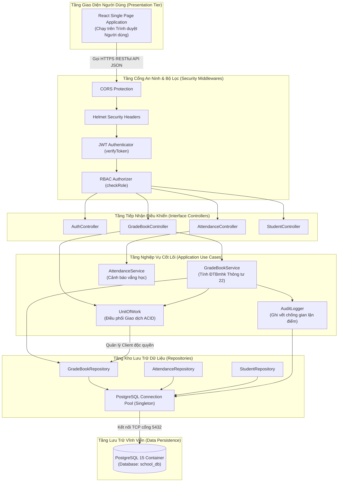
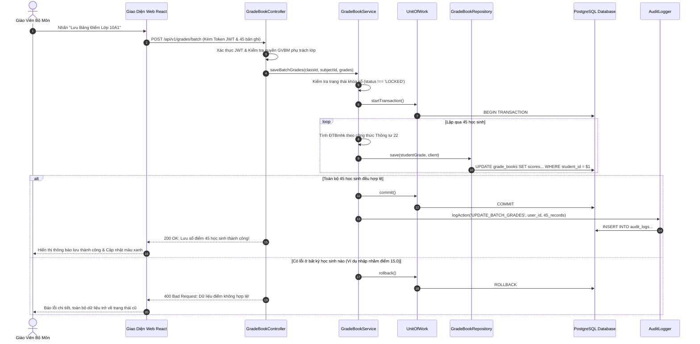
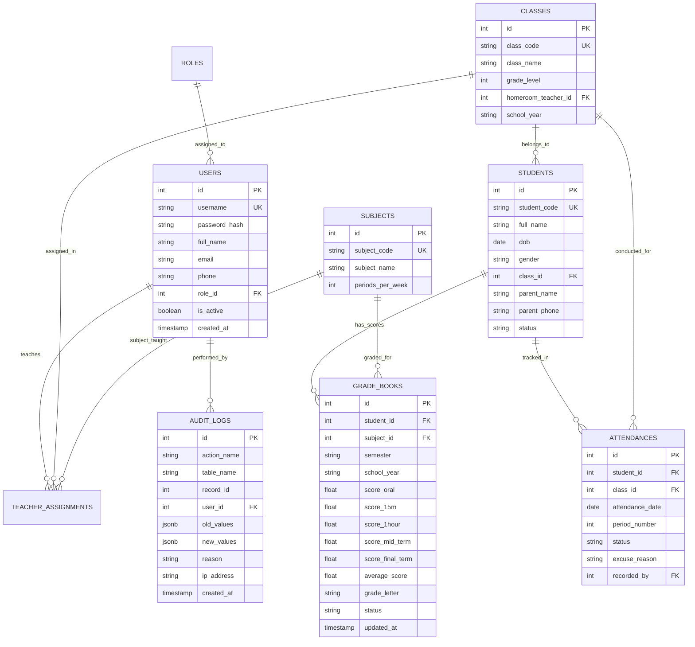

# TÀI LIỆU ĐẶC TẢ KIẾN TRÚC CHI TIẾT HỆ THỐNG
## HỆ THỐNG QUẢN LÝ LỚP HỌC (HTQLLH) — THPT HOA SEN (HSU)

```
================================================================================
DỰ ÁN: HỆ THỐNG QUẢN LÝ LỚP HỌC THPT HSU (SCHOOL MANAGEMENT SYSTEM - SMS)
MÃ MÔN HỌC: SW320DV01 — PHÁT TRIỂN DỰ ÁN PHẦN MỀM
VỊ TRÍ TÀI LIỆU: docs/KIEN_TRUC_CHI_TIET_HE_THONG.md
TÁC GIẢ: NHÓM DỰ ÁN PHÁT TRIỂN PHẦN MỀM HSU (TRƯỞNG NHÓM: VÕ DUY BÌNH)
NGÀY LẬP: 27/10/2026
PHIÊN BẢN: 2.0 (HOÀN THIỆN ĐẶC TẢ KIẾN TRÚC CLEAN ARCHITECTURE & DESIGN PATTERNS)
================================================================================
```

---

## MỤC LỤC

1. [Phần 1: Tổng Quan Chiến Lược Kiến Trúc Hệ Thống](#phan-1-tong-quan-chien-luoc-kien-truc-he-thong)
2. [Phần 2: Mô Hình Phân Tầng Clean Architecture 4 Lớp](#phan-2-mo-hinh-phan-tang-clean-architecture-4-lop)
3. [Phần 3: Sơ Đồ Kiến Trúc Tổng Thể (Mermaid C4 Container Diagram)](#phan-3-so-do-kien-truc-tong-the-mermaid-c4-container-diagram)
4. [Phần 4: Sơ Đồ Tuần Tự Xử Lý Giao Dịch Học Vụ (Sequence Diagram)](#phan-4-so-do-tuan-tu-xu-ly-giao-dich-hoc-vu-sequence-diagram)
5. [Phần 5: Các Mẫu Thiết Kế Phần Mềm Được Áp Dụng (Design Patterns)](#phan-5-cac-mau-thiet-ke-phan-mem-duoc-ap-dung-design-patterns)
   - [5.1 Repository Pattern (Mẫu Người Thủ Kho Dữ Liệu)](#51-repository-pattern-mau-nguoi-thu-kho-du-lieu)
   - [5.2 Unit of Work Pattern (Quản Lý Giao Dịch ACID)](#52-unit-of-work-pattern-quan-ly-giao-dich-acid)
   - [5.3 Singleton Pattern (Quản Lý Connection Pool Cơ Sở Dữ Liệu)](#53-singleton-pattern-quan-ly-connection-pool-co-so-du-lieu)
   - [5.4 Middleware Pipeline Pattern (Chuỗi Xử Lý Yêu Cầu An Ninh)](#54-middleware-pipeline-pattern-chuoi-xu-ly-yeu-cau-an-ninh)
6. [Phần 6: Thiết Kế Cơ Sở Dữ Liệu Chuẩn Hóa 3NF & Sơ Đồ ERD](#phan-6-thiet-ke-co-so-du-lieu-chuan-hoa-3nf--so-do-erd)
7. [Phần 7: Kiến Trúc Bảo Mật & Ma Trận Phân Quyền RBAC 5 Vai Trò](#phan-7-kien-truc-bao-mat--ma-tran-phan-quyen-rbac-5-vai-tro)
8. [Phần 8: Bảng Ánh Xạ Kiến Trúc Sang Mã Nguồn Thực Tế Trong Repository](#phan-8-bang-anh-xa-kien-truc-sang-ma-nguon-thuc-te-trong-repository)

---

## PHẦN 1: TỔNG QUAN CHIẾN LƯỢC KIẾN TRÚC HỆ THỐNG

### 1.1 Mục Tiêu Thiết Kế Kiến Trúc
Kiến trúc của Hệ thống Quản lý Lớp học THPT HSU (HTQLLH) được thiết kế nhằm đạt được 5 tiêu chuẩn kỹ thuật cốt lõi:
1. **Khả năng Bảo trì (Maintainability)**: Tách biệt hoàn toàn tầng logic nghiệp vụ học vụ khỏi tầng giao tiếp giao diện và cơ sở dữ liệu.
2. **Khả năng Kiểm thử Độc lập (Testability)**: Các ca kiểm thử logic tính điểm Thông tư 22 có thể chạy mà không cần kết nối vào PostgreSQL thật (thông qua Mock Repositories).
3. **Tính Toàn vẹn Dữ liệu (Data Consistency & ACID)**: Bảo vệ dữ liệu sổ điểm khi lưu hàng loạt 45 học sinh không bị rơi vào trạng thái rách nát dữ liệu nếu có sự cố mạng.
4. **Bảo mật Đa tầng (Defense in Depth)**: Kiểm soát truy cập nghiêm ngặt từ lớp biên (Network Firewall, CORS, Helmet) đến lớp ứng dụng (JWT, RBAC) và lớp dữ liệu (Prepared Statements, Audit Logs).
5. **Khả năng Mở rộng (Extensibility)**: Tổ chức mã nguồn dạng Monolithic Modular (Monorepo), sẵn sàng chia tách thành các dịch vụ độc lập (Microservices) trong tương lai.

---

## PHẦN 2: MÔ HÌNH PHÂN TẦNG CLEAN ARCHITECTURE 4 LỚP

Hệ thống tuân thủ nguyên lý Đảo ngược Phụ thuộc (Dependency Inversion Principle - DIP) của kiến trúc Clean Architecture: **Mọi sự phụ thuộc mã nguồn chỉ được phép hướng từ ngoài vào trong**.

```
+-------------------------------------------------------------------------------+
|                         TẦNG 4: FRAMEWORKS & DRIVERS                          |
|   - Web Client: React 18, Vite, Vanilla CSS Modern, React Router v6          |
|   - HTTP Server Engine: Node.js (v18 LTS), Express.js Framework               |
|   - Hệ Quản Trị CSDL: PostgreSQL 15 (Chạy trong Docker Container: postgres_db)|
|   - Thư viện bảo mật: bcryptjs, jsonwebtoken, helmet, cors                    |
+-------------------------------------------------------------------------------+
                                        |
                                        v
+-------------------------------------------------------------------------------+
|                         TẦNG 3: INTERFACE ADAPTERS                            |
|   - RESTful Controllers: Tiếp nhận HTTP, validate input, điều phối Service    |
|   - Repositories: Đóng gói truy vấn SQL tham số hóa ($1, $2)                  |
|   - Middlewares: verifyToken, checkRole, globalErrorHandler                   |
|   - DTOs & Presenters: Chuẩn hóa dữ liệu JSON đầu ra                          |
+-------------------------------------------------------------------------------+
                                        |
                                        v
+-------------------------------------------------------------------------------+
|                    TẦNG 2: USE CASES / APPLICATION SERVICES                   |
|   - GradeBookService: Thuật toán tính ĐTBmhk Thông tư 22, xếp loại học lực    |
|   - AttendanceService: Tính tỷ lệ chuyên cần, cảnh báo vắng học quá 20%       |
|   - UnitOfWork: Điều phối giao dịch nguyên tử nhiều bản ghi điểm              |
|   - AuditLogger: Đóng gói ghi vết kiểm toán học vụ chống gian lận             |
+-------------------------------------------------------------------------------+
                                        |
                                        v
+-------------------------------------------------------------------------------+
|                     TẦNG 1: ENTERPRISE DOMAIN / ENTITIES                      |
|   - Đối tượng nghiệp vụ cốt lõi: Student, Classroom, Subject, GradeBook       |
|   - Quy tắc nghiệp vụ bất biến (Invariants): Thang điểm [0-10], Sĩ số <= 45   |
+-------------------------------------------------------------------------------+
```

---

## PHẦN 3: SƠ ĐỒ KIẾN TRÚC TỔNG THỂ (MERMAID C4 CONTAINER DIAGRAM)



---

## PHẦN 4: SƠ ĐỒ TUẦN TỰ XỬ LÝ GIAO DỊCH HỌC VỤ (SEQUENCE DIAGRAM)

Luồng xử lý khi Giáo viên bộ môn lưu bảng điểm cho một lớp gồm 45 học sinh:



---

## PHẦN 5: CÁC MẪU THIẾT KẾ PHẦN MỀM ĐƯỢC ÁP DỤNG (DESIGN PATTERNS)

### 5.1 Repository Pattern (Mẫu Người Thủ Kho Dữ Liệu)
- **Tệp mã nguồn**: [GradeBookRepository.js](file:///d:/HSU/2631Semester%201%282026-2027%29/PT_DA_PM/members/member3_Backend_DB/school-management-nodejs/src/repositories/GradeBookRepository.js)
- **Vấn đề giải quyết**: Nếu viết câu lệnh SQL trực tiếp trong Service hoặc Controller, hệ thống sẽ bị phụ thuộc chặt chẽ (Tightly Coupled) vào PostgreSQL. Khi cần đổi sang CSDL khác hoặc viết Unit Test, mã nguồn sẽ bị phá vỡ.
- **Giải pháp**: Repository đóng vai trò như một tập hợp đối tượng trong bộ nhớ. Tầng nghiệp vụ [GradeBookService.js](file:///d:/HSU/2631Semester%201%282026-2027%29/PT_DA_PM/members/member3_Backend_DB/school-management-nodejs/src/services/GradeBookService.js) chỉ gọi `repository.findByClassName(className)` mà không cần biết bên dưới là câu lệnh SQL gì.
- **Trang mô phỏng trực quan**: [docs/pattern_demo.html](file:///d:/HSU/2631Semester%201%282026-2027%29/PT_DA_PM/docs/pattern_demo.html).

---

### 5.2 Unit of Work Pattern (Quản Lý Giao Dịch ACID)
- **Tệp mã nguồn**: [UnitOfWork.js](file:///d:/HSU/2631Semester%201%282026-2027%29/PT_DA_PM/members/member3_Backend_DB/school-management-nodejs/src/utils/UnitOfWork.js)
- **Vấn đề giải quyết**: Khi giáo viên nhập điểm cho cả lớp 45 học sinh, hệ thống thực hiện 45 câu lệnh cập nhật CSDL. Nếu lưu từng học sinh rời rạc, khi lưu đến em thứ 40 bị mất mạng hoặc điểm sai quy chế, 39 em trước đã bị ghi đè, 6 em sau chưa được lưu -> Dẫn đến tình trạng "Dữ liệu rách nát / Bất đồng bộ" (Inconsistent Data) vô cùng nguy hiểm trong học vụ.
- **Giải pháp**: `UnitOfWork` mượn một kết nối Client độc quyền và gom toàn bộ 45 thao tác vào một giao dịch nguyên tử duy nhất (Atomic ACID Transaction):
  + Bước 1: Phát lệnh `BEGIN TRANSACTION;`.
  + Bước 2: Thực thi cập nhật 45 học sinh trong bộ đệm giao dịch.
  + Bước 3 (Kịch bản thành công): Nếu 45 em đều hợp lệ -> Phát lệnh `COMMIT;`.
  + Bước 4 (Kịch bản lỗi): Nếu có bất kỳ lỗi nào -> Phát lệnh `ROLLBACK;` ngay lập tức, đưa dữ liệu trở về nguyên vẹn như lúc chưa sửa.

---

### 5.3 Singleton Pattern (Quản Lý Connection Pool Cơ Sở Dữ Liệu)
- **Tệp mã nguồn**: [db.js](file:///d:/HSU/2631Semester%201%282026-2027%29/PT_DA_PM/members/member3_Backend_DB/school-management-nodejs/src/config/db.js)
- **Vấn đề giải quyết**: Khởi tạo kết nối TCP mới tới PostgreSQL cho mỗi HTTP request sẽ tiêu tốn tài nguyên CPU/RAM và dễ gây lỗi vượt quá giới hạn kết nối (Max Clients Exceeded).
- **Giải pháp**: Tạo duy nhất một thể hiện (Instance) của đối tượng `pg.Pool` và xuất hàm `query()` dùng chung trong toàn bộ tiến trình Node.js.

---

### 5.4 Middleware Pipeline Pattern (Chuỗi Xử Lý Yêu Cầu An Ninh)
- **Tệp mã nguồn**: [server.js](file:///d:/HSU/2631Semester%201%282026-2027%29/PT_DA_PM/members/member3_Backend_DB/school-management-nodejs/src/server.js)
- **Giải pháp**: Thiết lập chuỗi lọc các lớp bảo vệ liên hoàn trước khi một HTTP Request có thể chạm tới Controller:
  ```
  Request ---> CORS ---> Helmet ---> Body Parser ---> Rate Limiter ---> verifyToken ---> checkRole ---> Controller
  ```

---

## PHẦN 6: THIẾT KẾ CƠ SỞ DỮ LIỆU CHUẨN HÓA 3NF & SƠ ĐỒ ERD

Toàn bộ 8 bảng trong CSDL PostgreSQL được chuẩn hóa theo dạng chuẩn 3NF:



---

## PHẦN 7: KIẾN TRÚC BẢO MẬT & MA TRẬN PHÂN QUYỀN RBAC 5 VAI TRÒ

### 7.1 Cơ Chế Xác Thực JWT (JSON Web Token)
- **Access Token**: Hạn dùng 15 phút, chứa thông tin mã hóa: `userId`, `username`, `roleCode`.
- **Refresh Token**: Hạn dùng 7 ngày, lưu trữ an toàn trong Cookie `HttpOnly; Secure; SameSite=Strict`.

### 7.2 Ma Trận Phân Quyền (RBAC Access Matrix)
| Chức Năng Hệ Thống | BGH / Admin | GVCN | GVBM | Học Sinh | Phụ Huynh |
| :--- | :---: | :---: | :---: | :---: | :---: |
| **Quản lý Người Dùng & Phân Quyền** | Toàn quyền (CRUD) | Không có quyền | Không có quyền | Không có quyền | Không có quyền |
| **Phân Công Giảng Dạy** | Toàn quyền (CRUD) | Xem danh sách | Xem môn của mình | Không có quyền | Không có quyền |
| **Điểm Danh Cấp Lớp (Sinh hoạt)** | Xem toàn trường | Điểm danh lớp mình | Không có quyền | Xem của mình | Xem của con em |
| **Điểm Danh Cấp Tiết Học** | Xem toàn trường | Xem lớp mình | Điểm danh tiết dạy | Xem của mình | Xem của con em |
| **Nhập Điểm Thành Phần** | Xem xét duyệt | Không có quyền | Nhập môn mình dạy | Không có quyền | Không có quyền |
| **Chốt & Khóa Sổ Điểm Học Kỳ** | Quyền quyết định | Không có quyền | Không có quyền | Không có quyền | Không có quyền |
| **Tổng Kết Hạnh Kiểm** | Phê duyệt | Đánh giá lớp mình | Đóng góp ý kiến | Xem của mình | Xem của con em |
| **Xem Bảng Điểm Cá Nhân** | Toàn trường | Xem lớp mình | Xem môn mình dạy | Chỉ xem của mình | Chỉ xem của con |
| **Tra Cứu Nhật Ký Kiểm Toán** | Xem toàn bộ | Không có quyền | Không có quyền | Không có quyền | Không có quyền |

---

## PHẦN 8: BẢNG ÁNH XẠ KIẾN TRÚC SANG MÃ NGUỒN THỰC TẾ TRONG REPOSITORY

| Thành Phần Kiến Trúc | Tệp Mã Nguồn Thực Tế Trong Dự Án | Trách Nhiệm Kỹ Thuật |
| :--- | :--- | :--- |
| **Server Entrypoint** | [src/server.js](file:///d:/HSU/2631Semester%201%282026-2027%29/PT_DA_PM/members/member3_Backend_DB/school-management-nodejs/src/server.js) | Khởi tạo Express, nạp Middlewares bảo mật và gắn kết Routers |
| **Database Pool (Singleton)** | [src/config/db.js](file:///d:/HSU/2631Semester%201%282026-2027%29/PT_DA_PM/members/member3_Backend_DB/school-management-nodejs/src/config/db.js) | Quản lý kết nối PostgreSQL bằng Connection Pool duy nhất |
| **Giao Dịch ACID (Unit of Work)** | [src/utils/UnitOfWork.js](file:///d:/HSU/2631Semester%201%282026-2027%29/PT_DA_PM/members/member3_Backend_DB/school-management-nodejs/src/utils/UnitOfWork.js) | Điều phối giao dịch `BEGIN`, `COMMIT`, `ROLLBACK` bảo vệ số liệu |
| **Ghi Vết Kiểm Toán (AuditLogger)**| [src/utils/AuditLogger.js](file:///d:/HSU/2631Semester%201%282026-2027%29/PT_DA_PM/members/member3_Backend_DB/school-management-nodejs/src/utils/AuditLogger.js) | Lưu vết chỉnh sửa điểm chống tiêu cực và gian lận |
| **Xác Thực & Phân Quyền RBAC** | [src/middlewares/authMiddleware.js](file:///d:/HSU/2631Semester%201%282026-2027%29/PT_DA_PM/members/member3_Backend_DB/school-management-nodejs/src/middlewares/authMiddleware.js) | Kiểm tra tính hợp lệ của Token JWT và quyền truy cập Role |
| **Nghiệp Vụ Sổ Điểm (Service)** | [src/services/GradeBookService.js](file:///d:/HSU/2631Semester%201%282026-2027%29/PT_DA_PM/members/member3_Backend_DB/school-management-nodejs/src/services/GradeBookService.js) | Tính điểm trung bình môn Thông tư 22, xếp loại học lực |
| **Kho Dữ Liệu Điểm (Repository)** | [src/repositories/GradeBookRepository.js](file:///d:/HSU/2631Semester%201%282026-2027%29/PT_DA_PM/members/member3_Backend_DB/school-management-nodejs/src/repositories/GradeBookRepository.js) | Đóng gói câu lệnh SQL tham số hóa chống SQL Injection |
| **Bộ Điều Khiển Điểm (Controller)**| [src/controllers/GradeBookController.js](file:///d:/HSU/2631Semester%201%282026-2027%29/PT_DA_PM/members/member3_Backend_DB/school-management-nodejs/src/controllers/GradeBookController.js) | Xử lý yêu cầu HTTP Request và trả về phản hồi chuẩn RESTful JSON |
| **Tập Lệnh Khởi Tạo CSDL DDL** | [database/schema.sql](file:///d:/HSU/2631Semester%201%282026-2027%29/PT_DA_PM/database/schema.sql) | DDL tạo bảng, khóa chính, khóa ngoại và chỉ mục (Indexes) |
| **Mô Phỏng Trực Quan Mẫu Thiết Kế**| [docs/pattern_demo.html](file:///d:/HSU/2631Semester%201%282026-2027%29/PT_DA_PM/docs/pattern_demo.html) | Mô phỏng tương tác 3 khối của Repository Pattern trên trình duyệt |
