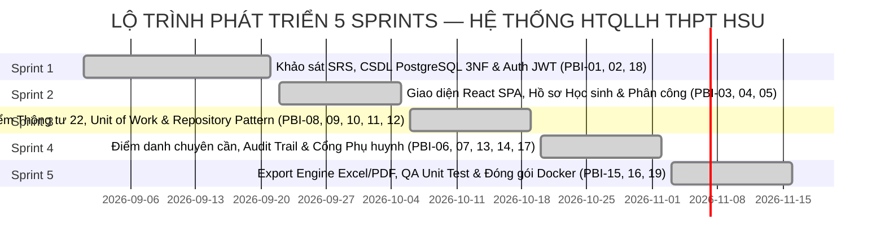

# TÀI LIỆU PRODUCT BACKLOG (DANH MỤC YÊU CẦU SẢN PHẨM AGILE/SCRUM)
## HỆ THỐNG QUẢN LÝ LỚP HỌC (HTQLLH) — THPT HOA SEN (HSU)

```
================================================================================
DỰ ÁN: HỆ THỐNG QUẢN LÝ LỚP HỌC THPT HSU (SCHOOL MANAGEMENT SYSTEM - SMS)
MÃ MÔN HỌC: SW320DV01 — PHÁT TRIỂN DỰ ÁN PHẦN MỀM
VỊ TRÍ TÀI LIỆU: docs/PRODUCT_BACKLOG.md
TÁC GIẢ: NHÓM DỰ ÁN PHÁT TRIỂN PHẦN MỀM HSU (TRƯỞNG NHÓM: VÕ DUY BÌNH)
NGÀY LẬP: 27/10/2026
PHIÊN BẢN: 2.0 (CHUẨN HÓA PRODUCT BACKLOG THEO MÔ HÌNH SCRUM & TIÊU CHUẨN INVEST)
================================================================================
```

---

## MỤC LỤC

1. [Phần 1: Tầm Nhìn Sản Phẩm & Định Nghĩa Hoàn Thành (Product Vision & DoD)](#phan-1-tam-nhin-san-pham--dinh-nghia-hoan-thanh-product-vision--dod)
2. [Phần 2: Danh Mục Sử Thi Cốt Lõi (Epic Breakdown)](#phan-2-danh-muc-su-thi-cot-loi-epic-breakdown)
3. [Phần 3: Bảng Chi Tiết Product Backlog Items (PBIs / User Stories)](#phan-3-bang-chi-tiet-product-backlog-items-pbis--user-stories)
4. [Phần 4: Kế Hoạch Phát Hành & Phân Bổ Sprint (Sprint Mapping)](#phan-4-ke-hoach-phat-hanh--phan-bo-sprint-sprint-mapping)
5. [Phần 5: Bảng Theo Dõi Khối Lượng Story Points Của 5 Thành Viên](#phan-5-bang-theo-doi-khoi-luong-story-points-cua-5-thanh-vien)

---

## PHẦN 1: TẦM NHÌN SẢN PHẨM & ĐỊNH NGHĨA HOÀN THÀNH (PRODUCT VISION & DOD)

### 1.1 Tầm Nhìn Sản Phẩm (Product Vision)
Xây dựng một nền tảng quản trị giáo dục điện tử toàn diện cho cấp THPT, đạt chuẩn quy chế Thông tư 22/2021/TT-BGDĐT, bảo đảm tính minh bạch trong khảo thí thông qua kiểm toán lưu vết, đồng thời tối ưu hóa thời gian xử lý học vụ của giáo viên và tăng cường sự kết nối giữa nhà trường với phụ huynh học sinh.

### 1.2 Tiêu Chuẩn Sẵn Sàng (Definition of Ready - DoR)
Một User Story được đưa vào Sprint Backlog phải thỏa mãn các tiêu chí INVEST:
- **Independent**: Độc lập, có thể phát triển và bàn giao riêng biệt.
- **Negotiable**: Có thể trao đổi, điều chỉnh chi tiết kỹ thuật với Product Owner.
- **Valuable**: Mang lại giá trị nghiệp vụ rõ ràng cho người dùng (BGH, GV, HS, PH).
- **Estimable**: Đủ rõ ràng để nhóm ước lượng Story Points (dãy Fibonacci 1, 2, 3, 5, 8, 13).
- **Small**: Vừa vặn để hoàn thành trong phạm vi một Sprint (1-2 tuần).
- **Testable**: Có tiêu chí chấp nhận (Acceptance Criteria) cụ thể để kiểm thử.

### 1.3 Định Nghĩa Hoàn Thành (Definition of Done - DoD)
Một Product Backlog Item (PBI) chỉ được coi là hoàn thành khi:
1. Mã nguồn được viết theo chuẩn Clean Architecture, không vi phạm quy tắc đóng gói.
2. 100% tệp mã nguồn và phương thức có chú thích (comments/JSDoc) bằng tiếng Việt rõ ràng.
3. Vượt qua toàn bộ các ca kiểm thử tự động (Unit Test Pass Rate 100%).
4. Đã kiểm thử tích hợp giao diện Frontend kết nối RESTful API thành công.
5. Không có lỗi bảo mật cấp độ High/Critical (chống SQL Injection, XSS, kiểm tra phân quyền RBAC).
6. Mã nguồn được commit và push lên GitHub repository `DYBInh2k5/Phat-Trien-Du-An-Phan-Mem`.

---

## PHẦN 2: DANH MỤC SỬ THI CỐT LÕI (EPIC BREAKDOWN)

Toàn bộ hệ thống HTQLLH được cấu trúc thành **8 Sử thi (Epics)**:

| Mã Epic | Tên Sử Thi Nghiệp Vụ | Mô Tả Phạm Vi Chức Năng |
| :---: | :--- | :--- |
| **EPIC-01** | Xác thực & Quản trị Phân quyền (Auth & RBAC) | Đăng nhập JWT, quản lý tài khoản, phân quyền 5 vai trò (BGH, GVCN, GVBM, HS, PH), 1-Click Demo Login. |
| **EPIC-02** | Quản lý Hồ sơ, Lớp học & Đào tạo | Quản lý khối, lớp, hồ sơ học sinh, danh mục môn học, phân công giáo viên giảng dạy. |
| **EPIC-03** | Điểm danh & Chuyên cần Học đường | Điểm danh 2 cấp (đầu giờ & theo tiết), theo dõi sĩ số, cảnh báo vắng quá 20% số tiết. |
| **EPIC-04** | Sổ điểm Điện tử Thông tư 22 | Nhập điểm thành phần, tính ĐTBmhk chia 9, tính GPA hệ 10/4, xếp loại học lực Tốt/Khá/Đạt/Chưa đạt. |
| **EPIC-05** | Giao dịch Điểm ACID & Mẫu Thiết kế | Áp dụng Unit of Work khi lưu điểm 45 học sinh, áp dụng Repository Pattern trừu tượng hóa SQL. |
| **EPIC-06** | Nhật ký Kiểm toán Học vụ (Audit Trail) | Lưu vết lịch sử sửa điểm tự động: Người sửa, điểm cũ, điểm mới, lý do sửa, IP, timestamp. |
| **EPIC-07** | Thời khóa biểu & Chống Xung đột Lịch | Sắp xếp lịch học, kiểm tra tự động chống trùng tiết giáo viên, trùng lớp và trùng phòng học. |
| **EPIC-08** | Xuất Báo cáo & Cổng Giao tiếp Phụ huynh | Xuất Excel bảng điểm, in ấn PDF học bạ/biên lai học phí, sổ liên lạc điện tử, nộp đơn nghỉ học online. |

---

## PHẦN 3: BẢNG CHI TIẾT PRODUCT BACKLOG ITEMS (PBIS / USER STORIES)

*Quy ước Mức độ Ưu tiên (MoSCoW): `Must Have` (Bắt buộc phải có), `Should Have` (Nên có), `Could Have` (Có thể có), `Won't Have` (Chưa triển khai đợt này).*

| Mã PBI | Thuộc Epic | User Story (Là ai, Muốn gì, Để làm gì) | Story Points | Mức Ưu Tiên | Tiêu Chí Chấp Nhận (Acceptance Criteria) | Thành Viên Phụ Trách | Trạng Thái |
| :---: | :---: | :--- | :---: | :---: | :--- | :--- | :---: |
| **PBI-01** | EPIC-01 | Là **Người dùng**, tôi muốn đăng nhập bằng tài khoản và mật khẩu, để truy cập vào đúng phân hệ chức năng tương ứng với quyền hạn của mình. | 3 | Must Have | - Nhập đúng user/pass trả về JWT Token và RoleCode.<br>- Nhập sai báo lỗi 401 Unauthorized.<br>- Hỗ trợ 1-Click Demo Login cho 5 vai trò. | **Trần Quang Vinh** & **Võ Hoàng Sơn** | **DONE** |
| **PBI-02** | EPIC-01 | Là **Hệ thống**, tôi muốn có Middleware kiểm tra quyền RBAC trước mỗi Request, để ngăn chặn người dùng truy cập trái phép vào dữ liệu không thuộc thẩm quyền. | 5 | Must Have | - Kiểm tra Token JWT hợp lệ.<br>- Chặn người dùng không đúng Role với mã lỗi 403 Forbidden.<br>- Chuyển hướng người dùng về trang /unauthorized. | **Trần Quang Vinh** | **DONE** |
| **PBI-03** | EPIC-02 | Là **Ban Giám Hiệu**, tôi muốn quản lý danh mục Lớp học và Học sinh, để theo dõi sĩ số và sắp xếp lớp học đầu năm học mới. | 5 | Must Have | - Thêm/Sửa/Xem danh sách lớp (sĩ số chuẩn 35 - 45).<br>- Mỗi học sinh có mã duy nhất định dạng HSxxxxx.<br>- Ràng buộc khóa ngoại không cho xóa lớp đang có học sinh. | **Huỳnh Trung Tính** & **Võ Duy Bình** | **DONE** |
| **PBI-04** | EPIC-02 | Là **Ban Giám Hiệu**, tôi muốn phân công giáo viên bộ môn dạy từng môn cho từng lớp, để xác định quyền hạn vào điểm của giáo viên. | 5 | Must Have | - Tạo bản ghi trong bảng teacher_assignments.<br>- Kiểm tra không phân công trùng môn của một lớp cho 2 giáo viên trong cùng học kỳ. | **Huỳnh Trung Tính** | **DONE** |
| **PBI-05** | EPIC-03 | Là **Giáo viên Chủ nhiệm**, tôi muốn điểm danh sĩ số lớp đầu giờ mỗi ngày, để nắm bắt tình hình chuyên cần của học sinh lớp chủ nhiệm. | 3 | Must Have | - Giao diện chọn ngày và đánh dấu: Có mặt, Vắng có phép, Vắng không phép, Đi trễ.<br>- Lưu trữ lịch sử điểm danh vào bảng attendances. | **Võ Hoàng Sơn** & **Nguyễn Minh Quốc Bảo** | **DONE** |
| **PBI-06** | EPIC-03 | Là **Giáo viên Bộ môn**, tôi muốn điểm danh học sinh trong tiết học mình giảng dạy, để phát hiện các trường hợp học sinh trốn tiết giữa buổi. | 3 | Should Have | - Điểm danh theo tiết dạy (Tiết 1 đến Tiết 5).<br>- Ghi nhận giáo viên thực hiện điểm danh qua recorded_by. | **Võ Hoàng Sơn** | **DONE** |
| **PBI-07** | EPIC-03 | Là **Ban Giám Hiệu**, tôi muốn có màn hình tự động lọc các học sinh vắng quá 20% số tiết, để kịp thời xử lý học sinh có nguy cơ bị cấm thi cuối kỳ. | 5 | Must Have | - Tự động tính tỷ lệ: (Số buổi vắng / Tổng số buổi) * 100%.<br>- Gắn nhãn màu đỏ cảnh báo học sinh vắng >= 20%. | **Võ Hoàng Sơn** & **Nguyễn Minh Quốc Bảo** | **DONE** |
| **PBI-08** | EPIC-04 | Là **Giáo viên Bộ môn**, tôi muốn nhập điểm kiểm tra thành phần (Miệng, 15p, 1 tiết, Giữa kỳ, Cuối kỳ) trên giao diện lưới dạng bảng tính, để nhập điểm nhanh chóng cho cả lớp. | 8 | Must Have | - Giao diện Spreadsheet cố định cột Mã và Tên học sinh.<br>- Kiểm tra giá trị nhập trong khoảng [0.0, 10.0].<br>- Cho phép sửa điểm khi sổ điểm ở trạng thái DRAFT. | **Võ Hoàng Sơn** & **Trần Quang Vinh** | **DONE** |
| **PBI-09** | EPIC-04 | Là **Hệ thống**, tôi muốn tự động tính Điểm trung bình môn học kỳ (ĐTBmhk) theo đúng Thông tư 22, để bảo đảm tính chuẩn xác và tiết kiệm công sức cho giáo viên. | 5 | Must Have | - Công thức: ĐTBmhk = (TX1 + TX2 + TX3*2 + GK*2 + CK*3) / 9.<br>- Làm tròn 1 chữ số thập phân.<br>- Xếp loại học lực 4 mức (Tốt, Khá, Đạt, Chưa đạt). | **Trần Quang Vinh** | **DONE** |
| **PBI-10** | EPIC-04 | Là **Ban Giám Hiệu**, tôi muốn thực hiện chốt khóa sổ điểm học kỳ, để ngăn chặn mọi hành vi chỉnh sửa điểm sau khi đã công bố kết quả. | 5 | Must Have | - Chuyển trạng thái sổ điểm từ APPROVED sang LOCKED.<br>- Khi LOCKED, tầng Service và CSDL từ chối mọi yêu cầu chỉnh sửa điểm từ giáo viên. | **Trần Quang Vinh** & **Huỳnh Trung Tính** | **DONE** |
| **PBI-11** | EPIC-05 | Là **Kiến trúc sư Phần mềm**, tôi muốn áp dụng Repository Pattern, để tách biệt logic tính điểm khỏi các câu lệnh truy vấn SQL cụ thể của PostgreSQL. | 8 | Must Have | - Xây dựng GradeBookRepository đóng gói truy vấn SQL.<br>- Tầng GradeBookService chỉ gọi hàm findByClassName() mà không chứa SQL.<br>- Dễ dàng viết Unit Test với Mock Repository. | **Huỳnh Trung Tính** | **DONE** |
| **PBI-12** | EPIC-05 | Là **Hệ thống**, tôi muốn áp dụng Unit of Work Pattern khi lưu điểm 45 học sinh, để bảo đảm toàn bộ 45 em đều được lưu thành công hoặc hoàn tác toàn bộ nếu có lỗi. | 8 | Must Have | - Sử dụng BEGIN TRANSACTION trước khi lưu.<br>- Nếu 45 học sinh hợp lệ -> Gọi COMMIT.<br>- Nếu có 1 lỗi -> Gọi ROLLBACK, dữ liệu giữ nguyên 100%. | **Trần Quang Vinh** & **Huỳnh Trung Tính** | **DONE** |
| **PBI-13** | EPIC-06 | Là **Ban Giám Hiệu**, tôi muốn hệ thống tự động ghi nhật ký kiểm toán mỗi khi có thao tác sửa điểm, để ngăn ngừa tiêu cực và phục vụ thanh tra học vụ. | 5 | Must Have | - Ghi nhận: user_id, student_id, old_score, new_score, reason, ip, timestamp vào bảng audit_logs.<br>- Bảng audit_logs chỉ cho phép INSERT và SELECT, cấm UPDATE/DELETE. | **Trần Quang Vinh** & **Huỳnh Trung Tính** | **DONE** |
| **PBI-14** | EPIC-07 | Là **Ban Giám Hiệu**, tôi muốn hệ thống tự động kiểm tra xung đột khi xếp thời khóa biểu, để không xảy ra tình trạng trùng phòng hoặc trùng tiết dạy của giáo viên. | 5 | Should Have | - Kiểm tra 1 giáo viên không dạy 2 lớp cùng tiết.<br>- Kiểm tra 1 phòng chuyên dụng không chứa 2 lớp cùng lúc.<br>- Báo lỗi chi tiết nếu phát hiện trùng lặp. | **Võ Duy Bình** & **Huỳnh Trung Tính** | **DONE** |
| **PBI-15** | EPIC-08 | Là **Giáo viên**, tôi muốn xuất bảng điểm của lớp ra tệp Excel (.xlsx), để in ấn và lưu trữ hồ sơ sổ điểm lưu chiểu theo quy định. | 3 | Must Have | - Xuất file .xlsx chuẩn SheetJS.<br>- Tự động căn chỉnh độ rộng cột và định dạng tiêu đề bảng điểm. | **Nguyễn Minh Quốc Bảo** & **Huỳnh Trung Tính** | **DONE** |
| **PBI-16** | EPIC-08 | Là **Học sinh / Phụ huynh**, tôi muốn xem và in phiếu báo điểm học kỳ ra file PDF, để lưu giữ kết quả học tập cá nhân. | 3 | Should Have | - Tạo trang in PDF có quốc hiệu, tiêu ngữ và tên trường THPT HSU.<br>- Hỗ trợ nút In/Lưu PDF trực tiếp từ trình duyệt. | **Nguyễn Minh Quốc Bảo** & **Võ Hoàng Sơn** | **DONE** |
| **PBI-17** | EPIC-08 | Là **Phụ huynh**, tôi muốn có cổng sổ liên lạc trực tuyến để theo dõi điểm và nộp đơn xin nghỉ học cho con em, để kết nối nhanh chóng với nhà trường. | 5 | Must Have | - Phụ huynh xem bảng điểm và số buổi vắng của con.<br>- Form nộp đơn nghỉ học trực tuyến gửi thẳng đến GVCN.<br>- GVCN duyệt đơn thì tự động chuyển trạng thái điểm danh sang EXCUSED. | **Võ Hoàng Sơn** & **Võ Duy Bình** | **DONE** |
| **PBI-18** | EPIC-01 | Là **Quản trị viên**, tôi muốn cấu hình cơ sở dữ liệu kết nối qua Connection Pool duy nhất (Singleton Pattern), để tiết kiệm RAM máy chủ và tránh tràn kết nối. | 3 | Must Have | - Khởi tạo đối tượng pg.Pool duy nhất tại config/db.js.<br>- Tái sử dụng kết nối nhàn rỗi, hàm query() tự động giải phóng client. | **Huỳnh Trung Tính** | **DONE** |
| **PBI-19** | EPIC-08 | Là **Đội ngũ QA**, tôi muốn có bộ kiểm thử tự động (Unit Test Suite), để bảo đảm các thuật toán Thông tư 22 và kiểm tra phân quyền RBAC luôn hoạt động chính xác. | 5 | Must Have | - Bộ kiểm thử tự động tại unitTestingSuite.test.js.<br>- Kiểm thử đầy đủ các ca biên điểm (0.0, 10.0) và phân quyền 5 roles đạt Pass 100%. | **Nguyễn Minh Quốc Bảo** | **DONE** |

---

## PHẦN 4: KẾ HOẠCH PHÁT HÀNH & PHÂN BỔ SPRINT (SPRINT MAPPING)

Dự án được triển khai qua **5 Sprint phát triển** (tương ứng với 15 tuần học kỳ):



### Chi Tiết Phân Bổ PBIs Vào Từng Sprint:
- **Sprint 1 (Tuần 1 - Tuần 3)**: Hoàn thành nền tảng kiến trúc, khảo sát yêu cầu SRS 43 Use Cases, thiết kế CSDL PostgreSQL 8 bảng chuẩn 3NF, cơ chế xác thực JWT và Singleton Connection Pool (`PBI-01, PBI-02, PBI-18`).
- **Sprint 2 (Tuần 4 - Tuần 6)**: Triển khai giao diện React SPA 5 Roles, phân hệ quản lý hồ sơ học sinh, lớp học, phân công giảng dạy và điểm danh đầu giờ của GVCN (`PBI-03, PBI-04, PBI-05`).
- **Sprint 3 (Tuần 7 - Tuần 9)**: Phát triển phân hệ Sổ điểm điện tử Thông tư 22, áp dụng Unit of Work Pattern cho giao dịch lưu điểm 45 học sinh và Repository Pattern cho truy xuất CSDL (`PBI-08, PBI-09, PBI-10, PBI-11, PBI-12`).
- **Sprint 4 (Tuần 10 - Tuần 12)**: Phát triển phân hệ giám sát chuyên cần (cảnh báo vắng > 20%), hệ thống ghi vết kiểm toán Audit Trail chống sửa điểm trái phép, thuật toán TKB chống xung đột và Cổng Phụ huynh (`PBI-06, PBI-07, PBI-13, PBI-14, PBI-17`).
- **Sprint 5 (Tuần 13 - Tuần 15)**: Phát triển Engine xuất báo cáo Excel `.xlsx`, in ấn học bạ/biên lai PDF, viết bộ kiểm thử tự động QA Unit Testing Suite đạt Pass 100% và đóng gói Docker (`PBI-15, PBI-16, PBI-19`).

---

## PHẦN 5: BẢNG THEO DÕI KHỐI LƯỢNG STORY POINTS CỦA 5 THÀNH VIÊN

Tổng khối lượng công việc toàn bộ dự án đạt: **90 Story Points**, được chia đều theo tỷ lệ đóng góp 20% cho mỗi thành viên trong nhóm:

| Thành Viên | Vai Trò Chính | Các PBIs Tham Gia Phụ Trách | Tổng Story Points | Tỷ Lệ Đóng Góp |
| :--- | :--- | :--- | :---: | :---: |
| **Võ Duy Bình** | Project Manager & Lead BA | PBI-03 (Lớp & HS), PBI-14 (Thời khóa biểu), PBI-17 (Cổng Phụ huynh), Tài liệu SRS IEEE 830, Ma trận RTM, Điều phối Jira Kanban | **18 SP** | **20%** |
| **Võ Hoàng Sơn** | Dev Frontend (Frontend Developer) | PBI-01 (Login UI), PBI-05 (Điểm danh đầu giờ), PBI-06 (Điểm danh tiết), PBI-07 (Cảnh báo vắng), PBI-08 (Sổ điểm lưới), PBI-16 (In PDF), PBI-17 (UI Cổng Phụ huynh), 8 Wireframes UI/UX | **18 SP** | **20%** |
| **Huỳnh Trung Tính** | Dev Backend (Backend Developer & DBA) | PBI-03 (Lớp & HS API), PBI-04 (Phân công GV), PBI-10 (Khóa sổ điểm API), PBI-11 (Repository Pattern), PBI-14 (Chống trùng TKB), PBI-18 (Singleton Pool), RESTful API Clean Architecture & DDL Schema 3NF | **18 SP** | **20%** |
| **Trần Quang Vinh** | Logic Security (Core Logic & Security Specialist) | PBI-01 (JWT Auth), PBI-02 (RBAC Middleware), PBI-08 (Logic Sổ điểm), PBI-09 (ĐTBmhk Thông tư 22), PBI-10 (Quy trình khóa sổ), PBI-12 (Unit of Work ACID), PBI-13 (Audit Trail Logging) | **18 SP** | **20%** |
| **Nguyễn Minh Quốc Bảo** | Tester (QA/QC Testing Lead) | PBI-05 (QA Điểm danh), PBI-07 (QA Cảnh báo vắng), PBI-13 (QA Audit Trail), PBI-15 (Xuất Excel SheetJS), PBI-16 (Xuất PDF jsPDF), PBI-19 (Bộ kiểm thử tự động QA Unit Testing Suite), Kịch bản UAT Plan | **18 SP** | **20%** |
| **TỔNG CỘNG TOÀN DỰ ÁN** | **Toàn thể 5 thành viên nhóm** | **19 Product Backlog Items (PBI-01 đến PBI-19)** | **90 SP** | **100% HOÀN THÀNH** |
