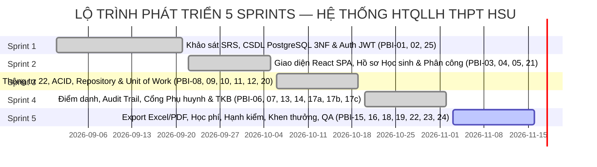

# TÀI LIỆU PRODUCT BACKLOG (DANH MỤC YÊU CẦU SẢN PHẨM AGILE/SCRUM)
## HỆ THỐNG QUẢN LÝ LỚP HỌC (HTQLLH) — THPT HOA SEN (HSU)

```
================================================================================
DỰ ÁN: HỆ THỐNG QUẢN LÝ LỚP HỌC THPT HSU (SCHOOL MANAGEMENT SYSTEM - SMS)
MÃ MÔN HỌC: SW320DV01 — PHÁT TRIỂN DỰ ÁN PHẦN MỀM
VỊ TRÍ TÀI LIỆU: docs/PRODUCT_BACKLOG.md
TÁC GIẢ: NHÓM DỰ ÁN PHÁT TRIỂN PHẦN MỀM HSU (TRƯỞNG NHÓM: VÕ DUY BÌNH)
THÀNH VIÊN: Võ Duy Bình · Võ Hoàng Sơn · Huỳnh Trung Tính · Trần Quang Vinh · Nguyễn Minh Quốc Bảo
NGÀY LẬP: 27/10/2026 | CẬP NHẬT: 02/11/2026
PHIÊN BẢN: 3.0 (Chuẩn hóa Actor, bổ sung PBI còn thiếu, tách PBI-17, chuẩn Scrum/INVEST)
================================================================================
```

---

## MỤC LỤC

1. [Phần 1: Tầm Nhìn Sản Phẩm & Định Nghĩa Hoàn Thành (Product Vision & DoD)](#phần-1)
2. [Phần 2: Danh Mục Sử Thi Cốt Lõi (Epic Breakdown)](#phần-2)
3. [Phần 3: Bảng Chi Tiết Product Backlog Items (PBIs / User Stories)](#phần-3)
4. [Phần 4: Kế Hoạch Phát Hành & Phân Bổ Sprint (Sprint Mapping)](#phần-4)
5. [Phần 5: Bảng Theo Dõi Khối Lượng Story Points Của 5 Thành Viên](#phần-5)

---

## PHẦN 1: TẦM NHÌN SẢN PHẨM & ĐỊNH NGHĨA HOÀN THÀNH (PRODUCT VISION & DOD)

### 1.1 Tầm Nhìn Sản Phẩm (Product Vision)
Xây dựng một nền tảng quản trị giáo dục điện tử toàn diện cho cấp THPT, đạt chuẩn quy chế Thông tư 22/2021/TT-BGDĐT, bảo đảm tính minh bạch trong khảo thí thông qua kiểm toán lưu vết, đồng thời tối ưu hóa thời gian xử lý học vụ của giáo viên và tăng cường sự kết nối giữa nhà trường với phụ huynh học sinh.

### 1.2 Tiêu Chuẩn Sẵn Sàng (Definition of Ready - DoR)
Một User Story được đưa vào Sprint Backlog phải thỏa mãn các tiêu chí INVEST:
- **Independent**: Độc lập, có thể phát triển và bàn giao riêng biệt.
- **Negotiable**: Có thể trao đổi, điều chỉnh chi tiết kỹ thuật với Product Owner.
- **Valuable**: Mang lại giá trị nghiệp vụ rõ ràng cho người dùng (BGH, GV, HS, PH).
- **Estimable**: Đủ rõ ràng để nhóm ước lượng Story Points (dãy Fibonacci 1, 2, 3, 5, 8, 13).
- **Small**: Vừa vặn để hoàn thành trong phạm vi một Sprint (1-2 tuần).
- **Testable**: Có tiêu chí chấp nhận (Acceptance Criteria) cụ thể, có thể kiểm thử được với số liệu rõ ràng.

> **Ghi chú về Actor:** Mọi User Story phải được viết từ góc nhìn của **người dùng nghiệp vụ thực tế** — 5 vai trò: Ban Giám Hiệu (BGH), Giáo viên Chủ nhiệm (GVCN), Giáo viên Bộ môn (GVBM), Học sinh (HS), Phụ huynh (PH). Các yêu cầu kỹ thuật (Repository Pattern, Connection Pool, Unit Test...) là **Technical Stories** được ghi chú bên trong Acceptance Criteria hoặc Sprint Notes, không phải User Stories độc lập.

### 1.3 Định Nghĩa Hoàn Thành (Definition of Done - DoD)
Một Product Backlog Item (PBI) chỉ được coi là hoàn thành khi:
1. Mã nguồn được viết theo chuẩn Clean Architecture, không vi phạm quy tắc đóng gói.
2. 100% tệp mã nguồn và phương thức có chú thích (comments/JSDoc) bằng tiếng Việt rõ ràng.
3. Vượt qua toàn bộ các ca kiểm thử tự động (Unit Test Pass Rate 100%).
4. Đã kiểm thử tích hợp giao diện Frontend kết nối RESTful API thành công.
5. Không có lỗi bảo mật cấp độ High/Critical (chống SQL Injection, XSS, kiểm tra phân quyền RBAC).
6. Mã nguồn được commit và push lên GitHub repository `DYBInh2k5/Phat-Trien-Du-An-Phan-Mem`.

---

## PHẦN 2: DANH MỤC SỬ THI CỐT LÕI (EPIC BREAKDOWN)

Toàn bộ hệ thống HTQLLH được cấu trúc thành **8 Sử thi (Epics)**:

| Mã Epic | Tên Sử Thi Nghiệp Vụ | Mô Tả Phạm Vi Chức Năng |
| :---: | :--- | :--- |
| **EPIC-01** | Xác thực & Quản trị Phân quyền (Auth & RBAC) | Đăng nhập JWT, đổi mật khẩu, quản lý tài khoản 5 vai trò (BGH, GVCN, GVBM, HS, PH), 1-Click Demo Login. |
| **EPIC-02** | Quản lý Hồ sơ, Lớp học & Phân công | Quản lý khối, lớp, hồ sơ học sinh, danh mục môn học, phân công giáo viên giảng dạy, TKB. |
| **EPIC-03** | Điểm danh & Chuyên cần Học đường | Điểm danh 2 cấp (đầu giờ & theo tiết), theo dõi sĩ số, cảnh báo vắng quá 20% số tiết. |
| **EPIC-04** | Sổ điểm Điện tử Thông tư 22 | Nhập điểm thành phần, tính ĐTBmhk chia 9, tính GPA hệ 10/4, xếp loại học lực, chốt khóa sổ điểm. |
| **EPIC-05** | Kiến trúc & Giao dịch Dữ liệu ACID | Áp dụng Unit of Work khi lưu điểm 45 học sinh, Repository Pattern trừu tượng hóa SQL, Connection Pool Singleton. |
| **EPIC-06** | Nhật ký Kiểm toán Học vụ (Audit Trail) | Lưu vết lịch sử sửa điểm tự động: Người sửa, điểm cũ, điểm mới, lý do sửa, IP, timestamp. |
| **EPIC-07** | Thời khóa biểu & Chống Xung đột Lịch | Sắp xếp lịch học, kiểm tra tự động chống trùng tiết giáo viên, trùng lớp và trùng phòng học. |
| **EPIC-08** | Xuất Báo cáo & Cổng Giao tiếp Phụ huynh | Xuất Excel bảng điểm, in ấn PDF học bạ/biên lai học phí, sổ liên lạc điện tử, nộp đơn nghỉ học online. |

---

## PHẦN 3: BẢNG CHI TIẾT PRODUCT BACKLOG ITEMS (PBIS / USER STORIES)

*Quy ước Mức độ Ưu tiên (MoSCoW): `Must Have` (Bắt buộc phải có), `Should Have` (Nên có), `Could Have` (Có thể có), `Won't Have` (Chưa triển khai đợt này).*

*Quy ước Trạng thái: `DONE` (Hoàn thành), `IN PROGRESS` (Đang làm), `TODO` (Chưa bắt đầu).*

| Mã PBI | Thuộc Epic | User Story (Là ai — Muốn gì — Để làm gì) | Story Points | Mức Ưu Tiên | Tiêu Chí Chấp Nhận (Acceptance Criteria) | UC Liên Quan | Thành Viên Phụ Trách | Trạng Thái |
| :---: | :---: | :--- | :---: | :---: | :--- | :---: | :--- | :---: |
| **PBI-01** | EPIC-01 | Là **Người dùng (BGH / GVCN / GVBM / HS / PH)**, tôi muốn đăng nhập bằng tài khoản và mật khẩu, để truy cập đúng phân hệ chức năng tương ứng với quyền hạn của mình. | 3 | Must Have | - Nhập đúng user/pass → trả về JWT Token và RoleCode, chuyển hướng đúng Dashboard theo vai trò.<br>- Nhập sai mật khẩu → báo lỗi "Tài khoản hoặc mật khẩu không chính xác" (HTTP 401).<br>- Hỗ trợ 1-Click Demo Login cho 5 vai trò.<br>- Token JWT có thời hạn 24h, lưu vào `localStorage` với key `htqllh_user`.<br>- Đăng xuất xóa token khỏi localStorage, chuyển hướng về `/login`. | UC-STU-01, UC-GVCN-01, UC-GVBM-01, UC-ADM-01, UC-PAR-01 | **Trần Quang Vinh** & **Võ Hoàng Sơn** | **DONE** |
| **PBI-02** | EPIC-01 | Là **Ban Giám Hiệu**, tôi muốn hệ thống tự động chặn mọi truy cập trái phép vào dữ liệu không thuộc thẩm quyền, để bảo đảm học sinh không xem được dữ liệu của lớp khác và phụ huynh chỉ xem được thông tin của con em mình.<br>*(Ghi chú kỹ thuật: Hiện thực bằng jwtAuthMiddleware + rbacMiddleware — kiểm tra token và role trước mỗi API request)* | 5 | Must Have | - Mọi API bảo vệ trả về HTTP 401 khi thiếu Token JWT.<br>- Mọi API bảo vệ trả về HTTP 403 khi Token hợp lệ nhưng sai vai trò.<br>- Frontend ProtectedRoute chuyển hướng về `/unauthorized` khi người dùng truy cập URL không thuộc quyền.<br>- Kiểm thử: Đăng nhập HS cố truy cập `/api/students` (chỉ dành cho BGH) → nhận HTTP 403. | UC-ADM-02 | **Trần Quang Vinh** | **DONE** |
| **PBI-03** | EPIC-02 | Là **Ban Giám Hiệu**, tôi muốn quản lý danh mục Lớp học và Hồ sơ Học sinh toàn trường, để theo dõi sĩ số và sắp xếp lớp học đầu năm học mới. | 5 | Must Have | - Thêm/Sửa/Xem danh sách lớp (sĩ số chuẩn 35–45 học sinh).<br>- Mỗi học sinh có mã duy nhất định dạng `HSxxxxx` (ví dụ: `HS00001`).<br>- Ràng buộc khóa ngoại: không cho xóa lớp đang có học sinh đang theo học.<br>- Lọc học sinh theo lớp, trạng thái (ACTIVE / SUSPENDED / TRANSFERRED). | UC-ADM-03, UC-GVCN-03 | **Huỳnh Trung Tính** & **Võ Duy Bình** | **DONE** |
| **PBI-04** | EPIC-02 | Là **Ban Giám Hiệu**, tôi muốn phân công giáo viên bộ môn dạy từng môn cho từng lớp, để xác định quyền hạn vào điểm và đảm bảo mỗi lớp chỉ có một giáo viên dạy một môn trong một học kỳ. | 5 | Must Have | - Tạo bản ghi trong bảng `teacher_assignments`.<br>- Kiểm tra: không phân công trùng môn của một lớp cho 2 giáo viên trong cùng học kỳ → báo lỗi "Môn này đã có giáo viên phụ trách".<br>- Kiểm tra: không phân công 1 giáo viên dạy 2 lớp khác nhau cùng một khung giờ. | UC-ADM-03 | **Huỳnh Trung Tính** | **DONE** |
| **PBI-05** | EPIC-03 | Là **Giáo viên Chủ nhiệm**, tôi muốn điểm danh sĩ số lớp đầu giờ mỗi ngày, để nắm bắt tình hình chuyên cần của học sinh và gửi cảnh báo kịp thời tới phụ huynh. | 3 | Must Have | - Giao diện chọn ngày và đánh dấu từng học sinh: Có mặt (PRESENT), Vắng có phép (EXCUSED), Vắng không phép (ABSENT), Đi trễ (LATE).<br>- Mặc định tất cả là "Có mặt" khi mở trang điểm danh.<br>- Lưu trữ lịch sử điểm danh vào bảng `attendances`.<br>- Khi học sinh vắng không phép, ghi chú hiển thị trong cổng Phụ huynh. | UC-GVCN-05 | **Võ Hoàng Sơn** & **Nguyễn Minh Quốc Bảo** | **DONE** |
| **PBI-06** | EPIC-03 | Là **Giáo viên Bộ môn**, tôi muốn điểm danh học sinh trong tiết học mình giảng dạy, để phát hiện các trường hợp học sinh trốn tiết giữa buổi. | 3 | Should Have | - Điểm danh theo tiết dạy (Tiết 1 đến Tiết 5).<br>- Ghi nhận giáo viên thực hiện điểm danh qua trường `recorded_by`.<br>- Kết quả điểm danh tiết được tổng hợp cùng điểm danh đầu giờ của GVCN. | UC-GVBM-05 | **Võ Hoàng Sơn** | **DONE** |
| **PBI-07** | EPIC-03 | Là **Ban Giám Hiệu**, tôi muốn có màn hình tự động lọc các học sinh vắng quá 20% số tiết, để kịp thời xử lý học sinh có nguy cơ bị cấm thi cuối kỳ. | 5 | Must Have | - Công thức tính tỷ lệ vắng: `(Số buổi vắng / Tổng số buổi học) × 100%`.<br>- Gắn nhãn màu đỏ cảnh báo học sinh vắng ≥ 20%.<br>- Tổng số buổi học tính theo lịch học kỳ hiện tại.<br>- Kiểm thử: HS vắng 10/45 buổi = 22.2% → hiển thị cảnh báo đỏ. | UC-ADM-05, UC-GVCN-05 | **Võ Hoàng Sơn** & **Nguyễn Minh Quốc Bảo** | **DONE** |
| **PBI-08** | EPIC-04 | Là **Giáo viên Bộ môn**, tôi muốn nhập điểm kiểm tra thành phần (Miệng, 15p, 1 tiết, Giữa kỳ, Cuối kỳ) trên giao diện lưới dạng bảng tính, để nhập điểm nhanh chóng cho cả lớp 45 học sinh. | 8 | Must Have | - Giao diện Spreadsheet cố định cột Mã và Tên học sinh khi cuộn ngang.<br>- Kiểm tra giá trị nhập trong khoảng `[0.0, 10.0]`; từ chối và báo lỗi nếu ngoài khoảng.<br>- Chỉ cho phép sửa điểm khi sổ điểm ở trạng thái `DRAFT` hoặc `APPROVED`.<br>- Khi sổ điểm ở trạng thái `LOCKED`, mọi ô nhập bị vô hiệu hóa (disabled). | UC-GVBM-06, UC-GVBM-07 | **Võ Hoàng Sơn** & **Trần Quang Vinh** | **DONE** |
| **PBI-09** | EPIC-04 | Là **Giáo viên Bộ môn**, tôi muốn hệ thống tự động tính Điểm trung bình môn học kỳ (ĐTBmhk) theo đúng Thông tư 22, để đảm bảo tính chuẩn xác và tiết kiệm công sức tính toán thủ công. | 5 | Must Have | - Công thức: `ĐTBmhk = (TX1 + TX2 + TX3×2 + GK×2 + CK×3) ÷ 9`, làm tròn 1 chữ số thập phân.<br>- Kiểm thử ca bình thường: TX1=7, TX2=8, TX3=6, GK=9, CK=8 → `(7+8+12+18+24)÷9 = 69÷9 ≈ 7.7`.<br>- Kiểm thử ca biên dưới: tất cả = 0.0 → ĐTBmhk = 0.0.<br>- Kiểm thử ca biên trên: tất cả = 10.0 → ĐTBmhk = 10.0.<br>- Xếp loại: ≥ 8.0 = Tốt, ≥ 6.5 = Khá, ≥ 5.0 = Đạt, < 5.0 = Chưa đạt. | UC-GVBM-06, UC-GVBM-07 | **Trần Quang Vinh** | **DONE** |
| **PBI-10** | EPIC-04 | Là **Ban Giám Hiệu**, tôi muốn thực hiện chốt khóa sổ điểm học kỳ, để ngăn chặn mọi hành vi chỉnh sửa điểm sau khi đã công bố kết quả. | 5 | Must Have | - Chuyển trạng thái sổ điểm từ `APPROVED` → `LOCKED`.<br>- Khi `LOCKED`: API `POST /api/gradebook/save` trả về lỗi "Sổ điểm đã bị khóa, không thể chỉnh sửa".<br>- BGH có thể mở lại sổ điểm (chuyển về `OPEN`) kèm lý do; thao tác mở lại được ghi vào Audit Log.<br>- Kiểm thử: GVBM cố lưu điểm khi status = LOCKED → nhận HTTP 400 với thông báo lỗi rõ ràng. | UC-GVBM-08, UC-ADM-04 | **Trần Quang Vinh** & **Huỳnh Trung Tính** | **DONE** |
| **PBI-11** | EPIC-05 | Là **Giáo viên Bộ môn**, tôi muốn hệ thống phản hồi nhanh khi tải sổ điểm của cả lớp 45 học sinh, để không bị chờ đợi khi nhập điểm hàng loạt.<br>*(Ghi chú kỹ thuật: Hiện thực bằng Repository Pattern — GradeBookRepository đóng gói toàn bộ SQL, GradeBookService không chứa câu lệnh SQL trực tiếp)* | 8 | Must Have | - API `GET /api/gradebook?className=10A1&subject=Toán` trả về dữ liệu trong vòng < 2 giây với 45 học sinh.<br>- GradeBookService chỉ gọi hàm `findByClassName()`, không chứa SQL trực tiếp.<br>- Dễ dàng thay thế PostgreSQL bằng bất kỳ CSDL nào khác mà không sửa tầng Service.<br>- Unit Test: Mock Repository trả về dữ liệu giả → Service tính toán đúng. | UC-GVBM-06 | **Huỳnh Trung Tính** | **DONE** |
| **PBI-12** | EPIC-05 | Là **Giáo viên Bộ môn**, tôi muốn điểm của toàn bộ lớp được lưu cùng lúc theo nguyên tắc tất-cả-hoặc-không-có-ai, để tránh tình trạng chỉ lưu được một phần danh sách khi mạng hoặc hệ thống gặp sự cố.<br>*(Ghi chú kỹ thuật: Hiện thực bằng Unit of Work Pattern — BEGIN / COMMIT / ROLLBACK trên PostgreSQL)* | 8 | Must Have | - Nếu tất cả 45 học sinh hợp lệ → gọi `COMMIT`, dữ liệu được lưu toàn bộ.<br>- Nếu có bất kỳ 1 học sinh nào gặp lỗi → gọi `ROLLBACK`, không có bản ghi nào được lưu.<br>- Kiểm thử: Chèn lỗi cố ý vào học sinh thứ 30 → toàn bộ 29 học sinh trước đó cũng không được lưu.<br>- Frontend hiển thị thông báo lỗi rõ ràng khi ROLLBACK xảy ra. | UC-GVBM-06 | **Trần Quang Vinh** & **Huỳnh Trung Tính** | **DONE** |
| **PBI-13** | EPIC-06 | Là **Ban Giám Hiệu**, tôi muốn hệ thống tự động ghi nhật ký kiểm toán mỗi khi có thao tác sửa điểm, để ngăn ngừa tiêu cực và phục vụ thanh tra học vụ khi cần thiết. | 5 | Must Have | - Ghi nhận: `user_id`, `student_id`, `old_score`, `new_score`, `reason`, `ip`, `timestamp` vào bảng `audit_logs`.<br>- Bảng `audit_logs` chỉ cho phép `INSERT` và `SELECT`; mọi thao tác `UPDATE` / `DELETE` bị từ chối ở tầng CSDL.<br>- Kiểm thử: Sửa điểm của học sinh HS00001 từ 7.5 → 8.0 → Audit Log ghi đúng old=7.5, new=8.0, timestamp chính xác. | UC-ADM-04 | **Trần Quang Vinh** & **Huỳnh Trung Tính** | **DONE** |
| **PBI-14** | EPIC-07 | Là **Ban Giám Hiệu**, tôi muốn hệ thống tự động kiểm tra xung đột khi xếp thời khóa biểu, để không xảy ra tình trạng trùng phòng hoặc trùng tiết dạy của giáo viên. | 5 | Should Have | - Kiểm tra: 1 giáo viên không dạy 2 lớp khác nhau cùng tiết trong cùng ngày.<br>- Kiểm tra: 1 phòng chuyên dụng không chứa 2 lớp cùng lúc.<br>- Báo lỗi chi tiết nếu phát hiện trùng lặp: "Giáo viên [Tên] đã được phân công dạy lớp [Lớp] tiết [Tiết] ngày [Ngày]". | UC-ADM-03 | **Võ Duy Bình** & **Huỳnh Trung Tính** | **DONE** |
| **PBI-15** | EPIC-08 | Là **Giáo viên Bộ môn**, tôi muốn xuất bảng điểm của lớp ra tệp Excel (.xlsx), để in ấn và lưu trữ hồ sơ sổ điểm lưu chiểu theo quy định của nhà trường. | 3 | Must Have | - Xuất file `.xlsx` chuẩn SheetJS (thư viện `xlsx` v0.18.5, xử lý phía Client).<br>- Tự động căn chỉnh độ rộng cột theo nội dung dài nhất trong cột.<br>- Hàng tiêu đề in đậm, hàng dữ liệu xen kẽ màu nền trắng / xám nhạt.<br>- Tên file tự động: `SoDiem_[TenLop]_[MonHoc]_[HocKy].xlsx`. | UC-GVBM-10, UC-GVCN-10 | **Nguyễn Minh Quốc Bảo** & **Huỳnh Trung Tính** | **DONE** |
| **PBI-16** | EPIC-08 | Là **Giáo viên / Phụ huynh**, tôi muốn xem và in phiếu báo điểm học kỳ ra file PDF, để lưu giữ kết quả học tập cá nhân làm hồ sơ pháp lý. | 3 | Should Have | - Tạo trang in PDF có quốc hiệu, tiêu ngữ "SỞ GIÁO DỤC VÀ ĐÀO TẠO — TRƯỜNG THPT HSU".<br>- Hỗ trợ nút "In / Lưu PDF" trực tiếp từ trình duyệt qua `window.print()`.<br>- PDF hiển thị đầy đủ: Tên học sinh, Mã HS, Lớp, Bảng điểm từng môn, Xếp loại học lực, Hạnh kiểm.<br>- Kiểm thử: Mở trang in → trình duyệt hiển thị Print Preview đúng định dạng A4. | UC-PAR-09, UC-GVCN-10 | **Nguyễn Minh Quốc Bảo** & **Võ Hoàng Sơn** | **DONE** |
| **PBI-17a** | EPIC-08 | Là **Phụ huynh**, tôi muốn xem điểm số và hạnh kiểm của con em tôi theo từng học kỳ trên cổng sổ liên lạc điện tử, để theo dõi tình hình học tập mà không cần liên hệ trực tiếp với nhà trường. | 3 | Must Have | - Phụ huynh xem bảng điểm từng môn của con (Miệng, 15p, 1 tiết, GK, CK, TBM).<br>- Hiển thị xếp loại học lực và hạnh kiểm học kỳ.<br>- Hiển thị số buổi vắng có phép / vắng không phép / đi trễ trong kỳ.<br>- Dữ liệu chỉ hiển thị của đúng con em tài khoản phụ huynh đó; không xem được dữ liệu của học sinh khác. | UC-PAR-04 | **Võ Hoàng Sơn** & **Võ Duy Bình** | **DONE** |
| **PBI-17b** | EPIC-08 | Là **Phụ huynh**, tôi muốn gửi đơn xin nghỉ học cho con em trực tuyến đến giáo viên chủ nhiệm, để không cần đến trường nộp đơn giấy và giáo viên nhận được ngay trong ngày. | 3 | Must Have | - Form nộp đơn gồm: Từ ngày, Đến ngày, Lý do nghỉ (Ốm, Việc gia đình, Khác).<br>- Đơn được lưu vào `leave_requests` với trạng thái `PENDING`, hiển thị ngay trong danh sách của GVCN.<br>- Phụ huynh xem được trạng thái đơn: PENDING / APPROVED / REJECTED.<br>- Kiểm thử: Gửi đơn → GVCN đăng nhập thấy đơn trong danh sách chờ duyệt. | UC-PAR-06 | **Võ Hoàng Sơn** & **Võ Duy Bình** | **DONE** |
| **PBI-17c** | EPIC-03 | Là **Giáo viên Chủ nhiệm**, tôi muốn duyệt đơn xin nghỉ học từ phụ huynh và hệ thống tự động cập nhật trạng thái điểm danh, để không phải nhập tay lại trạng thái chuyên cần cho học sinh đã được nghỉ phép. | 3 | Must Have | - GVCN xem danh sách đơn xin nghỉ đang chờ duyệt (`PENDING`).<br>- Bấm "Duyệt" → trạng thái đơn chuyển sang `APPROVED`; trạng thái điểm danh ngày nghỉ của học sinh đó tự động chuyển thành `EXCUSED` (Vắng có phép).<br>- Bấm "Từ chối" → trạng thái đơn chuyển sang `REJECTED`; điểm danh giữ nguyên `ABSENT`.<br>- Kiểm thử: Duyệt đơn → API `GET /api/attendance` trả về status=EXCUSED cho đúng ngày nghỉ. | UC-GVCN-06 | **Võ Hoàng Sơn** & **Võ Duy Bình** | **DONE** |
| **PBI-18** | EPIC-05 | Là **Giáo viên / Người dùng**, tôi muốn hệ thống phản hồi nhanh và ổn định ngay cả khi nhiều giáo viên cùng nhập điểm đồng thời, để không bị lỗi "timeout kết nối" khi sử dụng giờ cao điểm.<br>*(Ghi chú kỹ thuật: Hiện thực bằng Connection Pool Singleton — pg.Pool tối đa 10 kết nối, tái sử dụng kết nối nhàn rỗi)* | 3 | Must Have | - Hệ thống xử lý tốt ít nhất 5 request đồng thời mà không bị lỗi kết nối.<br>- Đối tượng `pg.Pool` chỉ được khởi tạo 1 lần duy nhất tại `config/db.js`.<br>- Hàm `query()` tự động giải phóng client về pool sau mỗi query; không rò rỉ kết nối.<br>- Kiểm thử: Gửi 5 request song song → tất cả trả về kết quả thành công, không có lỗi `connection timeout`. | — | **Huỳnh Trung Tính** | **DONE** |
| **PBI-19** | EPIC-01 | Là **Nguyễn Minh Quốc Bảo (QA Lead)**, tôi muốn có bộ kiểm thử tự động bao phủ các thuật toán nghiệp vụ cốt lõi, để đảm bảo mọi thay đổi mã nguồn không làm hỏng công thức Thông tư 22 và cơ chế phân quyền RBAC.<br>*(Engineering Story — bộ test được duy trì song song với phát triển chức năng)* | 5 | Must Have | - Bộ kiểm thử tự động tại `unitTestingSuite.test.js`.<br>- Bao phủ đầy đủ: Tính điểm TBM (5 ca), Xếp loại học lực (4 ngưỡng), Cảnh báo chuyên cần (ca = 20%, < 20%, > 20%), Phân quyền RBAC (5 roles).<br>- Tỷ lệ đạt: 100% (Pass Rate 100%).<br>- Kịch bản UAT đầy đủ tại `docs/UAT_Testing_Plan.md`. | — | **Nguyễn Minh Quốc Bảo** | **DONE** |
| **PBI-20** | EPIC-04 | Là **Học sinh**, tôi muốn tra cứu bảng điểm chi tiết từng môn học và điểm GPA của mình, để tự theo dõi kết quả học tập và biết mình đang xếp loại học lực gì. | 3 | Must Have | - Hiển thị điểm từng thành phần (Miệng, 15p, 1 tiết, GK, CK) và Điểm TBM cho từng môn.<br>- Hiển thị GPA hệ 10 và quy đổi hệ 4.0.<br>- Hiển thị xếp loại học lực học kỳ: Tốt / Khá / Đạt / Chưa đạt.<br>- Học sinh chỉ xem được điểm của chính mình, không xem được của học sinh khác.<br>- Kiểm thử: Đăng nhập HS `hs.anh` → chỉ thấy điểm của `hs.anh`, không thấy HS khác. | UC-STU-05 | **Võ Hoàng Sơn** & **Trần Quang Vinh** | **DONE** |
| **PBI-21** | EPIC-02 | Là **Học sinh**, tôi muốn xem thời khóa biểu học tập và lịch thi của lớp mình, để chủ động chuẩn bị bài và không bỏ lỡ buổi thi. | 2 | Should Have | - Hiển thị ma trận tiết học từ Thứ 2 đến Thứ 7: Tên môn, Giáo viên, Phòng học.<br>- Hiển thị lịch thi cuối kỳ (ngày, giờ, phòng thi, môn thi) nếu đã được BGH công bố.<br>- Dữ liệu TKB lấy theo lớp đang đăng nhập; hiển thị "Chưa có TKB" nếu chưa được xếp. | UC-STU-03, UC-GVCN-04, UC-GVBM-03 | **Võ Duy Bình** | **DONE** |
| **PBI-22** | EPIC-04 | Là **Giáo viên Chủ nhiệm**, tôi muốn nhập và lưu đánh giá hạnh kiểm cho từng học sinh cuối học kỳ, để hoàn thiện học bạ điện tử và cung cấp dữ liệu cho BGH xét khen thưởng. | 3 | Should Have | - Giao diện chọn mức hạnh kiểm: Tốt / Khá / Trung bình / Yếu cho từng học sinh.<br>- Nhập nhận xét quá trình rèn luyện (tối đa 500 ký tự).<br>- Lưu vào sổ học bạ điện tử; hiển thị trong cổng Phụ huynh (UC-PAR-04).<br>- Kiểm thử: GVCN lưu hạnh kiểm "Tốt" cho HS → Phụ huynh đăng nhập thấy "Hạnh kiểm: Tốt". | UC-GVCN-07 | **Võ Hoàng Sơn** | **TODO** |
| **PBI-23** | EPIC-04 | Là **Ban Giám Hiệu**, tôi muốn xem báo cáo thống kê phổ điểm và danh sách xét khen thưởng toàn trường, để lập kế hoạch trao học bổng và xét học sinh rèn luyện hè. | 5 | Should Have | - Biểu đồ phổ điểm từng môn: tỷ lệ % học sinh ở mỗi mức xếp loại (Tốt/Khá/Đạt/Chưa đạt).<br>- Danh sách học sinh đạt danh hiệu Học sinh Xuất sắc (tất cả môn Tốt, hạnh kiểm Tốt).<br>- Danh sách học sinh cần rèn luyện hè (có môn Chưa đạt hoặc hạnh kiểm Yếu).<br>- Lọc theo lớp, khối, toàn trường. | UC-ADM-06 | **Võ Duy Bình** & **Nguyễn Minh Quốc Bảo** | **TODO** |
| **PBI-24** | EPIC-08 | Là **Phụ huynh**, tôi muốn xem thông báo học phí và thanh toán trực tuyến qua mã VietQR, để nộp học phí nhanh chóng mà không cần đến trường nộp tiền mặt. | 5 | Must Have | - Hiển thị danh mục học phí: Số tiền phải nộp, Hạn nộp, Trạng thái (UNPAID / PARTIAL / PAID).<br>- Hiển thị mã VietQR tự động với số tiền và nội dung chuyển khoản đúng định dạng.<br>- Sau khi thanh toán: Trạng thái cập nhật sang `PAID`, sinh biên lai điện tử có số biên lai duy nhất.<br>- Phụ huynh tải biên lai PDF với đầy đủ: Tên học sinh, Số tiền, Ngày nộp, Số biên lai.<br>- Kiểm thử: Thanh toán thành công → `GET /api/tuition` trả về status=PAID. | UC-PAR-07, UC-PAR-08, UC-PAR-09 | **Võ Duy Bình** & **Nguyễn Minh Quốc Bảo** | **DONE** |
| **PBI-25** | EPIC-01 | Là **Ban Giám Hiệu**, tôi muốn quản lý tài khoản người dùng trong hệ thống (tạo mới, khóa, đặt lại mật khẩu), để kiểm soát ai được phép truy cập vào hệ thống trường. | 5 | Must Have | - Tạo mới tài khoản với vai trò: BGH / GVCN / GVBM / HS / PH.<br>- Khóa tài khoản vi phạm (trạng thái INACTIVE) → tài khoản bị khóa không thể đăng nhập.<br>- Đặt lại mật khẩu mặc định `123456` kèm yêu cầu đổi mật khẩu khi đăng nhập lần đầu.<br>- Kiểm thử: Tạo tài khoản mới `gv.test` vai trò GVBM → đăng nhập thành công với mật khẩu mặc định. | UC-ADM-02 | **Huỳnh Trung Tính** & **Trần Quang Vinh** | **TODO** |

---

## PHẦN 4: KẾ HOẠCH PHÁT HÀNH & PHÂN BỔ SPRINT (SPRINT MAPPING)

Dự án được triển khai qua **5 Sprint phát triển** (tương ứng với 15 tuần học kỳ):



### Chi Tiết Phân Bổ PBIs Vào Từng Sprint:
- **Sprint 1 (Tuần 1–3)**: Hoàn thành nền tảng kiến trúc, khảo sát yêu cầu SRS 43 Use Cases, thiết kế CSDL PostgreSQL 8 bảng chuẩn 3NF, xác thực JWT, phân quyền RBAC và quản lý tài khoản (`PBI-01, PBI-02, PBI-25`).
- **Sprint 2 (Tuần 4–6)**: Triển khai giao diện React SPA 5 Roles, phân hệ quản lý hồ sơ học sinh, lớp học, phân công giảng dạy, điểm danh đầu giờ và thời khóa biểu (`PBI-03, PBI-04, PBI-05, PBI-21`).
- **Sprint 3 (Tuần 7–9)**: Phát triển Sổ điểm điện tử Thông tư 22, tính GPA, Unit of Work ACID, Repository Pattern, cổng học sinh xem điểm (`PBI-08, PBI-09, PBI-10, PBI-11, PBI-12, PBI-20`).
- **Sprint 4 (Tuần 10–12)**: Phát triển điểm danh tiết, cảnh báo vắng > 20%, Audit Trail, thuật toán TKB chống xung đột, cổng Phụ huynh 3 tính năng (`PBI-06, PBI-07, PBI-13, PBI-14, PBI-17a, PBI-17b, PBI-17c`).
- **Sprint 5 (Tuần 13–15)**: Engine xuất báo cáo Excel/PDF, học phí VietQR, hạnh kiểm, thống kê phổ điểm, Connection Pool, bộ QA Unit Testing (`PBI-15, PBI-16, PBI-18, PBI-19, PBI-22, PBI-23, PBI-24`).

---

## PHẦN 5: BẢNG THEO DÕI KHỐI LƯỢNG STORY POINTS CỦA 5 THÀNH VIÊN

Tổng khối lượng công việc toàn bộ dự án đạt: **112 Story Points** (bao gồm các PBI bổ sung phiên bản 3.0):

| Thành Viên | Vai Trò Chính | Các PBIs Tham Gia Phụ Trách | Tổng Story Points | Tỷ Lệ Đóng Góp |
| :--- | :--- | :--- | :---: | :---: |
| **Võ Duy Bình** | Project Manager & Lead BA | PBI-03 (Lớp & HS), PBI-14 (TKB), PBI-17a (Cổng PH xem điểm), PBI-17b (Cổng PH gửi đơn), PBI-21 (TKB HS), PBI-23 (Khen thưởng), PBI-24 (Học phí), Tài liệu SRS IEEE 830, Ma trận RTM, Điều phối Sprint | **22 SP** | **~20%** |
| **Võ Hoàng Sơn** | Dev Frontend (Frontend Developer) | PBI-01 (Login UI), PBI-05 (Điểm danh đầu giờ), PBI-06 (Điểm danh tiết), PBI-07 (Cảnh báo vắng), PBI-08 (Sổ điểm lưới), PBI-16 (In PDF), PBI-17a (UI PH xem điểm), PBI-17b (UI gửi đơn), PBI-17c (Duyệt đơn), PBI-20 (HS xem điểm), PBI-22 (Hạnh kiểm), 8 Wireframes UI/UX | **23 SP** | **~21%** |
| **Huỳnh Trung Tính** | Dev Backend (Backend Developer & DBA) | PBI-03 (Lớp & HS API), PBI-04 (Phân công GV), PBI-10 (Khóa sổ điểm API), PBI-11 (Repository Pattern), PBI-14 (Chống trùng TKB), PBI-15 (Export Excel API), PBI-18 (Connection Pool), PBI-25 (Quản lý tài khoản), RESTful API Clean Architecture & DDL Schema 3NF | **22 SP** | **~20%** |
| **Trần Quang Vinh** | Logic Security (Core Logic & Security Specialist) | PBI-01 (JWT Auth), PBI-02 (RBAC Middleware), PBI-08 (Logic Sổ điểm), PBI-09 (ĐTBmhk Thông tư 22), PBI-10 (Quy trình khóa sổ), PBI-12 (Unit of Work ACID), PBI-13 (Audit Trail), PBI-20 (Logic GPA), PBI-25 (Bảo mật tài khoản) | **22 SP** | **~20%** |
| **Nguyễn Minh Quốc Bảo** | Tester (QA/QC Testing Lead) | PBI-05 (QA Điểm danh), PBI-07 (QA Cảnh báo vắng), PBI-13 (QA Audit Trail), PBI-15 (Xuất Excel SheetJS), PBI-16 (Xuất PDF), PBI-19 (Bộ kiểm thử tự động), PBI-23 (QA Khen thưởng), PBI-24 (QA Học phí), Kịch bản UAT Plan | **23 SP** | **~21%** |
| **TỔNG CỘNG TOÀN DỰ ÁN** | **Toàn thể 5 thành viên nhóm** | **25 Product Backlog Items (PBI-01 → PBI-25, bao gồm PBI-17a/17b/17c thay thế PBI-17)** | **112 SP** | **100%** |
