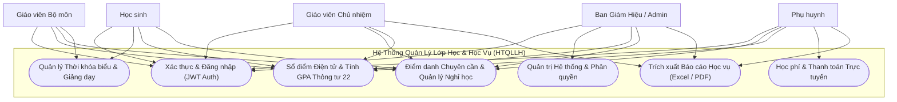
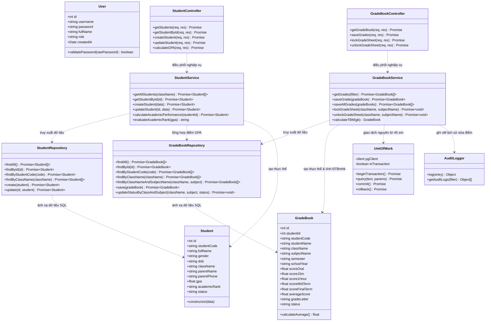
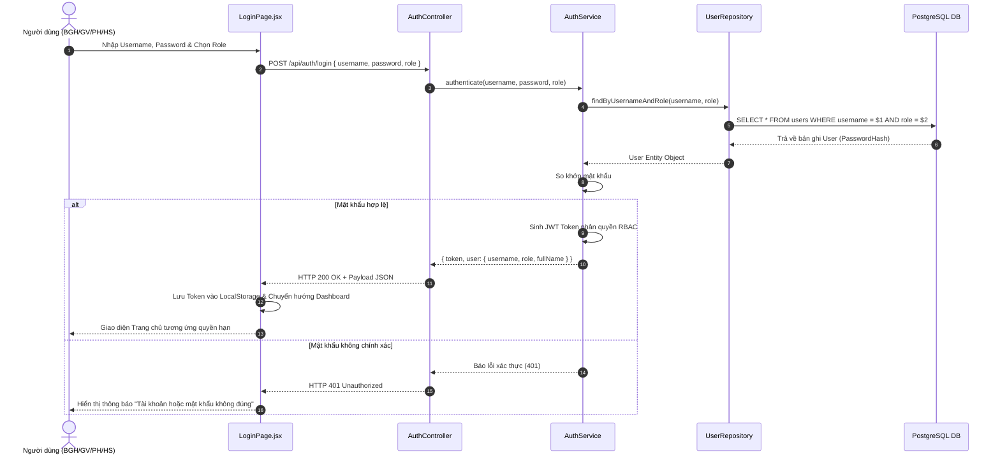
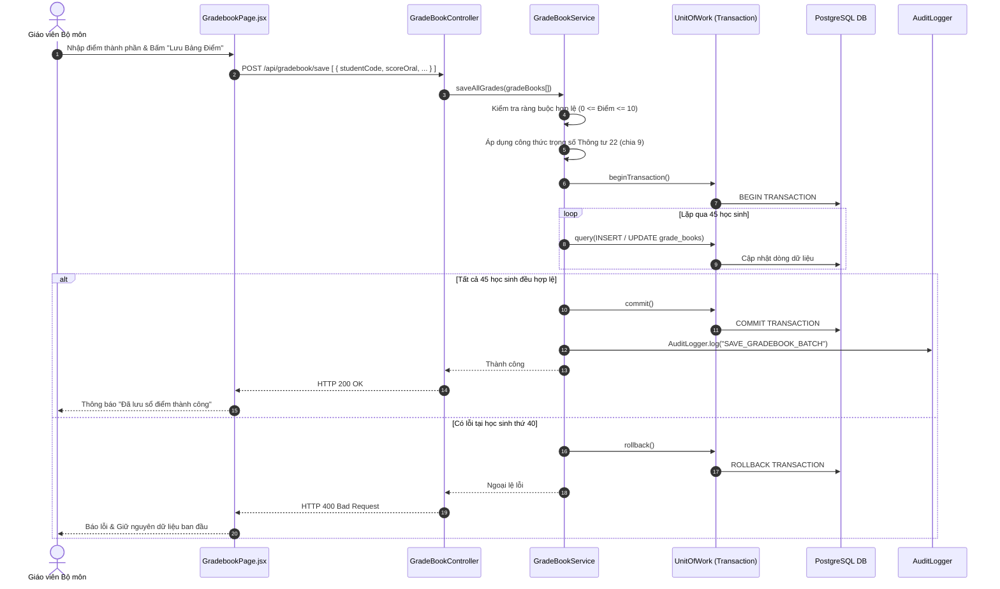
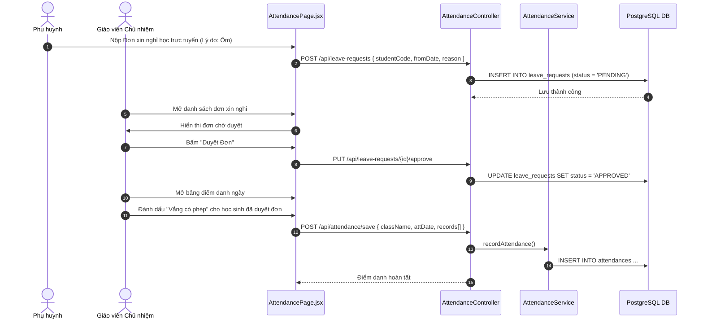
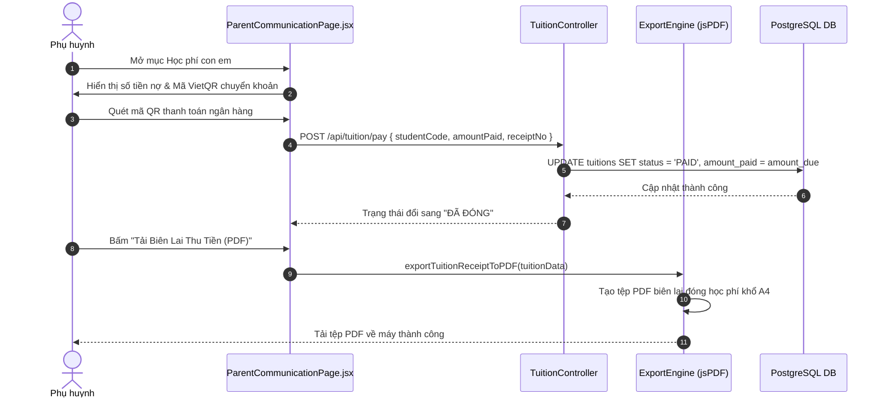
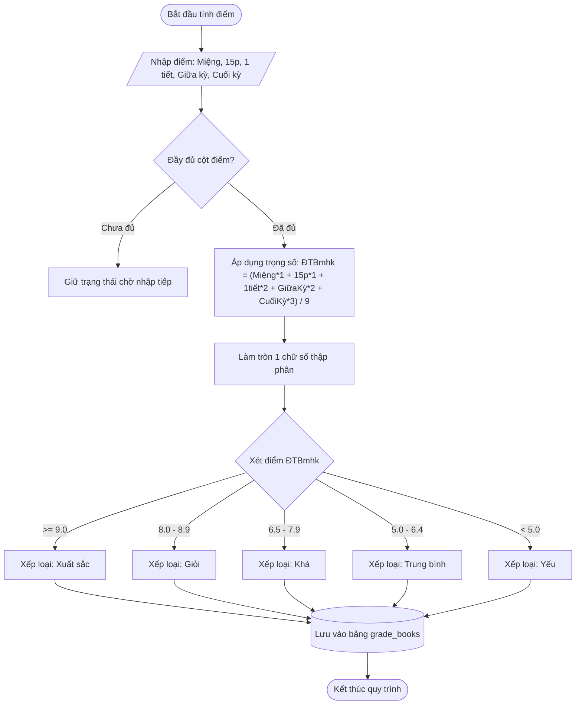
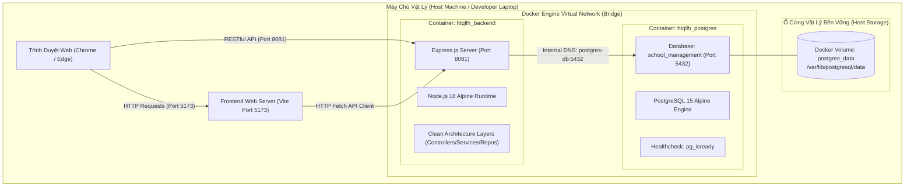

# TÀI LIỆU THIẾT KẾ MÔ HÌNH HÓA UML TOÀN DIỆN (UML SPECIFICATIONS)
## HỆ THỐNG QUẢN LÝ TRƯỜNG HỌC (HTQLLH / SCHOOL MANAGEMENT SYSTEM)

- **Đơn vị thực hiện**: Nhóm Đồ Án Phát Triển Dự Án Phần Mềm - Đại học Hoa Sen (HSU)
- **Tiêu chuẩn kỹ thuật**: Chuẩn UML 2.5 (Unified Modeling Language) & IEEE 830 SRS
- **Hệ quản trị CSDL liên kết**: PostgreSQL 15 chuẩn 3NF (Xem [database/ERD.md](file:///d:/HSU/2631Semester%201%282026-2027%29/PT_DA_PM/database/ERD.md))
- **Mã nguồn thực thi**: Node.js Express Clean Architecture & React 18 SPA

---

## MỤC LỤC
1. [Sơ Đồ Use Case Tổng Thể & Phân Rã (Use Case Diagrams)](#1-sơ-đồ-use-case-tổng-thể--phân-rã-use-case-diagrams)
2. [Sơ Đồ Lớp Kiến Trúc Clean Architecture (Class Diagram)](#2-sơ-đồ-lớp-kiến-trúc-clean-architecture-class-diagram)
3. [Các Sơ Đồ Tuần Tự Nghiệp Vụ Cốt Lõi (Sequence Diagrams)](#3-các-sơ-đồ-tuần-tự-nghiệp-vụ-cốt-lõi-sequence-diagrams)
   - [3.1. SD-01: Xác thực & Đăng nhập Hệ thống (Authentication & RBAC)](#31-sd-01-xác-thực--đăng-nhập-hệ-thống-authentication--rbac)
   - [3.2. SD-02: Nhập Điểm, Tính ĐTB Môn Thông Tư 22 & Khóa Sổ Điểm](#32-sd-02-nhập-điểm-tính-đtb-môn-thông-tư-22--khóa-sổ-điểm)
   - [3.3. SD-03: Điểm Danh Chuyên Cần & Duyệt Đơn Nghỉ Học](#33-sd-03-điểm-danh-chuyên-cần--duyệt-đơn-nghỉ-học)
   - [3.4. SD-04: Thu Học Phí Trực Tuyến & Xuất Biên Lai PDF](#34-sd-04-thu-học-phí-trực-tuyến--xuất-biên-lai-pdf)
4. [Sơ Đồ Hoạt Động Quy Trình Tính Điểm Học Vụ (Activity Diagram)](#4-sơ-đồ-hoạt-động-quy-trình-tính-điểm-học-vụ-activity-diagram)
5. [Sơ Đồ Triển Khai Hạ Tầng Docker (Deployment Diagram)](#5-sơ-đồ-triển-khai-hạ-tầng-docker-deployment-diagram)

---

## 1. SƠ ĐỒ USE CASE TỔNG THỂ & PHÂN RÃ (USE CASE DIAGRAMS)

Hệ thống HTQLLH phục vụ 5 nhóm tác nhân (Actors) chính:
- **Ban Giám Hiệu (BGH / Admin)**
- **Giáo Viên Chủ Nhiệm (GVCN)**
- **Giáo Viên Bộ Môn (GV)**
- **Phụ Huynh Học Sinh (PH)**
- **Học Sinh (HS)**

*Chi tiết toàn bộ đặc tả 43 Use Cases được lưu trữ tại: [USE_CASES.md](file:///d:/HSU/2631Semester%201%282026-2027%29/PT_DA_PM/USE_CASES.md).*

---

## 2. SƠ ĐỒ LỚP KIẾN TRÚC CLEAN ARCHITECTURE (CLASS DIAGRAM)

Sơ đồ lớp minh họa sự phân chia ranh giới theo Clean Architecture giữa các tầng: Domain Entities -> Use Cases (Services) -> Interface Adapters (Controllers, Repositories) -> Infrastructure (Database, Unit of Work, Audit Logger).

---

## 3. CÁC SƠ ĐỒ TUẦN TỰ NGHIỆP VỤ CỐT LÕI (SEQUENCE DIAGRAMS)

### 3.1. SD-01: Xác thực & Đăng nhập Hệ thống (Authentication & RBAC)

---

### 3.2. SD-02: Nhập Điểm, Tính ĐTB Môn Thông Tư 22 & Khóa Sổ Điểm

---

### 3.3. SD-03: Điểm Danh Chuyên Cần & Duyệt Đơn Nghỉ Học

---

### 3.4. SD-04: Thu Học Phí Trực Tuyến & Xuất Biên Lai PDF

---

## 4. SƠ ĐỒ HOẠT ĐỘNG QUY TRÌNH TÍNH ĐIỂM HỌC VỤ (ACTIVITY DIAGRAM)

Sơ đồ quy trình tính Điểm trung bình môn (ĐTBmhk) và xếp loại học lực theo Quy chế Thông tư 22/2021/TT-BGDĐT:

---

## 5. SƠ ĐỒ TRIỂN KHAI HẠ TẦNG DOCKER (DEPLOYMENT DIAGRAM)

Sơ đồ triển khai cấu trúc Containerization theo [docker-compose.yml](file:///d:/HSU/2631Semester%201%282026-2027%29/PT_DA_PM/docker-compose.yml):

---

*Tài liệu được lưu trữ chính thức tại kho mã nguồn của đồ án phục vụ công tác đối soát, thẩm định đồ án và phản biện chuyên đề tốt nghiệp.*
