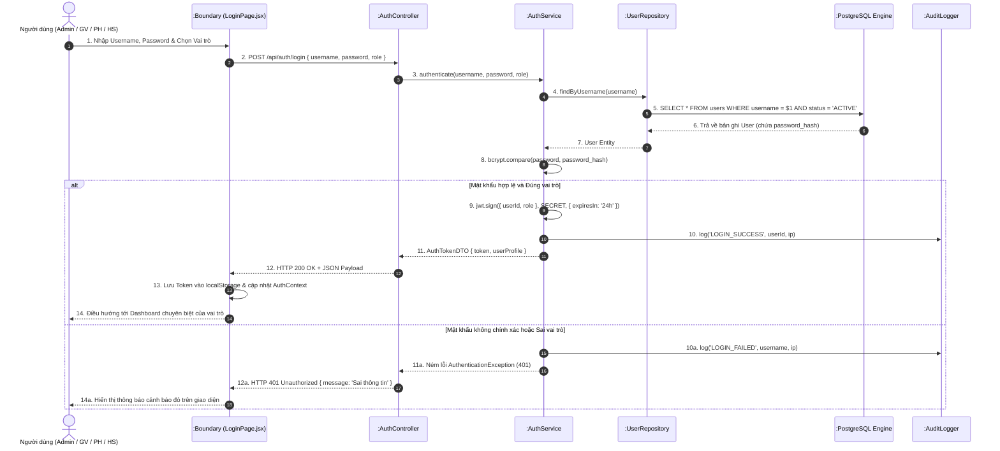
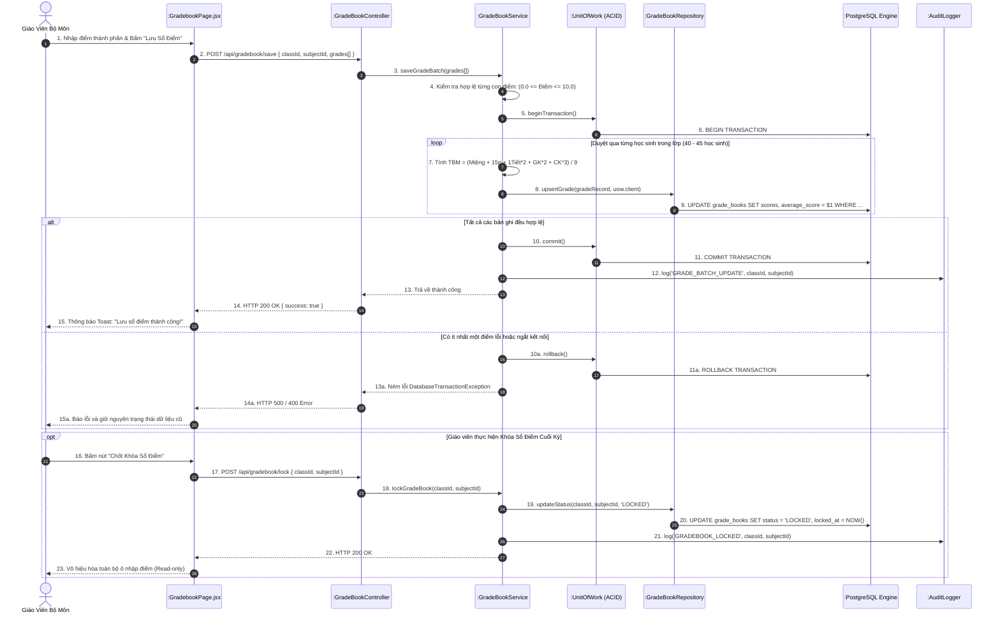
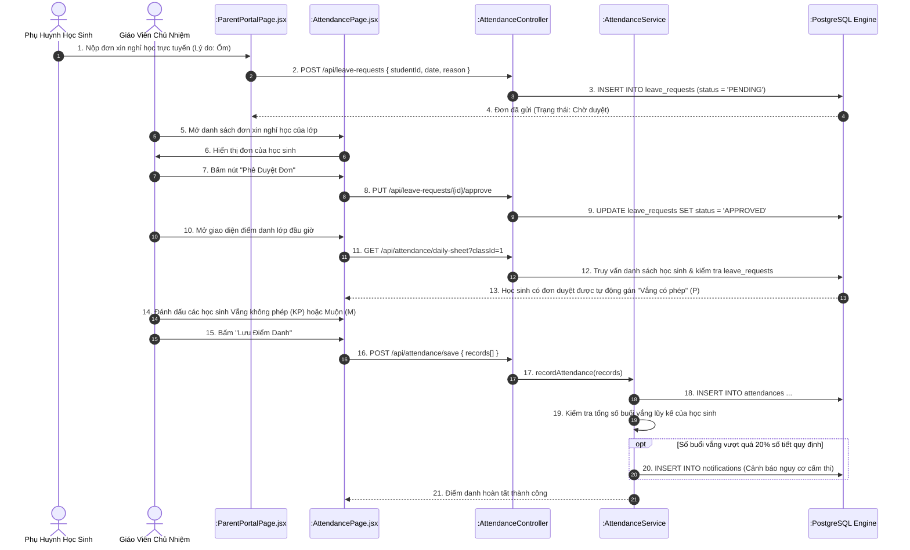
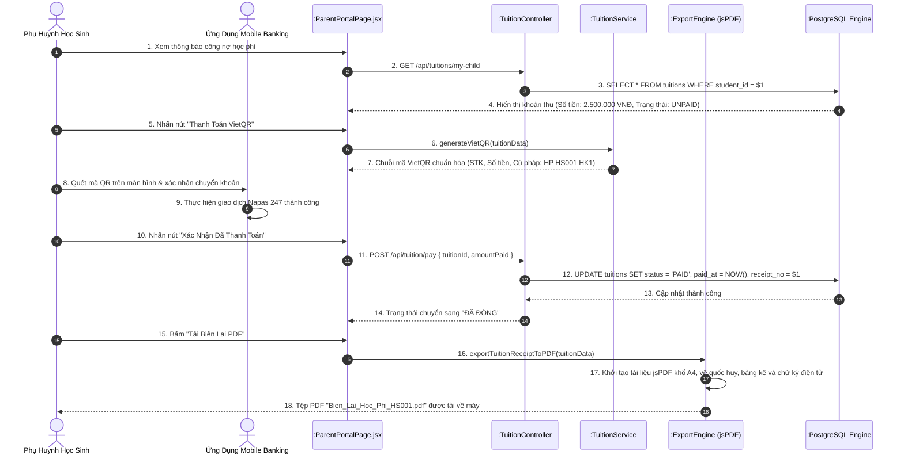
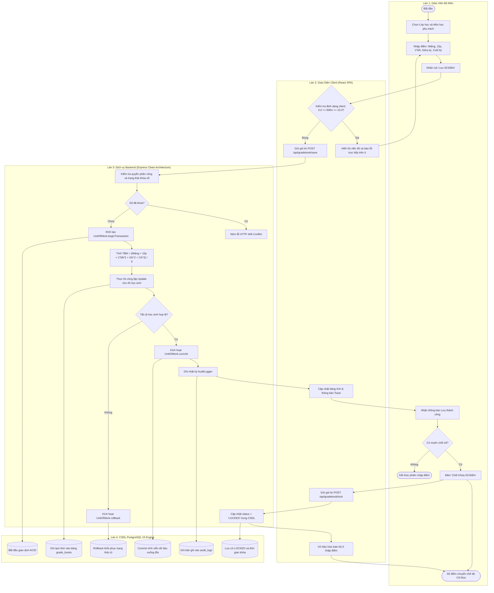
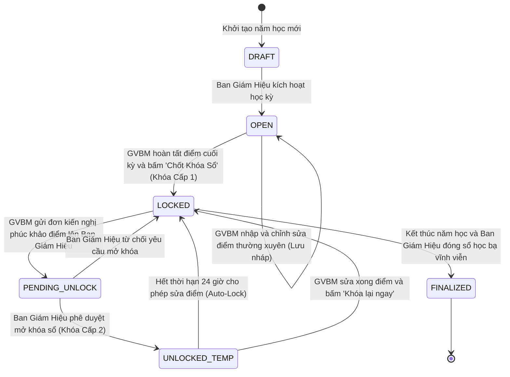
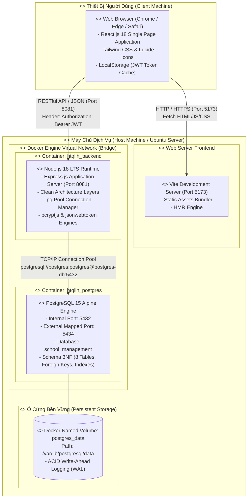

# TÀI LIỆU THIẾT KẾ MÔ HÌNH HÓA UML HỆ THỐNG (UML SYSTEM DESIGN SPECIFICATION)
## DỰ ÁN: HỆ THỐNG QUẢN LÝ LỚP HỌC & HỌC VỤ THPT (HTQLLH / SCHOOL MANAGEMENT SYSTEM)

```
================================================================================
TRƯỜNG ĐẠI HỌC HOA SEN (HSU) — KHOA CÔNG NGHỆ THÔNG TIN
BỘ MÔN: KỸ NGHỆ PHẦN MỀM & HỆ THỐNG THÔNG TIN
MÔN HỌC: PHÁT TRIỂN DỰ ÁN PHẦN MỀM (MÃ LỚP: SW320DV01 — HỌC KỲ 2631)
TIÊU CHUẨN THIẾT KẾ: OMG UML 2.5 (UNIFIED MODELING LANGUAGE) & CLEAN ARCHITECTURE
TÀI LIỆU: BẢN THIẾT KẾ MÔ HÌNH HÓA HỆ THỐNG PHẦN MỀM (SYSTEM UML SPECIFICATION)
PHIÊN BẢN: 2.1 (CHUẨN HÓA MÔ HÌNH THIẾT KẾ HƯỚNG ĐỐI TƯỢNG VÀ KIẾN TRÚC PHẦN MỀM)
NGÀY HOÀN THIỆN: 12/11/2026
================================================================================
```

---

## BẢNG KIỂM SOÁT THAY ĐỔI TÀI LIỆU (DOCUMENT REVISION HISTORY)

| Phiên Bản | Ngày Cập Nhật | Tác Giả / Người Thực Hiện | Vai Trò | Tóm Tắt Nội Dung Thay Đổi | Tình Trạng |
| :---: | :---: | :--- | :--- | :--- | :---: |
| **1.0** | 25/09/2026 | Võ Duy Bình, Huỳnh Trung Tính | PM, Backend Dev | Thiết lập sơ đồ Use Case và biểu đồ lớp thực thể sơ bộ từ yêu cầu SRS. | Đã duyệt nội bộ |
| **1.5** | 15/10/2026 | Huỳnh Trung Tính, Trần Quang Vinh | DBA, Security Dev | Bổ sung biểu đồ tuần tự SD-01 (JWT Auth) và SD-02 (ACID Sổ Điểm TT22). | Đã duyệt nội bộ |
| **2.0** | 28/10/2026 | Võ Hoàng Sơn, Nguyễn Minh Quốc Bảo | Frontend Dev, QA Lead | Bổ sung biểu đồ triển khai Docker và sơ đồ hoạt động tính điểm Thông tư 22. | Đã duyệt nội bộ |
| **2.1** | 12/11/2026 | Toàn thể Nhóm 2 | Kỹ sư Dự án | Tái cấu trúc theo chuẩn OMG UML 2.5, bổ sung biểu đồ trạng thái Sổ điểm (State Machine), phân tầng Clean Architecture, các fragment `alt/opt/loop` và làn bơi Swimlanes. | **CHÍNH THỨC BAN HÀNH** |

---

## THÔNG TIN ĐỒ ÁN & NHÂN SỰ PHỤ TRÁCH MÔ HÌNH HÓA

- **Đơn vị đào tạo**: Đại học Hoa Sen (Hoa Sen University - HSU)
- **Khoa**: Công nghệ Thông tin
- **Bộ môn**: Kỹ nghệ Phần mềm
- **Sinh viên thực hiện (Nhóm 2)**:
  1. **Võ Duy Bình** (MSSV: 22200000) — *Trưởng nhóm, Quản trị Dự án & Mô hình hóa Use Case*
  2. **Huỳnh Trung Tính** (MSSV: 22200000) — *Mô hình hóa Biểu đồ Lớp (Class Diagram) & Tầng Dữ liệu CSDL*
  3. **Võ Hoàng Sơn** (MSSV: 22200000) — *Mô hình hóa Tương tác Giao diện Boundary & Trạng thái UI*
  4. **Trần Quang Vinh** (MSSV: 22200000) — *Mô hình hóa Biểu đồ Tuần tự (Sequence Diagrams) & An ninh RBAC*
  5. **Nguyễn Minh Quốc Bảo** (MSSV: 22200000) — *Mô hình hóa Biểu đồ Hoạt động (Activity Diagrams) & Đối soát QA*

---

## MỤC LỤC TÀI LIỆU

1. [CHƯƠNG I: CƠ SỞ PHƯƠNG PHÁP LUẬN VÀ QUY ƯỚC MÔ HÌNH HÓA](#chương-i-cơ-sở-phương-pháp-luận-và-quy-ước-mô-hình-hóa)
2. [CHƯƠNG II: BIỂU ĐỒ USE CASE TOÀN HỆ THỐNG VÀ CÁC PHÂN HỆ (USE CASE DIAGRAMS)](#chương-ii-biểu-đồ-use-case-toàn-hệ-thống-và-các-phân-hệ-use-case-diagrams)
   - 2.1. Biểu đồ Use Case tổng thể toàn hệ thống
   - 2.2. Biểu đồ Use Case phân hệ Học vụ & Sổ điểm điện tử
   - 2.3. Biểu đồ Use Case phân hệ Quản lý Chuyên cần & Nghỉ học
3. [CHƯƠNG III: BIỂU ĐỒ LỚP CHI TIẾT THEO CLEAN ARCHITECTURE (CLASS DIAGRAM)](#chương-iii-biểu-đồ-lớp-chi-tiết-theo-clean-architecture-class-diagram)
   - 3.1. Cấu trúc phân tầng Clean Architecture (4 Tầng)
   - 3.2. Sơ đồ lớp chi tiết và các quan hệ hướng đối tượng
4. [CHƯƠNG IV: CÁC BIỂU ĐỒ TUẦN TỰ NGHIỆP VỤ CỐT LÕI (SEQUENCE DIAGRAMS)](#chương-iv-các-biểu-đồ-tuần-tự-nghiệp-vụ-cốt-lõi-sequence-diagrams)
   - 4.1. SD-01: Quy trình Xác thực Người dùng & Cấp phát JWT Token (Authentication & RBAC)
   - 4.2. SD-02: Quy trình Nhập Điểm, Tính TBM (Thông Tư 22), Giao Dịch ACID & Khóa Sổ Điểm
   - 4.3. SD-03: Quy trình Điểm Danh Chuyên Cần, Đồng Bộ Đơn Nghỉ Học & Cảnh Báo Vắng
   - 4.4. SD-04: Quy trình Thu Học Phí Trực Tuyến Qua VietQR Động & Xuất Biên Lai PDF
5. [CHƯƠNG V: BIỂU ĐỒ HOẠT ĐỘNG CÓ PHÂN LÀN BƠI (ACTIVITY DIAGRAMS WITH SWIMLANES)](#chương-v-biểu-đồ-hoạt-động-có-phân-làn-bơi-activity-diagrams-with-swimlanes)
   - 5.1. Quy trình Nghiệp vụ Nhập điểm & Đánh giá Học vụ theo Thông tư 22
   - 5.2. Quy trình Nghiệp vụ Nộp và Xét duyệt Đơn xin nghỉ học
6. [CHƯƠNG VI: BIỂU ĐỒ MÁY TRẠNG THÁI SỔ ĐIỂM (STATE MACHINE DIAGRAM)](#chương-vi-biểu-đồ-máy-trạng-thái-sổ-điểm-state-machine-diagram)
7. [CHƯƠNG VII: BIỂU ĐỒ TRIỂN KHAI VẬT LÝ & DOCKER (DEPLOYMENT DIAGRAM)](#chương-vii-biểu-đồ-triển-khai-vật-lý--docker-deployment-diagram)

---

## CHƯƠNG I: CƠ SỞ PHƯƠNG PHÁP LUẬN VÀ QUY ƯỚC MÔ HÌNH HÓA

### 1.1. Mục Tiêu Thiết Kế
Tài liệu Thiết kế Mô hình hóa này chuyển hóa các yêu cầu chức năng và phi chức năng trong tài liệu Đặc tả Yêu cầu Phần mềm (SRS IEEE 830) và Đặc tả Use Case thành các bản vẽ kiến trúc phần mềm trực quan, chuẩn xác theo chuẩn **UML 2.5** của Tổ chức Quản lý Đối tượng (Object Management Group - OMG).

### 1.2. Mối Tương Thích Giữa Mô Hình Thiết Kế & Mã Nguồn Thực Thi
Các mô hình trong tài liệu này có mối liên kết trực tiếp $1:1$ với mã nguồn hệ thống:
- **Biểu đồ Lớp (Class Diagram)**: Ánh xạ chính xác tới cấu trúc tệp mã nguồn Clean Architecture tại thư mục `members/member3_Backend_DB/school-management-nodejs/src/` (gồm các thư mục `entities/`, `services/`, `controllers/`, `repositories/`, `utils/`).
- **Biểu đồ Tuần tự (Sequence Diagrams)**: Ánh xạ tới luồng thực thi yêu cầu HTTP từ Router Express qua Middleware xác thực tới các phương thức dịch vụ và câu truy vấn SQL tham số hóa.
- **Biểu đồ Triển khai (Deployment Diagram)**: Ánh xạ tới cấu hình Containerization tại tệp [docker-compose.yml](file:///d:/HSU/2631Semester%201%282026-2027%29/PT_DA_PM/docker-compose.yml).

### 1.3. Bảng Quy Ước Ký Hiệu UML Áp Dụng
- Ký hiệu khả năng hiển thị (Visibility): `+` (Public), `-` (Private), `#` (Protected), `~` (Package).
- Ký hiệu quan hệ giữa các lớp:
  + Kế thừa (Generalization / Inheritance): `<|--`
  + Thực thi giao diện (Realization / Implementation): `<|..`
  + Kết tập mạnh / Chứa đựng (Composition): `*--`
  + Kết tập yếu (Aggregation): `o--`
  + Phụ thuộc (Dependency): `..>`
  + Liên kết (Association): `--`

---

## CHƯƠNG II: BIỂU ĐỒ USE CASE TOÀN HỆ THỐNG VÀ CÁC PHÂN HỆ

### 2.1. Biểu Đồ Use Case Tổng Thể Toàn Hệ Thống (System Use Case Diagram)

```mermaid
graph TB
    subgraph SystemBoundary ["Hệ Thống Quản Lý Lớp Học & Học Vụ THPT (HTQLLH)"]
        %% Core Auth
        UC_AUTH(["Xác thực & Cấp phát JWT Token"])
        UC_CHANGE_PASS(["Đổi mật khẩu cá nhân"])

        %% Subsystem Học vụ
        UC_INPUT_GRADE(["Nhập điểm thành phần Thông tư 22"])
        UC_CALC_TBM(["Tính điểm trung bình môn (TBM)"])
        UC_LOCK_GRADE(["Khóa sổ điểm điện tử"])
        UC_UNLOCK_GRADE(["Phê duyệt mở khóa sổ điểm"])
        UC_APPEAL_GRADE(["Nộp đơn phúc khảo điểm số"])

        %% Subsystem Chuyên cần
        UC_ATTEND_DAILY(["Điểm danh chuyên cần lớp học"])
        UC_SUBMIT_LEAVE(["Nộp đơn xin nghỉ học trực tuyến"])
        UC_APPROVE_LEAVE(["Phê duyệt đơn xin nghỉ học"])
        UC_WARN_ATTEND(["Cảnh báo vắng học quá ngưỡng"])

        %% Subsystem Tài chính & Báo cáo
        UC_PAY_TUITION(["Thanh toán học phí qua VietQR"])
        UC_EXPORT_PDF(["Xuất biên lai điện tử PDF"])
        UC_EXPORT_EXCEL(["Xuất báo cáo tổng kết ra Excel"])
        UC_AUDIT_LOG(["Tra cứu nhật ký kiểm toán Audit Trail"])
    end

    %% Actors
    Admin["Ban Giám Hiệu (BGH)"]
    GVCN["Giáo Viên Chủ Nhiệm"]
    GVBM["Giáo Viên Bộ Môn"]
    Parent["Phụ Huynh"]
    Student["Học Sinh"]

    %% Actor Connections
    Admin --> UC_UNLOCK_GRADE
    Admin --> UC_AUDIT_LOG
    Admin --> UC_EXPORT_EXCEL

    GVBM --> UC_INPUT_GRADE
    GVBM --> UC_LOCK_GRADE

    GVCN --> UC_ATTEND_DAILY
    GVCN --> UC_APPROVE_LEAVE
    GVCN --> UC_EXPORT_EXCEL

    Student --> UC_APPEAL_GRADE

    Parent --> UC_SUBMIT_LEAVE
    Parent --> UC_PAY_TUITION

    %% Include Relationships
    UC_INPUT_GRADE -. "<<include>>" .-> UC_AUTH
    UC_INPUT_GRADE -. "<<include>>" .-> UC_CALC_TBM
    UC_ATTEND_DAILY -. "<<include>>" .-> UC_AUTH
    UC_PAY_TUITION -. "<<include>>" .-> UC_EXPORT_PDF
    UC_APPROVE_LEAVE -. "<<include>>" .-> UC_ATTEND_DAILY

    %% Extend Relationships
    UC_APPEAL_GRADE -. "<<extend>>" .-> UC_INPUT_GRADE
    UC_UNLOCK_GRADE -. "<<extend>>" .-> UC_LOCK_GRADE
    UC_WARN_ATTEND -. "<<extend>>" .-> UC_ATTEND_DAILY
```

Biểu đồ phân định ranh giới hệ thống (System Boundary), 5 tác nhân chính và các quan hệ bản chất `<<include>>` (ràng buộc bắt buộc), `<<extend>>` (mở rộng khi thỏa điều kiện):



---

## CHƯƠNG III: BIỂU ĐỒ LỚP CHI TIẾT THEO CLEAN ARCHITECTURE (CLASS DIAGRAM)

### 3.1. Cấu Trúc Phân Tầng Clean Architecture (4 Tầng Ranh Giới)
Kiến trúc hệ thống bảo đảm **Quy tắc phụ thuộc một chiều (Dependency Rule)**: Mã nguồn tầng bên ngoài phụ thuộc vào tầng bên trong, tầng Domain tuyệt đối không phụ thuộc vào tầng Cơ sở dữ liệu hay Framework.

```mermaid
classDiagram
    %% TẦNG 1: DOMAIN ENTITIES (THỰC THỂ CỐT LÕI)
    class User {
        +int id
        +string username
        +string passwordHash
        +string fullName
        +string role
        +string status
        +validatePassword(raw) boolean
    }

    class Student {
        +int id
        +string studentCode
        +string fullName
        +string gender
        +string dob
        +string className
        +string status
    }

    class GradeBook {
        +int id
        +int studentId
        +string studentCode
        +string studentName
        +string className
        +string subjectName
        +string semester
        +float scoreOral
        +float score15m
        +float score1Hour
        +float scoreMidTerm
        +float scoreFinalTerm
        +float averageScore
        +string status
        +calculateTBM() float
        +isLocked() boolean
    }

    class Attendance {
        +int id
        +int studentId
        +string attendanceDate
        +string session
        +string status
        +string note
    }

    class LeaveRequest {
        +int id
        +int studentId
        +string fromDate
        +string toDate
        +string reason
        +string status
        +int approvedBy
    }

    class Tuition {
        +int id
        +int studentId
        +string semester
        +decimal amountDue
        +decimal amountPaid
        +string status
        +string receiptNo
    }

    %% TẦNG 2: USE CASES / APPLICATION SERVICES
    class AuthService {
        +authenticate(username, pass, role) Promise~AuthTokenDTO~
        +changePassword(userId, oldPass, newPass) Promise~boolean~
    }

    class GradeBookService {
        -GradeBookRepository gradeRepo
        -UnitOfWork uow
        -AuditLogger audit
        +getGrades(classId, subjectId) Promise~GradeBook[]~
        +saveGradeBatch(grades) Promise~boolean~
        +lockGradeBook(classId, subjectId, teacherId) Promise~boolean~
        +unlockGradeBook(classId, subjectId, adminId) Promise~boolean~
    }

    class AttendanceService {
        -AttendanceRepository attendRepo
        +recordAttendance(classId, date, records) Promise~boolean~
        +approveLeave(leaveId, teacherId) Promise~boolean~
        +checkAttendanceWarning(studentId) Promise~boolean~
    }

    class TuitionService {
        -TuitionRepository tuitionRepo
        +generateVietQR(tuitionId) string
        +processPayment(tuitionId, amount, receiptNo) Promise~boolean~
    }

    %% TẦNG 3: INTERFACE ADAPTERS (CONTROLLERS & REPOSITORIES)
    class GradeBookController {
        -GradeBookService service
        +getGradeBook(req, res) Promise
        +saveGrades(req, res) Promise
        +lockGradeBook(req, res) Promise
    }

    class AttendanceController {
        -AttendanceService service
        +recordAttendance(req, res) Promise
        +approveLeaveRequest(req, res) Promise
    }

    class GradeBookRepository {
        -Pool dbPool
        +findByClassAndSubject(classId, subjectId) Promise~GradeBook[]~
        +batchUpsert(grades, client) Promise~void~
        +updateStatus(classId, subjectId, status) Promise~void~
    }

    class AttendanceRepository {
        -Pool dbPool
        +saveBatch(records) Promise~void~
        +findLeaveRequests(classId) Promise~LeaveRequest[]~
    }

    %% TẦNG 4: INFRASTRUCTURE & UTILITIES
    class UnitOfWork {
        -PoolClient client
        -boolean inTransaction
        +beginTransaction() Promise~void~
        +query(sql, params) Promise~QueryResult~
        +commit() Promise~void~
        +rollback() Promise~void~
    }

    class AuditLogger {
        +log(action, entity, oldVal, newVal, userId, ip) Promise~void~
    }

    %% QUAN HỆ KIẾN TRÚC
    GradeBookController ..> GradeBookService : invokes
    AttendanceController ..> AttendanceService : invokes

    GradeBookService ..> GradeBookRepository : data access
    GradeBookService ..> GradeBook : calculates & mutates
    GradeBookService ..> UnitOfWork : coordinates ACID
    GradeBookService ..> AuditLogger : logs changes

    AttendanceService ..> AttendanceRepository : data access
    AttendanceService ..> Attendance : records
    AttendanceService ..> LeaveRequest : synchronizes

    GradeBookRepository ..> GradeBook : maps SQL rows
    AttendanceRepository ..> Attendance : maps SQL rows

    Student "1" *-- "*" GradeBook : has records
    Student "1" *-- "*" Attendance : has tracking
    Student "1" *-- "*" Tuition : has invoices
```



---

## CHƯƠNG IV: CÁC BIỂU ĐỒ TUẦN TỰ NGHIỆP VỤ CỐT LÕI (SEQUENCE DIAGRAMS)

### 4.1. SD-01: Quy Trình Xác Thực Người Dùng & Phân Quyền RBAC
Mô tả tuần tự luồng đăng nhập, so khớp mã băm bcrypt và cấp phát JWT token có hạn 24 giờ:



---

### 4.2. SD-02: Quy Trình Nhập Điểm, Tính TBM (Thông Tư 22), Giao Dịch ACID & Khóa Sổ Điểm
Mô tả quy trình xử lý giao dịch nguyên tử 40-45 học sinh, tính điểm Thông tư 22, ghi nhật ký kiểm toán và kích hoạt cơ chế khóa sổ 2 cấp:



---

### 4.3. SD-03: Quy Trình Điểm Danh Chuyên Cần, Đồng Bộ Đơn Nghỉ Học & Cảnh Báo Vắng
Mô tả tương tác giữa Phụ huynh, Giáo viên Chủ nhiệm và Hệ thống giám sát chuyên cần:



---

### 4.4. SD-04: Quy Trình Thu Học Phí Qua VietQR Động & Xuất Biên Lai PDF
Mô tả quy trình tạo mã VietQR động theo chuẩn Napas 247 và kích hoạt động cơ `jsPDF` render biên lai học phí khổ A4:



---

## CHƯƠNG V: BIỂU ĐỒ HOẠT ĐỘNG CÓ PHÂN LÀN BƠI (ACTIVITY DIAGRAMS WITH SWIMLANES)

### 5.1. Quy Trình Tính Điểm Học Vụ & Xếp Loại Theo Thông Tư 22
Biểu đồ phân chia 4 làn bơi (Swimlanes): Giáo viên Bộ môn $\rightarrow$ Giao diện Client $\rightarrow$ Dịch vụ Backend $\rightarrow$ Cơ sở dữ liệu:



---

## CHƯƠNG VI: BIỂU ĐỒ MÁY TRẠNG THÁI SỔ ĐIỂM (STATE MACHINE DIAGRAM)

Biểu đồ mô tả vòng đời và các điều kiện chuyển trạng thái nghiêm ngặt của Sổ điểm điện tử theo **Quy chế Khóa Sổ Điểm 2 Cấp**:



---

## CHƯƠNG VII: BIỂU ĐỒ TRIỂN KHAI VẬT LÝ & DOCKER (DEPLOYMENT DIAGRAM)

Mô hình triển khai hạ tầng môi trường thực tế của hệ thống theo chuẩn OMG UML 2.5 Deployment Specification:



---

*Tài liệu này được biên soạn độc lập bởi Nhóm 2 - Đồ án Phát Triển Dự Án Phần Mềm (Học kỳ 2631, Đại học Hoa Sen). Toàn bộ biểu đồ và đặc tả tuân thủ chặt chẽ tiêu chuẩn OMG UML 2.5 và quy chế đào tạo đại học.*
