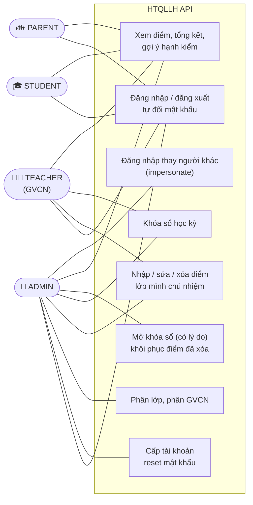

# 1. Tổng quan hệ thống

[← Mục lục](README.md) · [Tiếp: Kiến trúc →](02-kien-truc.md)

## 1.1. Bài toán

HTQLLH (Hệ thống quản lý lớp học / trường học) được nhóm chia thành nhiều phần. Phần này (**Member 4**) phụ trách:

| Nhóm chức năng             | Nội dung                                                                                             |
| -------------------------- | ---------------------------------------------------------------------------------------------------- |
| Xác thực (Authentication)  | Đăng nhập, access/refresh token, đăng xuất, đăng xuất mọi thiết bị, tự đổi mật khẩu                  |
| Phân quyền (Authorization) | 4 vai trò ADMIN / TEACHER / STUDENT / PARENT, phân quyền theo chức năng và theo quyền sở hữu dữ liệu |
| Quản lý tài khoản          | Admin cấp tài khoản cho mọi vai trò, reset mật khẩu khi người dùng quên                              |
| Phân lớp                   | Admin phân học sinh vào lớp, phân giáo viên làm GVCN                                                 |
| Sổ điểm điện tử            | Nhập điểm từng dòng hoặc hàng loạt, sửa, xóa mềm, khôi phục                                          |
| Logic học thuật            | Tính TBM môn, GPA hệ 10 và hệ 4, xếp loại học lực, gợi ý hạnh kiểm từ điểm danh                      |
| Khóa sổ                    | GVCN/Admin chốt sổ theo lớp + học kỳ; chỉ Admin mở khóa, bắt buộc có lý do                           |

## 1.2. Tác nhân và việc họ làm



> Xem điểm của STUDENT/PARENT bị giới hạn **đúng học sinh của mình**; TEACHER chỉ thao tác trên **lớp mình chủ nhiệm**.
> Chi tiết ở [Xác thực và phân quyền](06-xac-thuc-phan-quyen.md#63-phân-quyền-rbac-hai-tầng).

## 1.3. Công nghệ

| Thành phần        | Lựa chọn                               | Lý do                                                                        |
| ----------------- | -------------------------------------- | ---------------------------------------------------------------------------- |
| Runtime           | Node.js ≥ 22.8, ES Modules             | Có sẵn `--env-file`, `--watch`, test runner và coverage, không cần thêm tool |
| Web framework     | Express 5                              | Phổ biến, nhẹ; v5 tự bắt lỗi của `async` handler                             |
| Database          | PostgreSQL 16 (driver `pg`)            | DB chung của nhóm; transaction, `FOR UPDATE`, advisory lock                  |
| Validate đầu vào  | zod 4                                  | Khai báo schema một chỗ, ép kiểu, chặn field lạ (`strictObject`)             |
| Token             | jsonwebtoken (HS256)                   | Access token ngắn hạn + refresh token xoay vòng                              |
| Băm mật khẩu      | bcryptjs                               | Chuẩn phổ biến, có "cost" điều chỉnh được (`BCRYPT_ROUNDS`)                  |
| Bảo mật HTTP      | helmet, cors, express-rate-limit       | Header an toàn, giới hạn origin, chống dò mật khẩu                           |
| Log               | pino, pino-http, pino-pretty (dev)     | Log JSON có cấu trúc ở production, log đẹp kiểu NestJS khi dev               |
| Kiểm thử          | `node:test` + coverage có sẵn của Node | Không phụ thuộc Jest/Mocha; unit test + integration test với Postgres thật   |
| Chất lượng code   | ESLint, Prettier                       | Thống nhất phong cách, bắt lỗi sớm                                           |
| API test thủ công | Postman / newman                       | Collection sinh tự động từ script, chạy tuần tự được                         |

## 1.4. Cấu trúc thư mục

```text
school-api/
├── db/schema.sql                 # Schema CHUNG của nhóm – không sửa
├── docker-compose.yml            # Postgres 16, đọc DB_USER/DB_PASSWORD/DB_NAME/DB_PORT từ .env
├── docs/                         # Bộ tài liệu này
├── postman/                      # Collection + environment (sinh tự động)
├── scripts/                      # seed admin, init DB, chạy test, sinh Postman, dựng HTML coverage
├── src/
│   ├── server.js                 # Điểm vào: tạo logger, pool, app, listen, tắt êm (graceful shutdown)
│   ├── app.js                    # Tạo Express app + middleware + gắn router (không listen → dễ test)
│   ├── container.js              # Composition root: nối mọi tầng (DI thủ công)
│   ├── config/env.js             # Đọc + kiểm tra biến môi trường bằng zod (fail fast)
│   ├── db/                       # pool.js, transaction.js
│   ├── common/                   # Hạ tầng dùng chung, không chứa nghiệp vụ của module nào
│   │   ├── auth/                 # token, session store, hasher, permissions, access-policy, audit...
│   │   ├── errors/               # AppError + bảng mã lỗi
│   │   ├── http/                 # response chuẩn, phân trang, schema dùng chung
│   │   ├── logging/              # logger + định dạng kiểu NestJS
│   │   └── middleware/           # authenticate, can, validate, rate-limit, request-id, error-handler...
│   └── modules/                  # Mỗi module một nghiệp vụ
│       ├── academic/domain/      # HÀM THUẦN: TBM, GPA, xếp loại, hạnh kiểm
│       ├── auth/                 # routes, controller, service, schemas
│       ├── users/                # quản lý tài khoản
│       ├── classes/              # phân lớp, phân GVCN
│       ├── grades/               # sổ điểm, khóa sổ
│       ├── conduct/              # gợi ý hạnh kiểm
│       └── students/             # repository đọc bảng students/classes/subjects/attendances
└── tests/
    ├── helpers/harness.js        # Dựng app thật + DB thật cho integration test
    ├── unit/                     # Không cần DB
    └── integration/              # Cần TEST_DATABASE_URL
```

## 1.5. Ràng buộc và quyết định quan trọng

| Ràng buộc / quyết định                            | Hệ quả thiết kế                                                                                            |
| ------------------------------------------------- | ---------------------------------------------------------------------------------------------------------- |
| **Không sửa `db/schema.sql`**                     | Không có bảng phiên, bảng khóa sổ, cột nối user↔học sinh; phải dùng quy ước (xem [Dữ liệu](08-du-lieu.md)) |
| Không tự đăng ký                                  | Mọi tài khoản do Admin tạo qua `POST /users`; người dùng chỉ tự đăng nhập và tự đổi mật khẩu               |
| Role đọc từ DB mỗi request, không nằm trong token | Đổi role có hiệu lực ngay, token cũ không "giữ" quyền cũ                                                   |
| Điểm "chưa nhập" là `NULL`, khác `0`              | TBM chỉ tính trên các cột đã nhập; học lực "Chưa xếp loại" khi thiếu điểm bắt buộc                         |
| Mọi giá trị nghiệp vụ "cần chốt" để ở **một chỗ** | Hệ số điểm, bảng quy đổi hệ 4, ngưỡng xếp loại, ngưỡng hạnh kiểm nằm trong `modules/academic/domain`       |
| JavaScript thuần (không TypeScript)               | Bù lại bằng zod ở mọi đầu vào, `Object.freeze` cho hằng, ESLint nghiêm, test phủ cao                       |
