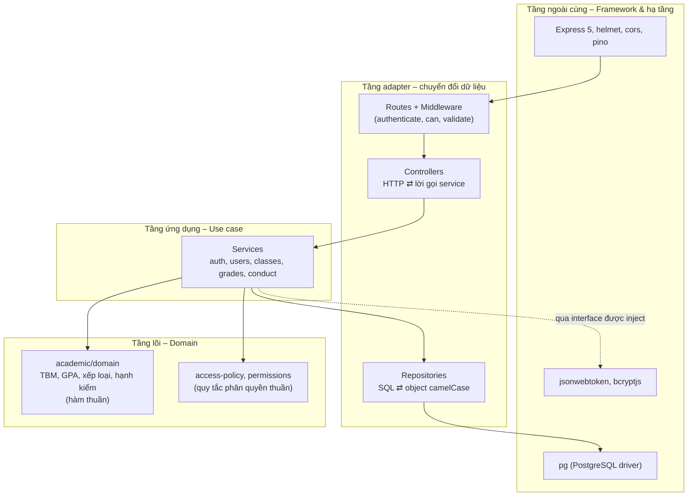
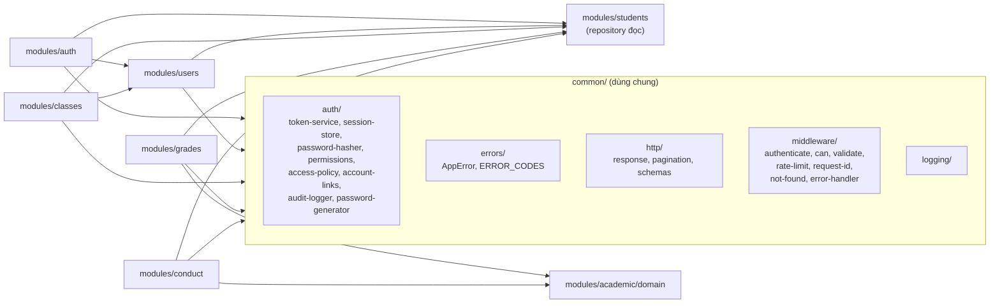
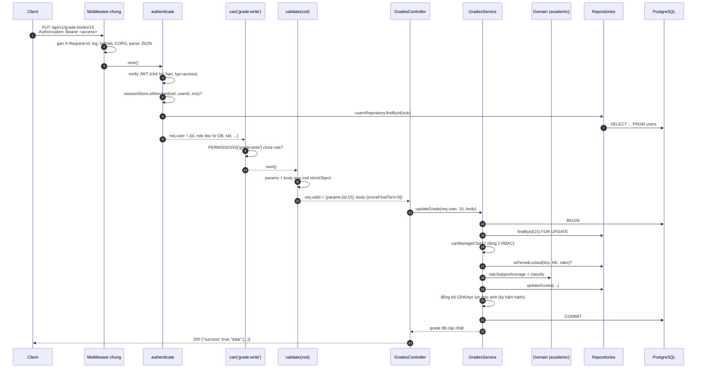
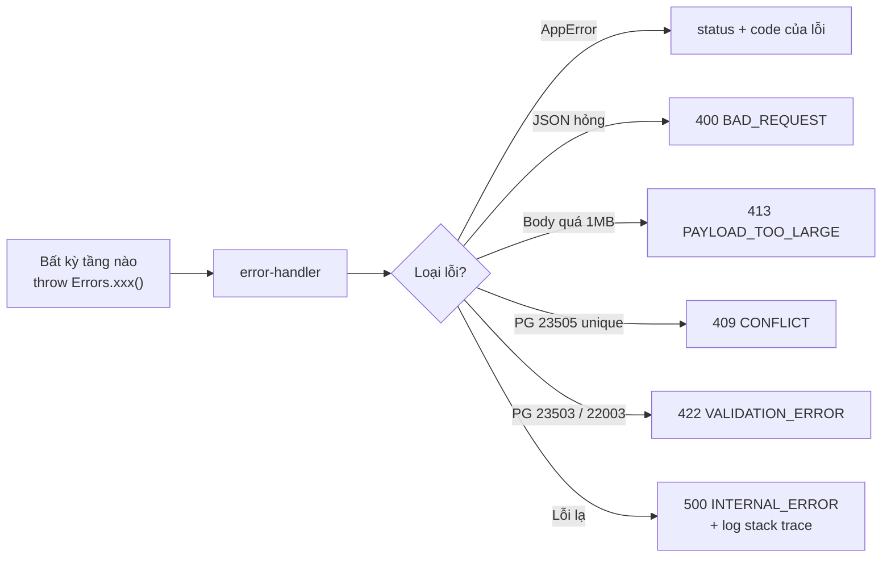
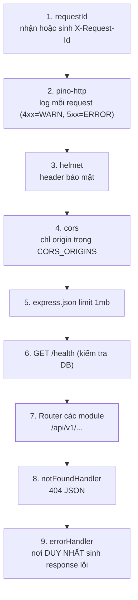
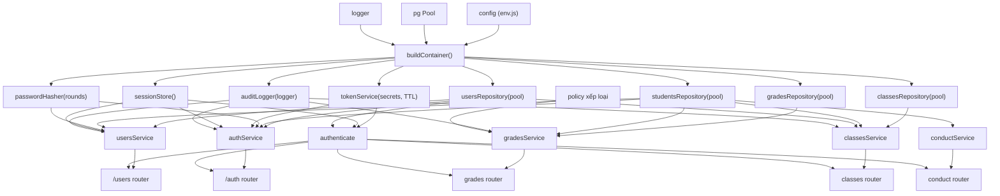
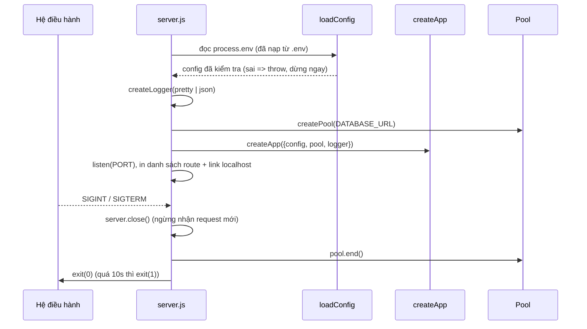

# 2. Kiến trúc tổng thể

[← Tổng quan](01-tong-quan.md) · [Mục lục](README.md) · [Tiếp: Clean Architecture →](03-clean-architecture.md)

## 2.1. Kiểu kiến trúc

Hệ thống là một **monolith dạng module** (modular monolith), bên trong chia **tầng** theo tinh thần Clean Architecture:

- **Theo chiều dọc**: chia theo **nghiệp vụ** (`auth`, `users`, `classes`, `grades`, `conduct`, `academic`).
  Mỗi module tự chứa route, controller, service, schema, repository của mình.
- **Theo chiều ngang**: trong mỗi module, code chia tầng **Route → Controller → Service → Repository/Domain**,
  phụ thuộc chỉ đi **một chiều từ ngoài vào trong**.

> Mũi tên = "phụ thuộc vào / gọi tới". Tầng lõi **không import** bất cứ thứ gì của tầng ngoài.
> Phân tích chi tiết từng nguyên tắc ở [Clean Architecture](03-clean-architecture.md).

## 2.2. Các module và quan hệ giữa chúng

| Module            | Trách nhiệm                                                                         | Endpoint gốc                                                 |
| ----------------- | ----------------------------------------------------------------------------------- | ------------------------------------------------------------ |
| `auth`            | Đăng nhập, refresh, logout, `/me`, đổi mật khẩu, chuyển vai trò                     | `/api/v1/auth/*`                                             |
| `users`           | Admin cấp tài khoản, liệt kê, reset mật khẩu                                        | `/api/v1/users/*`                                            |
| `classes`         | Danh sách lớp, tìm học sinh, phân lớp, phân GVCN                                    | `/api/v1/classes`, `/api/v1/students`                        |
| `grades`          | Sổ điểm, tổng kết học kỳ, tính lại, khóa/mở khóa sổ                                 | `/api/v1/grade-books/*`, `/students/:id/*`, `/grade-locks/*` |
| `conduct`         | Gợi ý hạnh kiểm từ điểm danh                                                        | `/api/v1/students/:id/conduct-suggestion`                    |
| `students`        | Chỉ có repository: đọc bảng `students`, `school_classes`, `subjects`, `attendances` | –                                                            |
| `academic/domain` | Hàm thuần tính toán học thuật, không biết HTTP hay DB                               | –                                                            |

## 2.3. Vòng đời một request

Ví dụ: GVCN sửa điểm cuối kỳ `PUT /api/v1/grade-books/15` với body `{ "scoreFinalTerm": 9 }`.

Nếu **bất kỳ bước nào** ném lỗi, lỗi đi thẳng xuống `error-handler` (bước cuối của pipeline), transaction tự `ROLLBACK`:

## 2.4. Pipeline middleware (thứ tự là có chủ đích)

Khai báo trong [`src/app.js`](../src/app.js):

| Vị trí                   | Vì sao đặt ở đó                                                                  |
| ------------------------ | -------------------------------------------------------------------------------- |
| `requestId` đầu tiên     | Mọi log và mọi response lỗi sau đó đều mang cùng một id để truy vết              |
| log trước bảo mật        | Request bị chặn vẫn được ghi log                                                 |
| `json` sau `cors`        | Không tốn công parse body của request bị CORS chặn                               |
| `notFound` sau router    | Chỉ chạy khi không route nào khớp                                                |
| `errorHandler` cuối cùng | Express nhận diện error handler qua 4 tham số; mọi `throw`/`next(err)` đổ về đây |

Trong từng route, thứ tự luôn là **`authenticate → can(permission) → validate(schema) → controller`**:

- `authenticate` trước `can` vì phải biết **ai** rồi mới biết **có quyền không**.
- `can` trước `validate`: người không có quyền nhận 403 ngay, không cần biết dữ liệu gửi lên đúng hay sai
  (tránh lộ cấu trúc API cho người không có quyền).
- Kiểm tra **quyền sở hữu** (học sinh này có phải của bạn không) nằm trong **service**, vì cần đọc DB.

## 2.5. Composition root – nơi duy nhất nối các tầng

[`src/container.js`](../src/container.js) tạo mọi đối tượng và **tiêm** (inject) phụ thuộc vào nhau. Không file nào khác
tự `new`/`create` phụ thuộc của mình.

Lợi ích cụ thể:

1. **Test dễ:** unit test truyền repository giả (object có vài hàm) vào service, không cần DB.
2. **Đổi hạ tầng không sửa nghiệp vụ:** ví dụ thay `sessionStore` trong RAM bằng Redis chỉ cần viết object mới cùng
   giao diện (`revokeSession`, `revokeAllForUser`, `isRevoked`, `markRefreshUsed`) và đổi **một dòng** trong container.
3. **Thấy toàn cảnh phụ thuộc ở một file**, không có "phụ thuộc ẩn" do `import` singleton rải rác.

## 2.6. Khởi động và tắt êm

- **Fail fast:** thiếu `DATABASE_URL`, JWT secret ngắn hơn 32 ký tự, hai secret trùng nhau, hoặc bật `DEMO_MODE` ở
  production → server **không khởi động** và in rõ lỗi.
- `createApp` **không gọi `listen`** để test tích hợp có thể dựng app trên cổng ngẫu nhiên.
