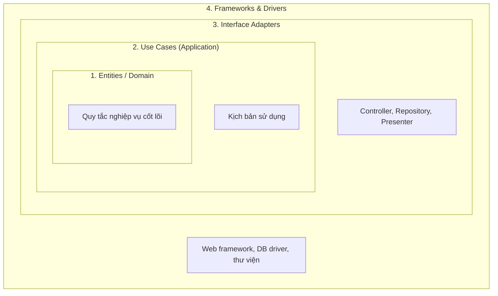
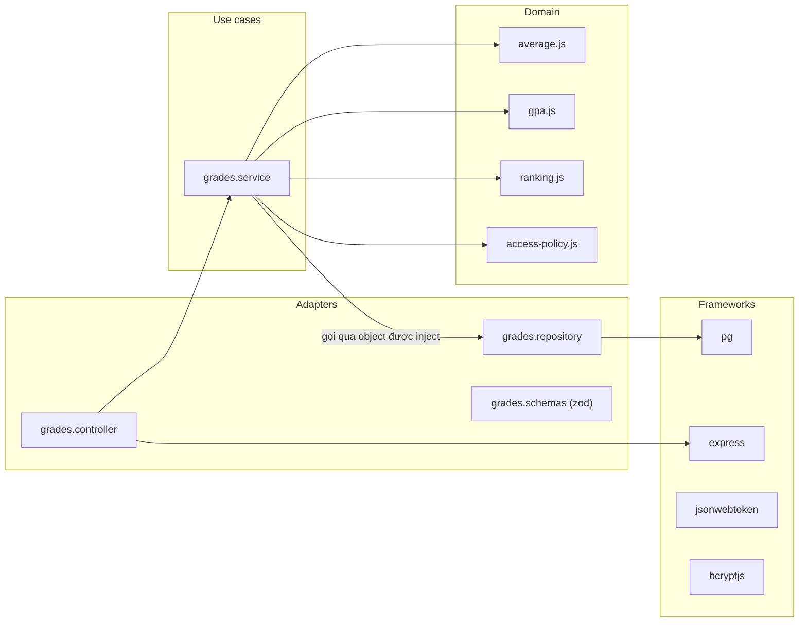
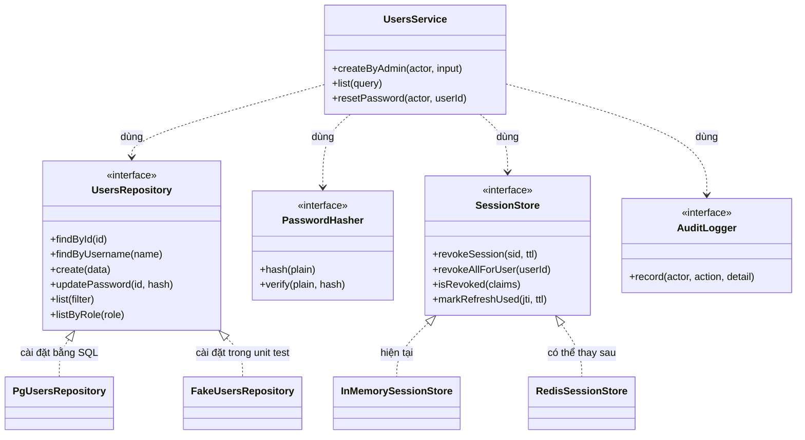
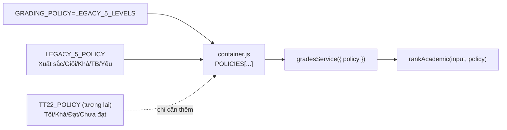
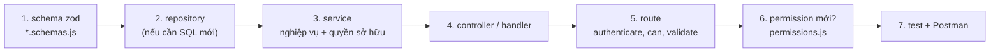

# 3. Clean Architecture trong dự án

[← Kiến trúc](02-kien-truc.md) · [Mục lục](README.md) · [Tiếp: RESTful API →](04-restful-api.md)

## 3.1. Clean Architecture là gì (ngắn gọn)

Clean Architecture (Robert C. Martin) tổ chức code thành các **vòng tròn đồng tâm**:



**Quy tắc phụ thuộc (Dependency Rule):** code ở vòng trong **không được biết** gì về vòng ngoài. Phụ thuộc chỉ trỏ **vào trong**.
Hệ quả: nghiệp vụ cốt lõi không bị ảnh hưởng khi đổi framework web, đổi DB, đổi thư viện token.

## 3.2. Ánh xạ vào code

| Vòng Clean Architecture | Trong dự án                                                                    | Ví dụ file                                                                                           |
| ----------------------- | ------------------------------------------------------------------------------ | ---------------------------------------------------------------------------------------------------- |
| 1. Entities / Domain    | Hàm thuần tính toán học thuật; quy tắc phân quyền thuần                        | `modules/academic/domain/*.js`, `common/auth/access-policy.js`, `permissions.js`, `account-links.js` |
| 2. Use Cases            | Service: điều phối một nghiệp vụ, transaction, kiểm tra quyền sở hữu           | `modules/*/*.service.js`                                                                             |
| 3. Interface Adapters   | Controller (HTTP ⇄ service), Repository (SQL ⇄ object), schema zod, middleware | `*.controller.js`, `*.repository.js`, `*.schemas.js`, `common/middleware/*`                          |
| 4. Frameworks & Drivers | Express, pg, jsonwebtoken, bcryptjs, pino                                      | `app.js`, `server.js`, `db/pool.js`, `common/auth/token-service.js`                                  |
| Composition Root        | Nơi duy nhất biết mọi vòng để lắp ráp                                          | `container.js`                                                                                       |



Kiểm chứng quy tắc phụ thuộc bằng chính code:

- `modules/academic/domain/*.js` **không có dòng `import` nào** tới express, pg, hay file ngoài thư mục `domain`.
- `access-policy.js` chỉ import `permissions.js` và `account-links.js` – đều là hàm/hằng thuần.
- Service **không import repository**: nó nhận repository qua tham số của hàm factory
  (`createGradesService({ gradesRepository, studentsRepository, ... })`).
- Controller **không chạm SQL**, repository **không chứa quy tắc nghiệp vụ**.

## 3.3. Trách nhiệm từng tầng – được và không được

| Tầng       | Được làm                                                                            | Không được làm                               |
| ---------- | ----------------------------------------------------------------------------------- | -------------------------------------------- |
| Route      | Khai báo đường dẫn + chuỗi middleware `authenticate → can → validate → controller`  | Logic nghiệp vụ                              |
| Controller | Đọc `req.valid` và `req.user`, gọi **một** hàm service, trả `ok()/created()/done()` | SQL, tính toán, `res.status().json()` tự chế |
| Service    | Nghiệp vụ, transaction, kiểm tra quyền sở hữu, ghi audit, `throw Errors.xxx()`      | Đụng `req`/`res`, viết SQL                   |
| Repository | SQL tham số hóa, map `snake_case` → `camelCase`, `FOR UPDATE`, advisory lock        | Quyết định nghiệp vụ, ném lỗi HTTP           |
| Domain     | Hàm thuần: vào số → ra số/nhãn                                                      | Import DB/HTTP, đọc biến môi trường          |

Ví dụ một controller hoàn chỉnh – chỉ là "dây nối":

```js
// src/modules/users/users.controller.js
async resetPassword(req, res) {
  const result = await usersService.resetPassword(req.user, req.valid.params.id);
  res.set('Cache-Control', 'no-store'); // response chứa mật khẩu tạm
  ok(res, result);
},
```

Ví dụ một hàm domain – không biết gì về HTTP/DB, test được bằng một dòng:

```js
// src/modules/academic/domain/average.js
calcSubjectAverage({ oral: 9, quarterHour: 8.5, oneHour: 8, midTerm: 9, finalTerm: 9.5 }); // 8.9
```

## 3.4. Dependency Injection thủ công (không dùng framework DI)

Mỗi thành phần là một **hàm factory** nhận phụ thuộc và trả về object:

```js
export function createUsersService({
  usersRepository,
  studentsRepository,
  passwordHasher,
  sessionStore,
  audit,
  generatePassword = defaultGeneratePassword,
}) {
  return {
    async resetPassword(actor, userId) {
      /* dùng các phụ thuộc ở trên */
    },
  };
}
```



JavaScript không có `interface`; "giao diện" ở đây là **tập hàm mà service gọi**. Bất kỳ object nào có đủ các hàm đó đều
thay thế được – đó là lý do unit test chạy không cần Postgres.

**Vì sao không dùng framework DI (Inversify, NestJS...)?** Dự án nhỏ, một file `container.js` dễ đọc hơn decorator và
reflection; không thêm "phép màu" khó giải thích khi báo cáo.

## 3.5. SOLID áp dụng cụ thể

| Nguyên tắc                    | Thể hiện trong code                                                                                                                                                 |
| ----------------------------- | ------------------------------------------------------------------------------------------------------------------------------------------------------------------- |
| **S** – Single Responsibility | `response.js` là nơi duy nhất dựng response thành công; `error-handler.js` là nơi duy nhất dựng response lỗi; `grade.mapper.js` là nơi duy nhất ánh xạ tên cột điểm |
| **O** – Open/Closed           | Thêm quy chế xếp loại mới = thêm một object policy cùng hình dạng vào `POLICIES`, chọn bằng `GRADING_POLICY` – **không sửa** `rankAcademic`                         |
| **L** – Liskov Substitution   | Repository giả trong test và repository Postgres thật thay thế cho nhau mà service không biết                                                                       |
| **I** – Interface Segregation | `authenticate` chỉ cần `usersRepository.findById`, không cần cả repository; mỗi service chỉ nhận đúng phụ thuộc nó dùng                                             |
| **D** – Dependency Inversion  | Service phụ thuộc vào "hình dạng" phụ thuộc được truyền vào, không `import` cài đặt cụ thể; việc chọn cài đặt dồn về `container.js`                                 |

Ví dụ **Open/Closed** với quy chế xếp loại:



## 3.6. Các nguyên tắc thiết kế khác

| Nguyên tắc                       | Cách áp dụng                                                                                                                                |
| -------------------------------- | ------------------------------------------------------------------------------------------------------------------------------------------- |
| **Fail fast**                    | Config sai → không khởi động; `can('ten-sai')` → ném lỗi ngay lúc khởi động                                                                 |
| **Single source of truth**       | Mã lỗi (`error-codes.js`), ma trận quyền (`permissions.js`), ánh xạ cột điểm (`grade.mapper.js`), hằng Postman                              |
| **Không tin client**             | `averageScore`, `gradeLetter`, `username` của học sinh, họ tên lấy từ DB đều do **server** tính/suy ra; field lạ bị chặn bởi `strictObject` |
| **Tách đọc dữ liệu đã kiểm tra** | Controller chỉ đọc `req.valid` (đã ép kiểu), không bao giờ đọc `req.body` thô                                                               |
| **Bất biến**                     | Hằng nghiệp vụ dùng `Object.freeze`; test khẳng định không sửa được lúc chạy                                                                |
| **Không lộ thông tin nội bộ**    | Production trả "Lỗi hệ thống", không trả message/stack; log mới có chi tiết                                                                 |

## 3.7. Những chỗ "chưa thuần" – nói thẳng

Kiến trúc là **thực dụng**, không phải sách giáo khoa. Các thỏa hiệp có chủ đích:

| Chỗ chưa thuần                                        | Lý do giữ nguyên                                                           | Nếu muốn "chuẩn" hơn                               |
| ----------------------------------------------------- | -------------------------------------------------------------------------- | -------------------------------------------------- |
| Service ném `AppError` có sẵn `status` HTTP           | Gọn, ít lớp chuyển đổi; mã lỗi vẫn là `code` độc lập HTTP                  | Ném lỗi domain thuần, adapter map sang HTTP status |
| Service nhận `pool` để mở transaction (`grades`)      | Transaction là mối quan tâm của use case; truyền `client` xuống repository | Trừu tượng "Unit of Work" được inject              |
| `classes.repository` **ghi** vào bảng của member khác | Yêu cầu phân lớp/GVCN; schema không đổi                                    | Gọi API/module của member sở hữu bảng đó           |
| Không có lớp Entity riêng (dùng object thường)        | JS không có kiểu; zod + mapper đảm bảo hình dạng dữ liệu                   | Dùng TypeScript + class Entity                     |

## 3.8. Lợi ích đo được

- **Kiểm thử:** domain và service có unit test không cần DB; integration test dựng app thật trên DB thật.
  Ngưỡng coverage bắt buộc: dòng ≥ 98%, nhánh ≥ 95%, hàm ≥ 95% (xem [Vận hành và kiểm thử](09-van-hanh-kiem-thu.md)).
- **Thay đổi cục bộ:** đổi công thức TBM chỉ sửa `average.js`; đổi thư viện JWT chỉ sửa `token-service.js`.
- **Thêm endpoint theo công thức cố định:**


