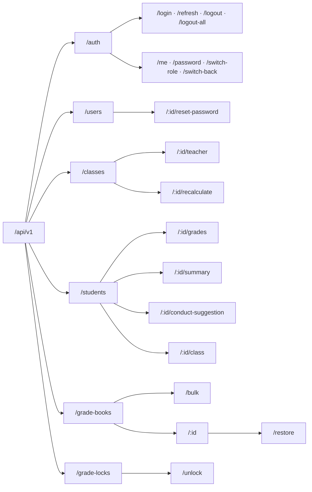
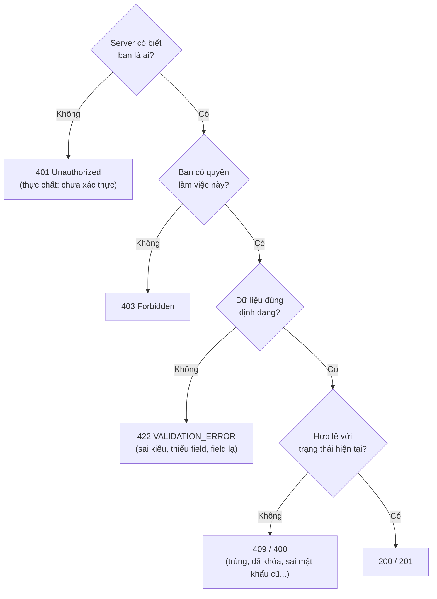
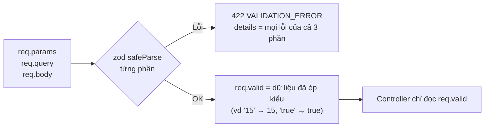
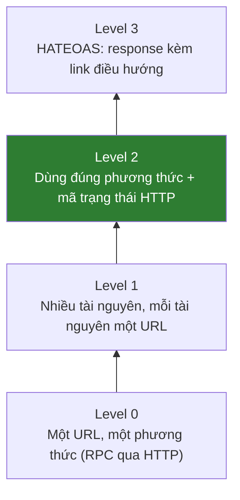

# 4. Thiết kế RESTful API

[← Clean Architecture](03-clean-architecture.md) · [Mục lục](README.md) · [Tiếp: Danh mục endpoint →](05-danh-muc-endpoint.md)

## 4.1. REST là gì và áp dụng tới đâu

REST (Representational State Transfer) là phong cách thiết kế API dựa trên **tài nguyên** (resource) được định danh
bằng URL và thao tác bằng **phương thức HTTP chuẩn**. Các ràng buộc chính và cách dự án tuân theo:

| Ràng buộc REST        | Áp dụng trong dự án                                                                                        |
| --------------------- | ---------------------------------------------------------------------------------------------------------- |
| Client – Server       | API chỉ trả JSON; frontend/Postman là client độc lập                                                       |
| **Stateless**         | Mỗi request tự mang đủ thông tin xác thực (`Authorization: Bearer <token>`); server không giữ session HTTP |
| Cacheable             | Response nhạy cảm (mật khẩu tạm) gửi `Cache-Control: no-store`                                             |
| **Uniform interface** | URL danh từ số nhiều, phương thức HTTP đúng nghĩa, một định dạng response, mã lỗi thống nhất               |
| Layered system        | Có thể đặt sau reverse proxy (`trust proxy` bật ở production)                                              |

> "Stateless" ở mức HTTP: server **không** lưu phiên đăng nhập để phục vụ request. Danh sách token bị thu hồi trong RAM
> chỉ là **danh sách chặn** (denylist) phục vụ bảo mật, xem [Xác thực](06-xac-thuc-phan-quyen.md#62-vòng-đời-token).

## 4.2. Quy ước URL

| Quy ước                                     | Ví dụ                                                                 |
| ------------------------------------------- | --------------------------------------------------------------------- |
| Tiền tố phiên bản                           | `/api/v1/...` (đổi lớn thì lên `/api/v2`, client cũ không vỡ)         |
| Danh từ, **số nhiều**, chữ thường, gạch nối | `/users`, `/grade-books`, `/grade-locks`, `/classes`                  |
| Định danh trong path                        | `/grade-books/15`, `/students/5/summary`                              |
| Tài nguyên con (sub-resource)               | `/students/:id/grades`, `/students/:id/class`, `/classes/:id/teacher` |
| Lọc, sắp xếp, phân trang trong **query**    | `/users?role=TEACHER&q=mai&sort=-createdAt&page=2&limit=20`           |
| Health check ngoài phiên bản                | `/health`                                                             |



## 4.3. Phương thức HTTP

| Phương thức | Ngữ nghĩa                            | Idempotent*   | Ví dụ                                          |
| ----------- | ------------------------------------ | ------------- | ---------------------------------------------- |
| `GET`       | Đọc, không đổi dữ liệu               | Có            | `GET /students/5/summary`                      |
| `POST`      | Tạo mới, hoặc thực thi một hành động | Không         | `POST /users`, `POST /grade-locks`             |
| `PUT`       | Cập nhật tài nguyên đã biết id       | Có            | `PUT /grade-books/15`, `PUT /students/5/class` |
| `DELETE`    | Xóa (ở đây là **xóa mềm**)           | Có về kết quả | `DELETE /grade-books/15`                       |

\* Idempotent: gọi nhiều lần cho cùng kết quả cuối. `PUT /students/5/class {classId: 1}` gọi 2 lần vẫn là "HS5 ở lớp 1".

`PUT /grade-books/:id` nhận **một phần** các cột điểm (gửi cột nào sửa cột đó, `null` = xóa điểm cột đó).
Về lý thuyết đây là ngữ nghĩa của `PATCH`; dự án dùng `PUT` cho thống nhất với nhóm và ghi rõ trong tài liệu endpoint.

### Hành động không phải CRUD

Một số thao tác là **hành động** chứ không phải tạo/sửa/xóa tài nguyên. Dự án dùng mẫu
"**controller resource**" – `POST` lên một đường dẫn động từ con:

| Hành động               | Endpoint                         | Vì sao không phải CRUD thuần                             |
| ----------------------- | -------------------------------- | -------------------------------------------------------- |
| Khôi phục điểm đã xóa   | `POST /grade-books/:id/restore`  | Đổi trạng thái kèm kiểm tra trùng, không phải "sửa điểm" |
| Tính lại TBM/GPA cả lớp | `POST /classes/:id/recalculate`  | Tác động hàng loạt, có kết quả thống kê                  |
| Mở khóa sổ              | `POST /grade-locks/unlock`       | Bắt buộc lý do, chỉ Admin                                |
| Reset mật khẩu          | `POST /users/:id/reset-password` | Server sinh mật khẩu, không nhận dữ liệu từ client       |
| Chuyển vai trò          | `POST /auth/switch-role`         | Sinh phiên mới, không sửa tài nguyên nào                 |
| Nhập điểm hàng loạt     | `POST /grade-books/bulk`         | Upsert nhiều dòng trong một transaction                  |

## 4.4. Mã trạng thái HTTP

| Mã      | Khi nào                                                                        | `error.code` tương ứng                                                                       |
| ------- | ------------------------------------------------------------------------------ | -------------------------------------------------------------------------------------------- |
| **200** | Thành công (đọc, sửa, hành động; kể cả logout trả `data: null`)                | –                                                                                            |
| **201** | Tạo mới thành công (`POST /users`, `POST /grade-books`, `POST /grade-locks`)   | –                                                                                            |
| **400** | Yêu cầu sai về **nghiệp vụ** hoặc JSON hỏng                                    | `BAD_REQUEST`                                                                                |
| **401** | Chưa đăng nhập, token sai/hết hạn/bị thu hồi, sai mật khẩu                     | `UNAUTHENTICATED`, `TOKEN_EXPIRED`, `INVALID_CREDENTIALS`, `REFRESH_TOKEN_INVALID`           |
| **403** | Đã đăng nhập nhưng **không có quyền**                                          | `FORBIDDEN`                                                                                  |
| **404** | Tài nguyên hoặc đường dẫn không tồn tại                                        | `NOT_FOUND`                                                                                  |
| **409** | Xung đột trạng thái: trùng, sổ đã khóa, đã xóa...                              | `CONFLICT`, `GRADEBOOK_LOCKED`, `GRADEBOOK_ALREADY_LOCKED`, `ALREADY_DELETED`, `NOT_DELETED` |
| **413** | Body vượt 1 MB                                                                 | `PAYLOAD_TOO_LARGE`                                                                          |
| **422** | Dữ liệu sai **định dạng** (zod): thiếu field, sai kiểu, field lạ, ngoài khoảng | `VALIDATION_ERROR`                                                                           |
| **429** | Vượt rate limit                                                                | `TOO_MANY_REQUESTS`                                                                          |
| **500** | Lỗi không lường trước                                                          | `INTERNAL_ERROR`                                                                             |
| **503** | `/health` khi DB không kết nối được                                            | `INTERNAL_ERROR`                                                                             |

Phân biệt hai cặp hay nhầm:



## 4.5. Định dạng response thống nhất

**Mọi** response đều là JSON và có trường `success`. Chỉ có hai nơi trong code tạo response:
`common/http/response.js` (thành công) và `common/middleware/error-handler.js` (lỗi).

### Thành công

```json
{ "success": true, "data": { "id": 15, "averageScore": 8.9, "gradeLetter": "Giỏi" } }
```

### Thành công có phân trang

```json
{
  "success": true,
  "data": [{ "id": 1, "username": "admin", "fullName": "Quản trị viên", "role": "ADMIN" }],
  "meta": { "page": 1, "limit": 20, "total": 41, "totalPages": 3 }
}
```

### Lỗi

```json
{
  "success": false,
  "error": {
    "code": "VALIDATION_ERROR",
    "message": "Dữ liệu không hợp lệ",
    "details": [{ "in": "body", "field": "scoreFinalTerm", "message": "Điểm phải từ 0 đến 10" }]
  },
  "requestId": "6f1d2c3a-4b5e-4f60-8a71-9b8c7d6e5f40"
}
```

| Trường          | Ý nghĩa                                                                                  |
| --------------- | ---------------------------------------------------------------------------------------- |
| `error.code`    | **Client dựa vào đây** để xử lý (ổn định, tiếng Anh, không đổi theo ngôn ngữ)            |
| `error.message` | Câu cho người đọc (tiếng Việt), có thể đổi, **không** dùng để rẽ nhánh logic             |
| `error.details` | Chỉ có ở lỗi validate: danh sách `{ in: params                                           | query | body, field, message }` |
| `requestId`     | Trùng header `X-Request-Id` và có trong log server → báo lỗi kèm id này là tra được ngay |

## 4.6. Validate đầu vào

Mọi `params`, `query`, `body` đi qua **zod** trong middleware `validate()` trước khi tới controller.



| Kỹ thuật                           | Tác dụng                                                                                                                                                                                                                         |
| ---------------------------------- | -------------------------------------------------------------------------------------------------------------------------------------------------------------------------------------------------------------------------------- |
| `z.strictObject(...)`              | **Chặn field lạ** → chống mass-assignment (vd gửi `averageScore`, `role`, `isAdmin` đều bị 422)                                                                                                                                  |
| `z.coerce.number()` cho path/query | `"15"` thành `15`; `"abc"` bị 422 thay vì lỗi SQL                                                                                                                                                                                |
| Enum                               | `semester` chỉ nhận `HK1`/`HK2`; `role` chỉ 4 giá trị                                                                                                                                                                            |
| Ràng buộc nghiệp vụ đơn giản       | điểm 0–10 tối đa 1 chữ số thập phân, `schoolYear` dạng `2025-2026` (năm sau = năm trước + 1), mật khẩu ≥ 8 ký tự có chữ và số (≤ 72 byte vì giới hạn của bcrypt), lý do mở khóa ≥ 10 ký tự, bulk 1–100 dòng không trùng học sinh |
| Gom lỗi                            | Trả **tất cả** lỗi một lần, không phải sửa từng lỗi rồi gửi lại                                                                                                                                                                  |

## 4.7. Phân trang, lọc, sắp xếp

Áp dụng cho `GET /users`, `GET /students`, `GET /grade-books`, `GET /grade-locks`.

| Tham số | Mặc định     | Giới hạn      | Ghi chú                                                               |
| ------- | ------------ | ------------- | --------------------------------------------------------------------- |
| `page`  | 1            | ≥ 1           |                                                                       |
| `limit` | 20           | 1–100         | Chặn client xin cả triệu dòng                                         |
| `sort`  | tùy endpoint | **whitelist** | `field` tăng dần, `-field` giảm dần; field ngoài danh sách → 422      |
| Lọc     | –            | theo endpoint | `role`, `q` (tìm gần đúng), `classId`, `unassigned`, `subjectName`... |

**Vì sao sort phải whitelist?** Tên cột không thể truyền qua tham số SQL (`$1`) được. Nếu nối chuỗi từ query vào
`ORDER BY` sẽ bị SQL injection. Dự án map `sort` qua một bảng cố định (`parseSort(sort, SORT_COLUMNS)`), client không
bao giờ chạm tới tên cột thật. Từ khóa `q` được escape ký tự `%` và `_` để không thành wildcard.

Tổng số dòng lấy bằng `COUNT(*) OVER()` ngay trong câu truy vấn trang → **một** round-trip tới DB.

## 4.8. Header quan trọng

| Header                                | Chiều    | Mục đích                                                                             |
| ------------------------------------- | -------- | ------------------------------------------------------------------------------------ |
| `Authorization: Bearer <accessToken>` | Request  | Xác thực                                                                             |
| `Content-Type: application/json`      | Request  | Mọi body là JSON (không có form-data)                                                |
| `X-Request-Id`                        | Cả hai   | Client gửi lên (8–64 ký tự `A-Za-z0-9_-`) thì giữ nguyên, không thì server sinh UUID |
| `RateLimit`, `RateLimit-Policy`       | Response | Chuẩn draft-7: còn bao nhiêu lượt, cửa sổ bao lâu                                    |
| `Cache-Control: no-store`             | Response | Ở response chứa mật khẩu tạm                                                         |
| Header của helmet                     | Response | `X-Content-Type-Options`, `Strict-Transport-Security`, CSP...; ẩn `X-Powered-By`     |

## 4.9. Mức trưởng thành REST (Richardson Maturity Model)



Dự án đạt **Level 2**: tài nguyên rõ ràng, phương thức và mã trạng thái đúng ngữ nghĩa. **Không** làm Level 3 (HATEOAS)
vì client là frontend do nhóm tự viết, biết trước các URL; thêm link vào mọi response làm payload phình mà không có
người dùng thực sự.
