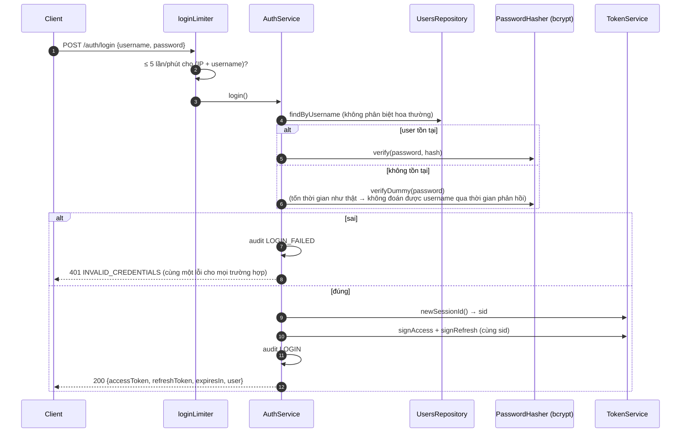
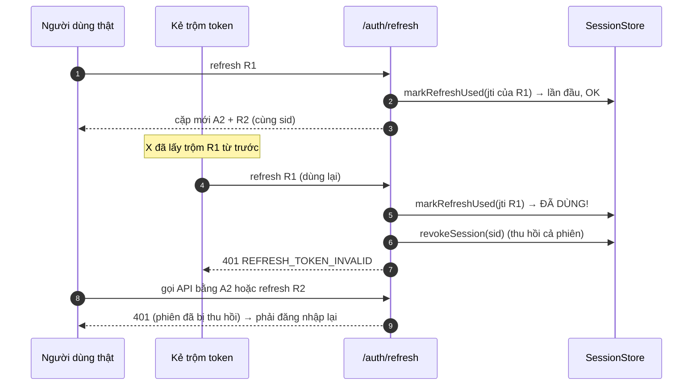
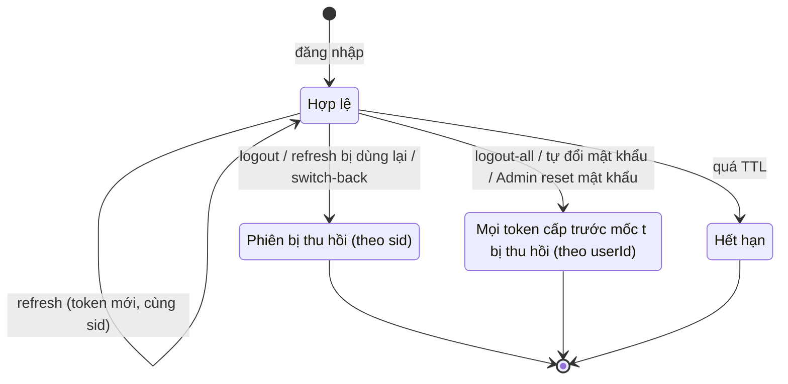
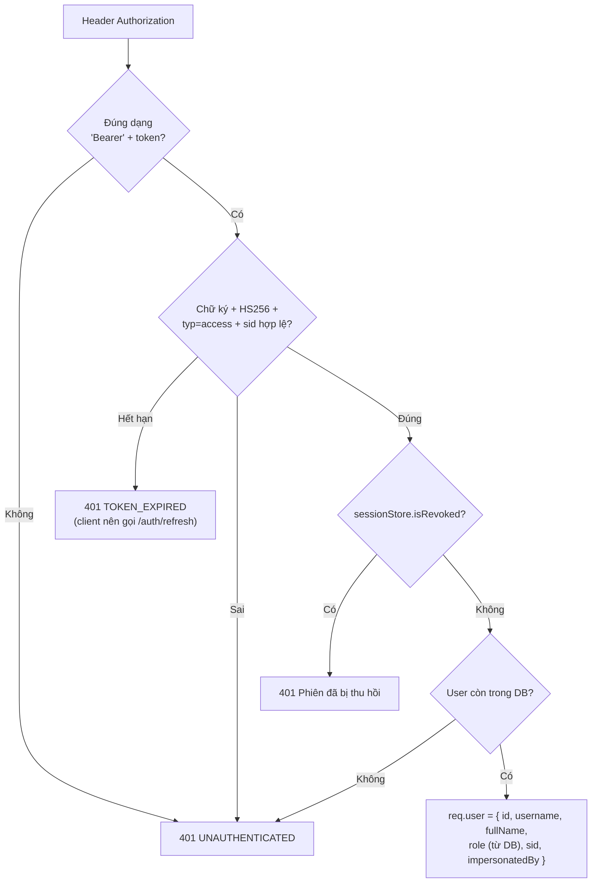
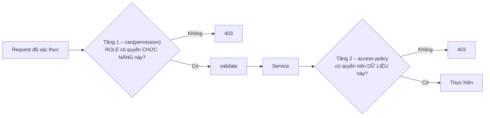
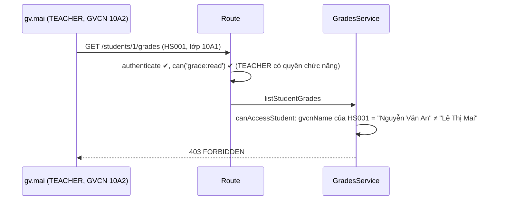
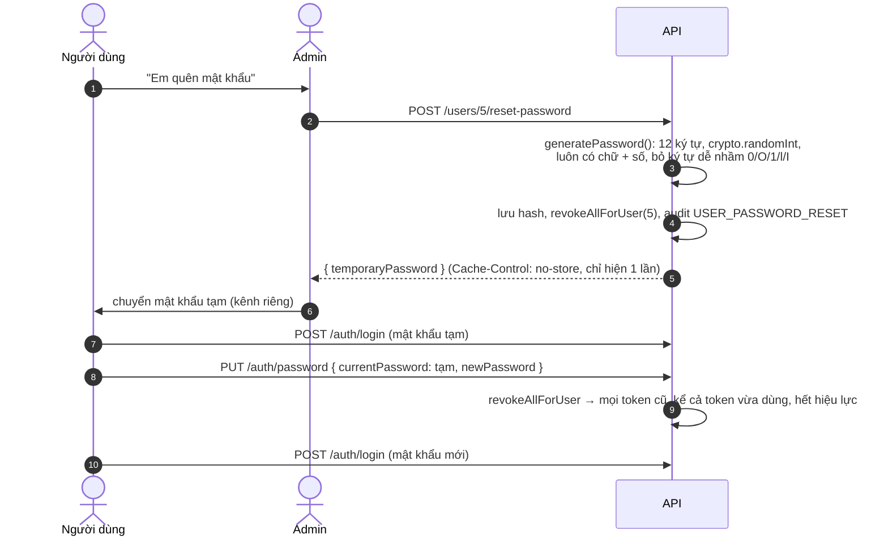
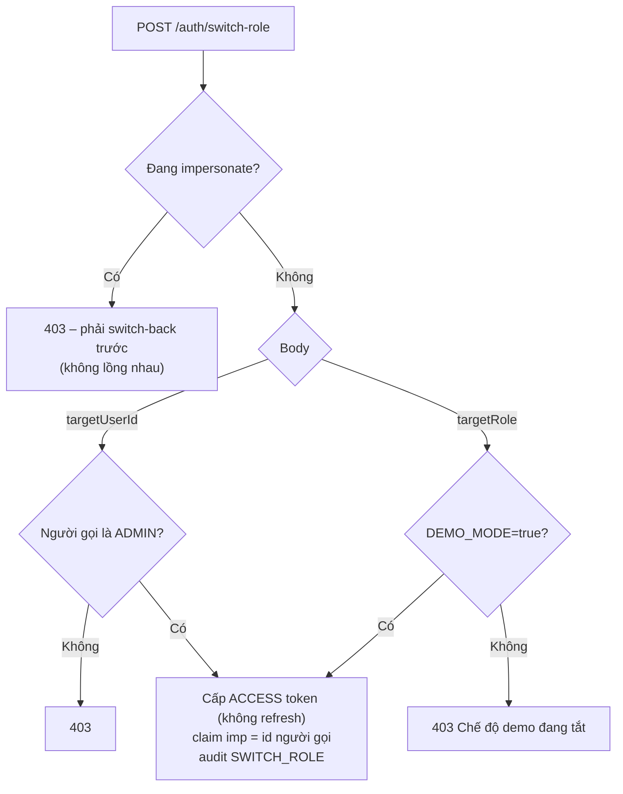

# 6. Xác thực và phân quyền

[← Danh mục endpoint](05-danh-muc-endpoint.md) · [Mục lục](README.md) · [Tiếp: Nghiệp vụ sổ điểm →](07-nghiep-vu-so-diem.md)

Hai câu hỏi tách bạch:

- **Xác thực (Authentication):** _Bạn là ai?_ → JWT, mật khẩu, phiên.
- **Phân quyền (Authorization):** _Bạn được làm gì, trên dữ liệu nào?_ → RBAC hai tầng.

## 6.1. Hai loại token

| Đặc điểm          | Access token                                                                                                        | Refresh token                                                        |
| ----------------- | ------------------------------------------------------------------------------------------------------------------- | -------------------------------------------------------------------- |
| Dùng để           | Gọi API (`Authorization: Bearer ...`)                                                                               | **Chỉ** để xin cặp token mới ở `/auth/refresh`                       |
| Thời hạn mặc định | 15 phút (`ACCESS_TOKEN_TTL_SECONDS=900`)                                                                            | 7 ngày (`REFRESH_TOKEN_TTL_SECONDS=604800`)                          |
| Khóa ký           | `JWT_ACCESS_SECRET`                                                                                                 | `JWT_REFRESH_SECRET` (**phải khác** access)                          |
| Thuật toán        | HS256, server chỉ chấp nhận đúng HS256                                                                              | HS256                                                                |
| Claims            | `sub` (userId), `sid` (id phiên), `typ: "access"`, `ims` (thời điểm cấp, ms), `imp?` (id Admin đang đăng nhập thay) | `sub`, `sid`, `typ: "refresh"`, `ims`, `jti` (id duy nhất của token) |

Quyết định quan trọng:

- **Không nhét `role` vào token.** Middleware `authenticate` đọc user từ DB **mỗi request**. Đổi role/xóa user có hiệu lực
  ngay, không phải chờ token hết hạn.
- **Hai secret khác nhau + claim `typ`:** không thể dùng refresh token thay access token (test có kiểm tra: `401`).
- **Access ngắn hạn:** nếu lộ, thiệt hại bị giới hạn trong 15 phút; refresh dài hạn nhưng được **xoay vòng** và phát hiện dùng lại.

## 6.2. Vòng đời token

### Đăng nhập

### Refresh xoay vòng và phát hiện dùng lại (reuse detection)

Khi refresh token bị dùng lại, server không biết ai là người thật, nên **thu hồi cả phiên** cho an toàn (theo khuyến nghị
OAuth 2.0 Security BCP).

### Các cách thu hồi

`SessionStore` (trong RAM) giữ 3 thứ:

| Bảng trong RAM    | Khóa                     | Dùng cho                                                        |
| ----------------- | ------------------------ | --------------------------------------------------------------- |
| `revokedSessions` | `sid`                    | logout, phát hiện dùng lại refresh, switch-back                 |
| `revokedBefore`   | `userId` → mốc thời gian | logout-all, đổi/reset mật khẩu: token có `ims` ≤ mốc bị từ chối |
| `usedRefresh`     | `jti`                    | Đánh dấu refresh token đã dùng                                  |

Mục hết hạn được dọn tự động. **Giới hạn:** mất khi restart server và không chia sẻ giữa nhiều instance (schema không có
bảng phiên). Giao diện được giữ nhỏ để thay bằng Redis/bảng DB mà không sửa service.

### Middleware `authenticate`

## 6.3. Phân quyền: RBAC hai tầng

### Tầng 1 – ma trận quyền (`common/auth/permissions.js`)

| Permission      | ADMIN | TEACHER | STUDENT | PARENT | Dùng ở                                                                 |
| --------------- | :---: | :-----: | :-----: | :----: | ---------------------------------------------------------------------- |
| `user:manage`   |   ✔   |         |         |        | `/users/*`                                                             |
| `class:manage`  |   ✔   |         |         |        | `/classes`, `/classes/:id/teacher`, `/students`, `/students/:id/class` |
| `grade:read`    |   ✔   |    ✔    |    ✔    |   ✔    | `/students/:id/grades`, `/students/:id/summary`                        |
| `grade:write`   |   ✔   |    ✔    |         |        | tạo/sửa/bulk/xem sổ lớp/tính lại                                       |
| `grade:delete`  |   ✔   |    ✔    |         |        | xóa mềm                                                                |
| `grade:restore` |   ✔   |         |         |        | khôi phục                                                              |
| `grade:lock`    |   ✔   |    ✔    |         |        | chốt sổ, xem danh sách kỳ đã chốt                                      |
| `grade:unlock`  |   ✔   |         |         |        | mở khóa                                                                |
| `conduct:read`  |   ✔   |    ✔    |    ✔    |   ✔    | gợi ý hạnh kiểm                                                        |

Ma trận được đóng băng (`Object.freeze`) và có test viết tay độc lập: ai sửa quyền mà không sửa test → test đỏ.
`can('ten-sai')` ném lỗi ngay lúc khởi động nên không thể gõ nhầm tên permission mà không biết.

### Tầng 2 – quyền sở hữu dữ liệu (`common/auth/access-policy.js`)

| Hàm                          | ADMIN   | TEACHER                                   | STUDENT            | PARENT                     |
| ---------------------------- | ------- | ----------------------------------------- | ------------------ | -------------------------- |
| `canAccessStudent(user, hs)` | Mọi HS  | HS thuộc lớp có `gvcn_name` = họ tên mình | `username` = mã HS | `username` = mã HS + `-PH` |
| `canManageClass(user, lớp)`  | Mọi lớp | Lớp có `gvcn_name` = họ tên mình          | Không              | Không                      |

So khớp họ tên dùng `normalizeName`: chuẩn hóa Unicode NFC, bỏ khoảng trắng thừa, không phân biệt hoa thường
(`"  phạm văn  BÌNH "` khớp `"Phạm Văn Bình"`).

Ví dụ đầy đủ: GVCN lớp 10A2 xem điểm học sinh lớp 10A1:

### Vì sao liên kết bằng quy ước (username, họ tên)?

Schema **không có** cột nối `users ↔ students` hay `users ↔ school_classes`. Thay vì sửa schema chung, hệ thống dùng quy ước
(xem `common/auth/account-links.js`):

| Liên kết                | Quy ước                                           | Bảo vệ                                                                |
| ----------------------- | ------------------------------------------------- | --------------------------------------------------------------------- |
| STUDENT ↔ học sinh      | `username = student_code`                         | Username do **server** suy ra khi Admin cấp, client không tự đặt được |
| PARENT ↔ học sinh       | `username = student_code + "-PH"`                 | Như trên                                                              |
| TEACHER ↔ lớp chủ nhiệm | `users.full_name` khớp `school_classes.gvcn_name` | Phân GVCN qua API **từ chối (409)** nếu có 2 giáo viên trùng họ tên   |

## 6.4. Mật khẩu

| Chủ đề            | Cách làm                                                                                    |
| ----------------- | ------------------------------------------------------------------------------------------- |
| Lưu trữ           | Chỉ lưu **hash bcrypt** (cost `BCRYPT_ROUNDS`, mặc định 10); không bao giờ trả hash ra API  |
| Độ mạnh           | ≥ 8 ký tự, có cả chữ và số, ≤ 72 byte (bcrypt bỏ qua phần sau 72 byte)                      |
| Đăng nhập         | Không áp luật độ mạnh, chỉ giới hạn độ dài 128 để chống DoS bcrypt                          |
| Chống dò username | User không tồn tại vẫn chạy bcrypt với hash giả → thời gian phản hồi như nhau               |
| Ai đổi mật khẩu   | **Chính chủ** qua `PUT /auth/password` (phải nhập mật khẩu hiện tại)                        |
| Quên mật khẩu     | Liên hệ Admin → Admin **reset** → server sinh mật khẩu tạm → người dùng đăng nhập và tự đổi |

Luồng quên mật khẩu:

**Admin không thể tự đặt** mật khẩu cho người khác, và không đổi được mật khẩu khi đang impersonate → mật khẩu thật sự
là "của riêng" người dùng.

## 6.5. Đăng nhập thay (impersonate) và Quick Role Switcher

- `DEMO_MODE=true` ở `NODE_ENV=production` → **server từ chối khởi động**.
- `switch-back` thu hồi phiên impersonate và cấp phiên mới đầy đủ cho tài khoản gốc.
- Mọi hành động trong lúc impersonate được ghi audit kèm `impersonatedBy`.

## 6.6. Rate limit

| Bộ giới hạn    | Áp cho                                                         | Mức              | Khóa đếm      |
| -------------- | -------------------------------------------------------------- | ---------------- | ------------- |
| `loginLimiter` | `POST /auth/login`                                             | 5 lần / 60 giây  | IP + username |
| `ipLimiter`    | `POST /auth/refresh`, `PUT /auth/password` (dùng chung bộ đếm) | 10 lần / 60 giây | IP            |

Vượt mức → `429 TOO_MANY_REQUESTS` (JSON chuẩn) kèm header `RateLimit`. Đếm theo **IP + username** ở login để kẻ dò mật khẩu
không khóa được người khác dùng chung mạng. Tắt khi dev bằng `RATE_LIMIT_ENABLED=false`.

## 6.7. Audit log

Mọi hành động nhạy cảm gọi `audit.record(actor, ACTION, detail)` → ghi log có cấu trúc (field `audit`):
`actorId`, `impersonatedBy`, `action`, `entity`, `entityId`, `before`, `after`, `note`.

| Nhóm      | Hành động                                                                                                                                                             |
| --------- | --------------------------------------------------------------------------------------------------------------------------------------------------------------------- |
| Phiên     | `LOGIN`, `LOGIN_FAILED`, `LOGOUT`, `LOGOUT_ALL`, `REFRESH_REUSE_DETECTED`, `SWITCH_ROLE`, `SWITCH_BACK`                                                               |
| Tài khoản | `USER_CREATE`, `USER_PASSWORD_RESET`, `PASSWORD_CHANGE`, `PASSWORD_CHANGE_FAILED`                                                                                     |
| Phân lớp  | `STUDENT_CLASS_ASSIGN`, `CLASS_TEACHER_ASSIGN`                                                                                                                        |
| Sổ điểm   | `GRADE_CREATE`, `GRADE_UPDATE` (có before/after), `GRADE_DELETE`, `GRADE_RESTORE`, `GRADE_BULK_UPSERT`, `GRADE_RECALCULATE`, `GRADE_LOCK`, `GRADE_UNLOCK` (kèm lý do) |

Không có bảng `audit_logs` (schema giữ nguyên) nên audit nằm trong log; giao diện `record()` giữ nguyên để sau này ghi DB.

## 6.8. Tổng hợp biện pháp bảo mật (đối chiếu OWASP API Top 10)

| Rủi ro OWASP                                    | Biện pháp                                                                                                        |
| ----------------------------------------------- | ---------------------------------------------------------------------------------------------------------------- |
| API1 Broken Object Level Authorization          | Tầng 2 `access-policy` cho mọi truy cập theo học sinh/lớp                                                        |
| API2 Broken Authentication                      | JWT ngắn hạn, refresh xoay vòng + phát hiện dùng lại, bcrypt, rate limit, lỗi đăng nhập đồng nhất                |
| API3 Broken Object Property Level Authorization | `strictObject` chặn field lạ; response không bao giờ có `password`/hash (integration test kiểm tra mọi response) |
| API4 Unrestricted Resource Consumption          | Body ≤ 1 MB, `limit` ≤ 100, bulk ≤ 100 dòng, rate limit                                                          |
| API5 Broken Function Level Authorization        | Tầng 1 `can(permission)` trên mọi route; test ma trận "mọi endpoint × 5 loại người gọi"                          |
| API8 Security Misconfiguration                  | helmet, CORS whitelist, ẩn `X-Powered-By`, không trả stack ở production, config fail-fast                        |
| Injection                                       | 100% SQL tham số hóa; `ORDER BY` qua whitelist; escape `%`/`_` trong tìm kiếm                                    |
