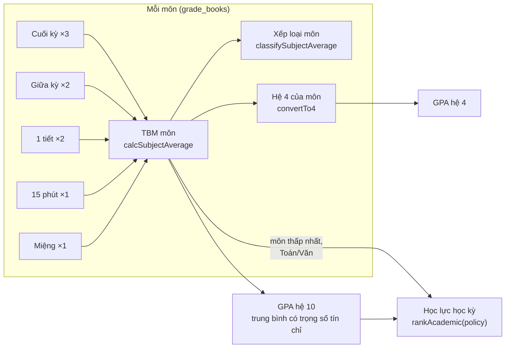
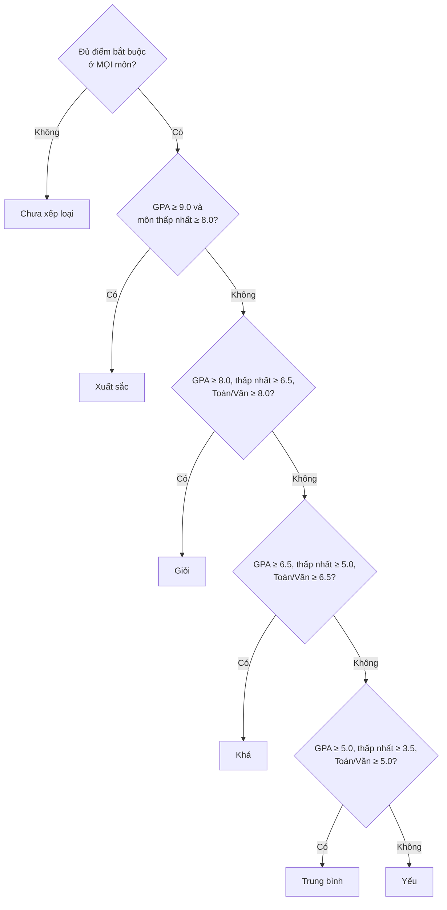
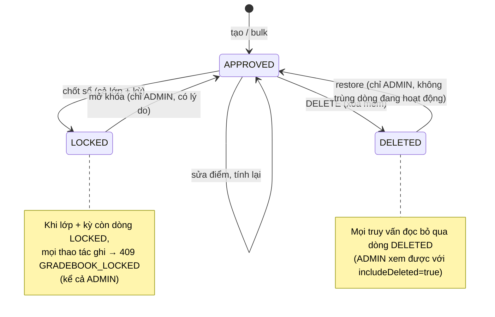
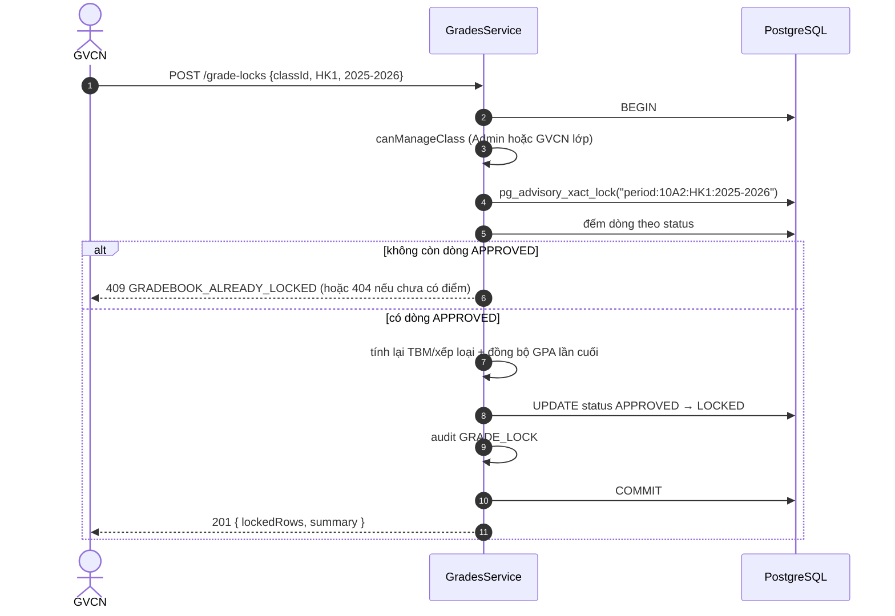
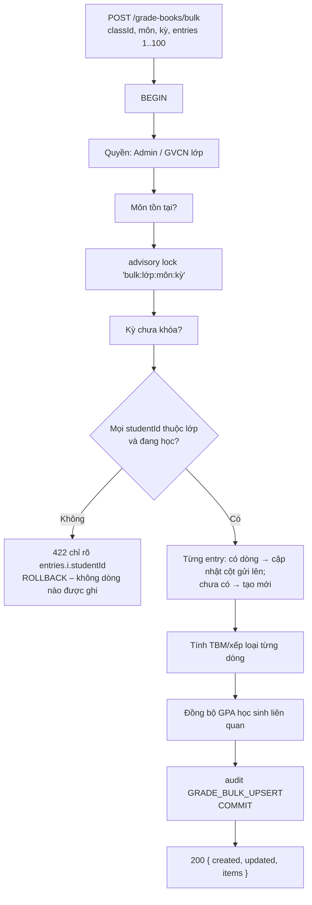
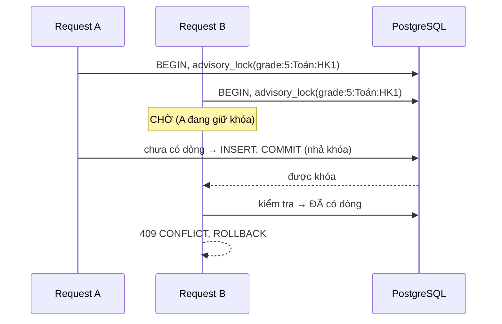

# 7. Nghiệp vụ sổ điểm

[← Xác thực và phân quyền](06-xac-thuc-phan-quyen.md) · [Mục lục](README.md) · [Tiếp: Dữ liệu →](08-du-lieu.md)

Toàn bộ công thức nằm trong `src/modules/academic/domain/` dưới dạng **hàm thuần** (không DB, không HTTP), có unit test
riêng. Các ngưỡng là **giá trị mặc định cần nhóm chốt** với quy chế của trường; đổi ở đúng một file.

## 7.1. Từ điểm thành phần đến học lực

## 7.2. Điểm trung bình môn (TBM)

$$
\text{TBM} = \frac{\sum_{k \in \text{cột đã nhập}} \text{điểm}_k \times \text{hệ số}_k}{\sum_{k \in \text{cột đã nhập}} \text{hệ số}_k}
$$

| Cột (API)        | Khóa domain   | Cột DB             | Hệ số |
| ---------------- | ------------- | ------------------ | ----- |
| `scoreOral`      | `oral`        | `score_oral`       | 1     |
| `score15m`       | `quarterHour` | `score_15m`        | 1     |
| `score1Hour`     | `oneHour`     | `score_1hour`      | 2     |
| `scoreMidTerm`   | `midTerm`     | `score_mid_term`   | 2     |
| `scoreFinalTerm` | `finalTerm`   | `score_final_term` | 3     |

Quy tắc:

- Cột **chưa nhập (`null`) bị bỏ khỏi cả tử và mẫu** – khác với nhập `0`.
- Chưa có cột nào → TBM = `null`, xếp loại "Chưa xếp loại".
- Môn được coi là **đủ điểm** khi có **giữa kỳ và cuối kỳ**.
- Làm tròn **half-up 1 chữ số** có xử lý lỗi số thực nhị phân (`8.45 → 8.5`, không thành `8.4`).
- Server **luôn tự tính lại** từ điểm gốc; không tin cột `average_score` lưu sẵn, không nhận TBM từ client.

Ví dụ: miệng 9, 15' 8.5, 1 tiết 8, giữa kỳ 9, cuối kỳ 9.5

$$
\frac{9 \cdot 1 + 8.5 \cdot 1 + 8 \cdot 2 + 9 \cdot 2 + 9.5 \cdot 3}{1+1+2+2+3} = \frac{80}{9} \approx 8.89 \rightarrow \mathbf{8.9}
$$

Chỉ có giữa kỳ 7 và cuối kỳ 8 → $\frac{7 \cdot 2 + 8 \cdot 3}{5} = 7.6$.

## 7.3. GPA hệ 10 và hệ 4

GPA là **trung bình có trọng số = số tín chỉ** của môn (bảng `subjects.credits`; thiếu hoặc ≤ 0 thì coi là 1).

| Môn       | Tín chỉ (seed) |
| --------- | -------------- |
| Toán Học  | 2              |
| Ngữ Văn   | 2              |
| Tiếng Anh | 2              |
| Vật Lý    | 1              |
| Hóa Học   | 1              |

$$
\text{GPA}_{10} = \frac{\sum \text{TBM}_i \times \text{tín chỉ}_i}{\sum \text{tín chỉ}_i}\ \text{(làm tròn 1 chữ số)}
\qquad
\text{GPA}_{4} = \frac{\sum \text{hệ4}(\text{TBM}_i) \times \text{tín chỉ}_i}{\sum \text{tín chỉ}_i}\ \text{(làm tròn 2 chữ số)}
$$

Bảng quy đổi hệ 10 → hệ 4 (`domain/gpa.js`), **quy đổi từng môn trước rồi mới lấy trung bình**:

| TBM môn     | Hệ 4 |
| ----------- | ---- |
| ≥ 8.5       | 4.0  |
| 7.0 – < 8.5 | 3.0  |
| 5.5 – < 7.0 | 2.0  |
| 4.0 – < 5.5 | 1.0  |
| < 4.0       | 0.0  |

## 7.4. Xếp loại học lực (policy `LEGACY_5_LEVELS`)

Duyệt **từ trên xuống**, mức đầu tiên thỏa **tất cả** điều kiện là kết quả:

| Mức        | GPA hệ 10 ≥ | Môn thấp nhất ≥ | Toán hoặc Văn (môn cao hơn) ≥ |
| ---------- | ----------- | --------------- | ----------------------------- |
| Xuất sắc   | 9.0         | 8.0             | –                             |
| Giỏi       | 8.0         | 6.5             | 8.0                           |
| Khá        | 6.5         | 5.0             | 6.5                           |
| Trung bình | 5.0         | 3.5             | 5.0                           |
| Yếu        | còn lại     |                 |                               |

- Thiếu điểm → **"Chưa xếp loại"**, hệ thống **không đoán**.
- Xếp loại **một môn** (cột `grade_letter`) chỉ dựa vào TBM môn đó theo cùng ngưỡng `minAverage`.
- Policy được chọn qua biến `GRADING_POLICY`; thêm quy chế mới (vd Thông tư 22: Tốt/Khá/Đạt/Chưa đạt) = thêm một object
  cùng hình dạng, không sửa thuật toán (xem [Open/Closed](03-clean-architecture.md#35-solid-áp-dụng-cụ-thể)).

## 7.5. Đồng bộ kết quả vào bảng `students`

Bảng `students` chỉ có **một** cặp `gpa`, `academic_rank` cho mỗi học sinh. Để không ghi đè lẫn giữa các kỳ, server chỉ
cập nhật khi thao tác thuộc **kỳ hiện hành** (`CURRENT_SEMESTER`, `CURRENT_SCHOOL_YEAR`). Thiếu môn → `gpa = 0.0`,
`academic_rank = "Chưa xếp loại"`. Việc đồng bộ chạy **trong cùng transaction** với thao tác ghi điểm.

## 7.6. Trạng thái một dòng điểm

Schema không có bảng khóa sổ hay cột `deleted_at`, nên dùng cột có sẵn `grade_books.status`:

## 7.7. Chốt sổ và mở khóa

Mở khóa: chỉ ADMIN, `reason` ≥ 10 ký tự, `LOCKED → APPROVED`, ghi audit `GRADE_UNLOCK` kèm lý do. Kỳ chưa chốt → `409`.

## 7.8. Nhập điểm hàng loạt (bulk upsert)

## 7.9. Xử lý đồng thời (concurrency)

Hai giáo viên/hai tab cùng ghi một lúc có thể tạo dòng trùng hoặc ghi đè. Schema không có UNIQUE index cho
(học sinh, môn, kỳ), nên dùng **khóa của PostgreSQL** trong transaction:

| Tình huống                              | Cơ chế                                                                                  |
| --------------------------------------- | --------------------------------------------------------------------------------------- |
| Hai request cùng tạo điểm một HS/môn/kỳ | `pg_advisory_xact_lock(hashtext('grade:<hs>:<môn>:<kỳ>:<năm>'))` rồi mới kiểm tra trùng |
| Sửa/xóa cùng một dòng                   | `SELECT ... FOR UPDATE` khóa dòng tới hết transaction                                   |
| Chốt sổ trong lúc đang nhập điểm        | Cùng khóa `period:<lớp>:<kỳ>:<năm>` cho chốt, mở khóa, tính lại                         |
| Lỗi giữa chừng                          | `withTransaction` → `ROLLBACK`, không có trạng thái nửa vời                             |

Advisory lock dạng `xact` tự nhả khi transaction kết thúc, không cần dọn dẹp thủ công.

## 7.10. Gợi ý hạnh kiểm

Chưa có bảng lưu hạnh kiểm, nên API chỉ **gợi ý** từ bảng `attendances` trong khoảng `from`–`to`:

| Nhóm       | Giá trị `attendances.status` được tính                  |
| ---------- | ------------------------------------------------------- |
| Có phép    | `EXCUSED`, `ABSENT_EXCUSED`, `CO_PHEP`                  |
| Không phép | `ABSENT`, `ABSENT_UNEXCUSED`, `UNEXCUSED`, `KHONG_PHEP` |
| Đi trễ     | `LATE`                                                  |

| Gợi ý      | Vắng không phép ≤ | Đi trễ ≤ |
| ---------- | ----------------- | -------- |
| Tốt        | 2                 | 3        |
| Khá        | 5                 | 8        |
| Trung bình | 10                | 15       |
| Yếu        | còn lại           |          |

> Các giá trị trạng thái điểm danh cần đối chiếu với module Điểm danh của thành viên khác. Hạnh kiểm chính thức do GVCN
> quyết định; response luôn kèm câu ghi chú này.
