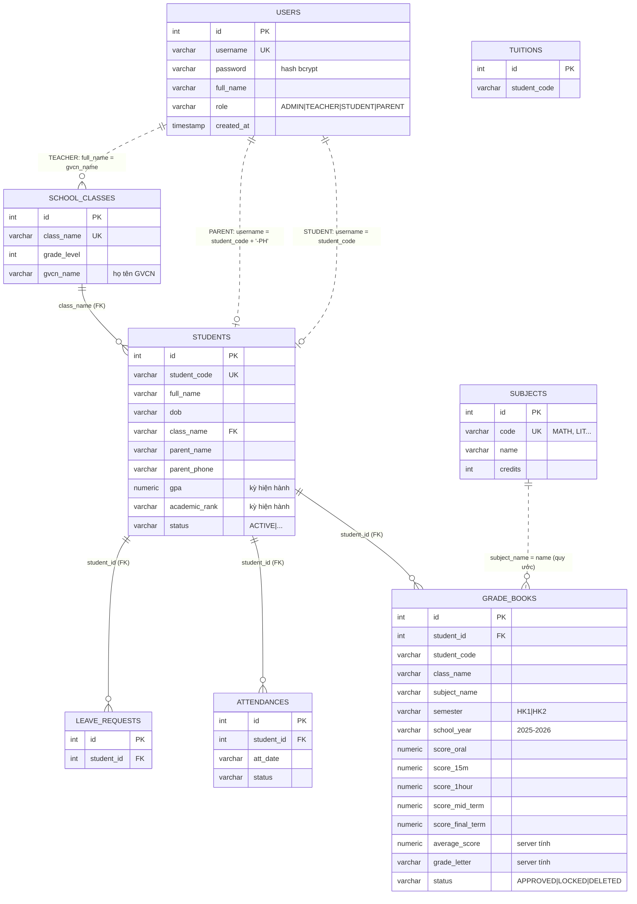
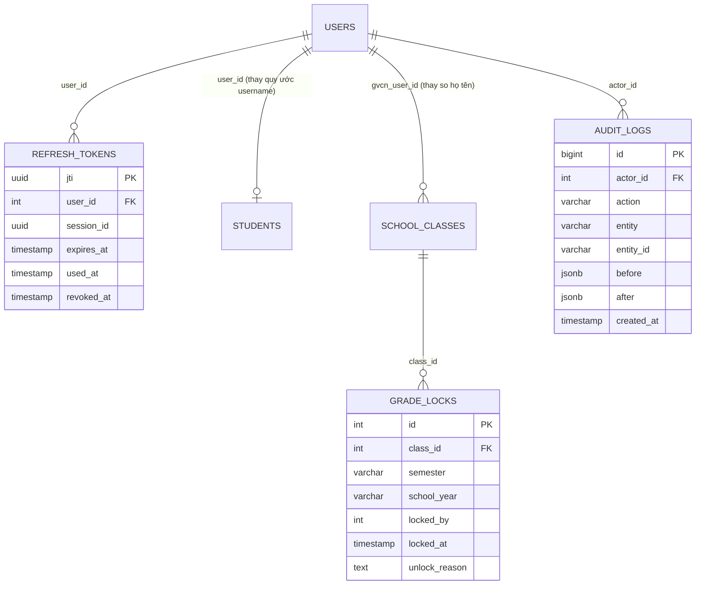

# 8. Dữ liệu

[← Nghiệp vụ sổ điểm](07-nghiep-vu-so-diem.md) · [Mục lục](README.md) · [Tiếp: Vận hành và kiểm thử →](09-van-hanh-kiem-thu.md)

`db/schema.sql` là **file chung của nhóm**, được mount nguyên bản vào Postgres (docker) và **không được sửa**.
Phần này mô tả các bảng, quan hệ thật trong DB, và các quan hệ "logic" mà code tự duy trì.

## 8.1. Sơ đồ ER

Nét liền = khóa ngoại thật trong schema. Nét đứt = liên kết **theo quy ước** do code duy trì (không có khóa ngoại).

## 8.2. Module này đọc/ghi bảng nào

| Bảng                         | Đọc | Ghi | Ghi gì                                                         |
| ---------------------------- | :-: | :-: | -------------------------------------------------------------- |
| `users`                      |  ✔  |  ✔  | Tạo tài khoản, đổi/reset mật khẩu                              |
| `grade_books`                |  ✔  |  ✔  | Điểm, TBM, xếp loại môn, `status`                              |
| `students`                   |  ✔  |  ✔  | `gpa`, `academic_rank` (kỳ hiện hành); `class_name` (phân lớp) |
| `school_classes`             |  ✔  |  ✔  | `gvcn_name` (phân GVCN)                                        |
| `subjects`                   |  ✔  |     |                                                                |
| `attendances`                |  ✔  |     | Đếm theo trạng thái để gợi ý hạnh kiểm                         |
| `leave_requests`, `tuitions` |     |     | Thuộc module khác                                              |

> Ghi vào `students.class_name` và `school_classes.gvcn_name` là phần **phân lớp / phân GVCN** do Admin thực hiện.
> Hai bảng này thuộc phạm vi của thành viên khác → cần thống nhất với nhóm để không làm trùng chức năng.

## 8.3. Những gì phải làm khác vì không đổi schema

| Nhu cầu                       | Cách làm hiện tại                                                | Giới hạn                                                  |
| ----------------------------- | ---------------------------------------------------------------- | --------------------------------------------------------- |
| Liên kết tài khoản ↔ học sinh | Quy ước username (`HS001`, `HS001-PH`), server tự suy ra khi cấp | Đổi mã học sinh thì phải đổi username tương ứng           |
| Liên kết giáo viên ↔ lớp      | So khớp họ tên với `gvcn_name` (chuẩn hóa)                       | Trùng họ tên → API phân GVCN từ chối; nên có `teacher_id` |
| Khóa sổ                       | `grade_books.status` `APPROVED ↔ LOCKED` theo (lớp, kỳ, năm)     | Không lưu "ai khóa, lúc nào" trong DB (chỉ có audit log)  |
| Xóa mềm điểm                  | `status = 'DELETED'`, truy vấn đọc loại trừ                      | Không có `deleted_by`, `deleted_at`                       |
| Chống trùng điểm              | Advisory lock + kiểm tra trước khi ghi                           | Không có UNIQUE index ở tầng DB                           |
| Điểm "chưa nhập"              | Lưu `NULL` (cột cho phép NULL), khác `0`                         | Dòng cũ dùng `DEFAULT 0.0` vẫn là 0                       |
| Phiên đăng nhập / thu hồi     | JWT + danh sách thu hồi trong RAM                                | Mất khi restart, không chia sẻ nhiều instance             |
| Audit                         | Log có cấu trúc                                                  | Chưa truy vấn qua API                                     |
| GPA nhiều kỳ                  | Tính động từ `grade_books` mỗi lần xem tổng kết                  | Cột `students.gpa` chỉ phản ánh kỳ hiện hành              |
| Ngày tháng                    | Cột `VARCHAR` dạng `YYYY-MM-DD`, so sánh chuỗi đúng thứ tự       | Không có kiểu `DATE` thật                                 |

## 8.4. Đề xuất nâng cấp schema (khi nhóm cho phép)

Kèm theo: `UNIQUE (student_id, subject_name, semester, school_year) WHERE status <> 'DELETED'` trên `grade_books`,
cột `users.is_active`, bảng `conduct_records`. Nhờ kiến trúc phân tầng, các thay đổi này chủ yếu nằm ở **repository** và
`session-store`, service gần như giữ nguyên.

## 8.5. Ánh xạ tên: DB ⇄ code ⇄ API

| DB (snake_case)    | Domain        | API / DTO (camelCase)    |
| ------------------ | ------------- | ------------------------ |
| `score_oral`       | `oral`        | `scoreOral`              |
| `score_15m`        | `quarterHour` | `score15m`               |
| `score_1hour`      | `oneHour`     | `score1Hour`             |
| `score_mid_term`   | `midTerm`     | `scoreMidTerm`           |
| `score_final_term` | `finalTerm`   | `scoreFinalTerm`         |
| `average_score`    | –             | `averageScore`           |
| `grade_letter`     | –             | `gradeLetter`            |
| `full_name`        | –             | `fullName`               |
| `password`         | –             | **không bao giờ trả ra** |

Một nguồn sự thật cho bảng trên: `src/modules/grades/grade.mapper.js` (`SCORE_FIELDS`). Repository là nơi duy nhất
chuyển `snake_case` sang `camelCase`; kiểu `NUMERIC` (Postgres trả về chuỗi) được đổi sang `Number` ở mapper.
