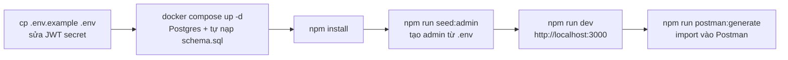
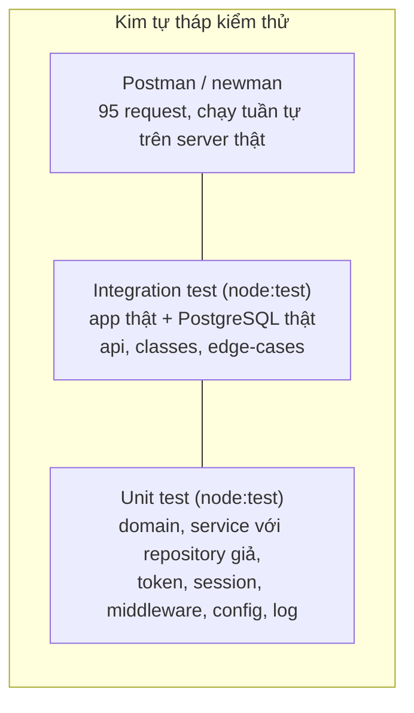
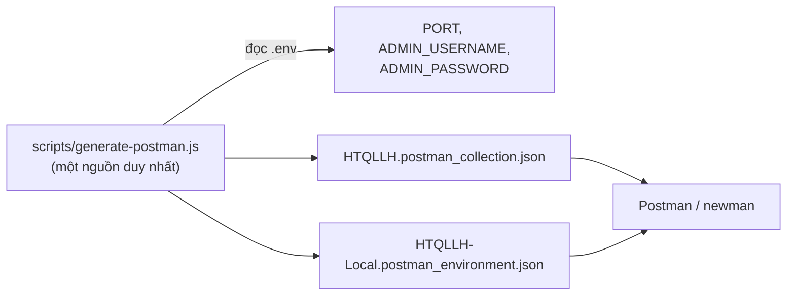
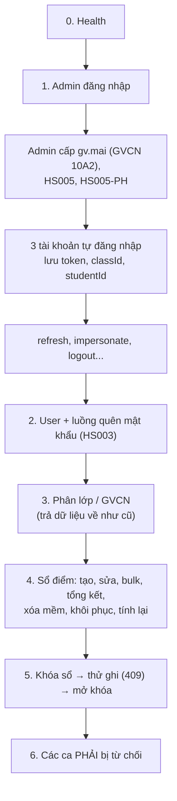
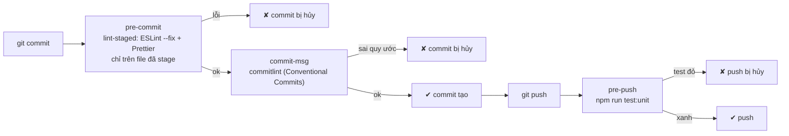

# 9. Vận hành, log và kiểm thử

[← Dữ liệu](08-du-lieu.md) · [Mục lục](README.md)

## 9.1. Chạy từ đầu



```bash
cp .env.example .env
docker compose up -d
npm install
npm run seed:admin
npm run dev
```

Không dùng docker: `npm run db:init` để áp `db/schema.sql` lên một Postgres có sẵn.

## 9.2. Cấu hình (`.env`)

Đọc bằng `node --env-file=.env` và **kiểm tra bằng zod** trong `src/config/env.js`. Sai là dừng ngay (fail fast).

| Biến                                                  | Mặc định                              | Ý nghĩa / ràng buộc                                                         |
| ----------------------------------------------------- | ------------------------------------- | --------------------------------------------------------------------------- |
| `NODE_ENV`                                            | `development`                         | `development` / `test` / `production`                                       |
| `PORT`                                                | 3000                                  |                                                                             |
| `LOG_LEVEL`                                           | `info`                                | `fatal` … `trace`, `silent`                                                 |
| `LOG_FORMAT`                                          | production: `json`, còn lại: `pretty` | `pretty` (kiểu NestJS) hoặc `json`                                          |
| `DATABASE_URL`                                        | **bắt buộc**                          | Phải khớp `DB_USER/DB_PASSWORD/DB_PORT/DB_NAME`                             |
| `DB_USER`, `DB_PASSWORD`, `DB_NAME`, `DB_PORT`        | postgres/postgres/htqllh/5434         | Docker compose đọc để tạo Postgres (chỉ có tác dụng khi tạo volume lần đầu) |
| `JWT_ACCESS_SECRET`, `JWT_REFRESH_SECRET`             | **bắt buộc**                          | ≥ 32 ký tự, **phải khác nhau**                                              |
| `ACCESS_TOKEN_TTL_SECONDS`                            | 900                                   | 15 phút                                                                     |
| `REFRESH_TOKEN_TTL_SECONDS`                           | 604800                                | 7 ngày                                                                      |
| `BCRYPT_ROUNDS`                                       | 10                                    | 4–15                                                                        |
| `DEMO_MODE`                                           | `false`                               | Bật Quick Role Switcher theo role; **cấm** ở production                     |
| `RATE_LIMIT_ENABLED`                                  | `true`                                |                                                                             |
| `CORS_ORIGINS`                                        | rỗng (chặn hết)                       | Danh sách origin, cách nhau dấu phẩy                                        |
| `GRADING_POLICY`                                      | `LEGACY_5_LEVELS`                     | Quy chế xếp loại                                                            |
| `CURRENT_SEMESTER`, `CURRENT_SCHOOL_YEAR`             | `HK1`, `2025-2026`                    | Kỳ hiện hành (mặc định cho truy vấn, đồng bộ `students.gpa`)                |
| `ADMIN_USERNAME`, `ADMIN_PASSWORD`, `ADMIN_FULL_NAME` | admin / …                             | Chỉ dùng cho `npm run seed:admin`; production cấm mật khẩu mặc định         |

## 9.3. Log

| Môi trường | Định dạng                                   | Ví dụ                                                                                                                              |
| ---------- | ------------------------------------------- | ---------------------------------------------------------------------------------------------------------------------------------- |
| Dev        | Kiểu NestJS (pino-pretty + formatter riêng) | `[HTQLLH] 42892  - 10/14/2026, 9:54:25 AM     LOG [HTTP] POST /api/v1/auth/login 200 - 69ms +3ms`                                  |
| Production | JSON một dòng (pino)                        | `{"level":30,"time":...,"req":{"id":"...","method":"POST","url":"/api/v1/auth/login"},"res":{"statusCode":200},"responseTime":69}` |

- Khởi động in danh sách route (`Mapped {/api/v1/..., POST} route`) và link `http://localhost:PORT` (Ctrl+Click trong VS Code).
- Mức log theo kết quả: 2xx/3xx → `LOG`, 4xx → `WARN`, 5xx → `ERROR` kèm stack trace.
- Ngữ cảnh: `[HTTP]` request, `[Audit]` hành động nhạy cảm, `[Bootstrap]` khởi động/tắt, `[RoutesResolver]` danh sách route.
- Header `Authorization` và `Cookie` bị **che** (`redact`) trong log.
- Mọi dòng log của một request mang cùng `requestId` với response → tra lỗi nhanh.

## 9.4. Chiến lược kiểm thử



| Loại         | Thư mục              | Cần DB | Kiểm tra gì                                                                                                                                                                                                                             |
| ------------ | -------------------- | ------ | --------------------------------------------------------------------------------------------------------------------------------------------------------------------------------------------------------------------------------------- |
| Unit         | `tests/unit/`        | Không  | Công thức TBM/GPA/xếp loại, ma trận quyền, access-policy, token, session store, service auth/users với repository giả, response, validate, config, logger                                                                               |
| Integration  | `tests/integration/` | Có     | Luồng thật qua HTTP: đăng nhập, refresh, thu hồi, cấp tài khoản, đổi/reset mật khẩu, phân lớp, nhập/sửa/xóa/khôi phục điểm, khóa sổ, rate limit, **ma trận RBAC mọi endpoint × 5 loại người gọi**, response không bao giờ chứa mật khẩu |
| E2E thủ công | `postman/`           | Có     | Kịch bản demo đầy đủ, chạy lại nhiều lần không hỏng                                                                                                                                                                                     |

Unit test của service không cần DB nhờ dependency injection:

```js
const service = createUsersService({
  usersRepository: {
    findById: async (id) => (id === 77 ? { id: 77, username: 'x' } : undefined) /* ... */,
  },
  passwordHasher: { hash: async (plain) => `hash(${plain})` },
  sessionStore: createSessionStore(),
  generatePassword: () => 'Tmp12345abcd', // cố định để kiểm tra được
  audit: { record: () => {} },
});
```

Integration test dùng `tests/helpers/harness.js`: dựng app trên cổng ngẫu nhiên, **xóa và dựng lại** dữ liệu test
(user, điểm, phân lớp) trước mỗi file → các file test độc lập với nhau.

> ⚠ Integration test **xóa** bảng `users`, `grade_books`, `attendances`. Luôn trỏ `TEST_DATABASE_URL` vào một database
> **riêng cho test**, không dùng DB dev.

## 9.5. Lệnh

| Lệnh                            | Việc                                                          |
| ------------------------------- | ------------------------------------------------------------- |
| `npm run dev`                   | Chạy server, tự khởi động lại khi sửa code                    |
| `npm start`                     | Chạy server (không watch)                                     |
| `npm run seed:admin`            | Tạo admin (chạy lại an toàn, đã có thì giữ nguyên)            |
| `npm run seed:demo`             | Thêm tài khoản demo `gv.an`, `HS001`, `HS001-PH` (tùy chọn)   |
| `npm run test:unit`             | Unit test                                                     |
| `npm test`                      | Unit + integration (cần `TEST_DATABASE_URL`)                  |
| `npm run test:coverage`         | Test + coverage + kiểm ngưỡng + báo cáo `coverage/index.html` |
| `npm run lint` / `format:check` | ESLint / Prettier                                             |
| `npm run postman:generate`      | Sinh lại collection + environment từ `.env`                   |
| `npm run postman:run`           | Chạy collection bằng newman (server phải đang chạy)           |
| `make ci`                       | lint + format-check + coverage (như pipeline CI)              |

Ngưỡng coverage bắt buộc (dưới ngưỡng → lệnh thất bại): **dòng ≥ 98%, hàm ≥ 95%, nhánh ≥ 95%**.

## 9.6. Postman



Thứ tự chạy của collection:



- Chạy lại nhiều lần không hỏng: tạo dữ liệu chấp nhận 201 hoặc 409, phân lớp được trả về như cũ, sổ được mở khóa lại,
  HS003 luôn kết thúc với mật khẩu `newUserPassword`.
- Id collection/environment **cố định** → import lại sẽ ghi đè, không sinh bản trùng tên.
- Hai lần chạy liên tiếp nên cách nhau ~1 phút vì rate limit (hoặc `RATE_LIMIT_ENABLED=false` khi dev).

## 9.7. Danh sách kiểm tra trước khi demo / nộp

- [ ] `.env` có JWT secret riêng, `DEMO_MODE` đúng ý muốn, `CORS_ORIGINS` đúng frontend
- [ ] `docker compose up -d` và `GET /health` trả `ok`
- [ ] `npm run seed:admin` đã chạy; đăng nhập admin bằng mật khẩu trong `.env` được
- [ ] `npm run postman:generate` sau khi đổi `.env`; xóa collection/environment cũ trong Postman rồi import lại
- [ ] `make ci` xanh (lint, format, coverage)
- [ ] Đối chiếu với nhóm các giá trị "cần chốt": hệ số điểm, bảng hệ 4, ngưỡng xếp loại, trạng thái điểm danh

## 9.8. Git hooks và quy ước commit

Husky tự cài hook khi chạy `npm install` (script `prepare`). Hook chặn lỗi **trước khi** code rời máy:



| Hook         | File                | Chạy                                              |
| ------------ | ------------------- | ------------------------------------------------- |
| `pre-commit` | `.husky/pre-commit` | `npx lint-staged` (cấu hình trong `package.json`) |
| `commit-msg` | `.husky/commit-msg` | `commitlint` theo `commitlint.config.js`          |
| `pre-push`   | `.husky/pre-push`   | `npm run test:unit` (không cần DB)                |

Quy ước message: `<type>(<scope>): <mô tả viết thường>`

| type       | Khi nào                                  | Ví dụ                                        |
| ---------- | ---------------------------------------- | -------------------------------------------- |
| `feat`     | Thêm chức năng                           | `feat(classes): admin phân học sinh vào lớp` |
| `fix`      | Sửa lỗi                                  | `fix(auth): thu hồi phiên khi đổi mật khẩu`  |
| `docs`     | Chỉ sửa tài liệu                         | `docs: thêm sơ đồ luồng khóa sổ`             |
| `refactor` | Đổi cấu trúc code, không đổi hành vi     | `refactor(grades): tách hàm tính tổng kết`   |
| `test`     | Thêm/sửa test                            | `test(users): thêm ca reset mật khẩu`        |
| `chore`    | Việc lặt vặt, cấu hình, phụ thuộc        | `chore(deps): nâng express lên 5.3`          |
| khác       | `build`, `ci`, `perf`, `revert`, `style` |                                              |

Scope gợi ý (sai chỉ cảnh báo, không chặn): `auth`, `users`, `classes`, `grades`, `conduct`, `academic`, `common`, `db`,
`config`, `logging`, `postman`, `docs`, `test`, `deps`. Bị chặn: thiếu type (`sửa lỗi`), mô tả viết hoa đầu câu
(`feat: Thêm...`), dòng đầu quá 100 ký tự.

`.gitattributes` ép xuống dòng **LF** trên mọi máy để Windows không tự đổi sang CRLF làm `format:check` báo lỗi.

> Hook chạy trên máy cá nhân và có thể bỏ qua bằng `--no-verify`, nên **chốt chặn thật** vẫn là `make ci` trên CI.
