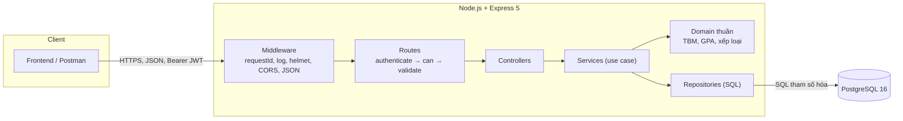

# Tài liệu kỹ thuật – HTQLLH Member 4 (Auth, RBAC, Sổ điểm)

Bộ tài liệu giải thích **vì sao** hệ thống được thiết kế như hiện tại, không chỉ **cái gì** có trong code.
Mọi sơ đồ viết bằng [Mermaid](https://mermaid.js.org/) nên xem trực tiếp được trên GitHub, GitLab hoặc VS Code
(cài extension _Markdown Preview Mermaid Support_).

## Đọc theo thứ tự

| #   | Tài liệu                                             | Trả lời câu hỏi                                                            |
| --- | ---------------------------------------------------- | -------------------------------------------------------------------------- |
| 1   | [Tổng quan hệ thống](01-tong-quan.md)                | Hệ thống làm gì, cho ai, dùng công nghệ gì, giới hạn ở đâu                 |
| 2   | [Kiến trúc tổng thể](02-kien-truc.md)                | Các tầng, các module, một request đi qua những đâu                         |
| 3   | [Clean Architecture](03-clean-architecture.md)       | Nguyên tắc phụ thuộc, vì sao tách tầng, áp dụng SOLID cụ thể trong code    |
| 4   | [Thiết kế RESTful API](04-restful-api.md)            | Tài nguyên, phương thức, mã trạng thái, định dạng response, phân trang     |
| 5   | [Danh mục endpoint](05-danh-muc-endpoint.md)         | Từng endpoint: quyền, đầu vào, đầu ra, lỗi có thể gặp                      |
| 6   | [Xác thực và phân quyền](06-xac-thuc-phan-quyen.md)  | JWT, refresh xoay vòng, thu hồi phiên, RBAC hai tầng, mật khẩu, rate limit |
| 7   | [Nghiệp vụ sổ điểm](07-nghiep-vu-so-diem.md)         | Công thức TBM, GPA, xếp loại, khóa sổ, xóa mềm, đồng thời (concurrency)    |
| 8   | [Dữ liệu](08-du-lieu.md)                             | Sơ đồ ER, quy ước liên kết khi không được đổi schema                       |
| 9   | [Vận hành, log và kiểm thử](09-van-hanh-kiem-thu.md) | Cấu hình, chạy, log, test, coverage, Postman                               |

## Tóm tắt một trang

- **Phạm vi:** đăng nhập và phiên (JWT), phân quyền 4 vai trò, quản lý tài khoản, phân lớp/GVCN, sổ điểm điện tử,
  tính TBM/GPA/học lực, khóa sổ, gợi ý hạnh kiểm.
- **Ràng buộc lớn nhất:** **không được sửa `db/schema.sql`** (file chung của nhóm). Mọi thiết kế phải dựa trên bảng và cột có sẵn;
  các chỗ phải "lách" được ghi rõ ở [Dữ liệu](08-du-lieu.md#83-những-gì-phải-làm-khác-vì-không-đổi-schema).
- **Kiến trúc:** phân tầng theo Clean Architecture, dependency injection thủ công tại một điểm duy nhất (`src/container.js`).
- **API:** REST, tiền tố `/api/v1`, JSON, một định dạng response thống nhất, lỗi có `code` máy đọc được.
